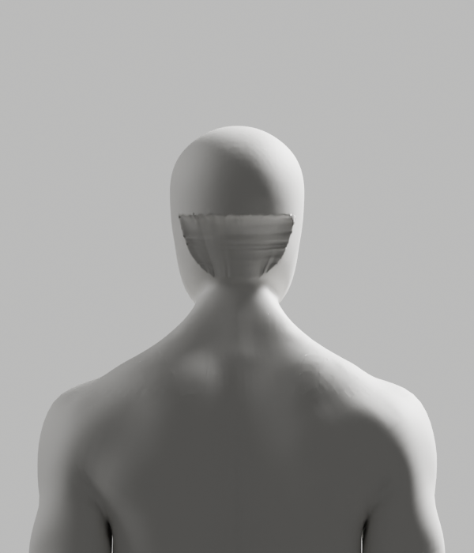
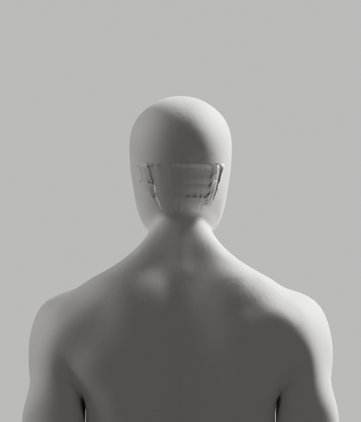

# 명시적 경계의 실제 표면 — 실패·미채택

2026-10-10 · [Story](../../../stories/avatar-neck-integration.md) · Draft PR #108 · 공개 웹 변경0

자동 순회에 맡기던 연결을 두 열린 경계의 명시적 native 연결로 바꿨다. 남성 상부 격자의 네 모서리는 지정1/2/3/4를 실제 따랐다. **연결 정렬만 해결됐으며 표면 품질은 실패했다.** 새 원본 저장0·아바타 채택0이고 기존 원본·GLB·실패/검증 증거는 보존한다.

## 실제 형상과 보호 검증

| 확인 항목 | Native simple 격자 | Native 경계 곡률 격자 |
|---|---|---|
| 모서리 | 지정1/2/3/4 일치 | 같은 모서리 일치 |
| 원래 표면 거리 | 첫 실패6.031mm. 전체 진단 최대22.502mm·6mm 이상1416점 | 최대4.243mm·6mm 이상0점 |
| 원본/리그/skin 보호 | 거리 실패 뒤 최종 검사 미실행 | 앞면·손·외부 좌표/원래 polygon/raw139그룹·각163 rest bone/pose/world/PBR exact 통과 |
| 새 형상 | 후두부 부피의 평탄화. core 뒤로 향하는 면1개 관찰 | 뒤틀린 core 면180개 관찰. 전역 tiny2→3으로 실패 |
| 실제 외형/최종 상태 | 뒤·측면에 움푹 들어가는 패치, 미채택 | 부피 이탈은 줄었지만 접합 주름과 불안정한 면이 남음, 미채택 |

거리6mm/tiny1e-10m² 기준·원본 보호 검사를 완화하지 않았다. 곡률 후보는 닫힘0·winding0·가중치 보호를 확인했지만, 수치 일부 통과로 외형이나 전체 제작 성공을 인정하지 않는다. 새 점의 literal0 membership25002개만 제거하기 전에 모든 보호점의0 아닌 값이 exact인 것을 검사했고 최종 raw 배열도 exact로 유지했다.





[Simple 측면](diagnostic-render/male-side.png)과 [곡률 측면](curved-diagnostic-render/male-side.png)을 비교한다. 실제 native 고정 조명/재질·카메라 렌더이며 AI 생성/이미지 편집/흐림으로 결함을 숨기지 않았다. **여성은 두 진단 모두 편집하지 않은 원본 비교**이고 여성 제작 성공이 아니다. Simple은 skin/remap 전, 곡률은 보호 skin/remap 후의 실패 상태다. 남녀 각각4컷씩 두 진단16PNG를 실제 생성했으며 직접 검수한 것은 남성 뒤/측면4컷이다.

## 재현과 코드 리뷰 경계

[동일 버전 공식 Grid Fill 구현](https://github.com/blender/blender/blob/v5.1.1/source/blender/bmesh/operators/bmo_fill_grid.cc)을 GitHub API로 확인했다. 직접 web 요청은 cache miss였다. Native는 명시적 열린 두 경계와 다른 두 boundary 경로로 격자를 만들 수 있지만, 이 조건은 후두부 부피·곡률·접합 품질을 보증하지 않는다. Simple의4방향 가중 평균과 곡률 보간을 고정 연결에서 비교했으며 강도/허용치/span sweep은 하지 않았다.

`engineering:debug`로 연결 실패와 부피/뒤틀림을 분리하고, `engineering:code-review`로 진단 저장 금지·source/runtime/helper SHA·원본 보호와 공개 제외를 확인했다. 진단은 명시 `diagnostic` 인자로 **어떤 결과에서도 모델 저장을 허용하지 않으며**, 기록된 특정 실패가 재현되어야만 렌더한다. 렌더 뒤 원래 저작 실패를 다시 발생시켜 native exit1로 종료했다. 도구 적용 patch의 첫 context 실패는 transcript에만 기록됐고 파일에는 적용되지 않았다. 이 실패도 native 성공으로 세지 않는다.

Blender MCP addon 조회는 실제 연결 오류다. 도구의 `isError=false` 필드를 연결 성공으로 오해하지 않고 오류 본문을 보존한다. CEO에게 기존 작업 저장 후 이미 설치된 로컬 addon 연결만 비차단 요청했다. 새 플러그인/계정·비용/시크릿/telemetry 변경0·live 사용자 장면 변경0이다.

## 미실행과 다음 조건

이번 남녀 전체 제작·원본 독립 재열기·118 기술 pose·GLB/왕복·Chrome·실제 사람·올바른 시범/판정·출시 외형 검증은 미실행이다. 이미지와 byte 검사는 그 검증의 대체가 아니다. 여성 제작은 첫 남성 실패 뒤 미실행이다. 외형 P2·Story/D2/전체1~6 미완료이며 Draft #108은 병합하지 않는다. 공개 웹·임상 판정·SDK/개인정보·운영 변경0, UI 최소 문구와 별도 승인 경계는 유지한다.

경계만으로 후두부를 보간하는 이번 알고리즘은 종료한다. 다음 설계는 내부 단면·접선·원래 전문 형상의 흐름을 기준으로 실제 표면 연결을 조형하는 것이다. [후속 읽기 전용 단면 확인](../reference-sections/README.md)에서 남녀 각각5개 단면이 하나의 닫힌 loop인 것을 확인했다. 새 내부 단면 표면 제작은 아직 미실행이다. 보호 영역을 지우거나 원래 접힌 표면에 전체 재투영해 숫자만 맞추지 않으며, 기존 원본/모든 실패를 보존한다.

```bash
node bodyguard/assets/blender/integration-neck/archive_explicit_attempt.mjs --check
```

`manifest.json`과 위 명령은 압축 전후 바이트/실제 실행 보고서 보존 검사이지, 모델 제작·전체 변형·브라우저 재실행이 아니다. 최초 저작 소스와 진단 보완 후 소스는 별도 이름/해시로 구별하며 결과를 덮어쓰지 않는다.

## 정리 구간의 실제 재검토

Ruff check/format5개 Python·Biome check2개 archive helper·`git diff --check`는 통과했다. 기존 root137·topology37·quad36/후속6·segmented42·이번 explicit42/단면5개 증거의 바이트 검사는 통과했다. **기존 결과 보존 검사이지 원본/GLB/변형/브라우저 재실행이 아니다.**

이미 생성된 explicit/단면 archive를 다시 생성하려는 두 음성 시험은 실제 exit1로 거부됐다. 전후 manifest SHA는 각각2d5ab4779a4de77db9793f0de45a891887b411001d6c9109a7e29b81e8c0dbd8/ea616b2fcd76b3cfbb671d809bee12540575548f5ea28643810b9268afc5ae34로 같았고, 이후 모든 archive 바이트 검사도 통과했다. 모델 입력ce8887d/CEO 참조45b3139는 불변이다. Draft #9 원본 작업트리의 HEAD25a9bd6·1959개 기존 상태와 A318 입력2eb274c도 유지한다. 원래 입력 경로의 첫 조회는 현재 트리에 없어 실패했고, 보존된 원래 작업트리에서 exact hash를 확인했다. 파일 삭제/덮어쓰기/공개 제품·API·DB·운영 변경0이다.
