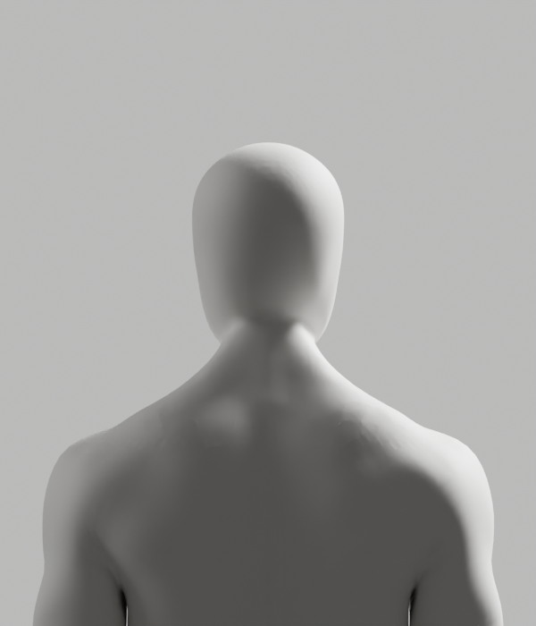
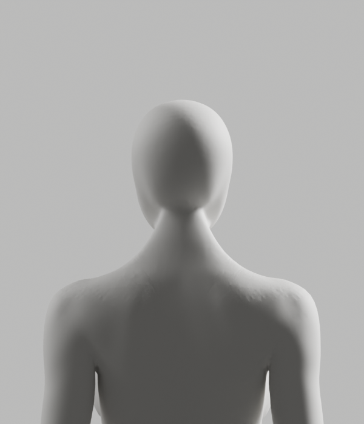

# 옆 목·어깨 보완 — 실제 실패 / 미채택

2026-10-10 · [Story](../../../stories/avatar-neck-integration.md) · Draft PR #108 · 입력 be038c04 보존

기존 전문 Blender 원본의 옆 목·어깨를 국소 처리했지만 접힌 면과 거친 마감이 남았다. **세 저작 모두 저장 전에 반려됐다. 새 후보·GLB는 없다.** 아래 남성 이미지는 마지막 반려 상태, 여성은 편집하지 않은 입력 비교다. 새 여성 제작이나 최종 아바타가 아니다.

## 실제 미리보기

[남성 정면](failure-render/male-front.png) · [측면](failure-render/male-side.png) · [사선](failure-render/male-quarter.png) · [여성 정면](failure-render/female-front.png) · [측면](failure-render/female-side.png) · [사선](failure-render/female-quarter.png)





8컷 모두 직접 확인했다. 남성 옆 목 일부의 주름은 줄었지만 어깨의 거친 표면·목 아래의 접합 흔적이 남아 참조 품질에 미달한다. 여성은 이번 저작이 적용되지 않았다. 동일 원본 재질/world/조명·카메라, CYCLES32, 600×700이다. 별도 이미지 편집·흐림·AI 생성으로 결함을 숨기지 않았다. 렌더 exit0는 저작/외형 통과가 아니다.

## 실제 실행

| 실행 | 결과 |
|---|---|
| 읽기 전용 원본 검사 | exit0. 선택 남성4964/여성5589점, 내부면8328/9301, >90° dihedral 연결14/6개. 실제 앞면 연결점68082/70145 제외. 원본/rig 불변 |
| 원래 단위의 고정 native 마감 | exit1. 남성76점·최대0.602mm 이동, 접힘14개 그대로. 보호 통과·저장0 |
| 단위 원인 가정 검사 | exit1. 처리 가능 점=실제 이동76이라는 가정이 틀림. 실패 JSON/로그/소스를 보존 |
| 별도 읽기 전용 단위 관찰 | exit0. source formula의 m/mm 처리 가능 점은 남성77/4908·여성18/5528. 실제 이동과 동일시하지 않음. 원본 단위/rig 변경0 |
| private mm 사본의 같은 native 마감 | exit1. 남성4941점·최대0.638mm, 접힘14→5·최대174.944°. 보호 통과·저장0 |
| private mm+계산용 native Triangulate | exit1. 남성4939점·최대0.377mm, 접힘14→4·최대174.035°. 원래 point/edge/polygon·raw skin/속성/rig 보호·저장0 |
| 동결된 마지막 실패 재현·면 연결 검사·8컷 | 진단 프로세스 exit0 / **authoring_passed=false**. 같은 반려를 재현하고 남은4개 edge를 기록. 새 후보 저장0 |

lambda0.2·iterations12·border0·normalized·XYZ를 고정했다. 값 sweep이나 허용치 상향은 하지 않았다. private 사본만1000배·rig modifier 제거·계산용 삼각화하며, 원래 선택점 위치만 m로 되돌렸다. 사본은 finally에서 제거한다. 제품 원본의 단위/연결 구조/rig를 바꾸지 않았다. 세 실제 저작 모두 남성 실패에서 중단되어 **여성 저작은 미실행**이다.

원래 외부 좌표·앞면·중앙 목·손/raw139 skin·163 rest/pose·world/PBR/history·모든 비위치 native 속성과 edge/면 연결의 exact, 전체 nonmanifold0/winding0·tiny남성2 유지·6mm 미만을 확인했다. 이 보호 성공은 접힘이나 외형의 성공이 아니다. 수치는 에셋 기하/제작 예산이며 사람의 정상 자세·측정 정확도·효과 기준이 아니다.

## 남은 문제와 다음 조건

마지막 남성의 edge296303/296304/305914/300297에 각각174.035/173.790/93.456/94.606°의 접힘이 남았다. 인접6개 face167049/167048/103829/175905/171044/171043는 **전부 선택 구간 내부**이며 원래 앞면/보호점 포함0이다. 따라서 앞면 보호 경계 때문에 필연적으로 남은 결함이라는 설명은 현재 증거와 맞지 않는다. 이 결과만으로 비평면 quad/퇴화 corner를 확정 원인으로 단정하지 않는다.

같은 Laplacian·단위·계산용 Triangulate를 다시 반복하지 않는다. 다음은 이6면과 인접 원래 전문 edge의 위치·연결·비평면/퇴화 조건을 읽기 전용 비교한 뒤 국소 연결 설계를 확정하는 작업이다. 기존 원본·실패·보호 조건을 유지하며 새 저작 계약/실제 실행 결과를 별도로 남긴다. 새 최종 원본에서 외형·독립 재열기·GLB 왕복·전체 기술 변형·Chrome 두 rig와 목표 노트북/실측을 실제 재실행해야 한다.

새 원본 저장·독립 재열기·GLB/118기술pose·브라우저·실제 사람/시범 정확도는 **미실행**이다. 과거 후보의 기술 성공을 복사하지 않는다. 외형P2·Story/D2-A·전체1~6은 미완료이며 PR #108은 Draft/병합 보류다. 공개 웹/문구/SDK/판정/안전·개인정보/운영 변경0. 최소 문구·별도 승인 경계는 유지한다.

## 보존과 재현

[입력](../lower-attempt/candidate-neck-center.blend) SHA256 `be038c042c8b29acf53e0877adc085fec92608e230a563b6860914a01f58e068`은 불변이다. 기존 원본·37개 체크포인트·17개 독립 검증 증거는 덮어쓰지 않았다. [manifest](manifest.json)은 실제 JSON/로그·8PNG·동일 실행 helper·초기 Ruff I001 소스 등39개 raw/archive SHA를 보존한다. 초기 Ruff 실패 메시지는 도구 transcript에만 있고 별도 원시 로그를 만들지 않았다. 파일 쓰기 patch의 실패·없는 경로 조회는 저작 성공/실패로 세지 않는다.

설치 Blender5.1.1 b70da489d7f4의 [공식 modifier 소스](https://github.com/blender/blender/blob/b70da489d7f4/source/blender/modifiers/intern/MOD_laplaciansmooth.cc)를 GitHub API로 실제 읽고 Git blob SHA1 `04a8254675aa641bae39eb07ce95513dcce78344`, 내용 SHA256 `aa85424124a4bc4760ffdced29d3a4b90fbd51b40861366e6b0ab864a29075ca`를 확인했다. 절대 작은면 기준과 group 밖까지 scale하는 volume_preservation을 확인해 builtin volume preserve는 채택하지 않았다. 공식 manual/API 직접 열기의402 오류는 성공으로 세지 않는다. GPL 원문 전체는 private 진단 증거에 보존하고 저장소에는 소스 식별자와 자체 요약 관찰만 담았다. 외부 소스 실행/import·새 의존성/플러그인·계정/비용 변경0.

당시 private proof는 `/private/tmp/bodyguard-lateral-quality.xdusAe`였다. 각 native 실행은 새 프로세스·factory-startup·disable-autoexec·python-exit-code1로 동일 입력을 열었다. 열린 사용자 장면/원본을 저장하지 않았다. 예시는 **반려 재현과 실패 렌더**이지 합격 명령이 아니다. 새 proof 경로가 필요하며 기존 증거를 덮어쓰지 않는다.

```bash
/Applications/Blender.app/Contents/MacOS/Blender --factory-startup --disable-autoexec \
  -b bodyguard/docs/review/avatar-neck-integration/lower-attempt/candidate-neck-center.blend \
  --python-exit-code 1 --python bodyguard/assets/blender/integration-neck/diagnose_lateral_failure.py \
  -- "$proof_dir"
node bodyguard/assets/blender/integration-neck/archive_lateral_attempt.mjs --check
```

마지막 Node 명령은 보존 바이트/이미 실행된 보고서 감사이며 native/브라우저 재실행이나 자동 외형 품질 판정이 아니다. [작성자 리뷰](../lateral-attempt-review.md)는 외부/전문가 승인과 구분한다.
