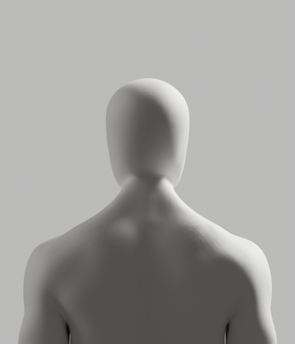
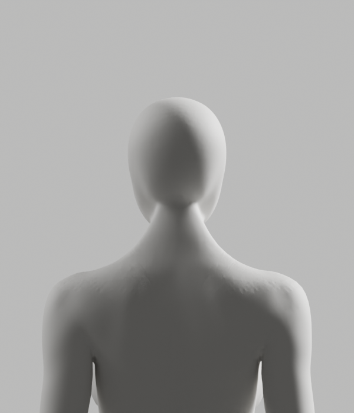

# 목 중앙 후보 실제 검증 — 보호 통과 / 외형 미달

2026-10-10 · [Story](../../../stories/avatar-neck-integration.md) · Draft PR #108 · 미승인 부분 후보

저장된 be038c04를 별도 Blender 프로세스에서 다시 열고 남녀 앞·뒤·측면·사선의 실제 이미지를 생성했다. **원본 보호는 통과했지만 목 아래·어깨의 거친 접합이 남아 외형 P2는 미해결이다.** 중앙의 작은 표면 변경을 전체 외형 개선으로 인정하지 않는다. 최종 아바타나 출시 기능이 아니다.

## 실제 미리보기

[남성 정면](male-front.png) · [여성 정면](female-front.png) · [남성 측면](male-side.png) · [여성 측면](female-side.png) · [남성 사선](male-quarter.png) · [여성 사선](female-quarter.png)





새 후보의 8컷을 모두 직접 확인했고, 이전2932e63d의 [남성 뒤](../projected-attempt/render/male-back.png)·[여성 뒤](../projected-attempt/render/female-back.png) 2컷과 대조했다. 목 아래와 어깨의 마감은 전체적으로 유의미한 개선을 보여 주지 않는다. 같은 원본 재질·world·조명·카메라, CYCLES32, 600×700 PNG다. 별도 이미지 편집·흐림·AI 생성으로 결함을 가리지 않았다.

## 실행과 경계

| 실제 실행 | 결과 |
|---|---|
| 저장 후보 독립 재열기 | exit0 / passed=true. 입력2932e63d와 후보be038c04 SHA 불변. 외부 좌표·raw skin·polygon·앞면·손·rest rig/world/PBR/history·기존 point INT provenance exact |
| 남녀 연결 검사 | nonmanifold0/winding0, tiny남성2·여성0. 새 점1470/1152, 원래 국소 표면 거리 최대23.299/15.725µm. 이는 에셋 기하 거리이지 웹캠 정확도 아님 |
| 실제 외형 렌더 | exit0 / 남녀8컷 생성·직접 검수. 목–어깨 외형 미달, 미채택 |
| 자동 승인 검토 | 이전 사용량 제한을 보존한 뒤, 현재 허용 상태에서 같은 정상 승인 절차가 통과해 실행. 우회·계정/비용/설정 변경 없음 |

새 후보의 GLB 왕복·118 기술 pose·Chrome/WebGL·실제 웹캠/참여자·시범 정확도는 **미실행**이다. 이전ce8887d의 기술 QA나2932e63d의 이미지를 새 후보 통과 증거로 사용하지 않는다. D2-A와 전체1~6단계는 미완료다. 제품 화면/SDK/판정/안전·개인정보/운영 변경0, 최소 문구 원칙과 별도 승인 경계를 유지한다.

## 보존과 재현

[기존 부분 원본](../lower-attempt/candidate-neck-center.blend) SHA256 `be038c042c8b29acf53e0877adc085fec92608e230a563b6860914a01f58e068`, [입력](../projected-attempt/candidate-projected.blend) SHA256 `2932e63d0d9f7565ae2b9835377d941af2ffe894f8036037479fb2c3fcc1e394`다. 추가 모델 복사나 덮어쓰기는 하지 않았다.

[manifest](manifest.json)은 실제 보고서·로그·8PNG·동일 실행 helper 등17개 raw/archive SHA를 보존한다. 실행 helper는 이전37개 [체크포인트](../lower-attempt/README.md)에 이미 보존된 소스와 같다. 이전 체크포인트의 미실행/사용량 제한 플래그는 **그 시점의 기록**으로 그대로 두고, 이번 후속 실행과 구분한다. 새 archive helper는 native 검증을 실행하는 도구가 아니다.

실제 명령은 다음과 같다. `proof_dir`는 당시 새 `/private/tmp/bodyguard-neck-center-qa.YwrUpM`이었다. Blender5.1.1 b70da489d7f4, 독립 프로세스·factory-startup·disable-autoexec를 사용했다. 열린 사용자 장면이나 원본을 저장하지 않았다.

```bash
/Applications/Blender.app/Contents/MacOS/Blender --factory-startup --disable-autoexec \
  -b bodyguard/docs/review/avatar-neck-integration/lower-attempt/candidate-neck-center.blend \
  --python-exit-code 1 --python bodyguard/assets/blender/integration-neck/reopen_neck_center.py \
  -- bodyguard/docs/review/avatar-neck-integration/projected-attempt/candidate-projected.blend \
  "$proof_dir/reopen.json" be038c042c8b29acf53e0877adc085fec92608e230a563b6860914a01f58e068
/Applications/Blender.app/Contents/MacOS/Blender --factory-startup --disable-autoexec \
  -b bodyguard/docs/review/avatar-neck-integration/lower-attempt/candidate-neck-center.blend \
  --python-exit-code 1 --python bodyguard/assets/blender/integration-neck/render_comparison.py \
  -- "$proof_dir/render"
```

보고서/로그는 `.gz`, PNG는 원본 바이트로 보존했다. 아래 명령은 보존 바이트와 이미 실행된 보고서만 점검하며 Blender/브라우저를 다시 실행하지 않는다.

```bash
node bodyguard/assets/blender/integration-neck/archive_center_verification.mjs --check
```

## 남은 보완

목 중앙의 동일 저작은 다시 시작하지 않는다. 남녀 옆 목·어깨의 원래 앞면을 보호하는 연결 설계를 이어간다. 여성 경계의 복수 hole/CDT 삽입은 [원래 구간 관찰](../lower-attempt/README.md)에 남아 있다. 경계 점 반올림·앞면 변경·리깅 축소로 통과시키지 않는다. 남은 구간을 해결한 새 최종 원본에서 외형·GLB 왕복·전체 변형·브라우저를 실제 재실행해야 한다. PR #108은 P2 때문에 Draft/병합 보류다.
