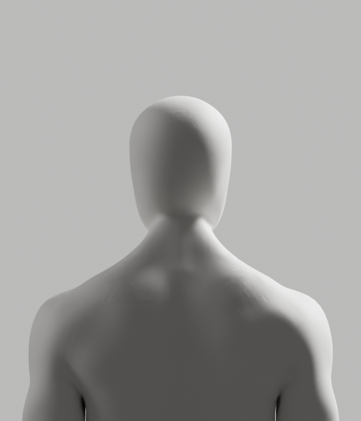

# 제약 연결띠 — 부분 제작 성공·전체 외형 미완료

2026-10-10 · [Story](../../../stories/avatar-neck-integration.md) · Draft #108 · 공개 웹 변경0

남녀의 **후두부 부분 연결**을 전문 원본에서 새로 제작하고 저장했다. 기존 검은 틈/점상 연결의 접힘은 새 실제 렌더와 저장본 기하 검사에서 사라졌다. 그러나 목 아래·어깨의 거친 마감과 전체 관절 품질은 남아 **외형 P2·미채택·Story/D2/전체1~6 미완료**다. 기존 [실패 상태](../ribbon-attempt/README.md)와 [부분 원본7481c5f](../sectioned-attempt/README.md)는 변경하지 않았다.

## 실제 미리보기 — 최종 외형 아님



[남성 측면](render/male-side.png)·[3/4](render/male-quarter.png)·[정면](render/male-front.png), [여성 뒤쪽](render/female-back.png)·[측면](render/female-side.png)·[3/4](render/female-quarter.png)·[정면](render/female-front.png). 실제 Blender5.1.1 CYCLES32/원래 재질·조명·카메라의8컷을 모두 직접 열어 검수했다. **이번에는 남녀 모두 새 부분 후보**이며 여성 원본 비교가 아니다. 원래 목–어깨의 거친 표면이 남아 외형을 승인하지 않았다. 이미지 편집/AI 생성/흐림0이다.

## 실제로 해결한 부분

읽기 전용 원본 검사는 남녀 선택 경계의 비인접 투영 교차0·원래 선택 면의Y음수0·body/rig snapshot exact를 확인했다. 기존 채움 실패가 원래 경계의 겹침 때문이라는 가설과 native 연결 방식을 분리했다. 설치된 `mathutils.geometry.delaunay_2d_cdt`를 실제 private 오목 annulus에서 확인한 뒤, 원래3D 점을 이동하지 않고 제약된 연결 인덱스만 사용했다. Native 삽입/병합/좌표 이동·경계 분할을 거부하며 원래 전문 단면과 native quad core를 유지했다. 새 인체 생성·전신 remesh·각도/의료 효과 주장0이다. [공식5.1 API](https://docs.blender.org/api/5.1/mathutils.geometry.html#mathutils.geometry.delaunay_2d_cdt) 검색과 실제 설치 doc/실행은 확인했고 직접 웹 열기402 오류는 성공으로 세지 않았다.

실제 남녀 저작은 exit0·새 원본 SHA2932e63d였다. 새 점2072/2624개, 원래 선택 표면 거리 최대8.942/11.953µm, 전체 연결띠400/454면의Y음수0·작은 면0·원래 내부 밖 점/면 중심0을 확인했다. 같은2178개 뒤쪽 위치에서 원래/새 중복 교차0·최대1회였다. 보호 영역/앞면/손·외부 좌표/polygon/raw139 groups·history·163 rest bone/pose/world/PBR exact, 닫힘0/winding0/tiny2→2/0→0을 실제 확인했다. 작은 거리는 제작용 표면 대조이지 사용자 자세 정확도나 의학적 정답이 아니다.

저장본의 **별도 Blender 재열기**도 exit0이며 원본 대비 위 보호·6mm/skin/rig/history/전체닫힘/tiny 조건을 다시 검증했다. 추가 읽기 전용 저장본 기하 검사는 각2178개 위치의 원본/후보 교차 배열이 실제 같았다. 그 검사의 ribbon 면은 원래/새 점을 함께 가진 **337/362개 혼합 면 subset**이며 전체400/454개와 혼동하지 않는다. 제작 단계는 전체 연결띠를 검사했다. 두 검사 모두 외형 승인·전체 변형·카메라 검증은 아니다.

변경 없는 원본을 새 후보로 인정하는 음성 시험과 이미 저장한 후보 덮어쓰기 시험은 실제 exit1·저장 전 거부였다. 입력·새 후보 SHA는 불변이다. 도구 호출의 JavaScript 구문 오류1건과 요약용 Node 구문 오류1건은 오케스트레이션 오류이며 native 저작/검증 성공으로 세지 않았다. Native 실제 종료 코드와 원래 로그를 따로 보존한다.

## 보존과 남은 조건

[새 부분 원본](candidate-projected.blend) SHA `2932e63d0d9f7565ae2b9835377d941af2ffe894f8036037479fb2c3fcc1e394`, [manifest](manifest.json). 35개 artifact의 raw/archive SHA·실제 보고서/로그·현재 실행 helper를 보존한다. Helper는 native 실행 후 현재의 **변경하지 않은 실행 소스**를 캡처한 것이며, 실행 전 별도 복사본을 만들었다고 주장하지 않는다. Archive helper의 첫 개수 검사는 실제33개를34개로 잘못 기대해 저장 전에 실패했다. 그 소스/실제 실패 로그를 별도 보존하고, 이2개 추가를 포함한35개 명시 목록으로 수정했다. 이를 native 실패나 외형 합격으로 바꾸지 않는다. 예전 frozen 저작기·원본·GLB·실패·최신 참조와 Draft #9는 유지한다.

```bash
node bodyguard/assets/blender/integration-neck/archive_projected_attempt.mjs --check
```

이 명령은 **보존 바이트 검사**이지 Blender/GLB/브라우저 재실행이 아니다. 새 후보의 전체118 기술 pose·GLB export/왕복·Chrome 두 rig·실제 사람/목표 노트북·올바른 시범/운동 판정·웹 전체/공급자/HTTPS·전문가 검토는 이번에 미실행 또는 미완료다. 과거 ce8887d/7481c5f의 QA를 새 후보로 복사하지 않는다. 공개 제품/UI/카메라/SDK/개인정보·계정/비용/시크릿/운영 DB/배포0이며 웹 최소 문구·별도 승인 경계는 유지한다.

신규5개 Python의 Ruff check/format·새 archive helper의 Biome·새35개 보존 검사를 실제 통과했다. 이전 root137/sectioned30/ribbon66개 보존 검사도 실제 재실행했으나 native QA가 아니다. 문서3개의 로컬 링크44개와 `git diff --check`, 원래 입력ce8887d/부분 후보7481c5f/최신 참조45b3139·A3182eb274c SHA, Draft #9 HEAD25a9bd6/작업 상태1959개를 재확인했다. 전체1959개 파일을 모두 hash했다고 쓰지 않는다. API/SQL/제품 build/전체 DOM/운영은 이번에 미실행이다.

`engineering:debug`로 원래 경계/연결 알고리즘을 분리해 접힘 원인을 좁혔다. 작성자 `engineering:code-review`는 원본 보호·CDT 이동/병합 거부·덮어쓰기·실제/모의 경계를 확인했다. **P2 Request Changes: 목–어깨/전체 관절 외형·참조 품질 미달.** 독립 사람/전문가/추가 agent 리뷰를 실행했다고 쓰지 않는다. 다음은 이 보호된 부분 후보와 실제 남은 목–어깨의 구간 경계를 읽고, 전문 도구에서 해당 표면의 흐름을 설계하는 보완이다. 이후 새 최종 원본/GLB/118변형/Chrome/외형·실측 전체 기준을 다시 통과해야 한다. Draft #108을 병합하거나 전체1~6 완료로 표시하지 않는다.
