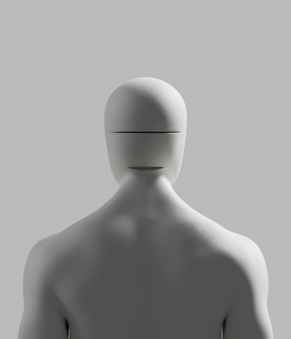

# 연결띠 보완 — 저장 전 실패·외형 미달

2026-10-10 · [Story](../../../stories/avatar-neck-integration.md) · Draft #108 · 공개 제품 변경0

**이번 제작은 실패했다. 새 남녀 후보를 저장하거나 제품에 채택하지 않았다.** 이전 [부분 후보7481c5f](../sectioned-attempt/README.md)와 모든 증거는 보존한다. 실제 실패 상태를 숨기지 않고 다음 조형 조건을 확인했다. D2·Story·전체1~6은 미완료다.

| 실제로 확인한 것 | 아직 해결되지 않은 것 |
|---|---|
| 네 모서리 대응이 맞는 native 열린 연결 | 연결띠가 원래 교체 영역을 넘고 접힘 |
| 원래 내부 단면으로 머리 부피 유지 | 단면의 양끝·연결띠까지 연속된 외형 |
| 원래 네 경계 arc로 공통 내부 높이 확인 | native 채움 면의 뒤 방향·원래 내부 포함·교차 |
| 새 점 모두 원래 내부, core 방향·6mm 검사 관측 | 연결띠 면 중심4개가 밖으로 나감·Y음수 면12개·뒤 중복 교차48개 |

## 실제 미리보기 — 미승인 실패 상태



[남성 측면](render-clear-failure/male-side.png)·[정면](render-clear-failure/male-front.png)·[3/4](render-clear-failure/male-quarter.png). 마지막8컷은 고정 CYCLES32/같은 원래 재질·조명·카메라의 실제 native 렌더이며 모두 직접 검수했다. 얼굴 앞면만 보고 합격 처리하지 않는다. **여성4컷은 편집하지 않은 원본 비교**이며 이번 여성 제작 성공이 아니다: [뒤](render-clear-failure/female-back.png)·[측면](render-clear-failure/female-side.png)·[정면](render-clear-failure/female-front.png)·[3/4](render-clear-failure/female-quarter.png). 이미지 편집/흐림/AI 생성0이다.

첫 네 방향 연결의 [실제 실패 뒤쪽](render-failure/male-back.png)·[측면](render-failure/male-side.png)을 포함한 이전8컷도 보존하고 모두 직접 검수했다. 두 렌더 집합의 여성 PNG 바이트는 같지 않았다. 이를 동일 바이트 대조 성공으로 쓰지 않고 각 실제 컷을 직접 열었다. 두 경우 모두 여성 원본 조형을 실행하지 않은 비교이며, 최종 남녀 외형이 아니다.

## 실제 실패와 관찰

네 쌍의 열린 Bridge는 모서리 대응과 core 뒤 방향을 확인했지만 연결띠 Y음수68·원래 중복 교차0 대비 새118개로 저장 전 exit1이었다. 저장 금지 재현에서 새 점19개가 원래 X/Z 교체 영역 밖에 있음을 확인했다. 여성 저작·skin 전송/독립 재열기·전체 변형/GLB/Chrome는 실행되지 않았다.

원래 투영 행을 단일 구간으로 가정한 시험과 중앙 구간을 선택한 시험은 각각 단일 구간/유일 중앙 내부 검사에서 exit1·저장0이었다. 읽기 전용 원래 경계 확인에서 남성의 전역 zmax 근처 행이23개로 갈라져 중앙이 없음을 확인했다. 원래 아래 arc 최고점·위 arc 최저점으로 읽은 안쪽 높이 구간은 남성1.517567~1.577669m/여성1.484953~1.534093m이며37/32개 행 모두 중앙 내부가 있었다. 전문 메시 좌표이지 실제 사람·정상 범위·코칭 수치가 아니다. 읽기 전용 검사 첫 lint의 반복 변수 바인딩 오류는 수정하고 별도 native exit0로 재실행했다. 첫 소스/보고서·로그는 보존하며 두 JSON은 실제 같았다.

마지막 native 투영 영역 채움은 새 점2072개 모두 원래 내부·core1980면 뒤 방향·원래 선택 표면 거리 최대8.942µm를 관측했다. 그러나 연결띠400면 중12개가 Y음수이고 새 면 중심4개가 원래 내부 밖, 같은2178개 위치의 뒤 중복 교차는48개/최대3이었다. 전체 제작은 저장 전 exit1이다. 작은 거리·닫힌 구멍·점 포함만으로 외형을 통과시키지 않는다. **skin 전송과 최종 보호 검사는 이 실패 뒤의 단계라 미실행**이며, 보호 raw skin/rest rig 통과를 주장하지 않는다.

독립 private mesh의 native 열린 Bridge/구멍 보존 채움 probe는 실제 exit0다. 이 probe를 전문 인체 제작·변형 성공으로 세지 않는다. Bridge probe의 `input_points_unchanged`는 vertex 집합 확인만 포함하므로 좌표 exact 검증으로 쓰지 않는다. 채움 probe는 좌표 exact를 실제 검사했다. 처음 열린 Bridge의 포맷 전 소스 바이트는 별도 캡처하지 않았고, 포맷 후 final 재실행과 캡처 소스를 연결했다.

`engineering:debug`로 경계 대응·부피·내부 영역·면 연결을 분리했다. `engineering:code-review` 결론은 **P2: 접힘/틈·외형 미달·Request Changes**다. 다음 설계는 원래 경계의 투영 자체가 단순한지와 native 채움 면의 경계 보존을 먼저 확인한 뒤, 설치된 native 2D 제약 삼각분할 API를 검증해 전문 영역의 연결을 설계하는 것이다. 아직 미실행이며 기존 실패 저작기를 고치거나 스무딩/허용치 sweep으로 통과시키지 않는다. 원래 보호 영역·6mm/skin/rig/tiny·전체 원본/GLB/118변형/Chrome/외형/실측·전체1~6 기준은 유지한다.

Blender MCP 상태는 실제 연결 오류였다. 기존 비차단 연결 요청은 반복하지 않았고 사용자 live 장면·telemetry/비용/계정/시크릿 변경0이다. [공식 Bridge5.1.1 source](https://github.com/blender/blender/blob/v5.1.1/source/blender/bmesh/operators/bmo_bridge.cc)는 GitHub API로 읽었고 web cache miss를 구별했다. 보존된 source의 SPDX GPL-2.0-or-later는 읽기 전용 검토 자료에만 적용되며 실행 코드나 아바타 에셋에 포함하지 않는다. [공식 triangle_fill API](https://docs.blender.org/api/5.1/bmesh.ops.html#bmesh.ops.triangle_fill) web 요청402는 성공으로 쓰지 않았으며 설치5.1.1 actual doc/실행으로 지원을 확인했다.

새 Blender/GLB 저장0·독립 새 후보 재열기/118 기술 pose/Chrome·실제 노트북/사람/올바른 시범·의학적 기준·전문가 검토·공급자/SDK·운영/HTTPS·전체1~6 검증은 미실행 또는 미완료다. 과거 ce8887d/7481c5f의 성공을 복사하지 않는다. 공개 UI/임상/SDK/개인정보·운영 변경0이며 최소 문구·승인 경계는 유지한다.

```bash
node bodyguard/assets/blender/integration-neck/archive_ribbon_attempt.mjs --check
```

이 검사는66개 raw/archive SHA와 실행 소스·실제 실패/관찰 보고서를 대조하는 **보존 검사**이며 Blender/브라우저 재실행이 아니다. 원래 입력ce8887d·이전 후보7481c5f·참조와 Draft #9는 보존한다. 새 archive를 다시 생성하는 시험은 실제 exit1로 거부했다. 새9개 Python의 Ruff check/format, 새 archive helper의 Biome 검사(기존 문자열 style info9, 오류0), 문서41개 로컬 링크/`git diff --check`를 실제 통과했다. 기존 root137/sectioned30/explicit42/읽기 전용 단면5개 바이트 audit도 실제 통과했고, Draft #9 HEAD25a9bd6/작업 상태1959개와 A318/원래 입력/7481c5f/참조 SHA를 재확인했다. 전체1959개 변경 파일을 모두 hash했다고 주장하지 않는다. 미실행 API/SQL/전체 웹 테스트·운영을 이 검사로 대체하지 않는다.
