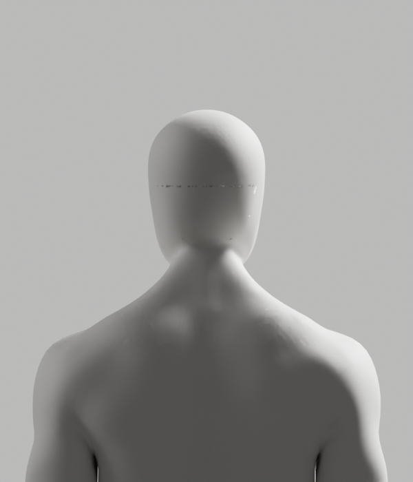
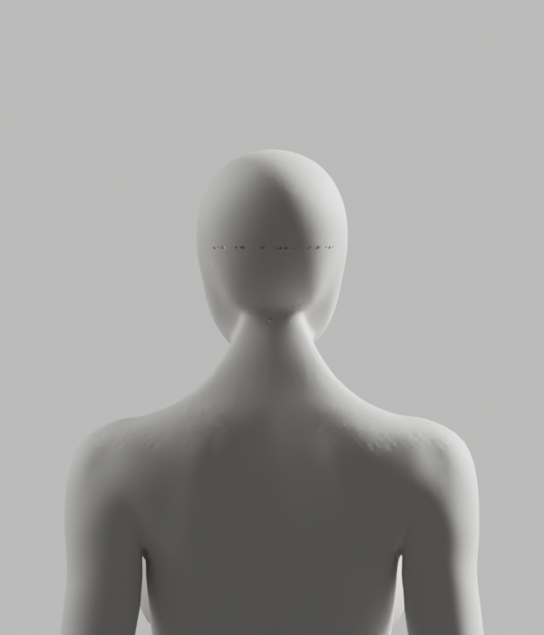

# 전문 단면 기반 후보 — 부분 저작 통과·외형 미달

2026-10-10 · [Story](../../../stories/avatar-neck-integration.md) · Draft #108 · 공개 제품 변경0

이전 [경계 보간 실패](../explicit-attempt/README.md)는 그대로 보존했다. 새 보완은 전문 원본의 실제 뒤 단면을 각 행에 사용했다. **남녀 후두부 부분 제작·보호 검사·독립 재열기는 통과했지만, 실제 외형은 미달이다.** 전체 아바타/코칭·D2·전체1~6 완료가 아니며 최종 모델로 채택하지 않는다.

| 실제 결과 | 완료한 부분 | 남은 문제 |
|---|---|---|
| 부분 표면 | 원래 단면으로 머리 부피 유지, 새 core의 면 방향 검사 통과 | 연결띠 접힘과 점상 접합선, 원래 목·어깨 마감 |
| 원본 보호 | 앞면/손·외부 좌표/polygon/raw139그룹·163 rest bone/pose/world/PBR/history 보호와 독립 재열기 통과 | 전체 변형·GLB/왕복·브라우저 검증은 이번 후보에서 미실행 |
| 외형 | 같은 조건의 실제 남녀8컷을 생성하고 모두 직접 검수 | 뒤 접합선이 남아 외형 P2, 미채택·Draft 유지 |

원래 입력ce8887d를 보존하고 새 [부분 후보](candidate-occipital.blend)7481c5f87f9d4de987f1b8999367b070b1c42b53467bbb4d9dbcdab4b306885a를 별도 생성했다. 전문 메시와 원본 private BMesh의 native 단면을 사용하며 구/원기둥 인체 생성·전신 remesh·보호 구조 삭제·기존 접힌 면 전체 재투영·스무딩 sweep은 하지 않았다. native Grid Fill은 연결에 사용하고, 원래 단면으로 부피를 제공했다.

남성37/여성32개 실제 단면 행을 읽었고, 새 점의 원래 선택 표면 거리 최대는1.122/1.255mm다. 6mm/skin 합0.01/원본 exact 보호 기준을 유지했고 nonmanifold/winding0·tiny 남성2→2/여성0→0이다. 기술 수치가 올바른 자세나 최종 외형을 보증하지 않는다. 독립 재열기는 원래 입력을 별도로 열어 보호 영역과 parent ledger/raw skin·리그·재질을 재비교했다. 모델 바이트는 전후 동일했다.





[남성 정면](render/male-front.png)·[측면](render/male-side.png)·[3/4](render/male-quarter.png), [여성 정면](render/female-front.png)·[측면](render/female-side.png)·[3/4](render/female-quarter.png)도 실제 native 렌더다. 여성도 이번에는 실제 부분 편집된 후보이며 이전 진단의 편집하지 않은 비교 원본과 다르다. 고정 CYCLES32/같은 조명·재질·카메라에서 생성했으며 이미지 편집·흐림·AI 이미지로 결함을 숨기지 않았다.

## 연결띠의 실제 문제

private BMesh의 읽기 전용 native 면/교차 검사에서 연결띠의 Y 음수 방향 면은 남성60/여성66개였다. 같은 전문 에셋 X/Z 위치2178개씩에서 원래 형상의 뒤 표면 중복 교차는0, 새 후보는 남성45/여성44개·최대3회였다. 원래 단일 뒤 표면에 없던 겹침이 새 연결띠에서 발생한다. 닫힘/winding/tiny나 원래 표면 거리만으로 이 결함을 잡을 수 없었다. 이는 사용자 좌표·임상 판정이 아닌 **전문 메시의 기하 검사**이며 전체 목·어깨 결함의 원인을 모두 규명한 것은 아니다.

`engineering:debug`로 부피와 연결띠 결함을 분리했고, `engineering:code-review`는 현재 저작의 기술 통과를 외형 통과로 승격시키지 않도록 했다. **P2: 연결띠의 접힘/중복 뒤 표면·점상 접합선. Request Changes, 병합 불가.** 다음 보완은 원래 네 모서리의 대응을 고정한 구간별 연결띠 설계이며 아직 미실행이다. core 단면 설계를 다시 경계 보간으로 되돌리거나 허용치를 높이지 않는다. 필수 형상 검사에 새 연결띠의 교차 방지 조건도 반영해야 한다.

## 음성 시험·보존·미실행

원래 입력을 새 후보로 제시한 재열기 시험은 실제 exit1로 거부했다. 이미 저장된 부분 후보에 다시 저작하려는 시험도 실제 exit1이며 모델7481c5f/원래 입력ce8887d가 전후 불변이다. 후자는 초기 저장 경로 guard에서 거부되어 JSON은 생성되지 않았고 실제 로그를 보존했다. Positive author/reopen/render/읽기 전용 ribbon 프로세스는 각각 실제 exit0이다.

Blender MCP 조회는 이번에도 실제 연결 오류다. 사용자 live 장면·telemetry·비용/계정/시크릿 변경0이고 기존 비차단 연결 요청을 반복하지 않았다. Bridge5.1 공식 문서 직접 요청은402 실패였으며 그 내용을 읽었다고 주장하지 않는다. 다음 구간별 native 연결 API/결과는 실제 설치 버전으로 검증해야 한다.

남녀 전체 구간 제작·전체118 기술 pose·GLB/왕복·Chrome·실제 사람/노트북·올바른 시범·임상 기준·전문가 검토·공급자/SDK 정책·운영/HTTPS·전체1~6 게이트는 이번 후보에서 미실행 또는 미완료다. 기존 후보의 성공을 복사하지 않는다. 공개 웹/판정/개인정보·운영 변경0, 아바타 중심 최소 문구와 별도 승인 경계는 유지한다.

```bash
node bodyguard/assets/blender/integration-neck/archive_sectioned_attempt.mjs --check
```

`manifest.json`은 모델·실제 실행 소스/로그/보고서·8PNG와 현재 helper의30개 artifact raw/archive SHA를 확인한다. `--check`는 바이트 보존 검사이며 Blender/변형/브라우저 재실행이 아니다. 이전 파일·manifest·실패와 Draft #9는 보존한다.

정리 구간에서 Ruff check/format3개 새 Python·Biome archive helper·문서38개 링크·`git diff --check`를 실제 통과했다. 이미 생성된 archive 재생성 시험은 예상대로 exit1로 거부됐고 뒤의30개 byte audit도 통과했다. 기존 root137·segmented42·explicit42·읽기 전용 단면5개 보존 audit도 통과했다. 이 검사는 과거 모델의 변형/브라우저 성공을 이번 후보로 승격시키지 않는다.
