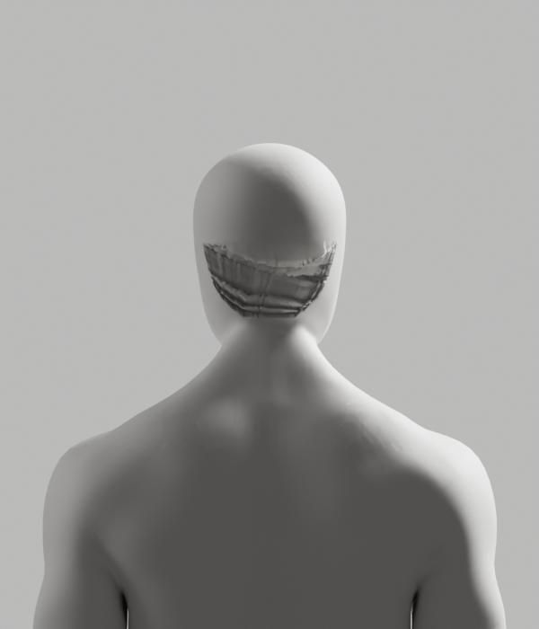

# 구간별 접합 제작 — 실패·미채택

2026-10-10 · [Story](../../../stories/avatar-neck-integration.md) · Draft PR #108 · 공개 웹 변경0

전문 남녀 원본의 후두부·목·어깨 연결을 구분하고 상부 연결의 새 격자를 제작했다. **저장 전 조건을 통과하지 못해 새 Blender 원본과 GLB는 없다.** 기존 파일과 이전 검증 증거는 보존하며, 외형 P2·D2·전체1~6 미완료 상태를 유지한다.

읽기 전용 검사에서 body와 rig의 world 축척이 다른 것을 확인했다. 최초 rig-local 배치는 보존하되 제작 기준으로 사용하지 않는다. 수정한 검사는 `body.world.inverse × rig.world`로 같은 공간에 옮겼고 원래 리그는 변경하지 않았다. 이 제작용 경계는 실제 사람의 해부학·운동 기준이 아니다.

## 실제 결과

- Curvature interpolation은 원래 표면에서7.0775mm 이탈해 실패했다. 아래 실제 진단 렌더의 남성 뒤쪽 격자에도 굴곡이 남았다. 여성은 편집하지 않은 비교 원본이다.
- Simple interpolation은6.1030mm로 실패했다. 거리6mm 기준을 낮추지 않았다. 모서리 진단은 native가 지정4개 중2개 대신 다른 점을 쓴 것을 확인했다.
- 후속 연결띠는 원래 경계218점을 보존하고 안쪽의 맞은편 점 수를36/55/36/55로 맞췄다. Native Bridge와 Grid Fill은 실행됐으나 **실제 모서리 표식이1/2/3/4가 아닌0/0/1/3**이어서 저장 전에 실패했다. 이후 거리·가중치·리그 최종 검사, 여성 제작은 미실행이다. 연결띠의 외형 렌더도 미실행이며 아래 이미지는 그 후보가 아니다.



남성 진단 렌더는 실패한 부분 격자의 geometry만 확인한 것으로, 가중치 전송·손 index 재매핑 전이다. [여성 원본 비교](diagnostic-render/female-back.png)를 여성 제작 성공으로 보지 않는다. 실제8컷 생성 후 저작 실패를 다시 발생시켜 native exit1로 종료했으며 Blender 모델은 저장하지 않았다. 흐림·AI 이미지 편집으로 결함을 수정하지 않았다.

## 후속과 검증 경계

설치5.1.1의 native API와 [같은 버전의 Grid Fill 소스](https://github.com/blender/blender/blob/v5.1.1/source/blender/editors/mesh/editmesh_tools.cc)를 읽기 전용으로 확인했다. 닫힌 경계에서의 native 순회 방향과 span을 맞추는 문제는 다음 설계의 가설이며 해결된 것으로 표시하지 않는다. 다음 제작은 두 열린 맞은편 경계를 직접 지정하는 native `grid_fill`로 연결을 명시하고, 같은4모서리·거리·tiny·보호점/skin/손·rig/PBR 조건을 다시 강제해야 한다. 이번 구간에서 이 후속 제작은 미실행이다.

새 원본 독립 재열기·118 기술 pose·GLB/왕복·Chrome·실제 사용/올바른 시범·최종 외형 검증은 모두 미실행이다. 이전 후보의 성공이나 압축 바이트 검사를 이번 제작 통과로 복사하지 않는다. Blender MCP는 addon 상태 조회에서 연결 오류였으나 독립 native 제작/진단은 실제 실행했다. 라이브 사용자 작업창·제품 UI·임상 판정·SDK 정책·운영 변경0이다. 짧은 UI 문구 원칙과 기존 승인 경계는 유지한다.

## 보존 검수

`manifest.json`은 실행한 소스·실패 JSON/로그·읽기 전용 검사·진단8PNG와 사용한 helper를 해시로 구별한다. `current-*`는 보존 시점의 코드이며 과거 실행 소스와 다르면 재실행 증거로 쓰지 않는다. 초기 Ruff의 pairwise 규칙 실패는 도구 transcript에만 관측됐고 별도 로그 파일은 없다. 보완 후 실제 검사 결과와 파일 바이트 검수는 PR에 별도로 기록한다.

```bash
node bodyguard/assets/blender/integration-neck/archive_segment_attempt.mjs --check
```

이 명령은 파일 보존 검사다. 모델 제작/브라우저를 재실행하거나 Story·단계 게이트를 통과시키지 않는다. 미해결 외형 P2 때문에 PR 병합은 보류한다.

실제 로컬 검수는 새 Python4개 Ruff/format, archive Biome, 이전137개와 topology37개·quad36개/후속6개·이번42개 바이트/압축 전후 SHA, 변경 문서의24개 상대 링크와 `git diff --check`를 확인했다. Archive 재실행은 기존 증거가 있어 exit1로 거부됐고 이후42개 SHA 검사는 exit0이었다. 원래 A318/ce8887d/CEO 참조 SHA, 기존 Draft #9 HEAD25a9bd6/1959개 추적 변경 수는 그대로다. 제품 빌드·전체 UI/API/SQL·실제 사람·운영 시험은 이번 구간에서 미실행이며 과거 결과를 새 성공으로 세지 않는다.
