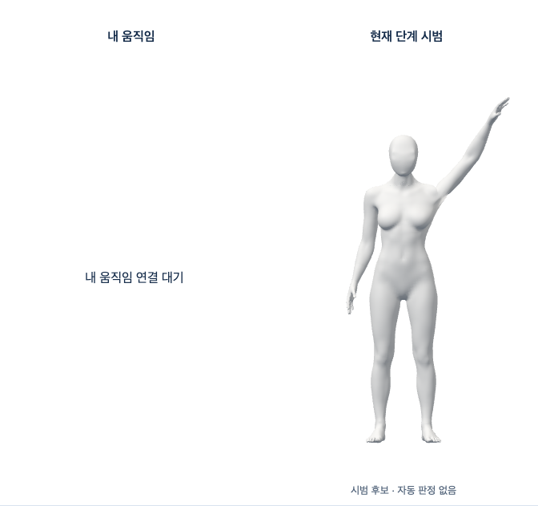

# Blender 동작의 단계별 3D 시범

2026-10-16 · [Story](../../stories/blender-reference-content.md) · base main `feffa27` · 개발 검수 전용.

## 작동하는 화면

기존 `/dev/coaching?motion=neck-side`에서 **시범 미리보기**를 누르면 오른쪽에 실제 3D 후보가 표시된다. 목 옆 기울이기·어깨 으쓱/이완·팔 위로 뻗기의 남녀6개 조합을 연결했다. 준비·수행·유지·복귀 중 필요한 구간을 재생하고 좌우·일시정지·재생·전신/상반신/자세히를 직접 선택한다. 같은 전체 동작만 자동 반복하는 영상이 아니다. 표시 구도는 카메라의 실제 촬영 범위나 판정 기준을 바꾸지 않는다.



[남성 목 동작](evidence/browser-c-male-neck-left.png) · [반대쪽](evidence/browser-c-male-neck-right.png) · [복귀](evidence/browser-c-male-neck-return.png) · [여성 상체 확대](evidence/browser-c-female-overhead-자세히.png).

왼쪽은 연결 대기로 남긴다. 사용자 동작을 관찰한 것처럼 같은 시범을 복제하지 않는다. 버튼을 누르기 전 GLB·GPU·카메라를 시작하지 않고, 시범을 열어도 코칭·자동 판정/성공·유지 시간·점수·기록 생성은 시작하지 않는다. 미채택 외형의 개발 화면이지 최종 아바타/출시 화면/올바른 자세 인증이 아니다.

## 원본·리깅·콘텐츠

- PR153의 [전문 도구 편집 원본](../motion-preview-content/native/motion-preview-authoring.blend), SHA256 `130d32ff93fb2bfd252f4ef068bc587490b0b904640adf91efa002e276d17794`을 읽기만 했다. Blender5.1.1에서 기존6개 action/slot을 실제 평가해 새 애니메이션 전용 GLB6개를 만들었다. 각 파일은 메시0·노드164·채널489이며 신체 메시/가중치/의상/얼굴·목을 새로 만들거나 덮어쓰지 않았다. 선정 근거와 작화 한계는 [기존 제작 Story](../../stories/motion-preview-content.md)에 있다.
- 신체는 불변 Git `2be0ebebe731d4b2e44cd93f453ddbf76b6b581f`의 MPFB/MakeHuman CC0 후보다. 남성11594720bytes/SHA `8c3d34b9d12c1d40f2c842c0167bff2c2d6ee72a427162b4c44d62e80bbf59bf`, 여성11549800bytes/SHA `a9bca83ca4dad075aaef8df8f49be17bba488883485847f6c034114a663e147b`. 원래 GLB를 재내보내거나 4가중치로 축소하지 않고 기존 여덟 가중치 renderer/CPU 변형을 재사용한다. 권리/외형 증거는 PR150에 보존하며 이번 PR로 최종 채택하지 않는다.
- [export-report](animations/export-report.json)의6개 출력은 SHA 검증을 명시한 exporter 재실행 `exported-b`와도 바이트 일치한다. 원본 저장0·원래 GLB 변경0이다. 메시를 선택하지 않은 animation-only export에서 Blender의 armature/mesh 경고가 나왔으며 실제 메시0/163관절 정지 변환·parent·clip 재생으로 출력 적합성을 별도 확인했다. 경고를 숨기거나 전체 GLB 품질 통과로 세지 않는다.
- [native-reopen](evidence/native-reopen.json)은 실제 원본을 다시 열어6action의 변화·복귀와 유한한 변형 경계를 검사했다. 실제 GLB unit은 전체163관절의 정지 위치/크기/회전·부모와 바인딩을 확인하고 모든 단계/좌우에서 사용자 복제본과 원본이 움직이지 않음을 확인했다. 기술적 정지 변환 오차 허용5e-6은 임상 각도/자세 허용치가 아니다.
- 여성 `tongue01.scale`은 export의 정지 scale이 node rest와 약6e-6 달랐다. 첫 검사는 실패로 남겼고 허용치를 올리지 않았다. 움직이지 않는 vector 채널의 실제 값을 보존하도록 수정했으며, 실제로 변하는 translation/scale·잘못된 경로/중복/비유한 값/정지 구조 불일치는 계속 거부한다.
- 기존 ReferenceProgram/Playback으로 native24fps 키를 준비·목표 접근·유지·복귀 구간으로 나눈다. 구간 길이/진폭은 작화값이다. 임상 정답·안전한 유지 시간/반복 수·운동 효과·손의 힘/통증·하체 자세를 검증하지 않았다.

## 검증과 오류 복구

[browser-c.json](evidence/browser-c.json)은 실제 Chrome155·React·WebGL에서6개 실제 GLB와 단계/좌우·정지 픽셀·복귀, 전신/확대·800px 화면, 손상 GLB 거부→명시 재시도, 실제 WebGL 컨텍스트 손실→새 canvas 복구, 숨김/계정401 회수를 확인했다. 명시 종료·숨김/401 뒤 소유했던 native WebGL context가 실제 lost 상태가 되는 것도 확인했다. 모든 GPU 메모리0이나 SDK 수명주기 해결 증거로 확대하지 않는다. 카메라/SDK Worker·외부 요청·저장·pageerror0, 실행 전후 소스 해시 일치다. 계정 응답과 손상 데이터만 제어했으며 실제 계정 공급자/사람/임상 시험은 아니다.

클라이언트는 고정8개 URL/크기/SHA·동일 출처·redirect/credential 금지·30초 한계·stream 크기·embedded GLB만 허용한다. 개발 서버는 고정 Git object/정규 파일만 읽고 경로 추측을 하지 않는다. 원본/누락/손상 오류는 고정 문구와 빈503으로 처리한다. 재시도는 수동이며 늦은 GPU 준비가 끝나 정리되기 전 다음 소유자를 만들지 않는다. 정리 실패는 페이지 새로고침 전 재획득을 차단한다. unit의 HTTP/소유권 제어 시험은 실제 브라우저 검증과 구분한다.

검증 명령은 `bodyguard/frontend`에서 실행한다. 시험마다 새 `mktemp -d /private/tmp/bodyguard-reference-content.XXXXXX` 폴더와 새 label을 사용한다. 기존 출력/증거는 덮어쓰지 않는다.

```sh
'/Applications/Blender.app/Contents/MacOS/Blender' --background ../docs/review/motion-preview-content/native/motion-preview-authoring.blend --python-exit-code 1 --python scripts/export-reference-content.py -- <scratch> exported-a
node scripts/test-reference-content.mjs <scratch> browser-a
pnpm test
pnpm build
pnpm check
node scripts/check-selection-production.mjs
ruff check scripts/export-reference-content.py
git diff --check
```

## 실패 보존·직접 리뷰

1. 초기 TypeScript2건의 실패 로그를 보존했다. React 의존성 검사 오류도 수정했으나 당시 도구 출력만 있고 별도 원문 파일은 없다. 최초 여성 unit의 정지 vector 실패는 위 값 보존으로 수정했다. 최초 HTTP unit은 happy-dom의 http `import.meta.url`을 파일 URL로 읽으려다 실패했으며 `node:path`의 실제 개발 폴더 경로로 고쳤다. Python 최초 형식 검사 실패도 보존하고 formatter 적용 후 다시 통과했다.
2. browser-a는 실제2흐름 이후 존재하지 않는 ‘설정 닫기’를 기다려 실패했다. 실제 버튼명 ‘화면 설정 닫기’로 고쳤고 a의 실행 스크립트/보고서/스크린샷은 보존했다.
3. browser-b는 기능5흐름을 통과했지만 800px 팔 올리기에서 손끝이 가장자리에 잘리는 시각 문제를 확인했다. b를 완전한 외형/구도 통과로 세지 않는다. 표시 카메라의 여유 공간만 보완하고 실제 여덟 가중치 변형 경계를 전신/좌우/640×630·1288×720에서 확인했다. browser-c 화면을 직접 확인해 손끝 여유를 확인했다. 확대 구도는 선택 목적대로 하체를 자를 수 있다.
4. 전체 회귀의 CameraFraming unit 한 곳은 예전 ‘전체 시범’ 버튼을 찾다가 실패했다. 새 ‘시범 미리보기’의 활성 상태를 확인하면서 자동 열기/코칭 시작 없음 검증은 유지했다. 실패한 전체 실행도 보존했다.

직접 리뷰 범위는 고정 자산/경로·해시/크기·늦은 준비/정리 경쟁·동작/성별 변경·숨김/401·컨텍스트 손실/수동 재시도·단계/좌우 독립·8가중치·키보드/정지·production 제외와 근거/작화 구분이다. 위 보완 후 이 개발 시범 Story 범위의 알려진 미해결 P1/P2는 없다. 원래 실패/브라우저와 exporter 실행 소스/압축 로그와 SHA는 `evidence/`에 보존한다. 모든 초기 unit의 당시 소스까지 별도 복사한 것은 아니며 존재하지 않는 증거를 실행 완료로 세지 않는다.

실행 기록: 전체frontend1972개/114파일(`full-test-b.log.gz`), 원래 typecheck/notice 포함 build(`full-build-b.log.gz`), 전체 Biome exit0·기존16info(`full-check-b.log.gz`), 변경19개 진단0(`scoped-check.log.gz`), Python Ruff/format(`ruff-b.log.gz`, `ruff-format-b.log.gz`), production guard(`production-guard-b.log.gz`)가 통과했다. 기존 실제 카메라 준비8흐름과 동작 카드7흐름도 통과했다([camera](evidence/camera-reference-regression.json), [media](evidence/media-reference-regression.json)). 가짜 카메라·제어 계정을 실제 사람/공급자 검증으로 세지 않는다. 이 실행들은 기능 회귀이며, 동시 검사 중 CPU 지연/목표 노트북 성능을 측정했다고 주장하지 않는다.

[evidence-manifest.json](evidence-manifest.json)의 코드 SHA/저장된 증거 SHA와 [raw-compression](evidence/raw-compression.json)의 압축 전 SHA를 대조할 수 있다. gzip은 무손실 복원을 확인했다. 내보내기 a/b의6개 파일은 동일하며 b 실행 소스 뒤의 Python 변경은 formatter뿐이다. 브라우저 c의 실행 소스 복사본도 별도 보존했다.

## 남은 필수 항목

왼쪽 실제 사용자 리타게팅과 오른쪽 시범의 동시 통합, 관찰→근거 있는 판정/추천→시범 적응→결과/기록 생성, 나머지4종 콘텐츠, 최종 남녀 외형/변형·노트북 성능은 미완료다. PR150/152는 미해결 외형/성능·원래 간헐 SDK 시작/정리 P2로 Draft/병합 금지를 유지한다. 참여자 검증 미실행을 합성 데이터로 통과시키지 않는다. 전체1~4단계/1~6단계 완료가 아니며, 공급자/Docker/HTTPS·운영 DB/시크릿·배포/출시·비용/계정 작업은 실행하지 않았다.
