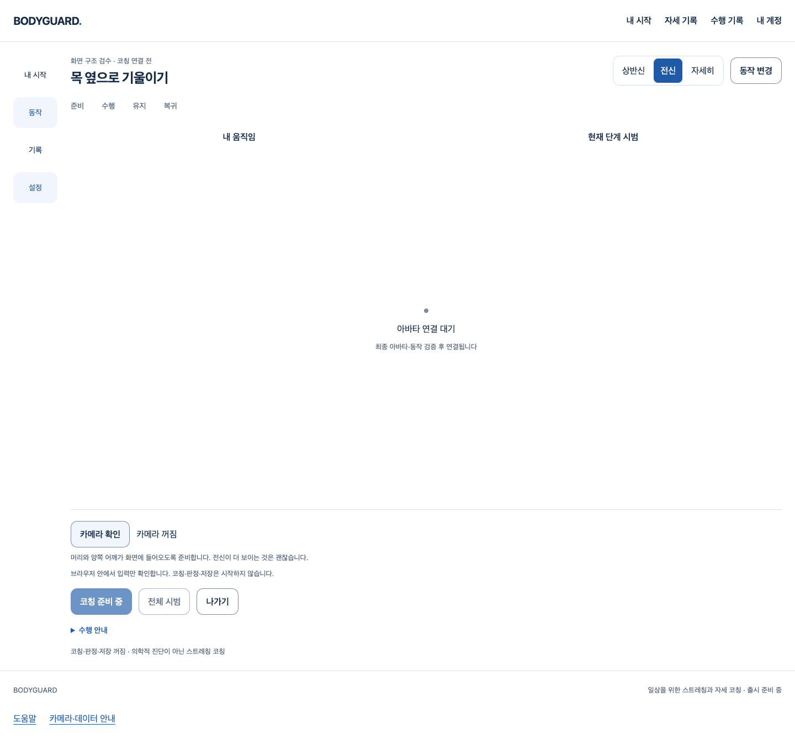

# 버리는 얼굴·손 추론 생략 — S3.C10

몸이 없거나 복수·불완전하면 얼굴·손 후보를 이미 버리는 기존 경로에서, 그 후보의 SDK 계산도 생략했다. 다음 유효 몸에는 같은 초기화 자원·원래 프레임/시각으로 얼굴·손을 다시 계산한다. 몸/가시성/판정 기준·heavy 기본값·얼굴/손 초기화·GPU→CPU·기한·회수는 변경하지 않았다.

기준 main `c57c1a331ae4f264138e72dc6c797aaf23950243`, `codex/body-gated-worker-inference`. [Story](../../stories/body-gated-worker-inference.md), [실행·소스·범위](verification.json), [원본/압축 SHA와 보존 목록](manifest.json). 좁은 비공개 입력 처리 보완이며 **공개 코칭·실제 자세 정확도·최종 아바타·전체1~6 완료는 아니다**.

## 실제 웹 흐름

[Chrome/React/Vite·실제 SDK/가짜 카메라8개 흐름](evidence/camera/body-gate-camera.json.gz)에서 명시 카메라 확인→첫 추론/결과 폐기→끄기, 권한 거부, 준비 취소/늦은 stream 회수, router 이탈/재진입, 계정401 회수를 확인했다. 최초 진입에서 카메라/Worker/video/canvas0, 외부 context 요청0·아바타 요청0·page error0이다. 계정 API와 거부/지연/401은 시험 제어이며 실제 사람·권한 팝업·메일/Google 검증이 아니다.

아래는 실제 개발 웹의 **카메라 종료 상태**다. 새 디자인 시안·최종 아바타나 출시 코칭이 아니다.

[권한 거부](body-gate-camera-denied-1440.png) · [좁은 데스크톱 창](body-gate-camera-stopped-800.png)

## 실제 SDK의 연속 빈 입력

[단독 최종4개 context](evidence/after/after-body-gate-standalone.json.gz)는 각3개의 생성된 백색640×480 프레임을 고정1→21→41ms SDK 시각으로 전달했다. 실제 Chrome155.0.8059.40·heavy/얼굴/손 모델을 모두 초기화한다. 관찰값은 각 프레임에서 몸0/world0/머리null/손0, 종료 후 Worker1→닫힘1·storage0이다. 원시 좌표/행렬·영상은 출력/저장하지 않았다.

| 로컬 제어 조건 | 첫 입력 왕복 | 후속2개 왕복 |
| --- | ---: | ---: |
| 일반1 | 741ms | 19/12ms |
| CDP4×1 | 515ms | 15/13ms |
| 일반2 | 488ms | 9/9ms |
| CDP4×2 | 523ms | 10/9ms |

페이지에서 실행한 요청의 왕복 관찰이다. SDK 계산만의 시간·CPU4× 실제 노트북/OS 부하·유효 사람 지속 성능으로 일반화하지 않는다. 수정 전 같은 하네스의 두 실행은 첫 추론 오류여서 성공 시간의 전후 비율을 계산할 수 없다. 현재 성공을 이전 실패의 원인 입증으로 세지 않는다.

[기존 실제 SDK6개 회귀](evidence/after/after-regression.json.gz)도 기본/몸 모델6초 제어 지연/취소/변조/파일별900ms/900ms+CDP4×를 통과했다. 성공4개에서 빈 결과1개, 취소/변조는 준비 실패·입력0, 모두 원래 Worker 종료를 확인했다. 모델 요청은 선택3개뿐이며 외부 context 요청0·page error0·소유 server/proxy 종료를 확인했다. proxy 거부 횟수는 브라우저 배경 연결 거부이며 process 전체 egress0의 증거가 아니다.6초 준비 성공을5초 성능 통과로 세지 않는다.

## 실패·보완·미완료

- [RED55중10실패](evidence/run/red.json.gz): 세 adapter가 버릴 얼굴/손도 호출하고, 그 오류가 몸 처리까지 실패시킴을 mocked SDK로 재현했다. 변경 후 [관련55통과](evidence/run/green.json.gz), 유효→빈 몸→유효 회귀2개를 더한 최종 전체 시험을 실행했다.
- [수정 전 첫 SDK](evidence/before/before-body-gate.json.gz)·[같은 조건 재실행](evidence/before/before-body-gate-repeat.json.gz): 준비는 ready였지만 첫 추론은 Worker 오류다. 실패 원본·기존3개 adapter source·당시 compiled Worker를 보존했다. 원인을 시각이나 특정 SDK task로 단정하지 않는다.
- [첫 후보](evidence/after/after-body-gate.json.gz)는 frontend/typecheck/Biome가 함께 실행된 구간의3개 빈 추론 뒤 종료 assertion 실패다. 당시 최종 close 값은 row에 남지 않아 정확히 어느 종료 assertion이 실패했는지 이 JSON만으로 식별할 수 없다. 후속 runner는 final 값을 assertion 전에 기록한다. 이후 단독 통과를 그 실패 원인 해결로 표시하지 않는다.
- [최초 타입 검사](evidence/run/typecheck.log.gz)는 새 비유한 좌표 fixture의 visibility 필드 누락으로 실패했다. fixture 모양을 기존 points와 같게 보완했다. 타입/임계값·제품 검사를 약화하지 않았다.
- [전체 회귀1874통과/1실패](evidence/run/full-frontend-final.json.gz)는 수정하지 않은 자세 기록 페이지의 SW10 초점 assertion 실패다. [해당 페이지+관련80통과](evidence/run/focus-and-related.json.gz)·[최종 단독 전체1875통과](evidence/run/full-frontend-standalone.json.gz)를 구분해 보존했다. 해당 제품/테스트·기한은 고치지 않았고 비결정적 초점 실패의 원인은 미확정이다. 이번 native 보완의 수정 범위 밖이며 6단계 회귀 후속 확인이 필요하다.
- 원래 시작P2/PR90 과거13실패·cold/부하 조건·실제 사람 추적/복구·가림/부위 정확도·다장치 성능은 여전히 미완료다. 얼굴/손 생략을 다른 사람 연결 안전성이나 올바른 자세 판정의 증거로 쓰지 않는다.

## 품질·변경 범위·작성자 리뷰

[최종 검증](verification.json)의 전체 frontend1875/103파일·실패/skip0, 타입/Biome·고정 모델5개 byte/SHA·원래 notice production build·원래 production guard·diff 검사를 실제 통과했다. Biome의 기존 info16은 그대로다. 이전/현재 private build와 원래 dist의 공개 JS365040byte·CSS31302byte는 파일명/SHA까지 같고 공개 코칭 활성화는 없다. 변경된 Worker는 비공개 probe 출력에 별도 보존했다. backend/API/SQL는 변경하지 않았고 이번 Story에서 재실행하지 않았다.

소스/압축 증거92개와 SHA를 보존했다. 중간 수정 전 runner의 모든 source snapshot을 개별 저장한 것은 아니며 보고서의 source SHA·기존 production adapter·compiled bundle과 최종 driver를 구분한다. 당시 close 관측 누락·초기 실패·미실행을 완료 증거로 바꾸지 않는다.

debug로 출력 폐기와 계산 생략의 위치를 확인했고 testing-strategy로 합성 호출 경계와 실제 SDK 실행을 분리했다. code-review에 따른 **작성자 검토**에서 기존 single-body 검사 불변·유효 프레임의 복사 순서/시각·disabled 필드·원래 모델·초기화/정리·late/abort barrier·추론 오류 격리·public private 차단을 확인했다. 좁은 변경의 미해결P1/P2 발견0이며 독립/전문가 검토나 위 기존 문제의 종결이 아니다.

## 완료·승인 경계

이 Story의 좁은 로컬 구현·검증은 완료했다. 조건부 병합은 최신 main/diff·HEAD·CLEAN/충돌·체크·리뷰를 다시 확인한 뒤 merge commit으로 진행하며 원격 결과는 PR에 기록한다. 아바타/참여자/Docker/공식 문의/Gmail·Google 보류, 출시 동작0·실제 보정/판정/추천·최종 시범/아바타·권리/실측/외부/운영·전체1~6은 미완료다. 새 UI/디자인 확장·임상 기준·영상/관절 수집·비용/계정/시크릿/운영 DB/배포/출시 변경은 없다.
