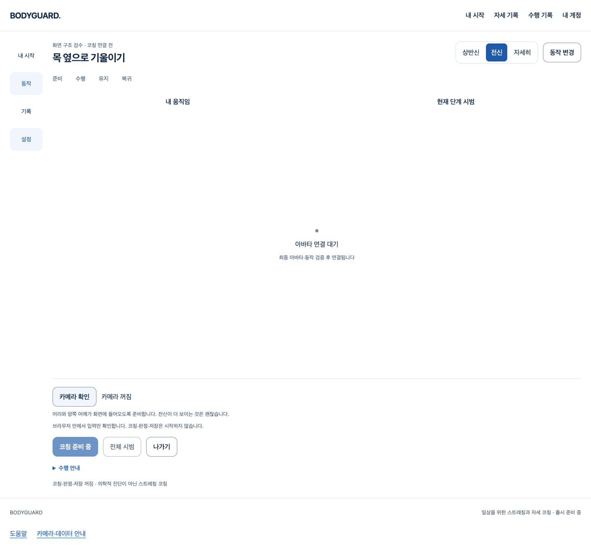

# 선택 모델의 제한된 동시 준비 — S3.C9

웹캠·분석 준비에서 선택한 고정 모델3개를 함께 읽어 독립 응답 대기가 누적되지 않도록 했다. 명시 카메라 확인→실제 SDK 첫 빈 추론→끄기, 취소·거부·화면 이탈·계정401 회수의 기존 웹 흐름은 유지한다. 비공개 개발 경로의 연결이며 **공개 코칭·정자세/추천·최종 아바타·1~6단계 완료가 아니다**.

기준 main `fb8635ad98debc009329b08ef3c3516666e92e37`(PR140 merge), 브랜치 `codex/bounded-model-download`. [Story](../../stories/bounded-model-download.md), [원본·압축 SHA와 소스/출력 대조](evidence-manifest.json). 이전 원본과 실패를 덮어쓰지 않았다. 조건부 GitHub 게이트는 별도 진행하며 실행 결과를 PR에 기록한다.

## 실제로 작동한 웹 흐름

[Chrome/React/Vite·실제 SDK와 가짜 카메라 결과](evidence/concurrent-camera.json.gz)의8개 흐름:

- 최초 진입은 카메라·Worker·video/canvas0. 별도 명시 준비에서 heavy/얼굴/손의 실제 SDK 첫 추론 결과를 버리고, 끄면 원래 track/Worker가 끝난다.
- 제어된 권한 거부는 복구 가능한 오류, 대기 중 취소는 늦은 stream 회수와 준비 권한 차단으로 이어진다.
- 새 명시 준비 뒤 router 이탈은 원래 자원을 회수한다. 대기 중 SPA 재진입도 기존 권한 요청 회수를 기다리고 자동 재획득하지 않는다.
- 실제 AuthProvider의 제어401은 비공개 UI와 native 자원을 회수한다.
- 실제 문서와 SDK Worker의 외부 fetch는 원래 connect-src에서 차단한다. 관찰한 context 외부 요청0·아바타 요청0·page error0.

영상/실제 사람·실제 권한 팝업 거부·SQL/메일/Google 공급자 검증이 아니다. 실패·401·permission 지연은 시험 제어다. 아래는 **실행된 개발 화면**이며 새 디자인 시안/최종 외형이 아니다. 카메라가 꺼진 상태라 실제 영상이나 신체 정보가 없다.

[거부 상태](concurrent-camera-denied-1440.png) · [800px 종료 상태](concurrent-camera-stopped-800.png)

## 준비 비용의 단독 전후 비교

Chrome155.0.8059.40, 같은 generated blank640×480/current-performance 입력, 각 선택 파일 응답을900ms 늦춘 로컬 제어 시험이다. 새 context별 단독 실행이다. CDP4×는 제어 CPU 제약이며 실제 저사양 노트북/OS 부하를 대체하지 않는다.

| 조건 | 이전 전체 준비 | 현재 전체 준비 | 이전→현재 요청 시작 간격 | 첫 추론 이전→현재 |
| --- | ---: | ---: | ---: | ---: |
| 일반 | 3205.7ms | 1377.3ms | 1870→1ms | 1056→1016ms |
| CDP4× | 3323.2ms | 1522.5ms | 2017→0ms | 947→917ms |

[이전](evidence/before-current-frame.json.gz) · [현재 단독](evidence/candidate-latency-isolated.json.gz). 모델 다운로드·hash와 원래 SDK 초기화까지의 전체 준비다. 네트워크/전체 제품/모든 장치 성능 향상으로 일반화하지 않는다.

이전 reader는 Git main의 정확한 source(`a53585fe…`)를 private probe의 단1개 모듈에만 주입했다. 현재 reader는 `eede84c8…`; 두 비교 probe 입력 SHA는 `644092ee…`로 같다. report.source에는 실행 디렉터리의 현재 source가 들어가므로 실제 비교 reader는 **readerProvenance**를 기준으로 확인한다. [이전 provenance](evidence/before-reader-provenance.json.gz) · [현재 provenance](evidence/after-reader-provenance.json.gz). 원래 production notice build의 override0; 실행 Worker도 전후 동일246213byte/SHA다.

## 원래 입력의 최종 실제 SDK 검증

최종 소스의 probe 기본 입력은 기존대로 **고정1ms**다. 시간 교체로 기본 성공을 만든 것이 아니다. [최종6개 흐름](evidence/final-original-input.json.gz)은 새 출력·별도 단독 실행에서 모두 완료했다.

| 흐름 | 준비 관찰 | 첫 추론 | 회수 |
| --- | --- | --- | --- |
| 기본 | ready530ms | 1031ms/빈 결과1개 | Worker1→종료1 |
| 몸 파일6초 지연 | ready6397.6ms | 897ms/빈 결과1개 | Worker1→종료1 |
| 준비 중 취소 | preparation 실패248.7ms | 0개 | Worker1→종료1 |
| 모델 변조 | preparation 실패62.1ms | 0개 | Worker1→종료1 |
| 파일별900ms | ready1283.7ms | 899ms/빈 결과1개 | Worker1→종료1 |
| 파일별900ms·CDP4× | ready1511.9ms | 960ms/빈 결과1개 | Worker1→종료1 |

각 context storage0·external0·page errors0, 소유 server/proxy 종료를 확인했다. proxy 거부38은 브라우저 배경 연결 거부 횟수이며 SDK 신체 데이터 전송이나 process 전체 egress0의 증거가 아니다.6초 준비 성공은5초 성능 통과가 아니다. Worker init/inference/cleanup5초와 모델 전체30초, heavy/얼굴/손·GPU→CPU 복구·정자세/안전 기준은 변경하지 않았다. 실제 몸 정확도/프레임 지속 성능을 측정하지 않았다.

## 실패·보완·남은 문제

- [구현 전 RED](evidence/concurrent-red.json.gz): 새 동시성5개 assertion 실패. 이전 순차 reader가 첫 응답 전1개만 시작함을 확인했다.
- [첫 관련 시험](evidence/related-first.json.gz): 실행된53개 assertion은 통과했지만 변수 pending 중복 선언으로 **1개 suite 파싱 실패**. 전체 통과가 아니다. receivers로 분리했다. 최초 Biome 오류4도 block 반복문/변수명으로 보완했다. 그 최초 Biome raw 로그는 따로 저장하지 못했고 도구 출력만 남았다.
- 초기 proxy ECONNRESET은 의도적 CONNECT 거부 후 socket 오류의 하네스 처리 누락이다. JSON을 쓰기 전에 종료됐고 해당 JSON은 없다. socket error 처리만 보완했다; SDK/제품 오류 해결로 세지 않는다.
- [이전 source](evidence/before-latency-repaired.json.gz)·[이전 준비 관측 추가](evidence/before-latency-diagnosed.json.gz)·[첫 후보](evidence/candidate-all.json.gz)는 준비 뒤 첫 추론 실패를 보존한다. 이후 [current-clock 진단](evidence/current-clock-diagnostic.json.gz)은 통과했지만, [고정1ms 단독](evidence/fixed-clock-isolated.json.gz)도 통과했다. **입력 시각을 원인으로 확정할 수 없다.**
- [고정 입력 병행 실행](evidence/fixed-clock-paired.json.gz)은 다른 native Chrome 시험과 겹쳐 준비/cleanup 실패10114.5ms, 추론0이었다. 실패·소유 서버 종료를 보존하며 시각 원인/성능 통과로 세지 않는다. 겹친 [후보 성공](evidence/candidate-current-frame.json.gz)의 시간은 전후 성능 비교에서 제외했다.
- 기존 PR90 시작P2/13실패와 cold/호스트 부하 조건은 미해결이다. 이번 성공 반복으로 해당 필수 게이트를 닫지 않았다. 실제 다장치·부하·추론/종료의 실패 조건 확인과 원인별 수정이 여전히 필요하다.
- 각 중간 trial 당시 변경한 driver source 자체를 매번 snapshot하지는 못했다. 원본 reader·JSON의 source SHA·로컬 출력 경로는 남았으며, 최종 소스와 collector/driver는 압축 보존했다. 중간 trial의 모든 source를 복구 가능하다고 주장하지 않는다.

## 최종 로컬 품질 게이트와 작성자 리뷰

[실행 명령/exit·전후19개 소스 SHA](evidence/final-quality.json.gz), [최종 frontend 원본](evidence/frontend-final-source.json.gz), [관련 회귀](evidence/related-corrected.json.gz):

- 전체 frontend1849개/102파일·실패0·pending0. 새 동시성5개 포함 관련69개/5파일 통과. 합성 network/hash/취소는 실제 원본/사람 시험과 구분한다.
- typecheck, Biome(exit0, 기존 info16·자동 수정0), 실제 고정 모델5개 byte/SHA CLI, **원래** notice production build, 원래 selection production guard, git diff --check 모두 exit0.
- 공개 JS362330byte·CSS31302byte는 이전/현재 private build와 standard dist에서 SHA까지 동일하다. 공개 후보/UI/코칭/카메라 활성화0.
- backend/API/SQL는 이번 변경 범위 밖이라 재실행하지 않았다. 실제 모델/SDK/가짜 카메라는 실행했으며 실제 참여자·아바타·Google/Gmail·Docker/HTTPS는 미실행이다.
- 증거 문서를 stage한 최초 cached diff 검사에서 README의 끝 추가 빈 줄을 발견(exit2)해 제거했다. 최종 cached diff 검사를 별도로 다시 실행한다. 제품/하네스 소스와 위 검증 SHA는 변경하지 않는다.

debug로 응답 대기/추론 실패를 분리했고 testing-strategy로 결정적 회수와 실제 SDK를 구분했다. code-review에 따른 작성자 검토에서 최대3개 고정 선택·snapshot·불필요 요청0·hash/bytes/동일 출처·전체 deadline·첫 실패의 형제 abort·늦은 body 회수·Worker 권위 없음·원래 GPU/CPU/시간 한계·production private 차단을 확인했다. 총 결과 buffer는 heavy+face+hands42,796,278byte로 고정하되 브라우저 내부/동시 crypto 메모리가 같다고 단정하지 않는다. 이 좁은 변경에서 미해결P1/P2 발견 없음; 독립 리뷰/전문가 승인은 아니며 위 기존 제품 P2는 유지한다.

## 완료 경계

좁은 모델 준비 보완의 로컬 구현·검증만 완료했다. 조건부 병합은 최신 main/diff·충돌·HEAD·체크·리뷰를 다시 확인한 뒤 merge commit으로 진행한다. 아바타/참여자/Docker/공식 문의/Gmail/Google 보류, 출시 적격 동작0, 실제 보정·판정·추천·최종 시범/아바타·권리·운영과 전체1~6 필수 기준은 미완료다. 비용/계정/시크릿/운영 DB/배포/출시·중요 안전/개인정보는 별도 승인이다. 제품의 사전 승인/UI 추후 개선·원본 보존 규칙은 그대로다.
