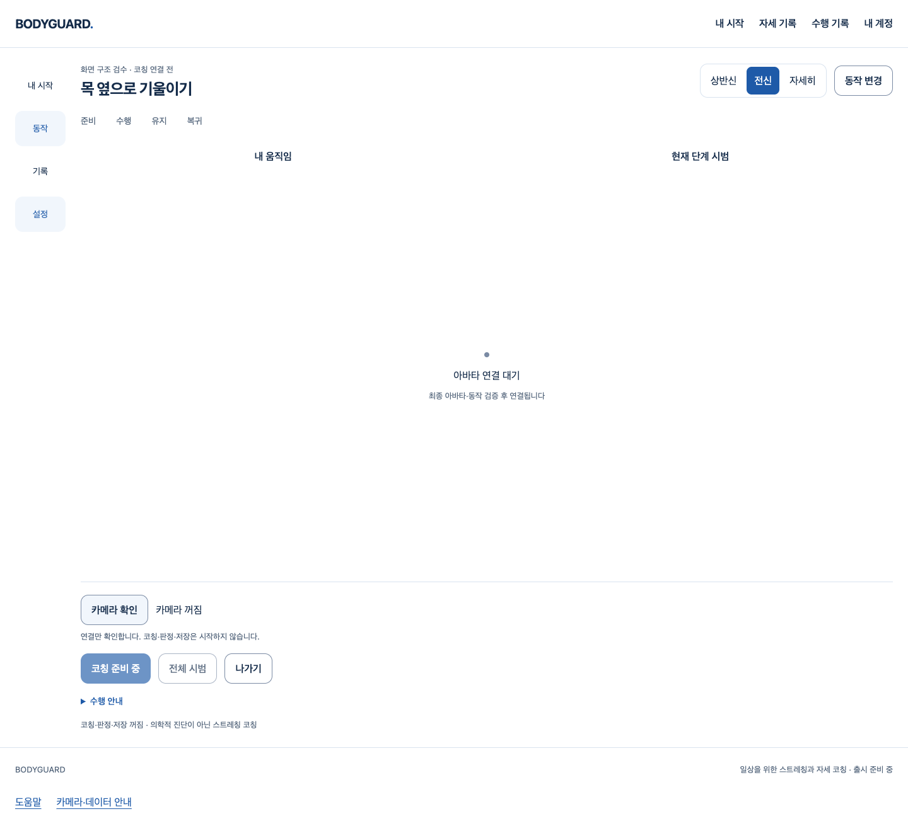

# 카메라 준비 취소 — 실제 웹 흐름

2026-10-11 · 기준 main `be1ec620965edae9a4ccd4b0ae02fc96061279f2` · [Story](../../stories/camera-playback-cancellation.md)

**작동한 흐름:** 카메라 확인→재생 준비 대기→준비 취소→카메라 꺼짐→명시 재시도→SDK 첫 입력 확인→끄기. 미완료 재생의 늦은 완료가 새 카메라를 끄거나 SDK를 부활시키지 않는다. 화면 나가기/재진입도 오래된 재생 완료를 기다리지 않는다. 정리 실패 시 재시작을 차단한다.

실제 React/AuthProvider/Vite/Chrome과 **native 가짜 카메라·실제 heavy body/face/hands SDK**를 썼다. 계정 응답, 끝나지 않는 재생 promise, 종료 후 예외는 제어한 시험 입력이다. 물리 카메라나 실제 사람에게 이 결함이 발생했다고 주장하지 않는다. 공개 코칭은 비활성이며 아바타·동작·판정·저장은 연결하지 않았다.

화면 구성/문구/CSS는 바꾸지 않았다. 중앙 공간은 아바타 보류로 비어 있으며 최종 외형 시안이 아니다. 스크린샷은 카메라 종료 후 촬영했고 영상/좌표/계정 원문을 담지 않는다.

## 실제 검증

| 범위 | 결과 |
| --- | --- |
| 첫 RED 카메라 하네스 | 취소가 미완료 play 종료를 기다림·첫 stop 예외가 다음 트랙/분리를 건너뜀, **2실패/0통과** |
| 수정 후 카메라·준비 연결 | 27통과, 늦은 재생 실패·다른 스트림 보존·권한 대기 소유·정리 실패 차단 포함 |
| 전체 frontend | 92파일·1701통과·실패/skip0 |
| 실제 취소 브라우저 | 최초/최종 각5통과; helper 문구 표현만 정리 후 최종 실행. 원본 helper/결과 모두 보존 |
| 기존 카메라·SDK 회귀 | 8통과; 거부/권한 취소/화면/계정 회수·문서/Worker CSP 원인 확인 포함 |
| TypeScript·범위 Biome | exit0. 문구 정리 직후 Biome format1실패는 수정 후 exit0, 테스트 실패로 환산하지 않음 |
| 실제 Vite production | 117module, exit0. prepare-assets/.env/새 아바타 제작 실행0 |
| production 제외·고지 | 기존 guard 프로그램의 자산 root만 소유 scratch로 대체해 통과, CSP/고지 존재. 이전 PR128의 공개 JS/CSS와 byte 동일 |
| 전후 소스 | 최종 브라우저/기존 회귀 전후 네 구현·하네스 파일 SHA 동일. [원문·수치·hash](verification.json) |

원본 JSON은 `.gz`로 보존했다. 압축 해제 원문 SHA와 byte 수는 verification.json의 records다. 처음 RED는 새 카메라 단위 시험 최초2개 시점이며 이후 추가 시험을 그때 실행한 것으로 세지 않는다. 첫 브라우저 helper는 `browser-helper-at-run.mjs.gz`, 최종 helper는 저장소의 scripts/test-camera-cancellation.mjs다. 실제 명령은 Story에 있다. 증거 수집기는 원문을 복사/압축했으며 시험을 재실행한 것이 아니다.

## 작성자 리뷰와 경계

- **P2 보완:** 획득한 스트림의 재생 대기만 abort로 거부하고, 취소 불가능한 getUserMedia 권한 promise는 소유 작업에 남겼다. 늦게 허용된 스트림은 붙이기 전에 종료한다.
- **P2 보완:** stop 실패 후 다른 트랙·본인 영상 분리도 시도한다. cleanup 실패는 고정 ResourceCleanupError이며 abort 이벤트에서 원문 예외를 던지지 않는다. 기존 준비/계정 retirement의 영구 차단으로 전달된다.
- 보안: 원본 영상/좌표 보존·직렬화·업로드0, 브라우저 저장0·외부 요청0·아바타 요청0. SDK/인증 정책은 불변이다.
- 성능/정확성: 새 타이머/timeout 확대0·정리 once·새 소유자 분리 방지·late rejection 소비. 원래 시작 지연P2 해결이나15fps/실사용 성능으로 확대하지 않는다.
- 유지보수: 공통 camera 함수만 제품 변경, 시험 fault는 별도 script/단위 시험뿐이다. 공개 JS/CSS·UI/API/DB/모델/임계값·기존 에셋과 실패 증거는 불변이다.

이번 범위의 미해결 P1/P2 없음. 독립 reviewer 검토는 실행하지 않았고 작성자 검토다. 필수 로컬 검증 이후에도 GitHub 최신 diff/충돌/HEAD/체크 게이트는 실제로 다시 확인한다. **전체1~6은 미완료**다. 실제 참여자/최종 아바타·동작·기존 시작P2·Docker/HTTPS·운영/출시의 미완료와 별도 승인 경계는 그대로 유지한다.
