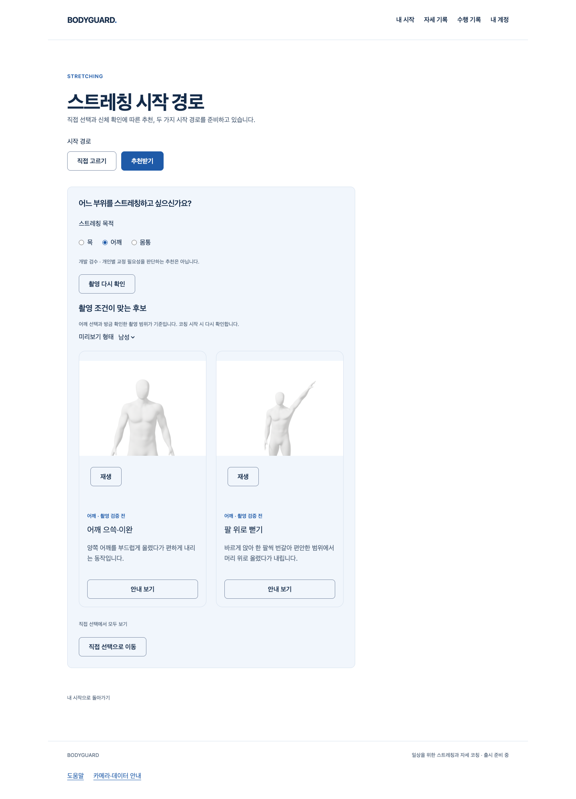
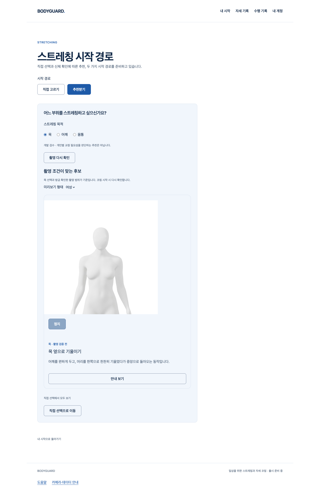

# 촬영 조건 확인 → 시각적 동작 후보 → 수행 안내

2026-10-17 · [S3.R1 명세](../../stories/camera-recommendation-flow.md) · 시작 main `5bf3cedefedd3df6cc527e9568b286d02607c943`.

## 실제 연결한 웹 흐름

기존 `/explore`의 추천 탭에서 부위 선택 → 명시 카메라/입력 확인 → 현재 촬영 범위 확인 → 카메라·Worker 정리 완료 → 남녀 Blender 미리보기 후보 → 기존 수행 안내로 이동한다. 목 후보1종, 어깨 후보2종이며, 몸통은 자동 후보 없이 직접 선택 안내를 제공한다. 새 메뉴·전체 UI 개편 없이 기존 화이트/블루·둥근 버튼/카드·미리보기 재생을 재사용했다. 결과 초점과 `촬영 다시 확인`도 연결했으며 다시 확인만으로 카메라를 자동 시작하지 않는다.

**개발 웹에서 작동하는 촬영 조건 필터이며, 개인별 신체 교정 필요성을 판단하는 완성된 추천이 아니다.** 선택한 부위와 확인된 관절 범위만 이유로 사용한다. 임상 점수/순위·기본 각도/운동량·자동 코칭/기록/기준선 저장은 추가하지 않았다. 다음 코칭의 새 촬영 검사는 면제하지 않는다. 기존 공개 적격0과 후보/아바타 검증 경계는 유지한다.

## 검증 범위

| 실행 | 실제 확인한 내용 | 대체·미실행 구분 |
|---|---|---|
| `test-camera-recommendation.mjs … generated-e generated` · 4흐름 | 실제 App/React·카메라 소유 controller·후보 정책·Blender PNG/MP4·hover/명시 여성 재생·안내 이동/복귀·초점 | 카메라/Worker/관절 입력과 계정 HTTP만 생성/모의. 실제 카메라·임상 추천 정확도 아님. |
| 생성 흐름의 예외 | 상반신만 보일 때 어깨 후보 차단, 다인/만료 후 이전 양성 폐기·새 전신 입력 회복, 숨김/목적 교체·늦은 권한 회수·401 이탈 | 영상/좌표 저장·계정/기준선/기록 HTTP 쓰기·외부 요청0. 브라우저 저장0. |
| `… native-d native` · 1흐름 | 실제 Chrome 가짜 장치·SDK/Worker·로컬 모델/WASM 요청, 빈 입력 후보0·명시 종료 track ended | 모듈 교체0, 계정은 모의. 실제 사람의 양성 인식·정확도·물리 카메라 시험 아님. |
| 순수/DOM `unit-e` | 4파일25검사: coverage·존재 신뢰도/가림·시각/세대·getter 재진입·만료·정리 대기/실패·계정/목적/숨김·명시 재확인 | DOM capture와 재생은 모의. 단위 결과를 실제 SDK/영상 증거로 세지 않음. |
| 전체 회귀 `full-suite-c` | 123파일2050검사 통과, `--maxWorkers=2` | 기존 전체 회귀. 이후 테스트 파일의 Biome 줄바꿈만 적용하고 해당12검사 재실행 통과. |
| 원래 `pnpm build` → guard · `build-c/production-guard-c` | 타입/고지/Vite·개발 목록/후보/SDK 경로의 공개 JS 제외 통과 | test config로 공개 빌드를 대체하지 않음. |
| `pnpm check` · `check-c` | 오류0·기존 info16 | 기존 무관 파일은 포맷 변경하지 않음. `git diff --check`도 확인. |

실행 전후18개 핵심 소스 SHA를 각 browser JSON에 기록했다. **최종 런타임 증거는 generated-e/native-d**이며, 이전 a/b/c/d의 코드·배치 차이는 보존하되 최종 소스와 동일하다고 주장하지 않는다. 최종 소스 압축·로그/JSON/시안의 SHA는 `evidence-manifest.json`에 있다. 도구 원문 로그의 공백 때문에 첫 staged diff 검사가 실패해 로그를 수정하지 않고 gzip으로 보존했다. 원문/압축 SHA와 원래 scratch도 유지한다. 시험 서버·Chrome은 소유한 자원만 정리했다. 실제 API/SQL·메일/OAuth·Docker/HTTPS·사람/물리 웹캠 검증은 이 Story에서 실행하지 않았다.

## 실패·리뷰 보완 보존

1. `type-a`: `await stop()` 전후 getter 상태를 같은 것으로 좁힌 타입 오류. 종료 뒤 현재 owner 상태를 다시 읽도록 보완했고 원래 타입/build가 통과했다.
2. 최초 DOM 작성 중 effect 의존성·runner 작성 중 try/finally 구문 오류는 터미널에서 발견해 수정했다. 별도 원문 로그 파일로 보존됐다고 주장하지 않는다. 저장된 `script-check-a`부터는 검사 통과다.
3. `production-guard-a`: 정적 import의 동작 목록 초기화가 공개 JS에 남아 실패했다. 기존 DEV-only lazy import/Suspense 패턴으로 경계를 수정했다. **guard 기대를 완화하지 않았다.** 실패 JS·Explore 원본 gzip/지문을 보존했으며 b/c 공개 검사는 통과했다.
4. `generated-c`: sandbox의 loopback listen EPERM으로 브라우저 시작 전에 실패했다. 같은 범위의 소유 로컬 시험 실행 권한으로 d/e를 실행했으며 c는 실행된 흐름0으로 보존한다. sandbox에서 GitHub 연결 확인도 실패했으나 실제 네트워크 허용 읽기 전용 확인에서는 기존 keyring 연결이 정상이다. 새 로그인/토큰 교체는 하지 않았다.
5. 작성자 리뷰 P2: 입력 복사에서 제공된 `presence`가 누락돼 존재 신뢰도0인 관절도 후보를 만들었다. `presence-red-a`에서 실제 실패를 재현하고 복사 필드를 보존했다. 같은12검사/DOM/전체 회귀와 최종 browser를 재실행했다. 실패 소스 gzip/로그를 보존하며 기존 신뢰도 임계값은 바꾸지 않았다.
6. `check-b`: 새 parameterized test의 줄바꿈 포맷 오류1. 해당 테스트만 Biome 포맷, `check-c` 오류0 및 해당 테스트12검사 통과. 앞선 `unit-a`의 stale 라벨은 순서 거부만 시험했고, b 이후에는 실제1000ms 만료를 시험하도록 바로잡았다.

실제 diff를 소유권/세대·신선도/관절 신뢰도·정리 실패/늦은 응답·초점/다시 확인·요약만 전달·공개 격리 관점에서 작성자가 검토했다. 위 두 P2를 보완했으며 이 좁은 변경에서 미해결 P1/P2를 발견하지 않았다. 독립 전문가 리뷰/실측 승인은 아니다.

## 남는 완료 기준

개인별 신체 분석→근거 있는 맞춤 추천, 동작별 검증된 실행 프로필/판정·교정 시범·결과 통합, 최종 아바타 외형/성능·실측 및 기존 Draft150/152/SDK P2는 남는다. 이 필터를 전체 추천/1~4/1~6단계 완료로 세지 않는다. 공개 후보/코칭 승격·원본/GLB/리깅 변경·임상/개인정보 정책·운영 DB/시크릿/비용/배포/출시 변경0. 다음은 근거/실행 프로필과 남은 동작 코칭 연결이며 기존 전체 완료 기준·보존·별도 승인 규칙을 유지한다.
