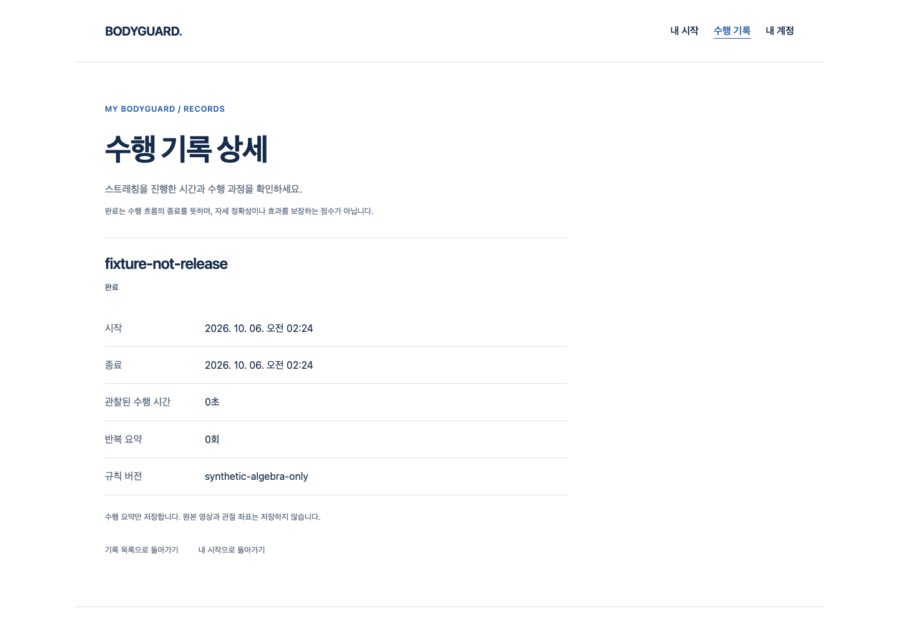
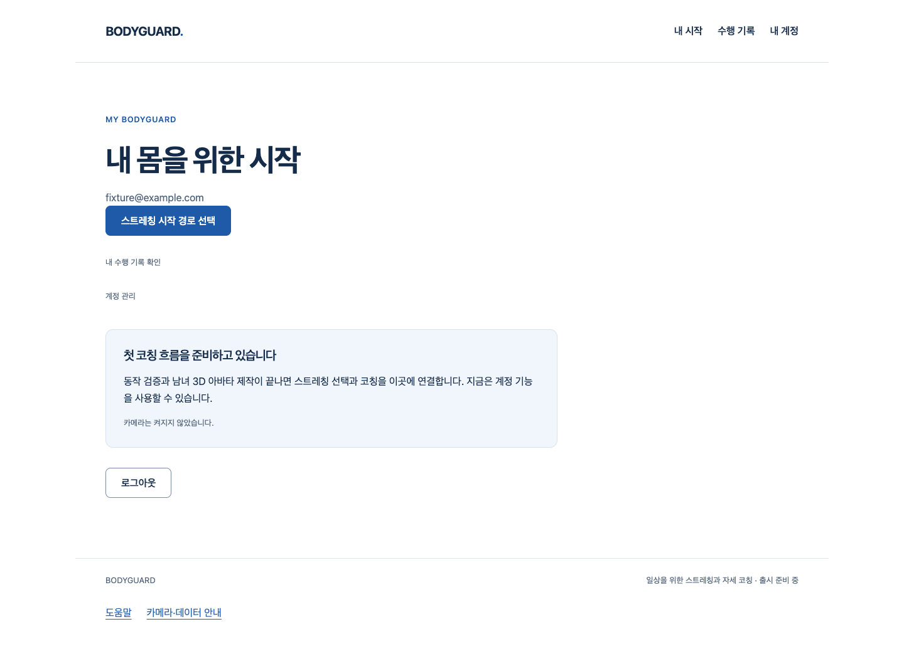

# 로그인·페이지 수명과 수행 기록 연결

S4.11의 private React hook이다. 실제 AuthProvider의 committed ready 객체에서만 명시적으로 준비하고, 기존 계정 캡처·수행 엔진·기록 API를 연결한다. 공개 코칭 producer는0이며 아바타나 실제 자세 판정의 완성을 뜻하지 않는다.

## 실제 작동 흐름

로그인 확인 → 명시 prepare → inert session → caller start → 수행/종료 → 명시 save → 본인 기록 상세. 같은 계정의 새 로그인 확인도 이전 권위가 아니므로 자원·저장 권한을 폐기한다. 로그아웃 실패/준비 중 계정 변경/unmount/페이지 이탈 역시 이전 준비·결과를 살려내지 않는다. 페이지로 돌아오기만 해서는 재시작하지 않는다.

실제 Chrome·기존 AuthProvider·HTTP API·격리 PostgreSQL을 사용했다. 수행 clock·ports·자세 프레임·메일은 **합성**이다. 실제 카메라/SDK·classifier·두 아바타·사람의 정확도·실제 OS 권한 팝업 취소 시험은 아니다. pagehide/pageshow는 브라우저에서 dispatch한 시험 이벤트다. 화면의 fixture-not-release/synthetic-algebra-only는 출시 동작이 아니다.

## 실패 원본과 수정

- 구현 전 missing module collection 실패는 상세 기능을 실행한 결과가 아니다. 초기15개 unit green 이후 작성자 리뷰17개 중2개 red로 이전 준비 실패가 새 preparing 상태를 덮는 경합과 중복 cancel의 cleanup 대기 누락을 재현했다. 현재 operation 일치 확인/상태 게시 시점과 소유 cleanup Promise 연결로 보완했다.
- 추가 pending pagehide 시험은19개 중1개 red였다. context 캡처가 끝나기 전에 페이지 이탈을 놓치는 문제가 있어 listener 소유를 **첫 await 이전**으로 이동했다. pending permission을 cancel 앞에 직렬화하지 않고 늦게 얻은 자원은 폐기한다.
- 초기 정적 검사에서 안정적인 ref의 불필요한 hook dependency를 발견해 수동으로 제거했다. 추가 시험 타입의 generic mock 불일치와 nullable 변수의 control-flow type 오류는 실제 타입 검사 실패로 보존하고 명시 type으로 보완했다. 검사 규칙/타입 강제 무시/패키지 버전 변경0이다.
- 첫 Chrome 실행4개는 private React library의 process.env.NODE_ENV가 browser에서 정의되지 않아 모두 실패했다. 준비/코칭 기능의 성공 증거0이다. test-only library에 production React 환경을 명시하고 다시 검증했다. product entry나 window.process 우회는 만들지 않았다.
- 별도 실행의 같은 격리 DB 점유로 전체 API 회귀는31pass/260setup-error로 실패했다. advisory lock이 migration/reset을 거부했으며 락을 우회하거나 점유 프로세스를 종료하지 않았다. 새 mktemp 소유 시험 DB를 Unix socket/TCP 비활성으로 준비해 단독 재실행했다.
- 추가로 발견한 별도 browser-first 실행은3fail/1interrupted/성공0이다. start heading 대기 실패가 있었고 실행 주체·중단 원인은 확정하지 않는다. stdout/report/error context를 보존하며 성공 증거나 제품 원인 단정에 사용하지 않는다. 해당 실행 종료를 읽기 전용으로 확인한 뒤 최종 브라우저를 별도 재실행한다. 추가 full-unit red/정적 실패와 이미 실행 중인 DB를 다시 시작하려다 실패한 로그도 원본으로 보존한다.

## 리뷰·디자인·남은 조건

최종 재실행 전523개 중 기존 모의 화면2건에서 heading 대기가 실패했다(새 hook20개는 통과). 원인을 제품 버그 또는 CPU로 확정하지 않는다. 기존 화면/timeout/assertion을 변경하지 않고 동일 소스 전체523개를 재실행해 실패0을 확인했다. 실패 XML을 보존하며 전체 출시 안정성·실제 사용자 검증을 대체하지 않는다. 이후 old 격리 DB의 재점유로 final-browser는 setup 실패/Chrome 실행0이었다. 마지막 브라우저는 전체 API가 끝난 새 소유 DB에서 순차 재실행했다.

engineering:code-review의 소유권/취소/자원/오류 경계를 작성자가 검토했다. independent reviewer가 검토했다고 주장하지 않는다. 임의 ID/time/clinical 기본값·로그/좌표/영상 저장·자동 POST/재시작·새 auth API·운영 schema/CSP 변경은 없다. 이미 서버가 수락한 기록은 로컬 abort로 rollback되지 않는다.

지정 web-design-studio의 기존 토큰·컴포넌트 우선과 실제 화면 확인 원칙을 적용한다. 현재 웹의 화이트·블루 디자인을 유지했으며 이번 Story는 UI 디자인을 새로 만든 작업이 아니다. 의료 진단/치료 효능을 암시하는 문구·모바일/네이티브 앱·다크 모드·외부 Figma/axe 및 실행하지 않은 디자인 audit을 추가하거나 완료로 표시하지 않는다.

2단계 외형/실측/통합, SDK 개인정보 P2(Draft36), classifier·아바타 wiring·Q32 부가 기능·실제 참여자·라이선스/법무·Docker/TLS·백업 복구 정책·외부/운영·전체1~6 게이트는 여전히 미완료다. 같은 아바타 부위의 새 제작/검증 사이클0을 유지한다.

[Story](../../stories/coaching-auth-lifecycle.md) · [실제 원본/SHA 수집기](collect-proof.mjs)

## 최종 증거

최종 전체 frontend523/실패0(추가20), 실제 API/SQL291/실패0(300.70초, asyncio deprecation 경고1), 실제 Chrome4/실패0(29.6초), 공개7+합성 RAF1/실패0(48.5초), 타입/정적/build·production guard 음성exit1/양성exit0을 실행했다. 공개 JS/CSS의 실제 byte SHA는 직전 PR40과 동일하다. source8/artifact46 SHA 검증과 수집기 byte-identical 재실행을 확인했다. 최초 및 중간 실패를 삭제하거나 성공으로 바꿔 쓰지 않았다. PR 조건부 게이트는 아직 진행 중이다.

