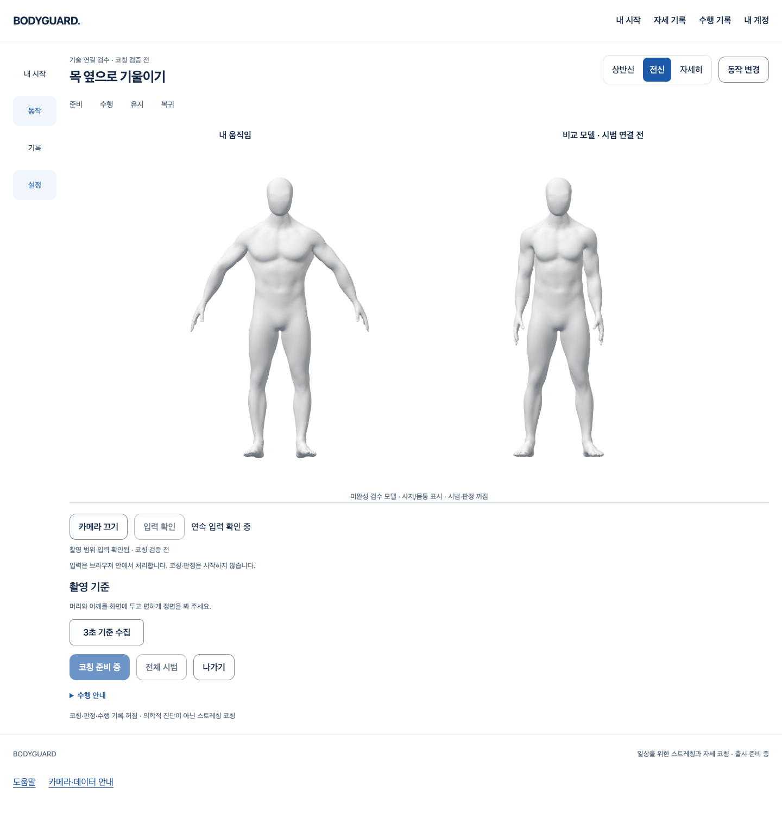

# 기존 코칭 화면에 두 모델 연결

2026-10-16 · [Story](../../stories/coaching-avatar-workspace.md) · **Draft/미완료: SDK 준비·정리 불안정 P2 유지, 병합 금지**

2026-10-16 후속: [명시 정렬을 통한 머리·손 표시 연결](details-20261016/README.md)을 추가했다. 아래는 최초 사지/몸통 연결 시점 기록이다. 후속 실제 Chrome에서도 오른쪽은 올바른 시범이 아닌 고정 비교 모델이며, 원래 SDK P2와 전체 단계의 미완료는 유지한다.

기존 로그인 전용 /dev/coaching에서 카메라 확인→입력 확인→두 모델 표시를 연결했다. 한 번의 추론에서 복사한 같은 프레임을 기존 촬영 범위/기준 수집과 왼쪽 사지·몸통 모델에 전달한다. 오른쪽은 **시범 미연결 비교 모델**이다. 자동 정답/교정·오류 색·타이머·수행 기록을 켜지 않았다.

## 실제 화면과 작동

[800px 전신](proof/workspace/review-browser-female-full-800.png), [상반신](proof/workspace/review-browser-view-0.png), [자세히](proof/workspace/review-browser-view-1.png), [변조 거부](proof/workspace/review-browser-integrity-error.png). AI 시안이나 최종 외형이 아니라 실제 React/Chrome/WebGL을 캡처했다. 남녀 모델은 PR150의 미채택 후보이며 머리/손의 세밀한 관찰·올바른 운동/전문가 승인 증거가 아니다.

최종 [화면 검증](proof/workspace/review-browser.json)의9흐름에서 왼쪽 합성 팔 변화/오른쪽 픽셀 불변·전신/상반신/상세·남녀·800px·명시 중지·변조 SHA 거부·실제 WebGL context loss→복원 후 명시 재시작·계정401 후 제거를 확인했다. 실제 SDK/사람 대신 합성 관찰과 제어 계정 API를 사용했다. 물리 카메라/페이지 외부 요청/pageerror0이다. 모델 준비 전에는 신체 입력을 기다리며 GLB를 요청하지 않고, 정답/시범 버튼은 계속 꺼져 있다.

전신은 두 모델의 공통 공간/카메라로 뻗은 팔이 보이지 않는 중앙 경계에서 잘리지 않게 했다. 상반신·상세만 좌우 근접 viewport를 쓴다. 기존 흰색/블루·둥근 컨트롤·메뉴를 유지하며 세 구도는 표시만 바꾼다. 촬영 범위나 판정 기준의 변경이 아니다.

## 소유권·모델·공개 경계

- 프레임의 원래 generation/sequence/시각을 전달한다. 첫 준비 중 원시 프레임을 큐로 보관하지 않고 이후 새 입력을 받는다. 영상/좌표를 React state·로그·API/저장소에 추가하지 않는다.
- 중지/숨김/페이지·계정/동작/성별 변경 시 abort/폐기하고, 늦은 모델·shader 준비와 카메라/Worker 정리가 끝난 뒤 새 시작을 허용한다. 실패 뒤 자동 카메라 재시작0. 확인하지 못한 관절을 성공으로 판정하거나 회색 표시하지 않는다.
- 남성8c3d34b9/여성a9bca83c GLB를 불변2be0ebe Git object에서 읽는다. 전문 Blender 원본·모든 여덟 가중치/뼈·과거 후보/실패를 바꾸지 않았다. 서버와 client에서 SHA256을 각각 확인하며 클라이언트 파싱 이전 변조를 거부한다.
- Vite 개발 서버의 고정 GET/HEAD 두 경로뿐이다. 요청값을 shell/파일 경로에 넣지 않고 Git 읽기만 한다. public/제품 폴더에 GLB를 복사하지 않는다. 이력이 없는 shallow clone은503/오류로 남으며 임의 에셋으로 대체하지 않는다. 로컬 검수에는 PR150의 고정 commit을 읽을 수 있는 Git 이력이 필요하다.
- 원래 production guard에 새 private 문자열과 GLB 출력0 검사를 추가했다. 실제 assets/build/guard에서 공개 JS에 코칭/검수 코드가 없고 GLB가 없음을 확인했다. 공개 CSS byte 동일이나 전체 운영/라이선스 완료로 확대하지 않는다.

## 실제 검증과 실패 기록

- 최종 전체 frontend1941/109파일, 타입·scoped Biome0진단/전체 기존16 info·오류0, 원래 assets/build·강화된 production guard·diff를 통과했다. 새 viewer unit4/DOM5는 renderer/loader/취소/표시 연결의 합성 시험이다. 모든 검증을 실제 사람 정확도 시험으로 세지 않는다.
- 기존 [카메라 기준](proof/reference/browser.json)7흐름은 실제 React와 합성 입력/API의 명시3초 수집·동의·scalar 저장/같은ID 재시도·이력200·취소·권한403을 통과했다. 실제 SQL/메일/OAuth가 아니다.
- [최종 native SDK](proof/native/workspace-native-recorded.json)8흐름은 실제 Chrome의 가짜 장치와 실제 heavy/face/hands Worker·CSP·명시 취소·라우트/401·키보드/800px을 통과했다. 마지막 문서의 init→ready→result→close→closed/clean=true 기술 메타데이터만 보존했다. 실제 참여자·권한 팝업·합성 양성을 SDK 사람 추론으로 검증한 것은 아니다.
- [기존 취소 회귀](proof/cancellation/workspace-cancellation.json)5흐름도 실제 SDK/가짜 장치와 인위적인 playback/stop 실패를 구분해 통과했다. native/취소 시험은 입력 확인을 통한 실제 SDK 양성→모델 움직임 통합을 입증하지 않는다. 실제 SDK 양성 통합은 여전히 필수 미완료다.
- 최초 전체 회귀는 기존 기준 화면이 lazy-loading 상태에 머물러1940통과/1실패였다. 새3D 모듈의 eager 의존을 실제 첫 신체 입력 뒤의 dynamic import로 분리했다. 제한 시간을 올리지 않았으며 같은 관련23 및 전체1941 재검증을 통과했다. 과거 전체 앱의 시작 P2를 해결했다는 뜻은 아니다.
- 최초800px 미리보기에서는 뻗은 팔이 중앙 scissor에 잘렸다. 원래 PNG/원문을 보존하고 전신 공통 카메라로 재렌더했다. 최종 이미지의 발끝/팔을 직접 확인했다. 상반신/상세의 명시적인 crop과 혼동하지 않는다.
- SDK working-source 최초 실행은 준비 중 cleanup/16초 실패, 다음 독립 실행은 stop 대기30초 실패였다. [첫 실패](proof/native/workspace-native.json), [다음 실패](proof/native/workspace-native-isolated.json)를 그대로 남긴다. 불변 main의 CameraPreparation만 대입한 비교는8흐름 통과했고, 이후 새 소스 재실행들도8흐름 통과했다. **원인 미확정이며 실패를 재실행 성공으로 지우지 않는다.** 마지막 native 실행은 전체 unit 회귀와 겹쳤음을 기록하며, 이를 냉시작/장시간/다장치 검증으로 대신하지 않는다.
- 초기 Worker trace 저장은 context 종료 이후 수집해 빈 목록이었다. 그 과거 JSON을 고치지 않고, 종료 전 실제 closed/clean 응답을 검증하도록 도구를 보완했다. 최종 recorded.json만 실제 protocol trace 증거다.
- 초기 nullable/포맷/반환 값·hook dependency 오류도 보완했다. 일부 최초 compiler/lint 원문은 tool 실행 기록에만 있으며 별도 파일 증거라고 주장하지 않는다. 모든 보관 로그는 내용을 자르지 않고 gzip 압축했다.

## 재현·다음 작업

기존 로컬 API 로그인과 pnpm dev의 localhost에서 /dev/coaching?motion=neck-side를 연다. 카메라/입력 확인 이후에만 관찰·모델을 시작하며 지금은 코칭/시범 검증판이 아니다. 모델 P2가 남았으므로 최종 제품으로 공개하지 않는다.

자동 화면 검수는 새 /private/tmp/bodyguard-workspace-avatar.<id>에 scripts/test-workspace-avatar.mjs <scratch> <새 label>을 실행한다. 가짜 장치 SDK는 test-camera-preparation.mjs의 camera-preparation 임시 경로/Chrome 절대 경로/새label로, 마지막 비교 전용 인수 baseline-main-camera는 불변8675f72의 해당 React 부품만 대입한다. 비교 성공을 현재 구현 검증으로 섞지 않는다. 기준/취소는 각각 기존 전용 script/임시 경로를 사용한다.

proof에는 성공/실패 JSON·실제 PNG·실행 로그가 있고 manifest는 최종 소스/원문 SHA를 기록한다. 작성자 code-review는 고정 Git/해시·동일 slot·세대/늦은 반환·renderer/Worker 회수·조건부 공개와 실제/합성 주장 범위를 검토했다. **SDK 초기/정리 불안정 P2를 해결하기 전에는 이 Story를 병합/완료 처리하지 않는다.** 독립 외부 전문가 리뷰가 아니다.

다음은 SDK의 body/face/hands 초기화·정리 경로를 같은 기능·시간/안전 기준에서 분리 진단하고 이 화면을 재검증하는 것이다. 작업을 통과시키려고 SDK 기능·관절 가중치·검증 기준을 낮추지 않는다. 최종 아바타 외형·세밀한 머리/손·실제 시범/코칭·추천·외부 공급자/Docker/HTTPS·실제 사람 검증과 전체1~6은 아직 미완료다. 비용·계정·시크릿·운영 DB·배포/출시0.
