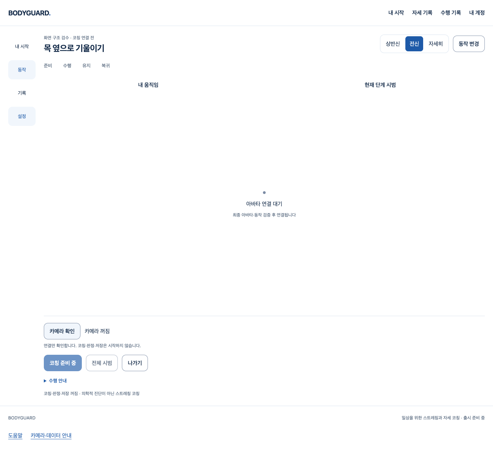
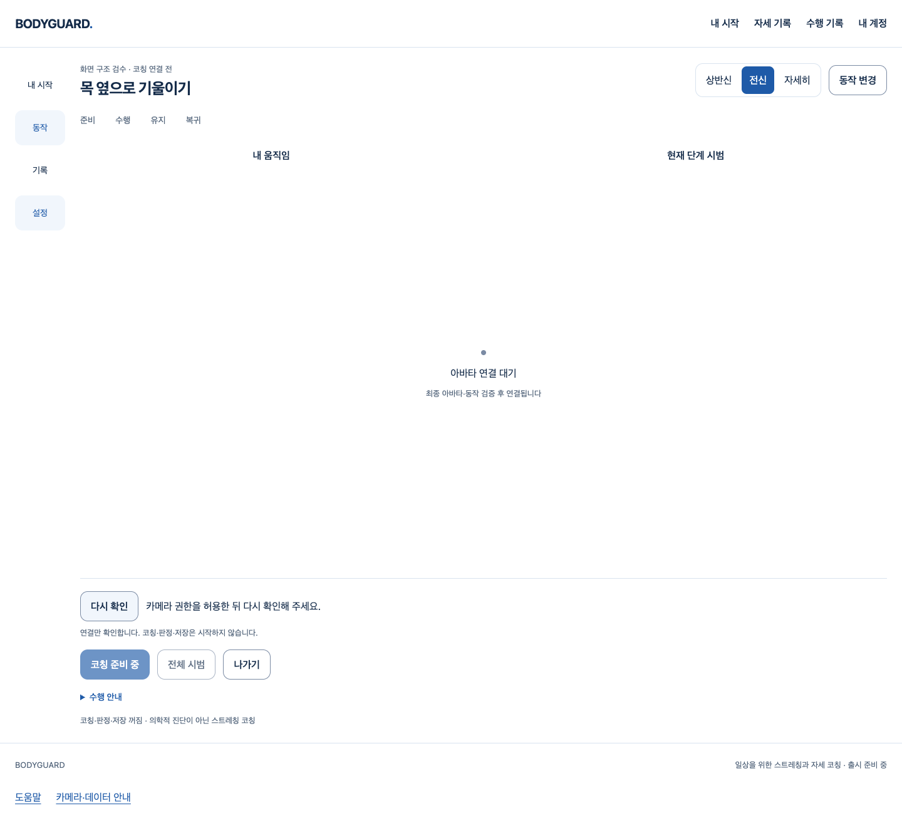
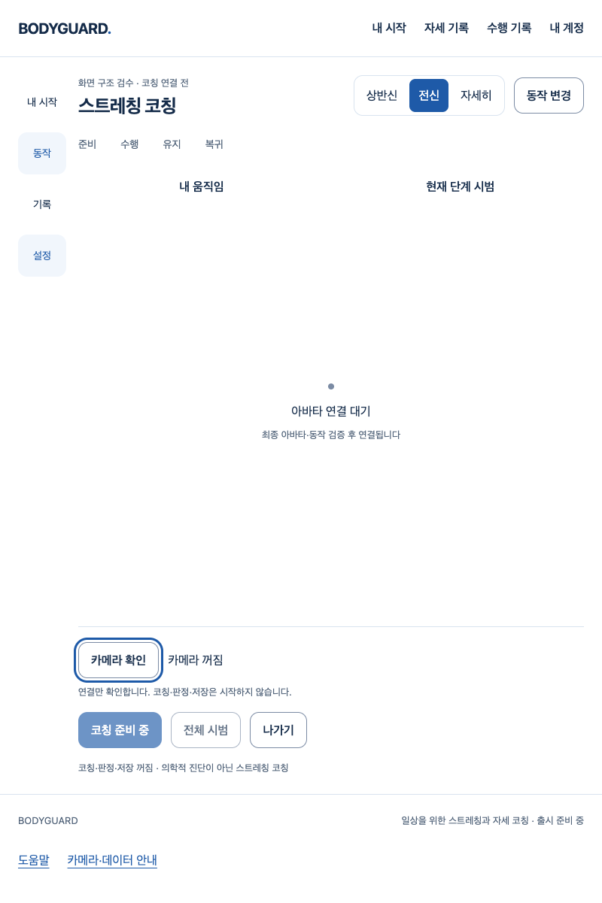

# 카메라 준비 — 실제 연결 흐름과 완료 경계

2026-10-11 · S3.C1 · 기반 main `fd331d2204dd425e962095c823aac3ca9681f733`

## 실제 작동한 것

승인된 비공개 코칭 화면의 **카메라 확인 → 몸/얼굴/손 SDK 준비 → 첫 입력 처리·즉시 폐기 → 카메라 끄기**를 연결했다. 준비 취소·거부 후 명시 재시도, 화면 이탈/재진입·계정 회수에서 카메라와 Worker를 정리한다. 이전 권한 응답/SDK 정리가 끝나기 전에 새 계정/새 화면이 연결을 시작하지 않으며 정리 실패는 재시작을 막는다.

실제 Chrome·React/AuthProvider·Vite·SDK와 브라우저 가짜 장치를 사용했다. 계정 API, 권한 거부·늦은 응답·401은 명시 제어다. [브라우저 실행 결과](browser.json)는 모델 heavy의 몸/얼굴/손 첫 추론, 종료, SPA 재진입 경합과 문서/실제 SDK Worker의 외부 fetch가 native `connect-src` 위반으로 차단됨을 확인했다. 요청0은 이 browser context의 관찰이지 Chrome 전체 프로세스의 모든 background 시도를 감사한 결과가 아니다.

첫 화면에서는 카메라/Worker/DOM video·canvas0이며 영상은 off-DOM video와 브라우저 메모리에서만 다룬다. 결과·좌표·점수·운동 성공·기록을 저장/전송/표시하지 않는다. 연결 확인은 바른 자세·신체 관찰 가능성·코칭 성공 판정이 아니다.

## 실제 화면

종료/거부 상태만 촬영했다. 원시 영상·관절 좌표·새 GLB·미완성 아바타를 촬영하거나 제작/변형 검증하지 않았다.

web-design-studio/frontend-design/UI UX Pro Max를 적용해 기존 백색/블루·12px 버튼·16px 상태·짧은 복구 문구를 재사용했다. 별도 카드/장식/애니메이션을 추가하지 않았다. 마지막 비평은 시각 위계·간격·색·글자·동작·상태·품질 스킬로 실제 PNG와 CSS를 대조했다. 아바타가 비어 있는 큰 공간은 최종 외형이나 완성 화면이 아니라 보류 상태다. 작은 창 가로 넘침0·컨트롤44px 이상·실제 Tab/Shift+Tab의 3px 초점선을 확인했다. 모바일 브라우저/실제 200% 확대·전체 접근성 감사/다크 모드 시험이 아니다.

## 발견·보완과 실패 보존

1. 실제 개발 classic Worker가 raw ESM을 받아 `SyntaxError`로 SDK 준비 전에 종료했다. [원래 실패](dev-worker-red.json). 개발 전용 middleware가 같은 Worker entry를 메모리 IIFE로 컴파일하고 CSP/no-store와 함께 제공하도록 보완했다. SDK 비공개 속성·모델·추론/정리5초 한계·production의 CSP 상속 Worker는 변경하지 않았다. [보완 후 실제 SDK/합성 빈 입력3개/종료](dev-worker-green.json). 이 lite 합성 시험의 시간은 실제 사람 정확도·노트북 성능 보장의 근거가 아니다.
2. 계정 ready 교체·라우트 재진입과 정리 실패 우회는 보완 전 DOM 회귀3개가 실패했다. 문서 내 retirement barrier·고정 계정 ID·late 응답 폐기로 보완했다. native 가짜 스트림을 인위적으로 지연시킨 실제 SPA 재진입도 통과했다. 같은 객체 ID 변경과 정리 실패는 합성 단위 시험이다.
3. decoded 입력 대기와 취소 시 callback 정리 예외는 보완 전 합성 시험2개가 실패했다. 기존 무제한 대기를 기술적5초로 한정하고 abort/timer/callback 정리를 처리했다. 이는 임상 유지 시간이나 기존 시작 시험 timeout 확대가 아니다.
4. 첫 전체 회귀는 오래된 raw Worker URL 픽스처 때문에 1689통과/1실패였다. 실제 보완된 고정 동일 출처 경로로 계약을 갱신했다. 이후1691, 계정 ID 회귀 추가 후1692가 통과했다.
5. 강화된 프록시의 bypass 순서 오류로 브라우저 시작 전에 실패한 [하네스 결과](browser-proxy-red.json)를 보존했다. `<-loopback>` 뒤에 정확한 앱 host:port만 허용하는 순서로 바로잡았다. 제품/CSP/SDK 한계를 완화하지 않았다.
6. 병렬 브라우저/전체 회귀 실행에서 DOM 단위 시험1개가 lazy 코칭 모듈 로드 중 실패했다(1691통과/1실패). 화면 조작 단위 시험은 모듈 import를 beforeAll에서 완료한 뒤 같은 계정/화면 조건을 검증하도록 정리했다. timeout은 늘리지 않았고 실제 cold Vite/SDK 실행은 별도 브라우저 하네스로 유지했다. 제품 로딩 속도를 해결했다고 하지 않는다.

큰 단위 JSON/실패 stdout 및 각 실행의 이전 PNG는 원래 private scratch와 대화 도구 출력에 보존한다. stdout만 받은 재현에 별도 원본 파일이 있다고 주장하지 않는다. [검증 요약과 실패 위치](verification.json)의 hash는 실행된 출력에 대한 식별자이며 테스트 내용을 대체하지 않는다.

## 필수 검증과 리뷰

전체 frontend1692/90파일·타입·범위 Biome·원래 production build/고지와 private exclusion을 통과했다. prepare-assets hook/.env/CI/기존 DB migration/운영을 실행·변경하지 않았다. production exclusion은 원래 검사 프로그램의 asset root만 소유 scratch 출력으로 치환해 실행했고 개발 카메라/코칭 문자열0이다. [소스 hash](source-hashes.json).

작성자 리뷰에서 준비 소유권·중복 획득/취소/late 응답·정리 실패·동일 출처 정책·DEV/production 경계·원시 입력 폐기·고정 오류/키보드를 검토하고 위 보완을 재검증했다. 이 목적의 미해결P1/P2 없음. 독립 리뷰 실행0이며 전문가/임상 검토가 아니다. PR의 체크 없음/충돌 여부/최신 diff·HEAD와 실제 병합 결과는 병합 게이트에서 별도 확인한다.

## 아직 완료가 아닌 것

아바타 보류·출시 적격 동작0·실제 참여자/관찰자·올바른 시범·판정 정확도·기존 시작P2·추천/결과 연결·최종 권리/법무/부가 기능·외부 공급자·운영/HTTPS와 전체1~6은 미완료다. Docker는 CEO가 나중에 연결하기로 했다. 실제 사람·물리 권한 팝업 거부·SQL/메일/Google·컨테이너·배포·출시·전문가 시험을 실행하지 않았다. 이 작은 준비 기능의 완료를 출시 후보판으로 표시하지 않는다.
