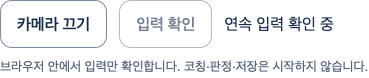

# 연속 입력 — 실제 웹 흐름

2026-10-11 · 기준 main `b5791b2b1c3b6639d2d3e028b5b2659bda99acc7` · [Story](../../stories/coaching-continuous-input.md)

**작동한 흐름:** 카메라 확인→첫 입력 처리·폐기→별도 `입력 확인`→같은 카메라와 Worker에서 새 decoded 입력을 순차 처리→카메라 끄기→명시 재시작. 입력 중 화면 나가기·숨김·pagehide·계정 회수 시 종료한다. 연결 대기 중에도 끌 수 있다. 최신 복사 관찰값은 메모리 슬롯1개에서 한 번만 가져가며 오래된 값을 새 시각으로 바꾸지 않는다.

실제 React/AuthProvider/Vite/Chrome과 **native 가짜 카메라·실제 heavy body/face/hands SDK**다. 계정 응답·held decoded callback·401·숨김/pagehide 이벤트는 시험에서 제어했다. 이 PNG는 DOM 조작 영역만 담으며 DOM video/canvas0을 확인했다. 원본 영상·관절 좌표를 캡처하지 않았다. [1440px 종료 화면](stopped-1440.png), [800px 종료 화면](stopped-800.png)의 중앙 공간은 아바타 보류로 비어 있으며 최종 외형이 아니다.

## 실제 검증과 실패 보존

| 범위 | 결과 |
| --- | --- |
| 처음 RED | 구현 전 observe 없음, 1실패/0통과 |
| 소유권·deadline·DOM | 최초21, 소유권26, deadline+DOM9 통과; 전체 실행에도 포함 |
| 전체 frontend | 최초1709통과/1실패: 기존 MeasureDemoPage의101회 DOM 조작 시험5000ms timeout. 같은 파일 단독7통과. 제한 확대/skip 없이 maxWorkers2 전체94파일·1710통과·실패/skip0 |
| 연속 입력 브라우저 | 최초5통과, 로컬 권한 실행5통과, 최종 숨김/pagehide 포함7통과. 최종 소스 전후 SHA 동일 |
| 브라우저 환경 실패 | sandbox 실행 setup0통과/1실패 보존. 별도 loopback listen 진단 EPERM. 승인된 로컬 시험의 권한 실행으로 진행했고 실패 원문은 삭제하지 않음 |
| 기존 카메라/SDK/정책 | 8통과, native document/Worker connect-src 차단·권한/화면/계정 회수 |
| 준비 취소 회귀 | 동시 SDK 시험1통과 후 명시 재시도 TimeoutError. 같은 하네스·시간 제한의 단독 실행5통과. 동시 시험의 정확한 원인이나 원래 시작P2를 해결했다고 주장하지 않음 |
| TypeScript·범위 Biome·diff | exit0. 초기 helper noAssignInExpressions lint1실패 후 고침; 실제 시험 실패와 구분 |
| 실제 production build | 117module·exit0. .env/prepare-assets/아바타 제작0 |
| 공개 제외·CSP·고지 | 기존 guard에 새 연속 입력 marker 추가, 소유 scratch root만 바꿔 exit0. 공개 JS/CSS는 이전 PR129 build와 byte 동일 |

원본 JSON/helper는 gzip으로 보존했다. [verification.json](verification.json)에 압축 전 SHA/byte·소스 hash·공개 자산 byte 비교가 있다. [collect.mjs](collect.mjs)는 실행 결과를 복사/압축하며 검증을 대신 실행하지 않는다. 처음 RED에 나중에 추가한 시험을 소급해서 세지 않는다. 초기 helper snapshot SHA는 첫 browser 결과와 대조했다. 중간5회와 최종7회의 차이는 시험 추가이며 실제 SDK 동작/제품 판정 기준 변경이 아니다.

## 작성자 리뷰·디자인 영향

- 정확성: 준비 frame은 producer에 전달하지 않는다. 같은 generation/원래 sequence·시각·크기를 보존한다. 한 번에 source read1, 최신 슬롯1, consume-once다. null/중복 입력으로 기술 deadline을 연장하지 않고 시계상5000ms 이상을 타이머 callback 전에라도 거부한다. consumer의 더 엄격한 freshness/관찰 가능성/임상 기준을 대체하지 않는다.
- 보안·개인정보: 계정 identity/가시성 권한·문서 retirement 경계는 유지한다. 종료·권한 회수 때 슬롯을 폐기하고 늦은 입력/원문 예외는 UI에 전달하지 않는다. 브라우저 저장·API write·외부 요청·GLB 요청0. cleanup 불확실 시 영구 차단한다.
- 성능·유지보수: 기존 camera/Worker/source를 빌려 순차 입력한다. 새 SDK·타이머 확대·임계값·API/DB 정책 변경0. 5초는 기술적 응답 한계이지 운동 시간/15fps 보장이 아니다. fault는 시험뿐이다.
- web-design-studio의8개 최종 점검으로 실제 PNG/기존 토큰·상태를 검토했다. 판정 성공처럼 보이지 않는 짧은 현재 상태, 12px 둥근 secondary, 기존16px/1.25 글자 체계와 white/blue를 재사용했다. 800px에서 가로 넘침0·44px 조작·3px 키보드 focus, 감소 동작을 확인했다. 주요 공간은 두 역할의 무박스 배치를 유지한다. 아바타가 없는 중앙의 빈 공간은 **출시 디자인 완료가 아닌 보류 의존성**이다. 새 색/장식/자동 애니메이션·CSS 변경0. axe/Figma/실사용자 접근성 검증은 하지 않았다.

이번 범위의 미해결 P1/P2 없음. 독립 리뷰는 실행하지 않은 작성자 리뷰다. GitHub 최신 diff/HEAD/main/CLEAN/체크 게이트는 별도로 실제 확인한다. **전체1~6 미완료**이며 실제 사람·출시 동작0·최종 아바타·기존 시작P2·Docker/HTTPS·운영 검증은 닫지 않았다. 공개 코칭/판정/추천/결과 기록은 비활성이다.

기존 색 토큰의 WCAG 계산값: ink/white14.27, muted/white6.06, muted/soft5.58, focus/white6.81, control-line/white3.46이다. 본문4.5/조작선3 기준을 충족한다. 비활성 버튼의 opacity 상태는 제외했고 자동 axe 전체 감사로 세지 않는다.
