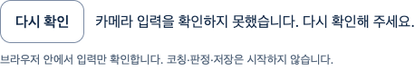
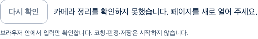

# 연속 입력 오류·명시 재시도 — 실제 웹 검증

2026-10-11 · 기준 main `bbc2b152d3bd236338b29b1829fafe230179c34a` · [Story](../../stories/coaching-input-recovery.md)

**확인한 흐름:** 입력 실행→입력 예외/Worker 오류/decoded 입력 정지→고정 오류·카메라/Worker 종료→사용자 명시 재시도→새 준비 입력1개 폐기→별도 입력 확인→실제 후속 SDK 입력→끄기. 새 카메라가 준비된 뒤 옛 callback을 풀어도 새 연결은 유지됐다. 트랙 stop의 제어 예외가 발생하면 나머지 소유자도 정리하고 재시도/화면 재진입을 차단한다.

실제 React/AuthProvider/Vite/Chrome·**native 가짜 카메라/실제 heavy body·face·hands SDK**다. 카메라·SDK의 실제 장치 고장을 관찰한 시험이 아니다. VideoFrame constructor/Worker error event/held callback/stop-after-native-end와 계정 응답은 test-only로 제어했다. PNG는 video/canvas0·모든 트랙/Worker 종료 후 **DOM 조작 영역만** 촬영했다. 최종 아바타/신체 영상/관절 좌표/계정 원문은 담지 않았다. 제품 UI/CSS·오류 문구·카메라/SDK 코드 변경0이다.

## 실제 결과와 실패

| 범위 | 결과·한계 |
| --- | --- |
| 기준선 browser | 4통과·실패0. 기존 코드에서 오류와 재시도가 작동했으며 RED/제품 보완으로 세지 않음 |
| 강화 browser | capture/Worker2통과 후 held 구간 TimeoutError1. 원본/그때의 helper·source 전후 hash 보존. 실패 위치가 세분화돼 있지 않아 정확한 대기 구간/원인을 소급 확정하지 않음 |
| 고정 상태 진단 추가 후 | diagnosis4통과, 같은 source/제한의 stability-check4통과. fault가 실제 주입됐는지 각각 횟수로 검증. 정상 재시험으로 원래 시작P2/간헐성 해결을 선언하지 않음 |
| 신규 unit | 4통과: 원문/최신 슬롯 폐기·자동 획득0·명시 generation2·새 owner/준비1·별도 관찰·정리 오류 차단 |
| 전체frontend | maxWorkers2, 95파일·1714통과·실패/skip0. timeout/판정 기준 확대0 |
| TypeScript/Biome/diff | exit0. 변경2파일 정적 검사. collector node syntax/hash/link 검사는 별도 수행 |
| 실제 production | 117module exit0, envDir scratch·.env/prepare-assets/새 아바타0. private guard/CSP/고지 존재·JSON 확인. JS/CSS는 PR130 build와 byte 동일 |

원문8개는 gzip으로 보존했다. [verification.json](verification.json)의 압축 전 byte/SHA·소스/공개 자산 hash와 [collect.mjs](collect.mjs)로 원본을 대조한다. collector는 시험을 재실행하지 않는다. 기준선/강화 시점의 각각 다른 helper를 보존했고 실제 보고서의 helper SHA와 확인했다. 정상 통과를 이전 실패의 보완/해결 증거로 대체하지 않았다.

## 작성자 리뷰·화면 검토

- 보안: fault는 별도 시험 script/단위 port뿐이다. 진단은 고정 UI 분류·숫자·트랙 상태만 저장하고 raw 예외/DOM·영상/좌표는 쓰지 않는다. API write·외부·GLB 요청·local/session 저장·pageerror0을 확인했다. product fault/우회/자동 재시도0이다.
- 정확성: 제어 fault 호출 횟수와 실제 정상 입력/종료를 대조했다. 새 카메라 준비 뒤 옛 callback을 풀어도 frame 증가0·새 트랙live를 확인한 뒤 별도 입력했다. cleanup 오류는 router remount로 우회하지 못한다. 조건이 없는 정확도/동작 성공을 추가하지 않았다.
- 성능·유지보수: 기존 source/Worker/기술 deadline5000ms·임계값·운영 정책·API/DB 불변. 하네스 자체 retry0, 서로 다른 시점 실행은 개별 원본으로 기록한다. SDK 결과/프레임을 보고서에 보관하지 않고 시험 자원을 종료한다.
- frontend-design 기준으로 실제 고정 오류·짧은 복구 동사와 disabled/회복 상태를 확인했다. 기존 white/blue·16px 본문/12px radius/44px secondary·감소 동작을 사용하며 새 장식·화면 구조/문구 변경0이다. 신규 PNG를 보고서에 확인했으며 이번에는 narrow/axe/Figma/참여자 접근성 시험을 재실행하지 않았다. 이전 PR130의800px·키보드 검증과 구분한다.

**이 시험 diff 범위** 미해결 P1/P2 없음, 독립 리뷰 미실행·작성자 리뷰다. 원래 시작P2와 강화 시험의 원인 미확정 timeout은 제품 안정성의 남은 조건이며 이번 Story로 닫지 않는다. 최신 diff/main/HEAD/CLEAN/체크·조건부 merge commit·브랜치 보존은 따로 확인한다. 실제 사람·출시 동작0·최종 아바타·Docker/HTTPS·운영과 **전체1~6은 미완료**다.
