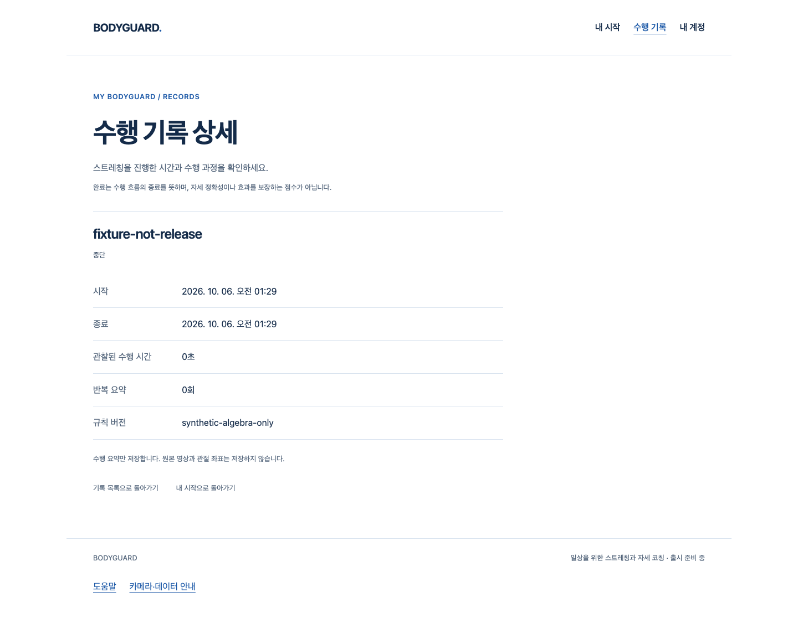
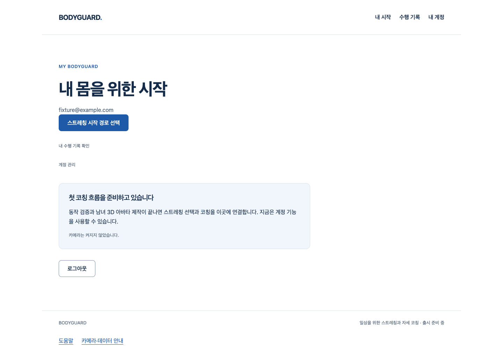

# 수행 시작 시각·본인 기록 연결 검증

S4.10의 private adapter다. 현재 공개 웹은 화이트·블루 계정/시작 경로/기록/도움말 UI를 유지한다. 실제 코칭 producer·출시 동작은0이며 이 작업이 실제 자세 판정·아바타 완성을 뜻하지 않는다.

## 작동 흐름

이미 캡처한 같은 인증 context → 실제 session의 최초 ready clock pair → pause/resume/종료 → 명시 save → 기존8필드 API → 본인 수행 기록 상세. 준비 대기는 수행 시간에 포함하지 않고 최초 ready anchor를 재개/저장 시점으로 바꾸지 않는다. UTC의 이후 이동은 단조 elapsed로 계산한 종료 시각을 바꾸지 않는다.

실제 Chrome/API/격리 SQL에서 준비 대기·40ms 관찰·pause/resume의300ms 수행 결과, 동일 결과의 응답 단절/재시도 한 건, 준비 중 같은 계정의 authority 교체, 통지를 놓친 실제 다른 쿠키의403을 확인했다. 관찰/clock/ports/authority 객체/메일은 **합성**이다. 실제 카메라·SDK·AuthProvider hook·classifier·두 아바타·사람의 자세 정확도 시험은 아니다. 화면의 fixture-not-release/synthetic-algebra-only/0초 표시는 테스트 전용 입력(40ms를 기존 UI가 초 단위 표시)이며 출시 동작/참여자 결과가 아니다.

## 실패와 보완

- 최초 pnpm test 두 호출은 새 작업트리 dependency 연결 문제로 registry 요청/DNS 거부가 발생했다(첫 exit1, 두 번째 interrupt130). 기능 실행0/XML0이다. 원본 도구 출력은 일부가 tool 길이 제한으로 잘렸으므로 완전한 stdout 파일을 보존했다고 주장하지 않는다. offline/frozen-lockfile 캐시 연결을 실제 수행한 stdout은 보존한다. 버전/lockfile/설치 정책 변경0.
- 실제 구현 전 contract-red는 missing module collection1 실패/time0이다. 상세 기능28개가 실행된 실패가 아니다.
- 초기 실제22개 green 후 작성자 리뷰3개가25개 중 red: plan getter raw 오류, 같은 context의 두 세션 허용, 중복 dispose의 cleanup 대기 누락. 고정 초기화 오류·WeakSet 소유권·같은 disposal Promise로 보완했다.
- 기존에 다른 결과로 bound된 writer 재사용은26개 중1개 red로 확인해 초기화 전에 idle writer만 허용한다. API-invalid year0/UUID coercible object는28개 중2개 red로 확인해 기존 timestamp 계약·명시 string 타입으로 준비 전에 차단했다.
- 첫 실제 Chrome3pass/1fail(49.5초)은 기존 API가 .384000Z로 반환한 정확한 시각을 하네스가 .384Z 문자열로 예상한 오류다. 최초 보고서/error context/stdout을 보존한다. API/제품 시각은 바꾸지 않고 기존 Python aware-datetime 직렬화 형식으로 정확히 비교하도록 하네스를 정정했다. 두 번째4pass(28.9초)는 최종 type/ID 경계 추가 전의 결과이므로 마지막 소스의 실제 브라우저 증거는 별도로 다시 수집한다.
- 공개·단위·API 최종 결과는 수집된 artifacts와 아래 Story에 기록한다. 실패를 성공으로 덮어쓰거나 timeout/skip/정책/제품 gate를 낮추지 않는다.

## 리뷰/한계

engineering:code-review로 경합/자원/오류/소유권을 점검했고 위 P2를 실제 red로 보완했다. explicit UUID/captured context·one context/one session·one bound writer, 최초 ready 동일 pair, 원본 session/codec/CSRF, 실제 종료 cleanup과 save의 분리, 같은 DTO 명시 retry·late dispose 폐기 경계다. 반환 메서드/고정 snapshot에는 추가 계정/UTC pair/좌표/원시 오류가 없다. API의 기존 started_at/ended_at은 허용된 요약이며 별도 UTC pair를 storage/log에 보관하지 않는다.

owner source의 변경은 caller가 syncOwner/dispose를 호출하거나 다음 action/ready gate에서 관찰할 때 자원을 종료한다. S4.9 context abort가 writer를 즉시 닫아도 실제 AuthProvider hook/페이지 수명 wiring은 이번 Story가 아니며 즉시 제품 전체 폐기를 완료했다고 주장하지 않는다. 서버가 이미 수락한 저장은 로컬 abort로 취소/복구되지 않는다.

web-design-studio의 기존 토큰/컴포넌트 우선·실제 화면 점검 원칙을 유지한다. 새 UI 디자인/임의 의학 효과/모바일 앱/다크 모드/외부 Figma·axe·추가 디자인 skill audit을 실행했다고 주장하지 않는다. 남은 SDK 개인정보 P2(Draft36)·2단계 외형/실측/통합·Q32/참여자/법무/외부/운영·전체1~6 게이트는 미완료다.

[Story](../../stories/coaching-recorded-session.md) · [작업 상태](../../tasks.md) · [실제 원본/SHA 수집기](collect-proof.mjs)

## 최종 실행 증거

최종 source: 전체 frontend503/실패0·정적/타입, 실제 API/SQL291(360.44초, 경고2)·Ruff/format/mypy, 실제 Chrome4(28.6초)·공개7/합성 RAF1(8개,1.4분)·build/guard 음성1·양성0을 확인했다. source8·artifact33 SHA를 실제 검증하고 수집기를 변경 없이 재실행했다. 과거 dist filename shasum은 missing exit1이므로 실제 새 파일명을 사용한다. 공개 JS byte SHA는 기존 deae9447 동일, CSS 변경은 .block display:block 규칙21byte 하나뿐이며 이를 제거하면 기존 c0123052 SHA와 byte가 일치한다. 임의 디자인/스택/제품 gate 변경으로 맞춘 것이 아니다.

