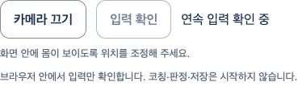
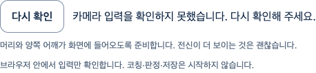

# 현재 SDK 연속 입력·오류 복구 통합 회귀 — S6.C11

최근 SDK 변경이 준비 이후의 기존 연속 입력·중지·오류 복구를 깨뜨리지 않는지 현재 웹에서 재검증했다. **새 제품 기능/제품 보완은 없으며 기존 정상 흐름의 회귀 증거**다. 준비/루프/계정 연결을 미구현 기능처럼 다시 만들지 않았다.

기준 main `9a26837bfaca00b4fa803d4432465cbd6a8834b2`, `codex/current-native-input-regression`. [Story](../../stories/current-native-input-regression.md), [실행·source·scope](verification.json), [원본/압축 SHA·목록](manifest.json). 최초 연속 입력은 PR144 source `2e302d0`에서 실행했고 source/main tree가 동일함을 실행 전 기록으로 구분했다. 복구는 이 main에서 생성한 새 Story 브랜치에서 실행했다.

## 실제 작동한 사용자 흐름

[연속 입력7](evidence/continuous-current-main.json.gz)에서 명시 카메라 준비1→별도 입력 확인→동일 camera/Worker의 후속 실제 SDK 입력→끄기, pending callback 취소/늦은 반환, 실제 router 이탈/재진입, 제어 pagehide/hidden·AuthProvider401 종료를 확인했다. 재진입 때 자동 재획득하지 않는다. 좁은800px 노트북 창·키보드/44px 조작·가로 넘침0을 유지했다.

[오류 복구4](evidence/recovery-current-main.json.gz)에서 capture/Worker 오류→고정 안내·소유 자원 종료→명시 새 준비/첫 입력 폐기→별도 입력 확인→후속 실제 SDK 입력→끄기가 작동했다. held callback의 기존5000ms 한계 종료 후 새 카메라가 준비된 상태에서 옛 callback을 풀어도 새 연결이 유지됐다. native track stop 후 제어 오류가 나면 나머지 source/Worker도 종료하며 router 재진입 후에도 재시작을 막는다.

[Worker 오류](evidence/recovery-current-main-worker-fault.png) · [정리 오류·재시작 차단](evidence/recovery-current-main-cleanup.png)

실제 React/AuthProvider/Vite/설치 Chrome·**native 가짜 카메라·실제 heavy body/face/hands SDK**다. 계정 HTTP, VideoFrame/Worker fault, held callback, visibility/pagehide와 stop 후 오류는 시험에서 제어했다. 실제 물리 장치 고장·사람/긍정 자세 정확도·OS 접근성 시험이 아니다. PNG는 DOM 조작/종료 영역이며 영상/관절 좌표/최종 아바타를 담지 않는다. 아바타 요청0·DOM video/canvas0으로 이번 회귀가 보류된 아바타 시험을 우회하지 않음을 확인했다.

모델3개 준비 구성의 현재 Worker를 사용하며 기존 body gate가 버릴 얼굴/손 후보는 계산하지 않는다. 원래 driver의 “body/face/hands Worker frames” case명은 준비 구성을 가리킬 뿐 매 프레임3개 추론이 호출됐다는 증거가 아니다. 생성 가짜 장치의 연속 처리를 실제 사람의 얼굴·손 추적/올바른 자세로 해석하지 않는다.

## 검증·보존·리뷰

현재 두 실행은7/4통과·실패0이며 정상 기준선을 RED/수정 완료라고 표시하지 않는다. 원래 준비/연속 관찰5000ms·모델·판정·SDK 통신·개인정보·API/DB·UI/CSS 기준은 변경0이다. source 전후 SHA와 추가 실행 전 worker/owner/driver/lock SHA를 대조했다.

관련 frontend60/8파일·전체1885/104파일·실패/skip0, 타입/원래 notices를 포함한 `pnpm build`, `pnpm check`(기존 info16), 원래 production guard·diff·증거 SHA/링크 검사를 실제 통과했다. 현재 public JS365359/CSS31514byte와 SHA는 PR144에서 보존한 final build와 같으며 공개 코칭 활성화0이다. backend/API/SQL·실제 provider·Blender/GLB/변형 검증은 변경0·이번 Story 미실행이다.

두 browser 실행의 외부 context 요청·API write·GLB 요청·pageerror·브라우저 저장0과 소유 track/Worker 종료를 확인했고, runner의 browser/Vite/API close를 await한 프로세스가 exit0으로 종료했다. context 요청0을 process 전체 egress0의 증거로 확대하지 않는다.

testing-strategy로 정상·오류·늦은 입력·소유권 회수를 나누고 code-review에 따른 **작성자 검토**에서 실제 fault 주입 횟수, 자동 획득0, 원래 deadline, 정리 차단, 실행 SHA/제어·실제 구분과 완료 주장 범위를 대조했다. 이 증거/문서 diff의 미해결P1/P2 발견0, 독립/전문가 리뷰 미실행이다. 기존 시작P2/PR90 실패·과거 간헐 timeout/SW10 원인·실제 사람/장치 검증을 이번 정상 실행으로 종결하지 않는다.

## 완료 경계

좁은 현재 native 입력·복구 회귀는 완료다. 조건부 병합은 최신 main/diff/HEAD/CLEAN/충돌·체크·리뷰 재확인 후 merge commit, 원격 결과는 PR에 기록한다. 아바타/참여자/Docker/공식 문의/실제 Gmail·Google 보류·출시 적격 동작0·실제 보정/추천/판정·최종 외형/시범/권리·운영/배포와 **전체1~6단계는 미완료**다. 이번 시험을 전문가 검토만 남은 상태로 표시하지 않는다.
