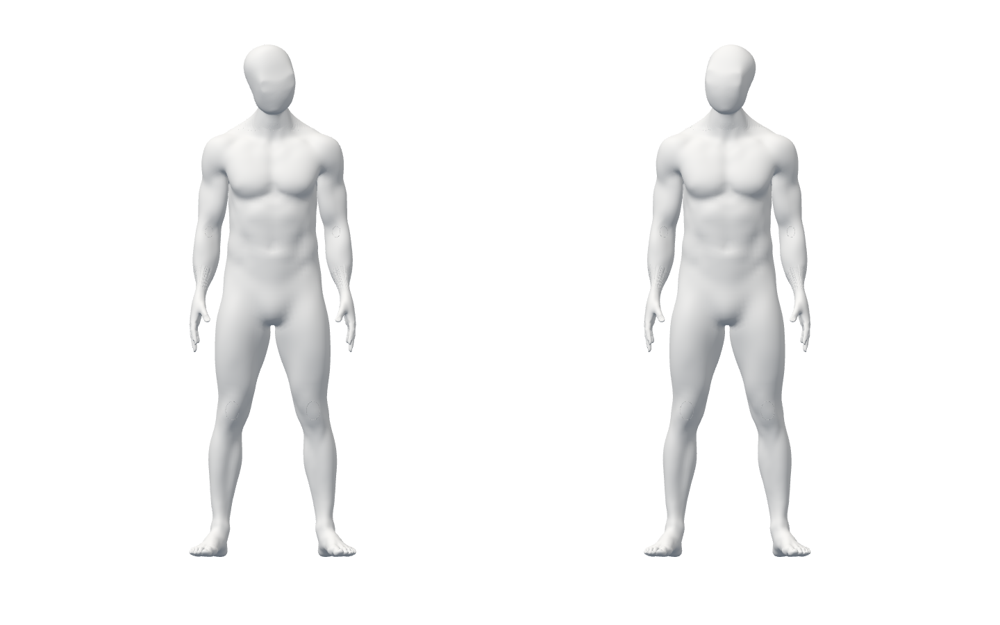
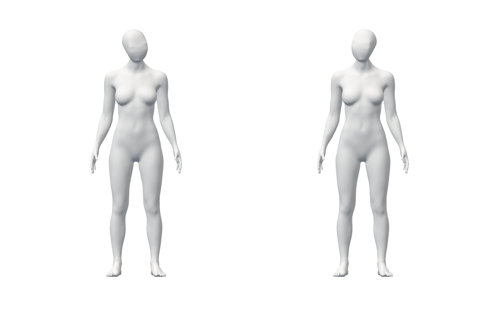

# 머리 방향 연결 — 실제 흐름과 남은 조건

runtime `2dd5d9e27c7b7309f18849ff15f12ac429b5234c` / baseline `01b97db` / [명세](../../stories/head-orientation.md) / [8소스·61원본 증거 SHA](summary.json).

## 작동하는 것

기존 남녀 A37를 실제 Chrome/WebGL의 독립 두 skeleton으로 불러온다. 명시 기준/행렬 순서로 서로 다른 yaw/pitch/roll 합성 입력을 따라간다. 첫 자세/첫2초를 자동 정면으로 바꾸지 않는다. 새 미검출은 추적을 취소하고 마지막 표시만 유지하며 종료 뒤 재생하지 않는다. source bone·position/scale·다른 bone·원본/추가 여덟 가중치를 보존하고 전신 구도를 확인했다.

아래는 **미완성 A37와 합성 입력의 검수 화면**이다. 외형 변경/승인·올바른 스트레칭·제품 디자인이 아니다. 입력 영상/사람 얼굴 screenshot0이다.

공개 화면 변경0·JS/CSS/모델 byte 동일·GLB0, camera/external 요청0이다. runtime의 실제 남녀2흐름과 전체960·타입/Biome·assets/build·공개 guard·diff를 통과했다. backend/native Face inference/실제 사람 시험이 아니다. [브라우저](browser-final.json), [검사](final-checks.json), 전체 unit 원본 gzip은 해제하면 그대로다.

## 실패와 보완

- 최초 unit은 module 미구현으로 suite 실패(assertion0). 구현 후14, 경계 보완 후21을 통과했다. 최초 Biome은 callback 반환1오류/비-null assertion3경고, 최초 타입 검사는 throw-only getter/closure narrowing4오류였다. 원본 보존 후 수정·재실행했다.
- 첫 launcher는 sandbox listen EPERM으로 Chrome 흐름0. localhost 권한 뒤 남성 첫 시험은 Promise 대기를 즉시 참으로 처리해 pixel 불변 검사에서 실패했다. child JSON은 보존됐고 wrapper는 증거 이름 EEXIST로 영수증을 쓰지 못했다. 그 wrapper 실패를 통과로 세지 않으며 이후 이름을 분리했다.
- 동기 대기 뒤 timeout 원본도 보존했다. 최종 진단은912frame·tracking이면서 각도 비교가 수치 하한에 걸린 것을 확인했다. Three의 비단위 world 분해 회전을 **비교할 때만** 단위화했다. authored scale/수치 오차 허용/목표 각도 기준은 변경하지 않았다. 오래된 첫 RAF 시각을 건너뛰는 경계도 보완했지만 timeout 원인으로 확정하지 않는다.
- 단위 이름의 단독 영어 토큰이 사용하지 않는 Tailwind CSS를 추가한 build도 보존했다. 이름을 명료하게 바꾸고 공개 byte 동일을 확인했다. 제품 UI 변경이 아니다.
- 원본 추가 attributes `weights_1/joints_1`까지 fingerprint를 확대하고 runtime에서 남녀2/전체960을 재실행했다. 공개 누출 sentinel의 실제 guard 실패(exit1) 뒤 이번에 만든 sentinel만 제거하고 exit0. 기존 파일 삭제·실패 덮어쓰기0이다.

## 작성자 코드 검토

engineering code-review의 보안·성능·정확성·유지보수 기준으로 runtime diff를 검토했다. 독립 리뷰/전문가 검토가 아니다. rotation/시각만 closure에 남고 landmark/translation·영상은 저장/전송하지 않는다. 배열 구멍/부적합 similarity/복수·누락, 외부 세대·중복/역행·만료/종료를 확인했다. payload 재진입은 새 관찰을 과거 값으로 덮지 않고 abort는 되살리지 않는다. 부모 교체·잘못된 배율/행렬은 적용하지 않는다.

발견한 재진입·sparse·runtime scale/parent 경계와 원본 추가 가중치 검수 누락을 보완·재검증했다. 범위 내 미해결P1/P2 없음. caller가 이 기준을 의학적 정면으로 쓰거나 머리1bone을 경추 측정으로 쓰면 안 된다. 제외 조건은 공개/후속 native 통합의 필수 게이트다.

## 여전히 미완료

동일 frozen video의 pose/face·사람 일치·native 수명, 실제 camera 기준/오차·참여자 수행·세밀한 경추/체간/손·검증된 시범/적색 피드백·최종 외형/권리·승인 디자인/SDK 정책·물리 노트북/운영/HTTPS 및 전체1~6은 미완료다. 출시 적격 동작0. 다음은 기존 native 재생과 face의 동일 프레임 연결이며 조형 사이클은 시작하지 않는다.

testing-strategy에 따라 단위/소수 실제 browser/회귀를 분리했다. graphify의 2026-09-27 그래프는 시제품 호출만 설명해 현재 리그 근거로 사용하지 않았다. [공식 geometry proto](https://github.com/google-ai-edge/mediapipe/blob/master/mediapipe/modules/face_geometry/protos/face_geometry.proto)와 [matrix proto](https://github.com/google-ai-edge/mediapipe/blob/master/mediapipe/framework/formats/matrix_data.proto)를 대조했고 저장 순서는 caller가 명시한다. 공식 소스는 설치된 SDK의 긍정 사람 시험을 대체하지 않는다.
