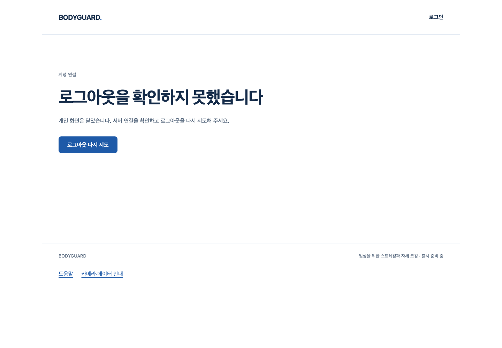

# S4.17 로그아웃 서버 확인 계약

2026-10-10 · [사전 명세](../../stories/logout-acknowledgement.md) · 시작 main `ced8c9b56b721fab29806a9367ea424ef4103692` (PR #112 병합).

## 실제로 달라진 사용자 흐름

웹이 계약과 다른 성공 응답200/202를 받으면 로그아웃 완료로 이동하지 않고 기존 오류/재시도 화면을 유지한다. 현재 탭의 개인 정보가 숨겨지고 focus/계정 변경 신호로 자동 복원되지 않는다. 명시적 재시도에 실제 서버204가 돌아온 뒤 게스트 화면·다른 탭 종료·이전 쿠키401을 확인했다. 서버가200을 반환하는 결함을 발견했다는 뜻은 아니다. 잘못된 응답은 시험에서 주입했으며 이때 backend 로그아웃 POST는 실행되지 않아 DB 세션은 실제200으로 유효했다.

1440×1000 로컬 production 빌드의 실제 화면이다. 새 디자인/배포본/실사용자 화면이 아니며 기존 화면 구성·CSS·문구를 바꾸지 않았다. 실패한 확인만으로 다른 탭의 유효한 세션까지 즉시 폐기된다고 주장하지 않는다.

## 실제 실행과 실패 원본

| 실행 | 결과 | 범위와 한계 |
| --- | --- | --- |
| client/DOM RED | 8실패/8통과, 총16 | 다른2xx6건+AuthProvider2건 실패. happy-dom/fetch/채널 합성이며 SQL 증거 아님 |
| native 최초 RED | 0통과/2실패 | 기존 API 소스에서 재시도 제목 없음. 이후 retry/쿠키 검증까지 실행되지 않음 |
| native 관측 RED | 0통과/2실패 | 주입200/202·intercepted1·backend POST0·native 세션200·웹 `/login`. 이후 retry 미실행 |
| 수정 후 부품/상태 전이 | 42통과 | 새16+기존 auth/AppFocus.204 JSON 미파싱·CSRF/POST/cookie/취소 signal·오류 상태/Retry-After·focus/채널 |
| 최종 전체frontend | 1497통과, pending0 | Vitest JSON/로그. 실제 인간·카메라 정확도 검증 아님 |
| native 계정 웹 | 11통과, retry0 | 기존9 bodies byte 동일+새2. 실제60초 재발송·가입/로그인·확인 실패/재시도·old-cookie401/두 탭 |
| native 통합/비밀번호/기록 웹 | 각각2/5/11통과 | 실제 계정·기록 조회/상세·삭제 취소/확인·복구/기간·로그아웃. 기록·메일은 합성 fixture. 비밀번호는 list reporter/PNG이며 JSON이 있다고 하지 않음 |
| 관련 backend SQL | 64통과 | `tests/test_auth.py` 실제 새 소유 DB. 이번 Story의 전체backend509 재실행 아님 |
| 정적/최종 빌드 | 통과 | frontend tsc/Biome299파일(기존 info15), backend Ruff/format48·mypy app11. public guard JS1개/private 후보 문자열0 |

native Chrome `155.0.8059.40`, 로컬 FastAPI/production Vite/실제 PostgreSQL18.6. 계정/메일은 fixture·private 시험 IPC이고 실제 메일/Google 공급자는 연결하지 않았다. 새2사례의 카메라 호출0·모델/외부 요청0, 주 페이지 pageerror0·최종 storage 항목 `[0,0]`이다. 순간적인 storage 쓰기·다른 탭 pageerror까지 측정했다고 하지 않는다. 원본 영상/좌표·아바타/GLB 요청·새 외형/변형 검증0.

초기 offline 설치는 tinybench 캐시 부족 오류, 이어진 단위 명령은 설치/DNS 오류로 시험을 시작하지 못했다(`dom-red.log`). 승인된 native 실행에서 잠금 의존성194개를 캐시로 재사용했고 다운로드0·lock 변경0이다. 관측 RED 로그의 상대경로 copy는 실패했다. 동일한 미수정 원본의 절대경로로 복사했으며 그 파일을 실행 전 snapshot이라고 부르지 않는다. backend-static.log는 mypy 출력만 포함한다. Ruff/format 통과는 대화 도구의 실제 출력이고 모든 정적 출력이 그 로그에 있다고 하지 않는다. 경고/실패를 지우거나 성공으로 세지 않았다.

## 입력/증거와 시험 격리

- `evidence/source/before/`는 관측 RED 이후·제품 보완/format 전12입력, `final/`은 제품 보완/format 후·최종 검증 전12입력이다. 최초 RED와 관측 RED의 하네스 차이는 `evidence/results/red-account*.spec.ts.gz`로 보존한다. collector 자체는 RED 실행 뒤 작성했으며 그 도구를 RED runtime 입력이었다고 주장하지 않는다.
- account 원본 세 폴더: `account-20261010T091310958037Z` (최초 RED), `account-20261010T091540256375Z` (관측 RED), `account-20261010T092231440785Z` (최종11). 기존 결과를 덮어쓰지 않는다. 실제 웹 report의 partial attachment와 최종 boundary attachment는 별개다.
- 통합 `integration-20261010T092641877216Z`, 기록 `records-20261010T093025709450Z`, 비밀번호 `password/`의 원본도 results에 보존했다. 변경하지 않은 회귀 case 파일3개는 실행 뒤 복사본이며 최종 소스 확인에 사용한다. source12가 시험 관련 모든 파일이라는 주장은 아니다.
- 새 `/private/tmp/bodyguard-auth-test.MwOoC6zQ`, UID501/디렉터리·socket·data0700, TCP 비활성. 기존 conftest의 DB/role `bodyguard_test`·소유/advisory lock guard로 실행했다. 시험 후 data_directory·버전·UID/PID46730을 실제 확인하고 이 DB만 정상 중단했다. 원본 DB·실패 파일은 보존하고 private mailbox/PG 내부 데이터/쿠키는 저장소 증거에 넣지 않는다. owned-stop.log는 중단 로그이며 소유 확인 출력까지 포함한다고 하지 않는다.
- 제품 변경은 `frontend/src/api/auth.ts`의 expected204 한 곳이다. AuthProvider/서버 endpoint/API schema/migration/화면/CSS/문구·lock/CI 변경0. 생성 JS는 이 수정으로 달라졌으므로 번들 전체 byte 동일이라고 하지 않는다.

`node bodyguard/docs/review/logout-acknowledgement/collect.mjs --check`는 [manifest.json](manifest.json)의108gzip 원본/압축 SHA·현재 입력12개·불변 제품/설정186개를 확인한다. **시험 재실행 명령은 아니다.** 새 소유 DB를 준비해 backend README 조건과 `BODYGUARD_TEST_DATABASE_URL`을 충족한 뒤 `python -m tests.run_browser account`로 native 회귀를 재실행한다. 운영 DB를 넣지 않는다.

## 작성자 코드 리뷰

engineering code-review 스킬로 전체 scoped diff/명세·실행 입력·원본 실패·증거를 검토했다. 별도 에이전트/전문가 리뷰로 표현하지 않는다.

- 기존 request가 비2xx 오류 처리 후 expected status를 검사하고 body 해석 전에 실패한다. 서버 세션 commit 이후204라는 기존 계약만 사용한다. 새 endpoint/보관/수집 정책·자동 인증 복원은 없다.
- 실패한 signOut operation은 기존 AuthProvider에서 유지되어 focus/계정 변경 refresh를 차단한다. abort·언마운트/timeout 경계는 기존 상태와 동일하며 이번 변경이 새 race/타이머를 추가하지 않는다.
- 다른2xx/기존 오류·Retry-After·CSRF/HTTP204·실제 native retry/old-cookie·다른 탭을 검증했다. 기존9 account body를 삭제·timeout 확대·retry로 숨기지 않았다.
- runner의 변경은 account 고유 결과 폴더/JSON 두 항목뿐이다. collector는 archive overwrite/symlink를 거부하고 source/원본 SHA를 확인한다. 민감한 raw 쿠키/메일 토큰 출력·운영 reset·아바타 제작 없음.
- scoped 미해결P1/P2 없음. 최신 원격 diff/HEAD/CLEAN/체크 게이트는 PR 병합 직전에 다시 확인한다. 현재 근거로 전체 출시를 승인하지 않는다.

## 그대로 남는 필수 조건

아바타는 최신 지시대로 보류, 기존 자산·실패 보존. 전체1~6·출시 후보판은 미완료다. 실제 신체/동작·올바른 시범·추천/판정 정확도·노트북 성능, 디자인 구조/제품 적용·SDK 통신 결정, 기존 시작P2/테스트 타입 문제, 공급자/HTTPS/Docker·권리/법무·운영·백업 복원 후 삭제/세션 재등장, Q13/27/32는 이번 Story에서 닫지 않는다. 중요한 범위/안전/개인정보·비용/계정/시크릿/운영DBmigration/배포/출시는 별도 승인이다.
