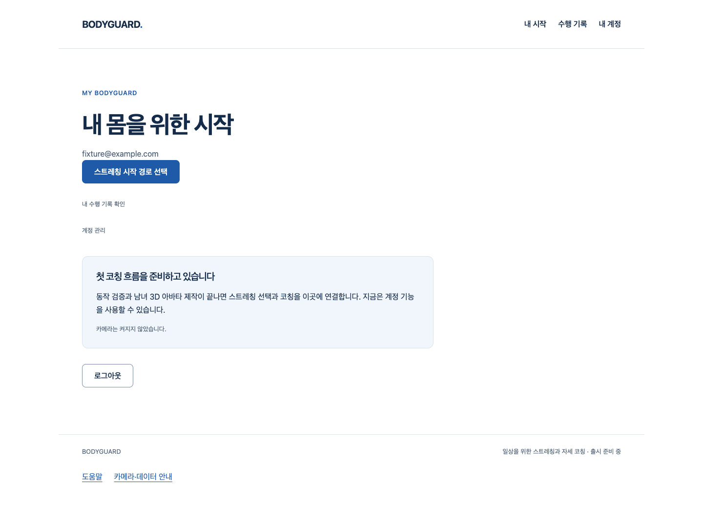

# 1분 시간가중 요약 기반

FR-R-01/06·ADR-0003의 private 집계 엔진이다. 실제 관찰된 구간만 UTC 시계 분별로 나누고, 지표별 시간가중 평균/측정·이탈 시간·foreground/background/presence/coverage를 계산한다. 불규칙 샘플 간격·가림·빈 시간으로 분모가 달라지는 문제를 독립적으로 검증한다.

## 제공하는 기능과 경계

입력은 명시적인 clock/calibration/method 정의 및 관찰된 구간의 편차/상태뿐이다. 개별 관절/영상·계정/추가 필드는 허용하지 않는다. 지표가 없는 구간은 null로 남기며 빈 시간을 정자세나 이탈 시간으로 채우지 않는다. 여러 지표가 동시에 이탈해도 any_bad는 구간을 한 번만 센다. 개별 구간을 history/배열로 저장하지 않고 누적 합만 유지하며 완료된 분의 flush/close·잘못된 입력에서 해당 누적 값을 버린다.

이번 결과 DTO는 private 계약이고 design §10의 제안 HTTP schema를 채택/대체한 것이 아니다. 기간별 집계/리포트는 이후 verified producer와 계정 권위·서버 계약을 연결해야 한다. baseline null은 보정 전 표시를 위한 값이며 임의 기준선을 만들어내지 않는다. 지표 정의·수치 유효 범위는 caller가 명시한 시험/검증 대상으로, 실측 채택이나 의료 기준이 아니다.

## 실제 실행과 실패 보존

- 최초 missing-module red는 collection 실패/기능0이다. 초기1개·상세33개는 합성 구간 시험이다. 상세 raw getter의 반환 type이 void로 추론된 타입 오류를 보존하고 명시 타입으로 수정했다.
- 작성자 리뷰에서 clock/definitions source를 반복 읽어 서로 다른 pair를 섞을 수 있는 경계는34개 중1개 red였다. clock/definitions object를 각각 한 번 캡처하도록 보완했다.
- 고해상도 단조 구간을 큰 UTC timestamp에 먼저 더하면 작은 기간이 사라지는 문제는35개 중2개 red(위 clock 경계 포함)로 재현했다. 분 경계 분할·flush 판단을 상대 시간에서 먼저 수행하고 마지막에 UTC minute timestamp를 붙이도록 수정했다. 이후35개가 통과했다.
- 최종 전체 frontend558(이번35)/실패0·타입·정적/build/production guard·실제 공개 웹 회귀를 확인한다. 실제 classifier·카메라·인체 정확도·개인 촬영이 아니라 합성 입력이다. API/backend source 변경0이며 이 Story에서 API 회귀를 새로 실행했다고 주장하지 않는다. PR41의 API 증거를 이번 source의 실행 증거로 다시 세지 않는다.

## 디자인와 남은 조건

engineering:code-review로 입력 schema/수치·시간/버퍼/폐기·metadata 불변/소유 close·public 누출 경계를 작성자가 검토했다. independent reviewer 검토가 아니다. 네트워크·IndexedDB/업로드 큐·새 DB/마이그레이션·의학 임계값·자동 POST·새 공개 측정 consumer는 없다.

지정 web-design-studio의 기존 토큰/컴포넌트·실제 화면 원칙과 화이트·블루 웹을 유지한다. 이 Story는 UI를 새로 디자인한 것이 아니다. 추가 디자인 audit·Figma·실사용자/모바일 앱·전문가 승인으로 표시하지 않는다.

2단계 외형/실측/통합·Draft36 SDK 개인정보 P2·classifier/기준선/실제 summary producer·계정/HTTP wiring·Q32 알림/PDF/LLM/변화 탐지·참여자/법무·외부/운영·전체1~6 필수 게이트는 미완료다. 같은 아바타 부위 새 제작/시험0을 유지한다.

[Story](../../stories/minute-aggregation.md) · [원본/SHA 수집기](collect-proof.mjs)

최종 frontend558·타입/Biome122·build·공개7+합성 RAF1(8개,15.8초)·guard 음성exit1/양성exit0·source3/artifact18 SHA 및 수집기 byte-identical 재실행을 실제 확인했다. public JS/CSS byte SHA는 PR41과 동일하다. PR 조건부 게이트는 진행 중이며 임상적 판단이나 웹 전체 완성으로 표시하지 않는다.

개발 중 main에 들어온 PR42의 계정 알림 설정 API/생성 타입을 branch에 통합했다. tasks.md만 충돌하여 양쪽 기록을 보존했다. 기존 backend/생성 타입에 별도 수정을 하지 않았으며 API 회귀를 새 실행한 것으로 세지 않는다. 통합 후558 frontend·타입/정적/build/guard·공개8(13.0초)·source3/artifact7 SHA와 수집기 재실행을 실제 확인했다. 초기 manifest/18개 원본을 그대로 두고 통합 증거는 artifacts-v2.json으로 추가했다.

## 실제 병합 확인

[PR43](https://github.com/HSU-OAS/bodyguard/pull/43)은 source692c7e463604514ed744c17ea0878e6377c1cc20 → mergecf65132fa5be6d3000a9f0323cd1d4f4eee23fc8로 병합됐다. 실제 부모/latest main 포함·브랜치 보존을 확인했다. [작성자 리뷰](https://github.com/HSU-OAS/bodyguard/pull/43#issuecomment-6000251778)의 조건부 게이트를 충족했으며 체크 없음·외부 리뷰0이다. 위 '게이트 진행 중' 문단은 당시 기록으로 보존한다. 이번 완료는 private 순수 집계 범위이고 공개 요약 기능/실제 신체 검증/전체1~6 완료가 아니다.

원격 diff의 최초 비교 실패는 index의 SHA 축약 길이 차이(로컬7자리/GitHub8자리)였다. 원본을 유지하고 --abbrev=8 로컬 diff로 재확인하여 hunk의 함수명 표시만 정규화한 본문/좌표 비교 및35개 실제 Git blob이 일치했다. source3개와 초기18개/통합7개 artifact SHA는 다시 검증했다. BMAD on_complete resolver 실제 absent exit2/default 빈 값은 별도 도구 설치나 성공으로 표시하지 않는다.

최신 maincf65132의 독립 codex/minute-aggregation-closure에서 문서 상태와 실제 병합 증거만 추가한다. 제품 코드·원본·PNG·manifest/검증 출력은 수정하지 않으며 기존 테스트를 이번 문서 변경에서 새로 실행한 것처럼 표시하지 않는다.
