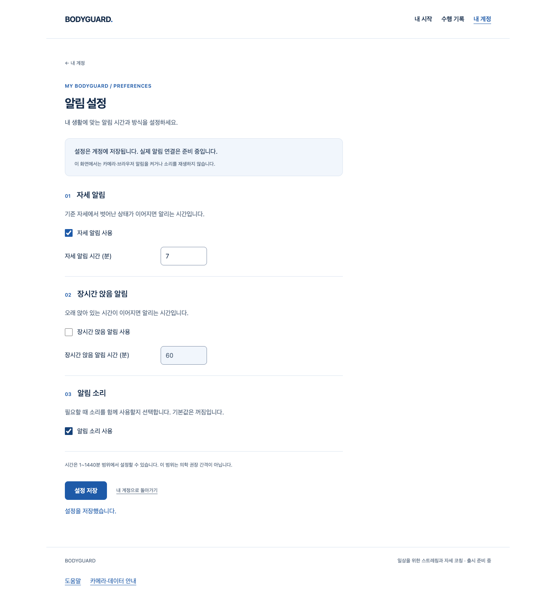

# 1분 요약 API — S4.14 실제 검증 기록

본인 계정의 1분 집계를 저장·재조회·기간 삭제할 수 있다. 같은 분의 동일 요청은 한 건만 남기고, 다른 내용은 batch 전체를 거부한다. 과거 기준선을 유지하며 지표별 측정 시간·이탈 시간·방법을 구분한다. 서버는 입력을 `client-reported`로 보관할 뿐 올바른 자세나 효과를 인증하지 않는다.

## 실행 환경과 범위

실제 FastAPI/ASGI·소유한 PostgreSQL18·SQL 잠금·migration·인증 쿠키/CSRF를 실행했다. 실제 TypeScript 집계기에 1,873개의 **합성** 관찰 구간을 넣어 나온 10분 fractional 집계를 실제 API에 저장하고 값을 대조했다. 실제 사람·웹캠·의학적 정확성 시험은 아니다. 영상·원시 좌표·샘플 업로드는 없고 운영 DB·시크릿·배포도 변경하지 않았다.

새 소유 source/target DB에서 실제 API로 두 계정의 요약과 현재·과거 기준선을 저장한 뒤 pg_dump/pg_restore, 본인 조회·타인 격리·직접 SQL 제약 보존을 실행했다. [최종 native 결과](native-summary-final.json)의 복구·제약·소유 서버 종료는 true다. snapshot 이후 삭제·로그아웃·비밀번호 변경이 복구로 재생되는 위험은 그대로 관찰됐고 운영 restore 승인은 false다. 백업 파일이나 원본 DB를 저장소에 넣지 않는다.

## 실패와 보완

- 최초 실제 GET은 미구현404로 실패했다. 첫 저장 시험은 이후 통과했다.
- 초기 summary 시험은 53통과/1실패였다. DB의 +09:00 생성 시각을 UTC로 반환하도록 보완했다.
- 전체 API 첫 회귀는 437통과/1실패였다. 새 child FK의 빈 테이블 DROP이 기존 0007의 관찰 LOCK보다 먼저 parent lock을 요구했다. 기존 guard 시험을 빈 0008 downgrade 뒤 분리하고, 새 0008의 실제 동시 insert/downgrade 시험을 따로 유지했다. 기존 migration은 수정하지 않았다.
- 읽기 전용 리뷰에서 UTC timezone/무한·범위 밖 시각, UTC 변환·삭제 증명 날짜 overflow를 보완했다. 불가능한 정상 시간 합집합은 실제 API201/SQL 허용으로 두 red가 실패했다. `전역 measured−any_bad ≤ 지표별 measured−bad 합`을 API·DB·새 migration에 함께 넣고 새 소유 DB로 검증했다. 원본 실패를 통과로 바꾸지 않는다.
- `openapi-errors-red`는 red를 시도한 **파일명**이다. 기존 전역 ErrorOut 선언 덕분에 최초 실행부터 1통과였다. 새 응답 계약 결함을 고쳤다고 주장하지 않는다.
- offline 설치 cache·초기 import 정렬·uv cache 권한·새 작업트리 모델 다운로드 실패는 원본과 실제 재실행을 구분한다. 최종 추가 회귀 `api-final3`은 sandbox의 로컬 DB 소켓/네이티브 프로세스 차단으로 3실패/427오류/28통과였다. [로그](api-final3.log.gz)와 [XML](api-final3.xml.gz)은 gzip 보존이며 실제 테스트 성공이 아니다. 필요한 로컬 접근으로 재실행한 `api-final4`는 실패/오류/skip0으로 통과했다.

## 웹과 디자인

기존 공개 웹 production Chrome 8흐름, 가입→내 계정→알림 설정 저장→새로고침과 응답 단절/명시 재조회·다른 계정 old-proof403·키보드/920px 4흐름을 실제 실행했다. 합성 메일/계정과 일부 합성 RAF 자원이며 실제 SMTP·카메라·알림 실행은 아니다. UI는 기존 PR45의 기여다. 이번 API Story는 새 요약 화면을 만들거나 공개 측정에 연결하지 않았다.

CEO의 `web-design-studio`와 기존 토큰을 따라 화이트·블루 디자인을 유지했다. 실제 PNG를 열어 확인했으며 새 Figma/axe/추가 외부 디자인 감사나 UI 개편은 실행하지 않았다.

## 최종 검증 / 리뷰 / 병합

최종 전체 [API458](api-final4.xml)(130.66초)·frontend590·타입·Biome·production build/guard와 Ruff/format/mypy는 통과했다. 기존 asyncio DeprecationWarning1은 별도로 남았으며 실패로 세지 않는다. 실제 검증의 소스20개와 출력은 [manifest](artifacts.json)에 SHA로 연결하며 수집기는 기존 증거를 덮어쓰지 않는다.

병합 전 기록 시점에 독립 읽기 전용 리뷰와 작성자 검토에서 보완 후 미해결 scoped P1/P2는 없었다. 리뷰어의 DTO 직접 시험은 API/DB 전체 회귀나 임상 검토가 아니다. 정확한 tested HEAD·최신 main·원격 diff·CLEAN·체크를 병합 직전에 다시 확인했다. 아래는 이후 실제 병합 확인 기록이다.

이후 [PR48](https://github.com/HSU-OAS/bodyguard/pull/48)을 source36bbab52576e2d600b4750967547cf12706f2dfe→merge654688be08ede24351491b687acae2b630dd674b로 2026-10-06T05:06:42Z 실제 병합했다. 부모fccd5c4/36bbab5·원격 main 포함·브랜치 보존/clean을 확인했다. 직전80파일 diff·동일 Git tree·source20/artifact54 SHA·CLEAN/MERGEABLE·체크 없음·외부 리뷰0 확인 결과는 [작성자 기록](https://github.com/HSU-OAS/bodyguard/pull/48#issuecomment-6009724542)에 있다. 이 후속 문서 기록에서 제품 소스·기존 manifest/실패/PNG는 변경하지 않으며 검증을 새로 실행한 것으로 세지 않는다.

공개 측정 생산자0·출시 허용 동작0, 실제 classifier/보정·두 아바타·단계2 이월·SDK 개인정보 P2·실제 참여자/노트북·Q32 부가 기능·법무/라이선스/외부/운영·전체1~6 게이트는 미완료다. 다음은 본인 요약 업로드 재시도·계정 전환 연결이며, 미검증 판정은 공개하지 않는다.

[Story](../../stories/minute-summaries-api.md) · [실제 결과 수집기](collect-proof.mjs)
