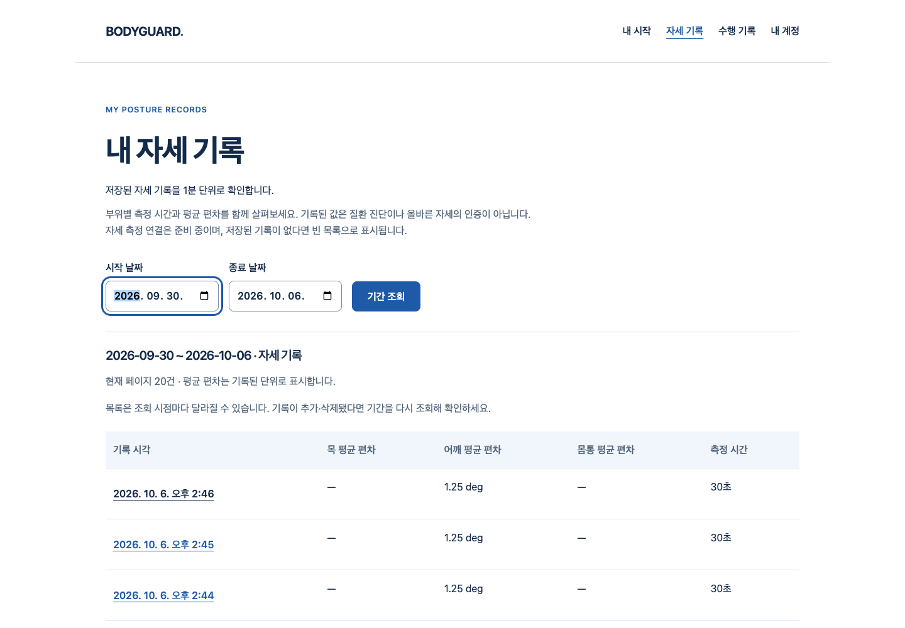

# S4.15 — 실제 본인 자세 기록 웹과 검증 증거

2026-10-06 · 기준 main `654688be08ede24351491b687acae2b630dd674b` · [Story](../../stories/minute-summary-web.md)

## 작동하는 화면과 사용자 흐름

화이트·블루 웹의 시작/헤더/내 계정 → **내 자세 기록** → 최근7일 또는 지정 기간 조회 → 분별 목록/20건 페이지 → 선택한 분의 목·어깨·몸통 지표와 측정 시간 → 삭제 대상 수/정확한 기간 확인 → 취소 또는 명시 삭제 → 최신 목록 재조회까지 실제 FastAPI·PostgreSQL·production Chrome으로 연결했다. 수행 기록과 별도 페이지이며 수행 기록/개인 기준선을 삭제하지 않는다.

빈 기록은 빈 목록이다. 평균 미측정과 분모0은 `—`로 표시하고 정상0%·임상 점수·전체 기간 통계를 만들어내지 않는다. 타인 쿠키와 기존 본인 context가 섞인 GET은 서버에서403으로 차단한다. 날짜 변경 시 기존 삭제 확인을 폐기한다. 응답 단절 후 성공을 추정하거나 자동으로 다시 삭제하지 않는다. 서버의409 뒤 대상 수를 다시 확인한다.

**아래 기록은 격리 시험 DB의 합성 요약**이다. 실제 계정·HTTP·SQL·Chrome은 사용했지만 실제 신체/웹캠/의료 정확도·배포·외부 메일/Google 공급자 시험은 아니다. 공개 측정 producer0·출시 동작0·전체1~6 미완료를 유지한다.

[전체 목록·상세](summary-desktop.png), [920px 노트북 창](summary-notebook.png), [390px 좁은 데스크톱 웹 창](summary-narrow-web.png), [확대](summary-zoom.png), [빈 목록](summary-empty.png), [삭제 확인](summary-confirmation.png), [삭제 결과 불확실](summary-uncertain.png), [조회 오류·재시도](summary-query-error.png).

## 실제 실행과 모의 시험의 구분

| 검증 | 실제 결과 | 구분/제한 |
|---|---|---|
| production Chrome SW-W01 | 가입/시작/빈 목록→합성21건 조회→상세/페이지/뒤로→취소 보존→명시21건 삭제→타인1건 보존 | 실제 서버 저장·조회·삭제. 합성 계정/메일·요약 |
| SW-W02 | 실제 서버 삭제 후 응답 단절→불확실 안내→중복 요청0→명시 조회로0건 확인 | 단절을 route.abort로 유발. 원래 삭제는 실제 SQL |
| SW-W03 | 다른 계정 쿠키+기존 proof/expected owner GET403→이전 기록 미표시→명시 계정 재확인 | 요청 스케줄/쿠키 혼합은 하네스. 실제 인증/HTTP/SQL |
| SW-W04 | 대상 변경409/재확인·cutoff 뒤 신규 기록 보존·이미 없는 대상0·조회 실패/재시도·invalid 기간 요청0 | 합성 대상·오류 주입. 실제 SQL 결과 대조 |
| frontend 전체 | 39파일653개 통과, 실패/skip0 | happy-dom/순수 TS. 실제 웹캠·의료 판정이 아님 |
| backend 전체 | 464개 통과, 실패/skip0, 경고2 | 전용 UTF8 PostgreSQL18. 기존 asyncio deprecation/Pydantic alias 경고 보존 |
| 공개 Chrome | 8개 통과 | 기존 공개·탐색 회귀7 및 실제 RAF/합성 resource1. 실제 카메라 아님 |
| 정적·빌드 | typecheck/Biome135파일·Ruff/format34파일·mypy11파일·production build/guard 통과 | 공개의 미연결 private producer/candidate0 |
| evidence validator | Node8개 통과; 동일 수집 재실행 동일 바이트/SHA | 실패한 aggregate/sibling/skip·가짜 comment/CDATA·부분 browser summary 거부 |

최종 브라우저 원본 report는 `summaries-20261006T055139372165Z`이며4 expected/0 unexpected/0 skipped/0 flaky다. 원본 실행 폴더와 scratch DB·로그를 보존했다. 초기 SQL_ASCII DB 및 최종 UTF8 DB는 각각 정확한 소유 PID/경로를 확인해 종료했고 파일은 삭제하지 않았다. backend 최종2회차의 기존 경고2는 실패와 구분하며 숨기지 않는다.

실행 명령은 프로젝트 frontend의 `pnpm test --reporter=default --reporter=junit --outputFile.junit=<owned-proof>/frontend-final3.xml`, `pnpm typecheck`, `pnpm check`, `pnpm build`, `node scripts/check-selection-production.mjs`; backend의 전용 `BODYGUARD_TEST_DATABASE_URL`과 기존 잠금 의존성을 이용한 `python -m pytest -q --junitxml=<owned-proof>/api-final2.xml`, `ruff check .`, `ruff format --check .`, `mypy app`, `python -m tests.run_browser summaries`; 기존 공개 Chrome 실행과 `node --test .../verify-results.test.mjs`다. 실제 결과 로그는 아래 manifest로 연결된다. 운영 DB 명령은 실행하지 않았다.

## 실패 원본과 리뷰 보완

- 최초 실제 App404 실패, 오프라인 의존성 cache 부재, SQL_ASCII/psycopg bytes의5개 환경 오류를 보존했다. UTF8 격리 DB에서 read binding 제거 시 실제4실패/1통과의 보안 red, 복구 뒤 통과를 별도로 남겼다. 환경 오류를 보안 red로 세지 않는다.
- 최초 Chrome은3통과/1실패다. route를 처리 중 unroute하는 하네스 오류를 수정했고 결과를 덮어쓰지 않았다. 이후2/3/4회차는 각각4통과다.
- DOM의 날짜 draft 경합/기존 삭제 proof/빈 다음 페이지/초점, 시계 차이·tiny 분모, 기존 CSRF-only GET 호환, 지속403 자동 refresh의 red를 보존했다. 완료된 계정 권위·layout cleanup·서버 요청 결속·날짜 proof 폐기·수동 재확인으로 보완했다.
- 기존 전체 Vitest652통과 뒤 첫 final Biome의 불필요 dependency1오류도 보존했다. dependency 정리·삭제 기간의 초/원본 소수부 표시 후 최종653전체/type/static/build 및 실제 Chrome을 다시 실행했다.
- BMAD의 Blind/Edge/Acceptance 독립 리뷰와 재검토를 수행했다. 최초 제품12보완/기존 live-offset snapshot 주장1 dismiss, 이후 collector P2(정상 child가 실패/skip 집계를 가리는 검사)와 preflight/삭제 기간 정밀 표시를 보완했다. 최종 edge의 comment/CDATA 가짜 testcase 문제도 제한된 runner dialect에서 거부하고 실제 보고서+Node8시험·수집 재실행으로 확인했다. 소스 리뷰를 실행 검증이나 전문가 승인으로 세지 않는다. 별도 판단/이월0이며 전체 프로젝트의 기존 P2는 그대로 남는다.

## 지정 디자인 skill의 최종 critique

`web-design-studio`가 기존 토큰 재사용, 주 행동 하나, 실제 상태 화면 검토를 이끌었다. frontend-design·UI UX Pro Max의 focused check와 아래8 critique 기준을 적용했다. 외부 랜딩/판매·neumorphism 추천은 이 기록 화면에 채택하지 않았다.

| 기준 | 확인한 화면/보완 |
|---|---|
| visual-audit | 최종 actual1440/920/390/확대·빈/오류/삭제/불확실 PNG를 직접 열어 확인. 백색·진청색·파란 액션으로 의학 계열의 정돈된 인상 |
| hierarchy-principles | H1→기간 폼→분 목록→선택 상세. 주 행동 `기간 조회`, 삭제는 별도 확인 내부에서만 적색 |
| spatial-rhythm | 기존48/24px 여백·4px 배수,48px 입력/버튼. 좁은 창은 폼1열, 표만 지역 가로 스크롤 |
| craft-signals | label/heading/현재 탭·단위·null·행 정렬, 일관된8/12px radius. 두 날짜 연속 입력과 삭제 proof 폐기 보완 |
| color-systems | 기존 백색 #fff/soft #f1f6fc·ink #142b49·accent #1e5aa8. 실제 계산 스타일·텍스트/컨트롤 대비·blue focus3px 확인 |
| type-systems | 기존 한글 시스템 글꼴·위계·줄높이 유지, 외부 폰트0. 긴 method/version은 부차적 상세로 구분 |
| motion-design | 장식/3D/scroll 연출0, 기존 버튼120ms만 유지. 실제 reduced-motion에서 전환0s. 초점은 상세/결과가 보이는 위치로 이동 |
| quality-checklist | 실제 키보드/ArrowRight 표 스크롤·확대·좁은 창·loading/error/empty/delete/recovery·light 고정 확인. 날짜 수정/초점/계정 루프/종료 초 표시 보완 |

390px은 **노트북 브라우저의 좁은 창** 시험이며 모바일 앱·모바일 브라우저 출시 범위 추가가 아니다. 공개 false clinical badge/효과/후기·자동 카메라·새 UI 패키지·원격 폰트·다크 모드·hero effects는 추가하지 않았다. Figma·axe·Impeccable·외부 디자인 audit은 실행하지 않았으므로 통과를 주장하지 않는다.

## 소스·증거 무결성

최종 기준은 [artifacts-final.json](artifacts-final.json)의 **source24/artifact93 SHA-256**다. PNG 픽셀은 수정하지 않았고 텍스트만 로컬 경로·hostname·ANSI를 정규화했다. raw/public SHA를 구분한다. DB archive/원시 영상/좌표/실제 신체 sample은 수집하지 않는다.

[artifacts.json](artifacts.json)은 마지막 reviewer 보완 전의 첫 수집을 그대로 보존한 **역사적 manifest**이며 현재 소스 통과 기준이 아니다. 당시 collector/validator/test 소스는 `*-before-final-review.txt`, 원래 Node7시험은 `collector-tests.log`로 보존한다. 최종은 `collector-tests-final.log` Node8이다. 최종 collector는 모든 report·모든 suite/root/testcase·기존 대상 파일을 preflight한 뒤 게시하고 동일 바이트 이외의 덮어쓰기를 거부한다. 반복 수집은 같은 최종 manifest를 냈다.

## 남은 필수 조건 / 다음 연결

이 Story는 **저장된 본인 자세 기록의 조회·상세·삭제 웹 범위**다. private 시간가중 집계→계정/세션에 묶인 업로드·동일 재시도 연결은 다음 독립 Story다. 실제 classifier/카메라·신체 기준선·추천/동작별 판정·두 고품질 남녀 아바타·SDK 개인정보 P2·실측/참여자·Q32 알림 작동/PDF/LLM/변화 탐지·사업/법무·운영/HTTPS·전체1~6 완료 기준은 미충족이다. 아바타 같은 부위 새 제작0, 중요한 안전/개인정보 변경·비용·계정·시크릿·운영 migration/배포/출시는 별도 승인 경계를 유지한다.
