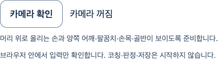

# 선택 동작·촬영 준비 — 실제 연결

2026-10-11 · [Story](../../stories/motion-camera-framing.md) · 기준 main `dde3d3c86731f1ba0c1c756769ddfb0aaaae187e`

**실제 연결:** 동작 선택→해당 촬영 안내→명시 카메라 준비(첫 입력 폐기)→별도 연속 입력→촬영 위치 안내→동작 변경 시 기존 카메라/Worker 종료→새 동작에서 명시 재준비. 보기 구도 변경은 실제 동작의 필요 촬영 범위를 바꾸지 않는다. 잘못된 동작 URL은 기존 입력을 종료하고 카메라 시작을 제공하지 않는다.

실제 React/AuthProvider/Chrome·native **가짜 카메라**·실제 heavy body/face/hands SDK다. 계정은 고정 GET 응답이며 실제 사용자·의학적 정확도·원래 시작P2 해결 증거가 아니다. 사진은 카메라/Worker 종료·video/canvas0인 기존 DOM 준비 영역만 담았다. 최종 아바타/신체 영상/관절/계정 원문을 담지 않는다.

## 결과·보존한 실패

| 실제 실행 | 결과 |
| --- | --- |
| unit RED | 새 module이 없어 suite 실패1. 실행된 판정 실패 시험으로 세지 않음 |
| 첫 범위/DOM | 19/22 통과. 첫 DOM fixture의 mock 함수 타입·Testing Library exact 옵션 타입 오류는 별도 TypeScript 명령에서 실패했다. fixture 타입/옵션을 수정했고 도구 출력에 남으며 별도 원본 로그 파일은 없다고 기록 |
| 전체frontend | 97파일·1730 통과·실패/skip0, maxWorkers2. 기술/판정 timeout 확대0 |
| 최종 계약 | 범위4파일22통과·실패0. 후보별 요구 매핑 누락 방지 기대값을 실제 재실행 |
| browser 최초 | setup Error·0통과. 실행 전 실패를 제품 성공으로 세지 않음 |
| browser 첫 권한 실행 | initial1통과 후 native-input TimeoutError. 준비/관찰 하위 진단이 없어 원인·구간을 소급 확정하지 않음 |
| browser 진단 | 동일 제품 코드/제한에서 하위 phase와 고정 상태 진단 추가 후 6통과·실패0. 이전 실패/기존 시작P2를 닫지 않음 |
| 타입/범위 Biome/build | exit0. 실제117module build, scratch envDir·.env/prepare-assets/새 아바타0 |
| production | 원래 private 제외 검사/CSP/고지 exit0. 첫 collector는 생성 파일명 동일 가정으로 ENOENT 실패, 실제 JS hash는 동일했고 CSS에 시험 제목의 invisible 단어로 미사용 utility29byte가 생겼다. 시험 제목만 수정·새 scratch build/private 검사 exit0, 공개 JS/CSS 내용이 PR131과 byte 동일함을 실제 비교했다. 기존 build와 도구 실패를 보존 |

원문9개는 gzip으로 보존했다. [verification.json](verification.json)과 [collect.mjs](collect.mjs)는 압축 전 SHA/byte·실제 browser 전후 소스 SHA·공개 자산 동일성을 대조한다. 초기 browser helper는 당시 보고서 SHA와 일치하며 보존했다. collector는 시험을 실행하지 않는다. 전체 회귀 후 추가한 후보 매핑 누락 방지 기대값은 최종 계약에서 다시 실행하며 제품 소스는 바뀌지 않았다.

## 작성자 리뷰

- 개인정보: 원시 입력은 기존 consume-once 슬롯에서 순수 계산으로 전달되고 React에는 고정 enum만 남는다. 입력/좌표/원문 오류/동일인·진단 결과 저장0. 실제 browser 외부/GLB/API write/local·session 저장/pageerror0이다.
- 정확성: 복수/빈/만료/역순/새 세대/저신뢰 관찰이 긍정 상태를 유지하지 않는다. 기존 신뢰 기준과 개발 1초 경계만 재사용하고 촬영 상태를 자세 성공·기록/코칭 gate로 소비하지 않는다. 머리/어깨·팔·체간·전신 요구를 구별한다. 전신 사례는 합성 계약이며 실제 SDK 전신 사람 시험이 아니다.
- 수명/성능: 기존 Worker/camera 정책·단일 추론/최신 슬롯1개를 유지한다. RAF는 새 추론을 만들지 않고 enum이 바뀔 때만 React를 갱신한다. motion key remount는 기존 document retirement 장벽을 사용하며 자동 재획득0이다. 실제 동작 변경 종료·새 명시 준비/unknown 이탈을 확인했다.
- 유지보수/화면: 메뉴/레이아웃/CSS/아바타 변경0, 기존 준비 영역의 동작 안내만 연결했다. UI/UX 다듬기와 아바타 제작은 CEO 지시로 보류한다. 최종 웹캠 사용자 사용성/좁은 화면/axe 검사를 이번 Story에서 재실행하지 않았다고 구분한다.

이 기능 diff의 작성자 리뷰 범위 미해결 P1/P2 없음, 독립 리뷰 미실행이다. 이전 및 이번 원인 미확정 시작 대기 실패는 제품 안정성의 남은 항목이며 이번 정상 시험으로 해결 선언하지 않는다. 아바타·참여자·Docker/HTTPS·운영 및 **전체1~6은 미완료**다. 최신 main/diff/CLEAN/체크 및 조건부 PR 병합은 별도로 기록한다.
