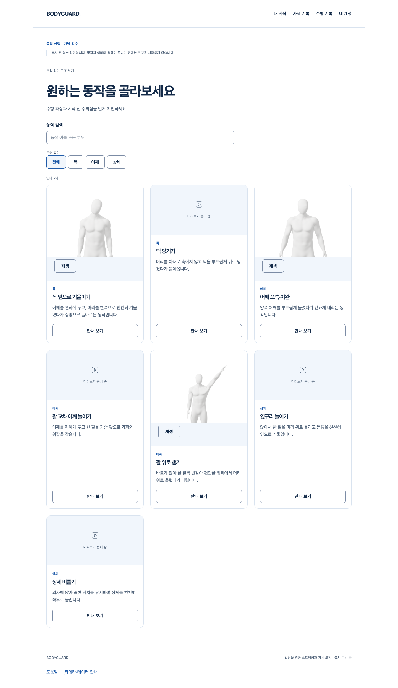

# 동작 카드의 실제 Blender 미리보기

2026-10-16 · [Story/제작 근거](../../stories/motion-preview-content.md) · base main8675f72 · 개발 전용, 최종 외형/올바른 자세 인증 아님.

## 실제로 연결한 흐름

`/dev/motions`의 목 옆 기울이기·어깨 으쓱/이완·팔 위로 뻗기 카드가 자체 제작한 3D 아바타의 대표 포즈를 보여준다. 커서를 올리거나 키보드로 진입하면 재생되며 다른 카드로 옮기면 앞 영상이 멈춘다. 수동 재생/정지와 오류 재조회가 있고 정지하면 대표 포즈가 복원된다. 코칭 화면의 동작 변경에서는 선택한 남녀 형태에 맞는 같은3종을 보여준다. 닫힌 대화상자·숨김/이탈·401 뒤에는 재생을 유지하지 않는다. 카메라/추론/판정/코칭 기록은 이 과정에서 시작하지 않는다. 나머지4종은 기존 안내와 준비 중 미리보기를 유지한다.



[800px 창](evidence/browser-d-catalog-800.png) · [여성 동작 선택](evidence/browser-d-female-picker.png) · [남성 영상](media/male-neck-side.mp4) · [여성 영상](media/female-neck-side.mp4). 영상은 최종 아바타가 아닌 미채택 후보의 개발 미리보기다.

## 제작·권리·보존

- PR150의 불변2be0ebe에 있는 전문 MPFB/MakeHuman CC0 후보를 별도 복사해 Blender5.1.1에서 키프레임을 저작했다. 신규 구매/계정·생성 이미지·단순 코드 도형으로 인체를 대체하지 않았다. 원본의 권리 문서/최종 외형/변형 검토는 PR150에 보존되고 이 미디어로 승인되지 않는다.
- [source-preservation](evidence/source-preservation.json)은 원본 Git byte와 복사본의 SHA256 `71c369c96667549d00a4e77ff5d0b301ce307d806d5f3b42e739f48b4b7a8a2d` 일치를 검사했다. [render-report](native/render-report.json)의 시작/종료 메시·면·가중치 해시가 남녀 각각 같다. 원본·GLB 덮어쓰기0, 이번 Story의 새 GLB export/브라우저 GLB 품질 검증0이다.
- [편집 원본](native/motion-preview-authoring.blend)에 남녀6action을 fake-user로 보존했다. [native-reopen](evidence/native-reopen.json)은 실제 파일을 다시 열어 모든 action의 시작/대표/복귀 회전 변화와 유한 변형 경계를 검사했다. 전신 관절 정확도/의학적 적합성 검증은 아니다.
- EEVEE512×512/24fps의 실제720프레임을 렌더한 뒤 흰색 합성·H264/무음 MP46개와 RGB PNG6개로 인코딩했다. [encoding-report](native/encoding-report.json)에 ffprobe의 프레임 수·해상도·코덱·길이와 원본 해시가 있다. 진폭/영상 길이는 작화값이며 판정/운동량 기준이 아니다. 상체 구도는 앉은 하체/의자 시범이 아니다.
- 720렌더 프레임·입력 복사본은 별도 `/private/tmp/bodyguard-motion-media.yZAKUQ`에도 남겨두었다. 저장소에는 최종 편집 원본/결과 미디어와 초기 후보18프레임씩·각 원본 gzip·실패/실행 로그를 보존한다. gzip은 원본 byte 복원/해시 일치를 확인했다. [전체 artifact 해시](evidence-manifest.json), [압축 전 해시](evidence/raw-compression.json).

## 실행 명령과 결과

실행 위치는 `bodyguard/frontend`, 새 임시 폴더를 사용한다. 아래 `scratch`는 실행마다 `mktemp -d /private/tmp/bodyguard-motion-media.XXXXXX`로 생성하고 입력 `.blend`를 별도 복사한다. 기존 출력에 덮어쓰지 않는다.

```sh
'/Applications/Blender.app/Contents/MacOS/Blender' --background <copied-source.blend> --python-exit-code 1 --python scripts/render-motion-previews.py -- <scratch> rendered-d video
node scripts/encode-motion-previews.mjs <scratch>/rendered-d encoded-a
'/Applications/Blender.app/Contents/MacOS/Blender' --background ../docs/review/motion-preview-content/native/motion-preview-authoring.blend --python-exit-code 1 --python scripts/check-motion-preview-native.py -- <scratch>
node scripts/test-motion-media.mjs <scratch> browser-d
pnpm test
pnpm build
pnpm check
node scripts/check-selection-production.mjs
ruff check scripts/render-motion-previews.py scripts/check-motion-preview-native.py
git diff --check
```

인코더는 새 결과를 저장소의 새 고정 경로에 복사한다. 이미 있는 결과를 교체하려면 새 Story/보존 경로를 먼저 지정해야 하며 그대로 재실행해 덮어쓸 수 없다. 원본·운영 자료·사용자 입력이 아닌 소유 후보만 입력한다.

- [browser-d.json](evidence/browser-d.json): 실제 Chrome155.0.8059.80·React·로컬 Vite·6개 실제 MP4 디코딩, 7흐름 통과. 실제 hover의 시간/decoded frame/픽셀 변화, 단일 소유 재생, reduced-motion 수동 제어, 잘못된 영상/대표 이미지의 오류→재조회 복구, 800/1440px 넘침, 계정401 후 회수를 확인했다. 실제 카메라·SDK worker·외부 요청·pageerror0, 파일 전후 해시 일치. API200/401만 모의이며 실제 로그인/서버 DB 시험이 아니다.
- `final-tests.log.gz`: 전체frontend1946개/109파일 통과. `final-build.log.gz`: typecheck/Vite build 통과. `final-check.log.gz`: 전체Biome exit0, 기존16info 유지. `scoped-check.log.gz`: 변경14파일 진단0. `python-check.log.gz`: 두 Blender 스크립트 Ruff 통과. `production-boundary.log.gz`: 미채택 미디어/개발 경로의 production 유출0. 로그는 [evidence](evidence/)에 있다.
- dev middleware는 고정12경로의 크기/정규 파일/SHA 검증 후만 제공한다. 합성 unit은 경로 이탈·금지 method·누락·손상·과대 파일을 검사한다. 실제 Chrome 재생 시험과 구분한다. 작은 MP4는 Range가 와도 제한 크기의 전체200으로 제공한다.
- browser-c는 unit/build와 일부 동시에 실행됐다. browser-d는 그 이후 별도 실행했다. 이 시험은 클릭/재생 기능 확인이며 추론 지연이나 목표 노트북의 아바타 성능 측정으로 승격하지 않는다.

## 실패·반려·검토

1. candidate-a: 동적 OCIO enum을 정적 목록으로 검증해 렌더 전 예외. Blender가 기본값으로 exit0을 반환했지만 실패로 기록했다. 원본 색 관리 유지·후속 명령의 `--python-exit-code 1`로 보완했다.
2. candidate-b: 카메라+Y가 뒷면을 보여주고 배경/표면 대비도 낮아 채택하지 않았다. candidate-c에서 -Y 전면/투명 렌더를 확인한 뒤 rendered-d 영상에 적용했다. 메시 회전/수정은 하지 않았다. b/c의 원본과 프레임·보고서를 모두 보존했다.
3. browser-b: 대표 이미지 복원 뒤 숨겨진 paused video를 visible로 기다리는 하네스가 실패했다. attached video와 visible poster를 구분해 고쳤으며 원래 실패는 남겼다. browser-a/c/d를 실패 삭제나 실제 사람 검증으로 세지 않는다.
4. 초기 DOM 검증에서 닫힌 코칭 대화상자가 영상3개를 선로딩하는 문제가 드러났다. 실제 열 때만 media를 전달해 기존 video0 계약을 유지했다. 기존 기대를 낮추지 않았다.

직접 코드 리뷰로 allowlist/동일 출처·임시/원본 보존·source 교체/late-play 경쟁·1개 재생·숨김/401/언마운트·포스터 오류·접근성/키보드·공개 build 제외·문헌의 정성 과정/작화값 구분을 확인했다. 위 보완 후 이번 개발 미리보기 Story에 알려진 미해결 P1/P2는 없다. 별도 PR150 외형/성능과 PR152 SDK 간헐적 준비/종료 P2는 해결되지 않았고 해당 Draft는 병합하지 않는다.

아직 미완료: 4종 추가 미디어, 검증된 올바른 코칭 시범/동작별 판정·신체 기반 추천·코칭 결과 생성, 최종 남녀 외형/변형/성능, 실제 사람 정확도·전체1~4단계/1~6단계 통과. 공급자/Docker/HTTPS·운영 DB/시크릿·배포/출시·비용/계정 변경은 실행하지 않았다.
