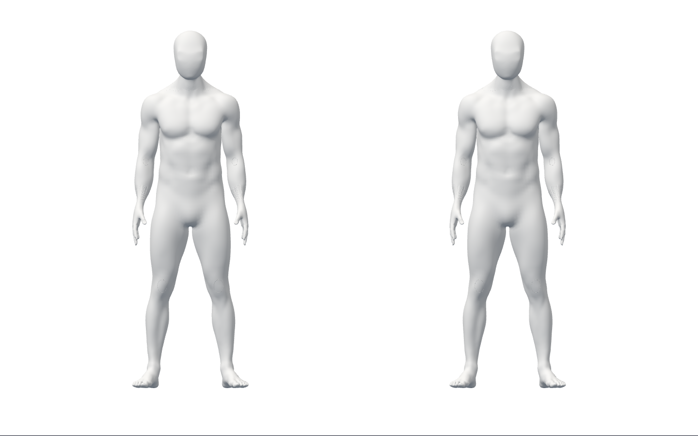
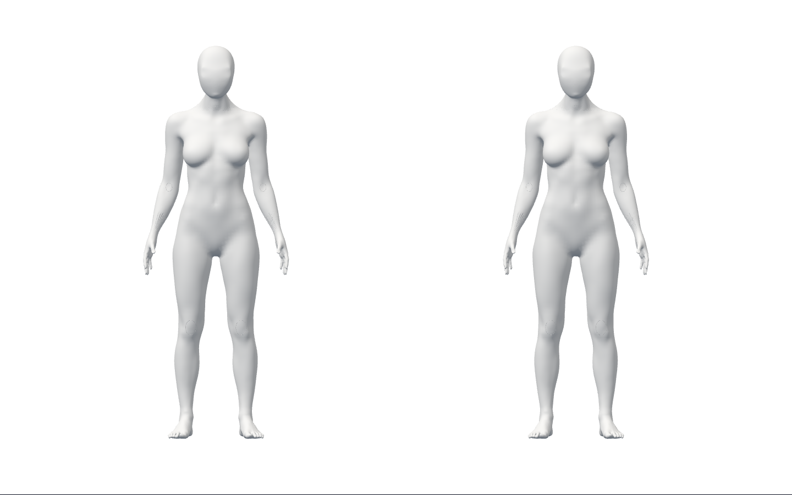

# native 카메라 복구와 재시작

S2.T10 / baseline708c6a0 / runtime9918072. 실제 재사용 adapter와 비공개 Chrome·API·격리 SQL 시험이다. 공개 코칭/전체1~6단계 완료가 아니다.

## 작동하는 흐름

- 로그인·새 준비만으로 카메라0. 명시 시작으로 native 가짜 카메라·SDK·남녀 두 GLB·RAF를 연결한다.
- 실제 브라우저 권한 denied → native 요청 거부 → SDK/모델/기록0 → 권한 복구 → 새 준비·명시 시작으로 재생한다.
- native camera 반환 보류 중 취소/새 준비 → 이전 반환/정리를 기다림 → 늦은 stream 종료 → 새 준비 완료. 자동 카메라 재시작0.
- 실행 중 track stop·시험 ended 이벤트 또는 GLB HTTP404 → 종료/프레임·모델·SDK·카메라 정리 → 새 준비·명시 시작으로 복구한다.
- 기존 같은 계정 갱신·logout204·서버 /me401·pagehide·unmount와 본인 interrupted·관찰0 기록 흐름도 유지한다.

13 단위는 native API mock이다. 브라우저는 실제 Chrome154·SDK/GLB/WebGL·인증/API/SQL이며 촬영/메일/motion gate·camera 반환 보류·ended 이벤트만 합성이다. 권한은 실제 Chrome 설정을 제어했으며 사람이 popup을 누른 시험이나 물리 webcam/케이블 분리가 아니다. 재시작 때 **새로 증가한 프레임**을 확인했다. 미검출을 정답/완료 수행으로 만들지 않았고 오류 복구 흐름의 기록 POST는0이다.

## 아바타 canvas 미리보기

기존 **미완성 A37**의 복구 후 전신 구도다. 최종 외형/올바른 시범/새 UI 시안이 아니며 손·얼굴/목 등의 이월 품질 문제는 그대로다. 원본 영상/input 스크린샷0이고 아래 PNG에는 아바타만 있다. 외형이나 GLB 원본을 바꾸지 않았다.

## 검증·실패 보존

[summary.json](summary.json)에 exact runtime·40소스 SHA·명령 exit·전체 frontend939/adapter13·native 복구8/계정 회귀12, 공개 JS/CSS/5모델 동일·GLB0와123증거의 SHA를 기록했다. readable 파일은 경로/행말만 정리했고 raw/*.gz는 원본 byte 그대로다. 압축 해제 SHA를 대조했다. GitHub 체크 없음은 CI 통과가 아니다.

미구현 최초 단위는 suite 실패/assertion0이다. 구현 후 happy-dom 누락으로13중12가 실패했고 명시 환경 뒤 통과했다. 첫 브라우저4 실패는 권한 시험 설정과 snapshot의 종료 사유 접근이었다. `SessionSnapshot.failure`는 내부 fail만 나타내므로 명시 end의 `state.result.reason`을 읽게 고쳤다. 제품 종료 동작 수정으로 주장하지 않는다. 다음2 실패는 CDP 연결 종료가 설정을 prompt로 초기화하는 문제였다. 별도 실제 Chrome에서 `denied/NotAllowedError → detach/prompt`를 재현했다. owning CDP를 native 요청/재시도까지 유지하고 자동 허용 fake-UI flag를 recovery 시험에서 제거해 통과했다. 실패 원본/실험을 보존하고 조건을 낮추거나 권한 오류 자체를 mock하지 않았다.

초기 launcher의 nativeSdkOrGlb=false는 잘못된 metadata다. 후속 receipt에서 정정했으며 초기 원본은 보존했다. runtime receipt는 실행 HEAD와 launcher SHA도 확인한다. 변경 runner만 Ruff를 실행했고 전체 backend pytest 실행으로 표시하지 않는다. 격리 DB 서버는 종료하고 데이터/시험 증거는 보존했다.

## 작성자 리뷰

code-review로 정확성·개인정보·성능/수명·유지보수를 검토했다. 별도 독립 리뷰가 아니다.

- model/rig/loader를 명시하고 prototype 키·잘못된 설정을 거부한다. 생성은 inert이고 공개 consumer가 없다.
- hidden detached video, 고정 camera 오류 종류만 제공한다. raw error·영상/좌표·계정 데이터 로그/저장/전송을 추가하지 않는다.
- native dispose는 외부 close 전에 idempotence를 게시하고 이벤트에서 raw 예외를 던지지 않는다. explicit cleanup에는 고정 ResourceCleanupError를 보존한다. SDK late 반환/cleanup 실패 후 camera 정리·재사용 차단을 단위로 확인했다.
- 기존 cohort 장벽이 pending 입력/결과를 닫은 뒤 active native SDK/camera를 닫는다. 새 bridge와 명시 재시작만 허용한다. 실제 cancelled late stream과 model HTTP 실패 복구를 확인했다.
- CDP/가짜 장치·CSP/self·외부 route/proxy·frame 계수·synthetic gate/개인 시험 번들은 테스트 전용이다. AuthProvider/API/SQL을 mock하지 않았다. 공개 build의 JS/CSS는 byte 동일하고 개발 adapter/fixture·GLB 유출0이다.
- CSP가 막은 SDK 외부 시도를 실제 관찰했다. route0·저장소0은 SDK 제품 무통신/개인정보 승인 증거가 아니다. B09는 별도 승인 대기다.
- 이 Story의 미해결 P1/P2 없음. 기존 외형/실측/디자인·SDK 정책/시작 지연 원인 P2를 닫거나 기준을 낮추지 않았다.

## 남은 출시 조건

물리 webcam·사람·권한 popup·다장치/장시간/GPU·worker, neck/체간/손/비틀림·세밀한 자세 판정, 검증된 시범/적색 교정, 최신 얼굴/목·최종 외형/권리, 승인된 클릭 구조·SDK 정책·실제 공급자/HTTPS/운영은 남는다. [이월 조건](../../stage2-carryover.md)을 유지한다. 공개 출시 동작0이며 미승인 화면 확장·조형/GLB 변경·운영 migration·배포/출시·시크릿/비용 작업0이다. 최소 텍스트 원칙은 유지하되 안전 안내/실패 복구·접근성 이름을 생략하지 않는다.
