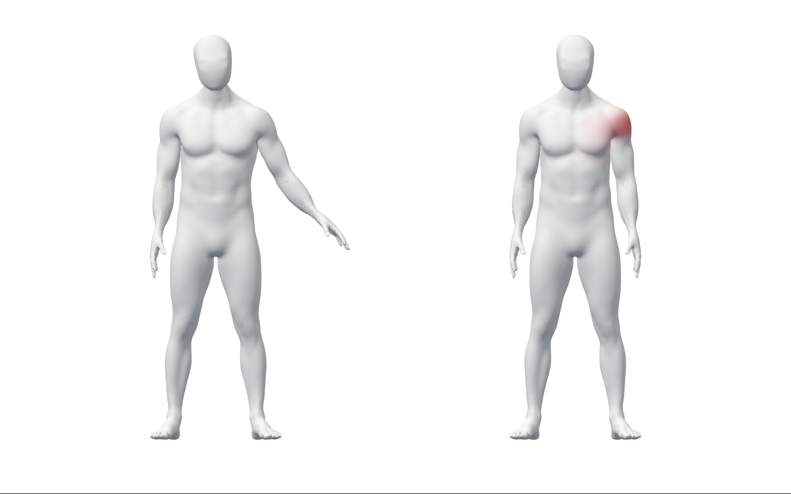
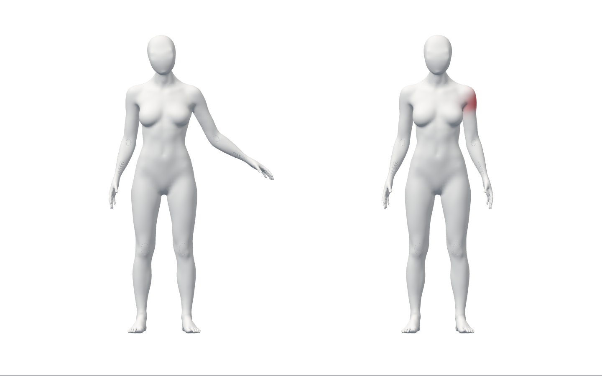

# S2.T20 — 같은 native 관찰의 코칭·오류 표시 연결

로그인 소유 세션에서 현재 관찰과 현재 코칭 상태가 일치할 때만 사용자 모델의
오류를 표시하고 시범은 현재 수행 단계에 반응한다. 가림·복수·미검출은 성공으로
채우지 않으며 종료/권한 회수 이후 이전 전달을 차단한다.
**비공개 통합 기반이며 실제 자세 판정·최종 외형·완성 웹·전체1~6 완료가 아니다.**

## 실제 화면·작동 흐름

아래는 runtime **d4f475c6682ea9d38716ad2b5d19313ac77b519d**의 실제
Chrome154.0.8037.98/WebGL이다. 왼쪽은 단계 시범 fixture, 오른쪽은 **합성
관찰·오류**다. 원래 native SDK 결과는 가짜 카메라에서 사람/얼굴/손0이며,
긍정 시험에서만 최종 JS body 배열을 원본 rest bone 기반 생성 좌표로 대체했다.
올바른 스트레칭이나 실제 사람 추적의 증거로 사용할 수 없다.
A37 목·전완·표면·변형은 미완성이며 승인 외형·공개 UI가 아니다.

- 실제 계정/API/격리 SQL/세 SDK/GLB로 준비→수행→오류 표시→가림/복수/미검출
  해제→복구→pause/새 세대, 단계 시범의 준비/수행/유지/복귀·정지/만료를 연결했다.
- 실제 GPU 색상 픽셀은 사용자 오른쪽 남3745/여1821, 시범 왼쪽0이다.
  가림/복수/미검출은 양쪽0이었다. 반환값은 픽셀 개수뿐이고 원시 픽셀/관절은
  로그·서버에 내보내지 않았다. 아바타 전용 screenshot과 합성 계정 화면만 보존한다.
- logout204·/me401·pagehide·unmount·같은 계정 refresh에서 이전 관찰/시범/재개/저장을
  차단했다. held native JS 반환은 async 경계의 모의 지연이며 실제 SDK latency가 아니다.
  반환 전 SDK/VideoFrame borrowed를 유지하고 반환 뒤 세 SDK·카메라·모델을 해제한다.
  fixture의 즉시 canvas 숨김은 테스트 caller UI이며 공개 UI 완료로 세지 않는다.
- 명시 중단→본인 interrupted 기록 저장→실제 기록 상세를 확인했다. observed_ms0이며
  합성 시범 관찰을 실제 운동 기록으로 주장하지 않는다. 종료 후 memory는 기존
  PBR cache 기준 geom0/texture1이고 같은 input의 native 결과/frame/자원을 정확히 정리했다.
- 커밋 소스의 통합16·옵션 없는 기존 시범 비교14·전체FE1145(실패/skip0),
  types·Biome247(경고/info0)·assets·Vite·변경 Python 하네스 Ruff·diff를 실제 통과했다.
  API 코드 변경/전체 API 회귀를 실행했다고 주장하지 않는다.
- 공개 JS355151/CSS31199 bytes는 PR82 main의 보존 파일과 byte 동일하다.
  남녀 GLB·5 SDK 모델은 기존 bytes이며 Blender 열기/조형/저장/GLB 수출0이다.
  운영·배포·시크릿·CI·제품 SDK 통신 정책·공개 구조 변경0이다.

## 실패·리뷰 보완과 한계

1. 구현 전14계약 실패. 첫 구현13실패는 테스트 bone 이름을 실제 리그와 다르게
   지정한 fixture 결함이다. 올바른 bone으로 고친 뒤91계약이 통과했다.
2. 재진입한 이전 callback/오류 getter의 예외가 새 관찰까지 중단하는 문제를
   2실패로 재현했다. evaluator를 command 밖에서 동기 실행하고 최신 token일 때만
   고정 기술 오류로 종료한다. abort/Promise/retained·borrow 경계도 확인했다.
3. 잘못된 phase/빈 step/NaN age가 강조에 도달하는 문제를3실패로 재현해
   identity·capture/관찰 시각·phase/step·bounded age를 확인한다. 최종 대상96통과.
4. 타입3오류(closure/mock 추론)와 browser2오류(readonly SDK 배열 직접 변경)를
   보완했다. 대체 결과는 원래 close에 위임하는 별도 객체다. 초기 정적/format
   오류를 보존했고 최종 경고/info0이다.
5. 첫 Chrome14통과/2실패는 시작·재준비 지연이었다. 다음15통과/1실패는 시작
   native 반환2/필요3으로5초 기준을 넘었다. 종료 전 snapshot의 이후7반환은
   확인했으나 간헐적 시작 지연 원인을 해결한 것은 아니다. timeout5000/60000ms,
   assert·판정 기준은 그대로다. 기존 출시 시작 P2/실사용 성능 게이트는 남긴다.
6. 시범 fixture를 재준비 때 중복 요청하지 않고 읽은 immutable 프로그램을 재사용한다.
   처음 격자 좌표의 기괴한 변형 화면도 첫 증거로 보존했다. 강화 fixture는 원본
   rest bone 기반이며 실제 몸을 추정·교정한 결과가 아니다. source/ref/GLB는 그대로다.
7. 같은 커밋 전체16재실행·옵션 없는 비교14는 통과했다. 성공을 시작 원인 해결/
   실제 카메라·노트북 성능 검증 완료로 표시하지 않는다.
8. 공개 guard에 자기 표식만 주입해 실제 실패를 확인한 뒤 원문을 보존하고
   **그 표식 파일 하나만 제거**했다. 복구 guard는 통과했다. DB는 정확한 자체
   인스턴스만 정상 종료하고 데이터/로그를 남겼다. 기존 원본/실패는 삭제하지 않는다.

author-only 리뷰로 권한·current state/시간·재진입·가림/복수·retained handles·
source/시범 독립·8가중치·cleanup·개인정보·실제 화면을 점검했다. 이 adapter diff의
미해결 P1/P2는0이며 독립 reviewer/전문가 승인/기존 출시 P2 해결의 뜻이 아니다.
공개 classifier나 임계값은 추가하지 않았고 실제 적격 동작은0이다.

## 증거와 다음 조건

[manifest](summary.json)의413파일은 runtime Git source21, 원문/압축·실제
화면/번들/receipt391과 Three 고지1을 연결한다. 압축 해제 후 bytes/SHA와
소스/공개 byte/GLB를 재검증했다. 대용량 SDK/GLB는 다시 커밋하지 않는다.
초기 일부 source snapshot·Git 기준선/hash/log만 있으며 모든 중간 source나
truncated tool output/비파괴 경로 조회 원문을 보존했다고 주장하지 않는다.
수집 후 문서·PR/commit/merge receipt는 이 manifest에 있다고 주장하지 않는다.

마지막 리뷰에서 검증 번들의 의존성 고지 누락을 보완했다. 실제 포함된 React/
React DOM/scheduler의 설치 LICENSE와 MediaPipe package.json·기존 canonical
Apache 원문 및 [별도 추가 고지 SHA](notices/README.md)를 보존한다. 최초413파일
manifest는 그대로이며 전체 SDK/WASM/model 권리·제품 배포 승인의 뜻이 아니다.

다음은 실제 동작 기준/오류 분류와 오류별 교정 시범 연결이며 선행 실측은 별도다.
같은 사람/깊이·목/체간/손/축 회전·실제 webcam/참여자/다장치·최종 남녀 얼굴/목/
표면/Blender·변형/권리·승인 공개 디자인/구조·SDK 정책·외부 계정·HTTPS/운영/
사용성/보안/성능·기존 시작 P2 및 전체1~6 완료 기준은 유지한다.
최소 텍스트·같은 부위 새 조형 보류·별도 운영/안전/개인정보 승인은 그대로다.
