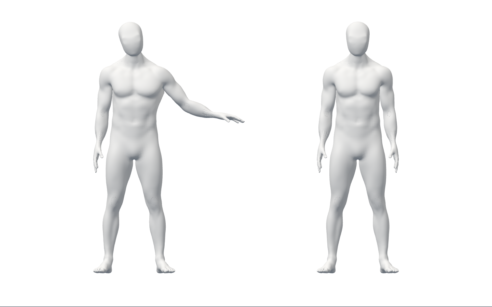
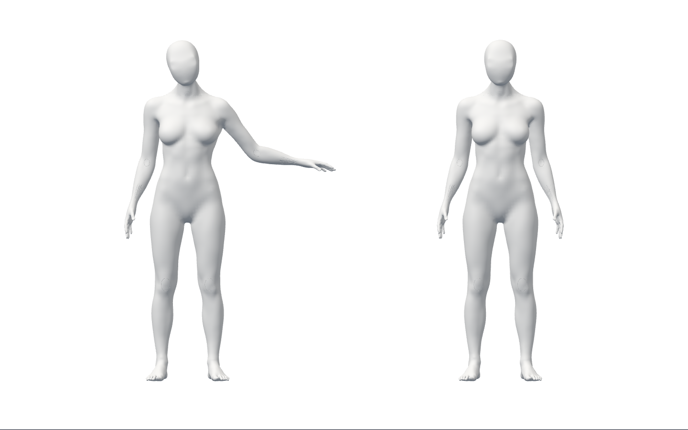

# S2.T18 — 실제 소유 세션의 비공개 시범 연결

로그인 소유 pair의 시범이 준비→수행→유지→복귀에 반응한다.
pause는 기존 pair를 해제하고 resume은 새 세대로 시작한다. logout/401/refresh/
pagehide/unmount 때 렌더·이전 cue·저장/재개를 차단하고 빌린 native 입력 반환 후 정리한다.
**Story 검증 결과이며 전체1~6/출시 완료가 아니다. 공개 화면 변경0·출시 동작0개다.**

## 실제 미리보기

수정된 runtime7dfc3bf의 남녀 실제 Chrome canvas다. 왼쪽은 보존된 Blender 시험 클립,
오른쪽은 blank 가짜 카메라의 미관찰 사용자 모델이다. **실제 사람 추적 화면, 검증된
스트레칭, 확정 웹 디자인 또는 최종 아바타 외형이 아니다.** 목·표면·전완 문제는 D2-A에 남는다.

## 작동한 흐름과 실제 검증

- 실제 AuthProvider·API·격리 PostgreSQL18.6·Chrome154.0.8037.98/WebGL/native
  Pose/Face/Gesture. 시범14흐름 및 reference 비활성 head12/hands12 회귀 통과.
- 수행·유지 시범의 마지막 관절 자세가 명시 시험 클립과 일치(수치 오차<2e-6).
  시범이 돌아도 합성 target 관측 전 verifiedMs0, 사용자 리그 독립 유지.
  cue 만료 정지, 복귀, pause/새 세대 resume, 동일 계정 새 소유자 명시 시작 확인.
- native SDK의 같은 frozen 입력/원래 시각과 blank 미검출0을 확인했다. phase는
  별도 합성 start/target 입력이다. target2000ms는 시험값이며 임상·출시 처방이 아니다.
  JS에서 최종 SDK 결과를 대기시킨 취소 시험은 실제 SDK 처리 지연 측정이 아니다.
- 전체 FE1113·types·Biome(경고/info0)·assets·Vite·공개 유출 guard·Ruff·diff를
  수정된 커밋7dfc3bf에 고정해 재실행했다. guard 주입은 실제 실패, 제거 뒤 실제 통과.
- 원본 blend/남녀 GLB·5모델·공개 JS355151/CSS31199 bytes 동일. 이번 Story에서
  Blender 원본 재열기/제작/조형/GLB 재수출은 하지 않았다. PR80의 메모리 제작 fixture 재사용.
- 외부 route 요청0·storage0·영상/관절 좌표 캡처/저장0. SDK CSP 차단 시도는 별도
  counters에 남는다. 제품 SDK 무통신 또는 egress 정책 승인 증거가 아니다.
- 시험 DB는 종료했고 데이터와 실패/번들을 보존했다. 운영 DB·배포·시크릿·비용 작업0.

## 실패·리뷰 보완

1. 미구현 계약 RED53통과/6실패→구현59통과. 입력 getter 재진입/고정 오류/세대 순서를
   보강한62통과는 추가 계약 확인이며 실패 보완으로 허위 표시하지 않는다.
2. 최초 브라우저14통과는 `referenceMoved`만 비교한 약한 기준이었다. 실제 시범은 거의
   rest였고 부동소수점 변화가 이동으로 집계됐다. 이 결과를 올바른 시범 검증으로 세지 않는다.
3. 정확한 시험 quaternion 종단 비교를 추가한 runtime8c24d5b에서12통과/2실패했다.
   session 시각이 현재 RAF보다 늦을 때 즉시 전달한 cue가 매번 stale 정지를 만들었다.
   **원래 render 시간이 cue에 도달할 때 현재 권한을 재확인해 전달**하도록 보완했다.
   두 시각을 다시 찍거나 임상 허용 기준을 낮추지 않았다. 시간 RED62/1→63통과.
4. renderer가 보관한 pair도 종료 권한을 우회하지 못하도록 getter/관측/명령/렌더를
   보호했다. retained pair RED63/1→64통과. borrowed 입력 회수 전 SDK를 먼저 닫지 않는다.
5. 실제 강화 브라우저14통과 및 이전 native24회귀·전체1113 재검증. 첫 약한 화면,
   실패 커밋/번들·report/오류·stdout/stderr와 보완 화면을 모두 별도로 보존했다.
6. 비파괴 파일 조회 중 잘못된 경로/완성 전 작업트리 조회는 도구 오류였다.
   전체 원시 도구 출력 파일을 별도 보관했다고 주장하지 않는다. `types-fixture`는
   포맷 작업과 겹쳤으므로 최종 동일 소스 증거로 쓰지 않고 실제 최종 검사를 사용한다.

author-only 검토: 권한·시각·경계/재진입·해제·성능/불필요 할당·개인정보·기본 호출 회귀와
실제 화면을 점검했다. 발견된 Story P2를 보완했고 미해결 Story P1/P2는0이다.
독립 전문가·외부 reviewer 승인 또는 전체 출시 품질 충족을 의미하지 않는다.

## 증거와 남은 조건

[manifest](summary.json)은 runtime7dfc3bf의 source26, 실패 runtime8c24d5b source13,
증거352개의 원본/압축 SHA와 실행 receipt를 포함한다. gzip을 풀어 원본 SHA를 검증했다.
대용량 GLB는 이전 Git25a9bd6/보존 경로와 SHA로 연결하며 새 복제물을 PR에 넣지 않는다.
private probe.js는 보존하지만 그 옆에 재복제된 SDK 정적 배포물은 다시 아카이브하지 않는다.
최초 증거 커밋의 원시 DB 초기화 로그는 빈 EOF 때문에 diff 검사에서 실패했다.
원본 byte를 바꾸지 않고 gzip 보관으로 전환하고 실제 실패 receipt도 추가했다.
모델5 SHA는 assets.json, 실제 외형/임상 권리는 D2-A/P에 남는다. Three의 실제 MIT 고지 포함.

최종 외형/변형/권리, 실제 참여자의 시작·목표·복귀·보상/가림 오판정, 신체 대응/경추·체간,
검증된 시범·적응형 오류 강조, 승인 공개 선택→두 아바타→결과 흐름, 실제 webcam/다장치,
Gmail/Google·SDK 정책·HTTPS/운영·사용성/보안/성능 게이트는 미충족이다.
검증된 오류 안내/비교의 독립 연결을 이어가되 실제 classifier/공개 UI 승격은 선행 조건을 따른다.
기존 사전 승인·최소 텍스트·원본 보존·별도 승인 및 전체1~6 완료 기준을 유지한다.
