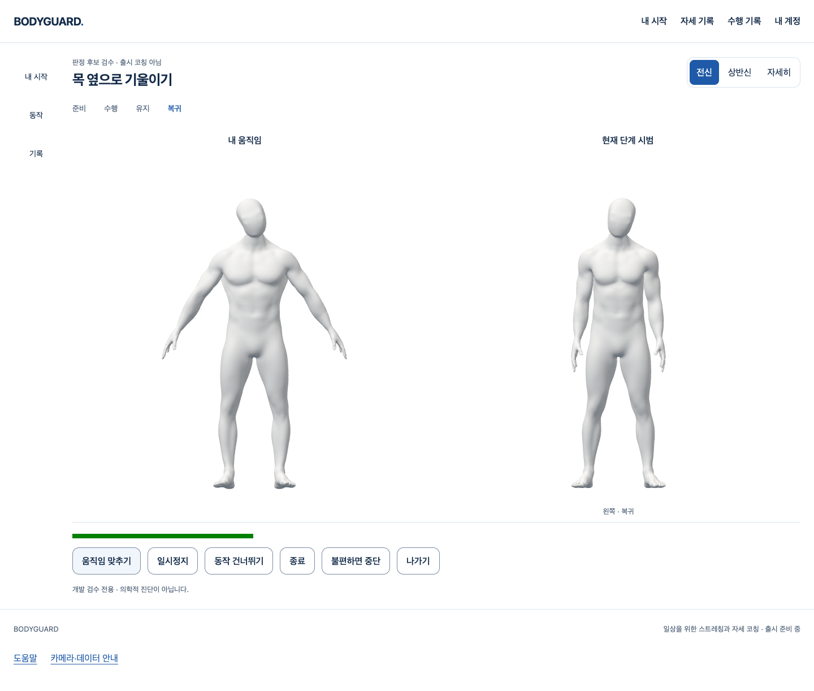
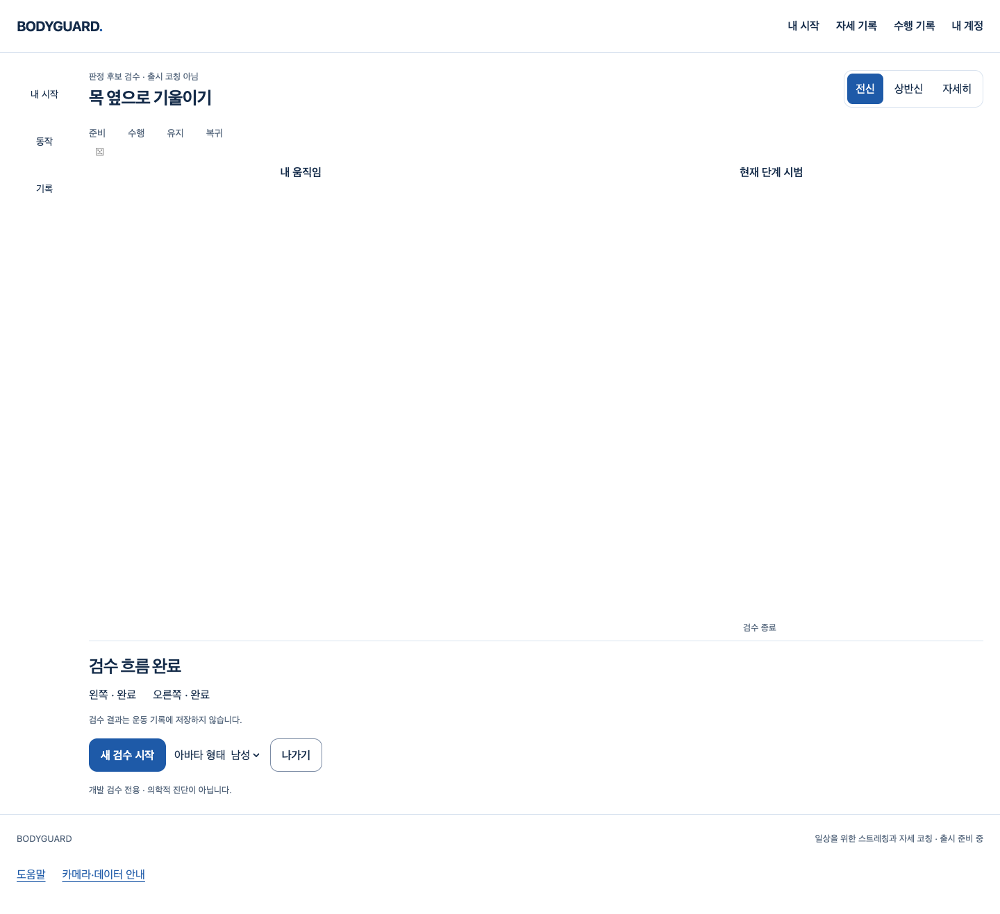

# 목 코칭 후보 — 두 아바타·단계 진행·결과 화면

2026-10-16 · [Story](../../stories/neck-coaching-workspace.md) · 시작 main `5b03763`.

## 이번에 작동하는 흐름

기존 화이트·블루/둥근 컨트롤과 좌우 공용 공간을 유지한 `NeckCoachingRun`을 만들었다. 명시 검수 구성으로 시작하면 한 카메라/Worker/소스/GLB 소유 묶음이 기존 `useRecordedPlayback`·분류기·진행 엔진을 연결한다. 별도 `CameraPreparation`을 동시에 마운트하지 않는다. 신규 라이브러리·API·DB·운영 변경은 없다.

- 왼쪽은 같은 원래 세대·순서·촬영 시각의 관찰을 받는다. 머리·손의 ‘움직임 맞추기’는 다음 입력을 이용한 표시 기준이며 정자세 인증이나 개별 목 관절 측정이 아니다. 재개 때 새 기준이 필요하다.
- 오른쪽은 실제 Blender에서 제작한 준비/수행/유지/복귀·좌우 클립을 현재 단계에 따라 한 번 재생한다. 어깨선/머리 위치 오류는 준비 클립을, 방향/범위 오류는 현재 목표 단계 시범을 다시 보여준다. 새로운 치료 동작을 코드로 지어내지 않았다.
- 빈 입력은 준비로 돌아가며 유지 시간이 늘지 않는다. 일시정지 후 카메라·SDK·GPU를 정리하고 명시 재개하면 새 세대/새 canvas를 쓴다. 결과는 좌우 완료/부분/진행 전을 구분하며 불편 중단·기술 오류·취소를 성공으로 바꾸지 않는다.
- 결과 제목으로 키보드 초점을 옮긴다. 전신/상반신/확대와 남녀 표시, 오류 후 새 검수, 숨김/401 회수와 자동 재시작 금지를 유지한다. 늦은 권한 응답은 회수하고 Worker/아바타 준비를 이어가지 않는다.
- 후보 결과는 운동 기록에 저장하지 않는다. 저장 버튼·기록 POST·좌표/영상 전송·브라우저 영구 캐시를 추가하지 않았다.

## 적용 범위: 공개 코칭이 아니다

기본 `CoachingPage`에는 실행 구성이 공급되지 않으므로 기존 ‘코칭 준비 중’ 상태가 유지된다. `run`은 명시 개발 구성 주입 지점이고, 이번 실행은 **테스트 Vite alias만** 수학 fixture를 공급한다. 일반 페이지에 fixture/정답 각도/운동량 기본값이나 사용자 입력 파일을 연결하지 않았다. `releasedMotionIds`는 여전히 비어 있다.

검수 구성의 shape가 motion gate를 승인하지 않는다. false gate는 카메라/Worker/GLB 획득 전에 거부된다. 성공 시험의 true gate와 `50ms` 유지·각도 band는 생성 입력의 상태 전이를 검증하는 자극일 뿐, 사람의 올바른 동작/안전한 운동량 또는 출시 허용 근거가 아니다.

빨간색 **문구** 피드백까지 연결했다. 목/머리/쇄골의 세밀한 실제 신체 표면 착색은 아직 없다. 현재 표시를 해당 관절 단위의 정확한 오차 시각화로 주장하지 않는다. 프로필/콘텐츠의 실제 검증, 나머지 동작·추천, 최종 에셋 외형/변형/성능·공개 적용과 실제 결과 저장 통합은 후속 필수다.

## 실제 검증과 구분

`scripts/test-neck-workspace.mjs`는 실제 React/AuthProvider/기존 소유 세션·classifier·진행·WebGL/자체 GLB를 사용한다. 카메라/Worker/계정은 모의이며 좌표는 수학적으로 생성한다. false gate, 오류/가림, 일시정지/새 세대 재개, 좌우 복귀 후 완료, 여성/확대/800px, 불편 중단, 지연 권한 취소/늦은 회수, 추론 실패/명시 새 검수, 숨김/401을 검사한다. 실제 사람·SDK 정확도나 SQL 저장 시험은 아니다.

`scripts/test-neck-workspace-native.mjs`는 **실제** MediaPipe Worker/모델/WASM·GLB와 Chrome의 **빈 가짜 장치**를 쓴다. 계정과 프로필만 fixture다. 새 연결→빈 입력 적립0→일시정지/실제 자원 정리→명시 새 연결/중단을 확인한다. SDK 경로 확인을 생성 입력의 양성 판정 시험과 섞지 않는다. 실제 OS 카메라·참여자 영상/좌표는 사용하거나 저장하지 않았다.

프런트 전체 테스트, 원래 typecheck/notice/Vite build, Biome(기존 info는 별도 표시), production 후보 격리, `git diff --check`를 실행한다. 최종 명령/결과와 소스 SHA는 `evidence-manifest.json` 및 원문 압축 증거에 연결한다. 미실행: 실제 사람·촬영 정확도/안전성·SQL 결과 쓰기·Blender 신규 제작/GLB 재수출·최종 조형/노트북 성능·공급자/Docker/운영 배포.

| 실제 실행 | 결과 | 증거/한계 |
|---|---|---|
| 최종 `browser-i` | 6흐름 통과, page error/운동 기록 쓰기/실제 장치/SDK/외부 요청0 | 생성 관절·모의 카메라/Worker/계정, 실제 React/GLB/classifier/진행 |
| 최종 `native-c` | 2흐름 통과, 실제 Worker/모델/WASM 요청·빈 입력 적립0·두 번 연결/회수 | Chrome 가짜 장치이며 사람/양성 판정 검증 아님; RAF receiver 차이도 실제 재현 |
| `pnpm test` | 120파일 / 2021통과 | 새 UI 테스트6 포함, 모의 playback을 실제 SDK/아바타 증거로 세지 않음 |
| 원래 `pnpm build` | 타입/notice/Vite 통과 | `build-c`, build 후 `guard-c`에서 후보 코드/GLB/media 격리 |
| `pnpm check` / scoped | 전체 오류0·기존 info16 / 변경 코드12파일 진단0 | `check-b`, `scoped-final` |
| `git diff --check` | 통과 | 최종 staged diff도 별도 확인 |

## 실패 보존과 보완

1. `browser-a`는 첫 연결 후 수행 상태를 기다리다 실패했다. 새 실행의 DOM canvas가 준비되기 전에 이전 노드를 사용할 수 있는 경로를 닫았다. 실행 번호+세대가 일치하는 실제 노드를 callback ref로 인계하며, 기다리는 작업도 소유 신호 취소를 따른다. 원래 오류 세부 원인을 과도하게 단정하지 않는다.
2. `browser-b/c`는 일시정지에서 `cleanup-error`로 종료됐다. 빈 Chrome에서 네이티브 `cancelAnimationFrame.call({},0)`가 TypeError, 래퍼 호출이 정상임을 실제 재현했다. 소유 스케줄러가 native 함수를 다른 receiver에 바인딩하지 않도록 래퍼로 바꿨고, 이후 실제 SDK 정리/재개도 확인했다.
3. `browser-d`는 추론 오류 결과에 alert가 없어 실패했다. 기존 onFailure가 `session.end(reason)`을 호출하므로 `snapshot.failure`뿐 아니라 결과의 제한된 종료 사유를 확인해야 했다. 사용자 중단/불편/건너뛰기는 기술 오류로 표시하지 않는다.
4. `browser-e`는 fixture가 `document.hidden`만 바꾼 상태에서 자원 회수를 기다리다 실패했다. 실제 소유 수명주기는 `visibilityState`를 사용한다. 두 속성이 일치하도록 fixture를 고쳤고, 화면도 동일 조건으로 상태를 지운다. 실제 숨김 자원 수명주기 조건을 느슨하게 만들지 않았다.
5. 초기 타입 검사에서 snapshot의 리터럴 추론·DOM Testing Library의 잘못된 `exact` 옵션·nullable canvas waiter가 실패했다. 타입/명시 null guard를 보완했다. 초기 Biome의 불필요 의존성 지적도 실제 구성/계정 회수 조건을 사용하도록 고쳤다. 터미널에만 남은 첫 타입/Biome 실패를 저장된 원문 파일이 있는 것으로 꾸미지 않는다.

과거 실행의 사진/JSON/로그는 덮어쓰지 않는다. 예전 `guard-a`는 build-a가 타입 오류로 실패한 뒤 이전 dist를 검사한 것이므로 **이번 소스의 build/격리 통과로 세지 않는다**. 성공 build 이후의 guard만 최종 증거다. 기존 PR150/152의 외형/성능·과거 간헐 SDK P2를 이 신규 실패와 같은 원인으로 종결하지 않는다.

실패 실행의 JSON은 당시 before/after SHA를 보존한다. 당시 모든 TypeScript 원본을 별도로 복사해 두지는 않았으며, 그 복사본이 존재하는 것으로 표시하지 않는다. 최종 실행 소스 원문은 압축해 보존하고 최종 SHA/현재 파일과 대조한다.

## 리뷰·남은 기준

작성자가 실제 diff를 자원 소유권/늦은 결과·세대/시각·계정 회수·API 쓰기/원시 데이터 경계·공개 격리·화면 복구/키보드 관점에서 검토한다. 자동화 시험이 사람 정확도나 임상 승인을 대신하지 않는다. 기존 Draft·원본·이전 GLB/실패와 승인 경계를 보존한다. 이 Story만으로 1~4 또는 1~6 완료/출시 후보판을 선언하지 않는다.

작성자 리뷰에서 DOM 노드 인계, native RAF receiver, 기술 종료 사유 표시, 숨김 상태/결과 초점과 취소 안내를 보완하고 최종 실행으로 확인했다. 이 좁은 개발 검수 범위에서 미해결 P1/P2는 발견하지 않았다. **코칭의 실제 정확도/출시 품질에 대한 승인이나 기존 Draft P2의 해결 판정은 아니다.** 다음 필수 구현은 검증 가능한 목/머리/어깨 표시 범위에 맞는 오류 표면 강조·나머지 콘텐츠/추천·실제 결과 저장의 공개 전 통합이며, 임상 기준·최종 외형/성능 게이트는 그대로 남는다.
