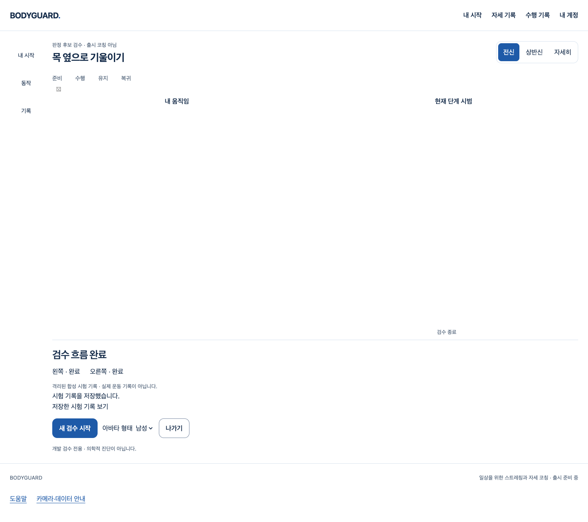
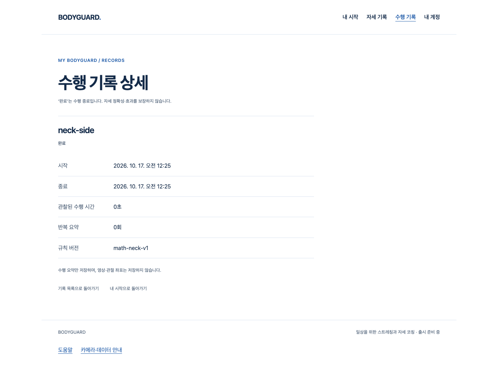

# 현재 목 코칭 결과 → 명시 저장 → 실제 수행 기록

2026-10-17 · [S4.R11 명세](../../stories/neck-result-recording.md) · 시작 main `eb94fac57e33ce35afa6d072a701a3aceedae31f`.

## 연결한 흐름

기존 `NeckCoachingRun`의 좌우 완료·중단 결과에 수동 저장·진행/실패·같은 기록 재시도·기록 상세 이동을 연결했다. 기존 UUID/준비 시 UTC와 단조 시계·계정 lease·CSRF·8필드 요약·멱등 API/SQL을 재사용한다. 새 메뉴·CSS/디자인 개편·API/DB schema·원시 영상/좌표 수집은 없다.

**기본 후보 화면은 계속 저장하지 않는다.** DEV/loopback의 명시 `recording: 'isolated-local-test'` 구성만 시험 저장 컨트롤을 보여준다. 실제 실행은 test Vite entry에서만 이 표식을 공급한다. 표식/프로필 shape는 임상·출시 적격이나 서버 DB 격리를 입증하지 않는다. locked runner와 새 소유 PostgreSQL이 실제 시험 DB를 격리한다. 공개 bundle에는 후보 실행·표식·시험 문구/entry를 넣지 않았다.

- 명시 클릭 후 해당 네이티브 owner의 늦은 획득/추론까지 정리하는 barrier와 세션 정리를 기다린다. 정리 실패 상태도 별도로 확인하고 공통 저장/재시도에서 `cleanup-error`를 차단한다.
- 중복 클릭은 한 작업으로 막는다. 수락 뒤 응답이 끊겨도 자동 재시도/새 UUID를 만들지 않는다. 명시 재시도만 같은 결과를 보낸다. 401/403/409는 성공이나 안전한 재시도로 바꾸지 않는다.
- 계정 refresh/변경·숨김/나가기·새 구성/검수는 이전 lease/요청을 회수한다. 늦은 응답으로 성공 UI를 되살리지 않는다. 취소가 이미 수락된 서버 쓰기를 되돌린다는 뜻은 아니다.
- 성공/실패 알림에 초점을 옮기고 기존 결과/버튼 스타일을 유지한다. 기록은 기존 상세/목록에서 조회하며 `client-reported` 요약이지 자세 정확성·효과 승인이 아니다.

## 실제 실행·한계

| 실행 | 결과 | 증거 범위 |
|---|---|---|
| `tests.run_browser neckrecording --config playwright.neck-recording.config.ts` · `browser-b` | 3흐름 통과 | 실제 Chrome/React/AuthProvider/classifier/진행/GLB/GPU/API/CSRF/PostgreSQL. 카메라·Worker/관절·프로필·메일만 합성. 사람/실제 SDK 정확도 아님. |
| N01 | 완료·중단 각각 저장·기존 상세 조회, 본인 목록2/타 계정 목록0·상세404 | 제한8필드·시간/관찰량·자원 회수·알림 초점·`client-reported`. |
| N02 | 실제201 수락 뒤 응답 단절 → 같은 UUID/본문 명시 retry200 → SQL-backed 목록1 | 자동 재시도/새 proof 발급0. 모의 API가 아니라 실제 서버 수락을 끊은 시험. |
| N03 | 여성 GLB 후 cookie 계정만 교체 → 옛 proof403·양쪽 계정 목록0 | 자동 재인증/재저장0. 실제 장치·SDK·외부 요청0. |
| 기존 기본 후보 `recording-default-a` | 8흐름 통과·기록 쓰기0 | 실제 Chrome/GLB/classifier/engine + 생성 입력/계정/Worker. 두 아바타/표면·재개/결과·숨김401 유지. |
| `pnpm test --maxWorkers=2` · `full-a` | 121파일 / 2033검사 통과 | 일반 회귀 전체. 새 UI10검사와 공통 cleanup 차단1 포함. |
| 원래 `pnpm build` → production guard · `build-a/guard-a` | 타입/notice/Vite·공개 격리 통과 | 성공 build 뒤 guard. test config로 공개 빌드를 우회하지 않음. |
| `pnpm check` / scoped | 오류0·기존 info16 / 변경10파일 진단0 | runner Ruff/format 통과. config/suite 불일치2건은 DB/포트 이전 거절. |
| `git diff --check` | 통과 | 최종 staged diff도 확인. |

두 실제 API 실행은 **각각 새 소유 private Unix-socket PostgreSQL18**을 썼다. 첫 실패 DB를 다시 초기화하지 않았다. UID/inode/PID/실제 postgres 명령을 확인해 해당 서버만 종료했으며 데이터/실패를 보존했다. API/웹 시험 서버는 runner/Playwright가 정리한다. 운영 DB·Docker·SMTP/OAuth·외부 계정/시크릿·배포는 사용하지 않았다.

실행 전후30개 핵심 소스 SHA와 기본 browser 전후 SHA·최종 소스/산출물 압축을 `evidence-manifest.json`에 연결한다. DB 데이터·mailbox/cookie/CSRF/환경 시크릿은 저장소에 복사하지 않는다. 기록 화면의 동작명 ID/종료 뒤 여백 등 기존 화면 표시는 이번에 개편하지 않았다.

## 실패 보존·리뷰

1. `type-b/d`: test fetch mock의 호출/선택 반환 타입 오류를 실제 응답 함수 타입과 없는 fixture guard로 보완했다. 최종 타입/원래 build 통과.
2. `unit-c`: 정리 실패에도 POST1이 발생했다. generic controller가 rejected promise 대신 notice/snapshot으로 실패를 알렸다. native owner 정리 대기+snapshot 검사와 공통 `recordedSession.save/retry` 차단·회귀 검사를 추가했다. `unit-d`45검사와 전체 회귀에서 POST0/재획득 격리를 확인했다. 실패 시험을 삭제하거나 기대를 느슨하게 만들지 않았다.
3. `browser-a`: N01/N02가 Vite module/화면 준비 전에 fixture를 조작해 실패했고 N03은 통과했다. 실제 시작 버튼 준비를 기다리도록 **시험만** 고쳤다. 제품 gate/판정은 바꾸지 않았다. 새 DB의 `browser-b`3흐름 통과.
4. 초기 uv cache 권한 오류·잘못된 cwd Biome 호출은 터미널에만 남아 있다. 설치/설정 변경 없이 기존 `.venv` 도구를 직접 썼다. 당시 Ruff 로그 경로가 이후 검사로 재사용돼 초기 원문 파일이 보존됐다고 주장하지 않는다. 나머지 저장된 타입/단위/browser 실패·JSON/사진은 보존한다.

작성자가 실제 diff를 자원/세대·계정 identity/옛 proof·중복/응답 단절·초점·요약만 전송·공개 격리와 runner config 경계 관점에서 검토했다. 위 문제를 보완했고 이 좁은 Story에서 미해결 P1/P2를 발견하지 않았다. 독립 외부/임상 리뷰는 아니다.

## 남는 출시 조건

공개 코칭·임상 프로필/출시 적격 동작·추천·다른 동작 통합은 남는다. 사람/촬영 정확도·최종 아바타 외형/성능·신규 Blender/GLB·실제 SDK의 이번 저장 흐름·전체 backend pytest/기본 전체 browser suite·공급자/Docker/HTTPS/운영 검증은 이번 미실행이다. 기존 Draft150/152/SDK P2·별도 승인과 전체1~4/1~6 기준을 유지한다. 다음은 동작별 근거/실행 프로필·추천과 공개 전 통합이다.
