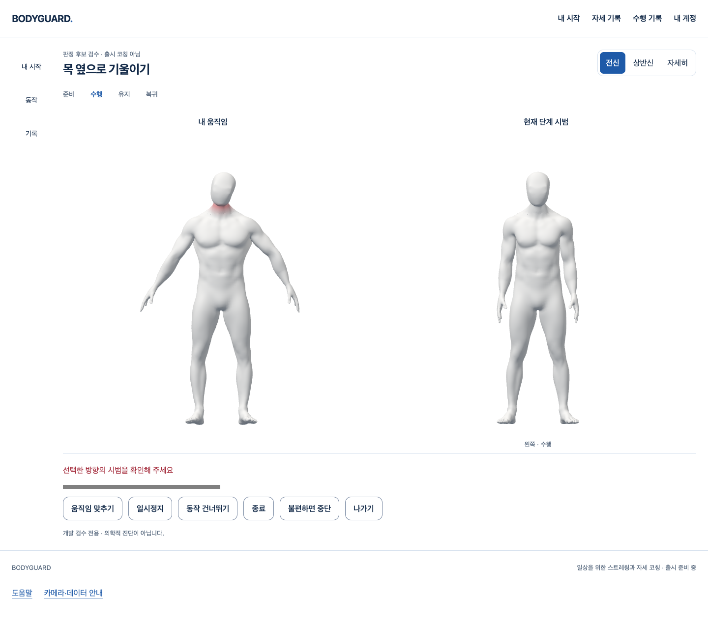
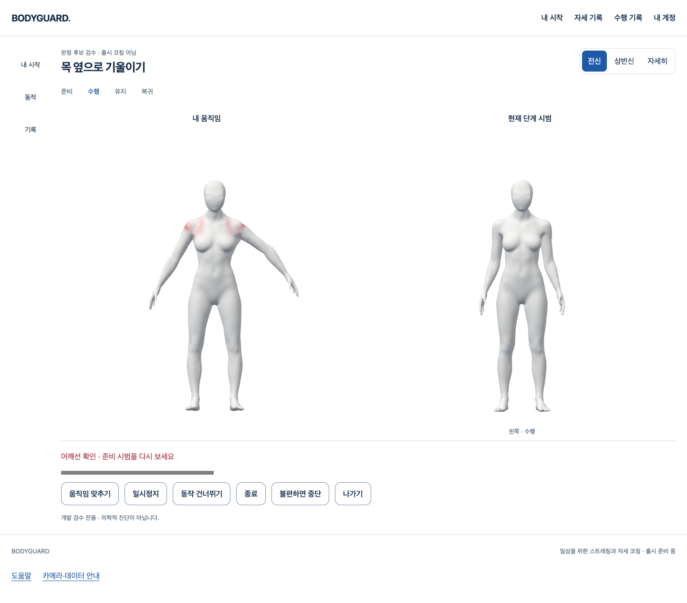

# 목·어깨 오류의 사용자 아바타 표면 표시

2026-10-16 · [S3.C3 명세](../../stories/neck-surface-feedback.md) · 시작 main `3b71975427b6b88e66b375543030645db604d0e8`.

## 작동하는 화면

기존 코칭 후보 화면의 같은 카메라/Worker/세대/촬영 시각을 사용한다. 판정이 보낸 목·어깨 오류를 **왼쪽 사용자 GLB에만** 표시한다. 오른쪽 Blender 시범·현재 단계 반응과 기존 메뉴/흰 공용 공간은 유지한다. 새 카메라·의존성·API·DB 쓰기는 없다.

- 목 오류: 현재 귀/어깨 투영과 실제 머리 표시 추적이 모두 유효할 때만 목 표면을 강조한다. 개별 경추 관절의 회전 측정이 아니다.
- 어깨 오류: 관찰한 어깨선에 대응하는 양쪽 표시 영역을 강조한다. 단일 카메라의 어깨선만으로 어느 근육/쇄골 관절이 원인인지 단정하지 않는다.
- 가림·낮은 신뢰도·다인·입력 만료·중단/세대 교체에는 색을 해제한다. 확인 불가 색이나 초록 성공 표시를 추가하지 않는다. 원래 판정·진행의 보류 조건을 바꾸지 않는다.
- 원본 가중치를 색상 마스크로 읽되 얼굴/가슴 번짐은 bind-space feather로 제한한다. 색 경계 비율은 표시 설계이고 임상 판정 수치가 아니다. 같은 오류가 지속되면 전체 정점 색 버퍼를 반복 작성하지 않는다.

## 실제 검증

| 실행 | 결과 | 무엇을 검증했는가 / 한계 |
|---|---|---|
| `browser-e` · `test-neck-workspace.mjs … with-surface` | 8흐름 통과 | 실제 Chrome/React/classifier/진행/GLB/GPU. 남녀 목·어깨, 오른쪽 중립, 머리 추적 소실/입력 만료 해제·복구, 일시정지/새 세대, 좌우 결과, 800px/확대, 지연 권한/오류/숨김/401. 카메라/Worker/계정·관절은 생성 fixture다. |
| `native-a` · `test-neck-workspace-native.mjs …` | 2흐름 통과 | 실제 Worker/MediaPipe/모델/WASM/GLB와 Chrome 빈 가짜 장치. 빈 입력 적립0·실제 자원 정리/명시 재개. 사람·양성 자세 정확도 증거가 아니다. |
| `pnpm test --maxWorkers=2` · `full-f` | 121파일 / 2022검사 통과 | 모든 일반 단위/화면 회귀. 기존 환경 격리는 유지하고 동시 실행 수만 제한했다. |
| `pnpm test:neck-surface` · `proof-a` | 남녀 실제 GLB 2검사 통과 | 고정 SHA·6개 원본 geometry 속성·원본/시범 독립·모든 정점의 CPU 스키닝 결과 동일. 머리 추적/관찰·시각/세대·재진입/중단·색 버퍼 재사용도 검사한다. |
| 원래 `pnpm build` → production guard · `build-d/guard-d` | 통과 | 타입/notice/Vite 및 공개 bundle의 후보 판정·fixture·GLB 격리. |
| `pnpm check` / 변경 코드 검사 · `check-c/scoped-final-b` | 오류0·기존 info16 / 변경18파일 진단0 | 기존 info를 수정 완료로 세지 않는다. |
| `git diff --check` | 통과 | 최종 staged diff도 확인한다. |

일반 회귀와 고정 GLB 전체 정점 검증은 둘 다 필수다. 후자는 큰 모델 파싱/CPU 검증이므로 별도 단일 worker 설정에서 실행한다. 15초 예산은 이 CPU 시험에만 적용하며 제품 카메라/SDK/판정 시간 제한은 변경하지 않았다. 검사를 삭제하거나 기본 회귀에서 조용히 생략한 것이 아니다. 일반 검사는 새 경량 정책 검사를 포함하고, 전체 GLB 검사 명령은 위에 명시했다. CI workflow는 변경하지 않았다.

`evidence-manifest.json`에 실제 실행 산출물·최종 소스 원문 압축/SHA와 `browser-e/native-a`의 실행 전후 SHA 대조를 보존한다. 영상·실제 사람 좌표를 사용/저장/전송하지 않았다. 화면 사진은 생성 입력의 자체 렌더 결과다.

## 실패와 보완

1. `unit-a`: 변형 전후 대조 사이에 테스트가 rig를 한 번 더 진행해 실패했다. 동일 포즈의 전체 정점 SHA를 비교하도록 고쳤다. 원본 deform를 바꿔 통과시키지 않았다.
2. `browser-a/b/c`: 초기 목 색이 턱/가슴으로 번지거나 어깨 안쪽 띠에 치우쳤다. inverse-bind 관절 기준의 표시 feather를 보완했다. 원본 정점/노멀/가중치는 변경하지 않았다. 최종 mask는 `browser-e` 소스와 같다.
3. `browser-d`: 여성 검수의 오류 입력이 다음 새 검수에도 남아 준비 단계를 통과하지 못했다. 새 사용자 준비를 모사하는 fixture를 중립으로 초기화했다. 실제 시작 판정 gate는 느슨하게 만들지 않았다.
4. `type-a/c`와 `build-a`: projected 배열/포트 mock/BufferAttribute 좁히기/재진입 fixture 타입이 실패해 보완했다. `guard-a`는 실패 build 뒤 이전 dist 검사이므로 이번 소스의 최종 빌드 증거로 세지 않는다.
5. `full-b/d`: 무거운 GLB 검사와 일반 worker pool에서 시간 초과가 발생했다. `full-c`는 기존403 화면의 DOM 생성 직후 초점 단정이 실패했고, 같은 초점 조건을 passive effect 이후까지 기다리도록 해당 **테스트만** 보완했다. 기록 제품 코드는 바꾸지 않았다.
6. `full-d/e`: 실행마다 서로 다른 기존 화면 대기/초점 검사와 GLB 로딩이 실패했다. 호스트 자원 압박과의 연관은 추정이며 모든 실패 원인을 확정하지 않는다. GLB 검사를 별도 필수 gate로 분리하고 일반 검사 동시 실행 수를2로 제한한 `full-f`가 통과했다. 기본 동시성의 실패를 성공으로 덮어쓰거나 모든 timeout을 올리지 않았다.

모든 저장된 실패 원문·사진/JSON을 보존한다. 실패 실행의 before/after SHA는 해당 JSON에 있지만 당시의 모든 소스 복사본이 있는 것은 아니다. 최종 실행 소스 원문을 보존하며 과거 소스를 최종 소스로 대체하지 않는다.

## 리뷰·미완료 경계

작성자가 실제 diff의 세대/시각·재진입/중단·원시 데이터/계정 회수·GPU 자원 복구·원본 독립·공개 bundle 격리를 검토했다. 고정 영역을 개별 관절의 관찰 evidence로 승격하지 않고, 현재 머리 추적을 잃으면 목 표시를 해제한다. 변경18파일 검사와 위 실제 명령 기준으로 이 좁은 Story에서 미해결 P1/P2를 발견하지 않았다. 외부 독립 리뷰나 사람 정확도 검토가 아니다.

기본 `CoachingPage`는 후보 구성 없이 여전히 비활성이다. 임상 기준/운동량·출시 동작/추천·다른 동작 판정·실제 결과 저장 통합·최종 아바타 외형/성능과 기존 Draft150/152/SDK P2는 남는다. 신규 Blender/GLB 재제작·사람/공급자/Docker/운영 검증·배포는 하지 않았다. 이 Story/PR만으로 전체1~4/1~6 통과나 출시 후보판을 선언하지 않는다.
