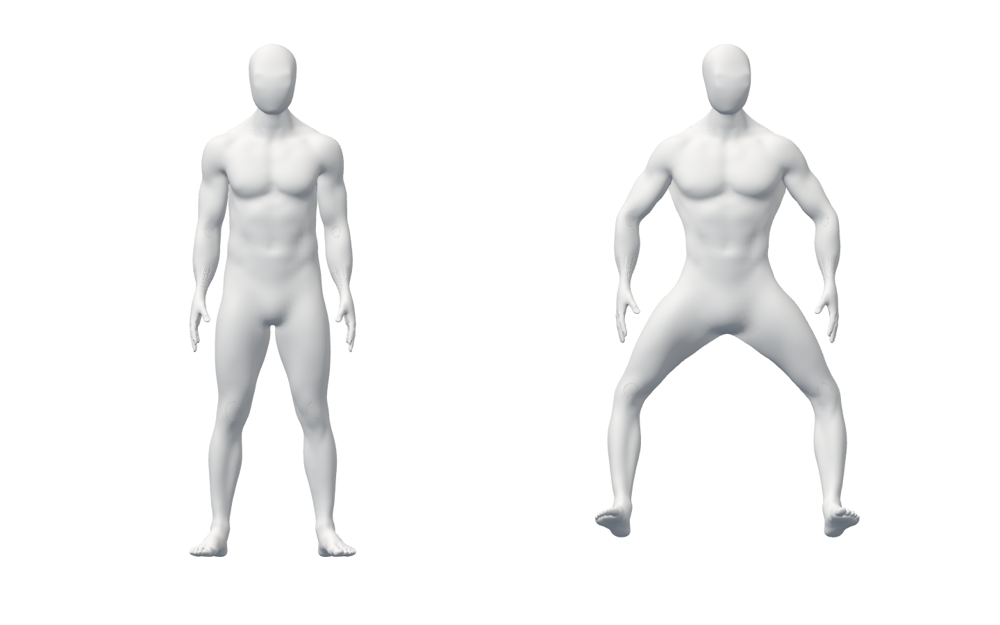
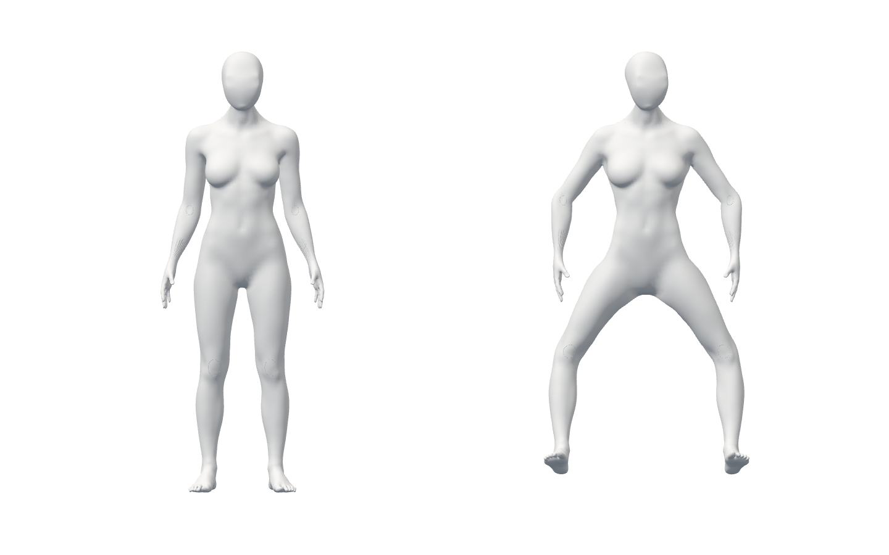

# 같은 입력 → 사용자 머리·사지

S2.T13 · runtime `e29342b547f4f9a383e11e447fc09bc883bef545` · 시작 main `2bc3cd9`(PR75)

**비공개 기술 연결이다. 출시 아바타·올바른 시범·실제 사용자 정확도·전체1~6 완료가 아니다.** 공개 JS/CSS·5모델 byte와 화면/문구는 그대로다.

## 실제 흐름

Chrome154.0.8037.98/MediaPipe1.0.1의 가짜 카메라에서 남녀 기존 A37 GLB 각각:

`소유 두 모델 준비 → native 미검출 → 별도 합성 머리+사지 → RAF 재생 → 얼굴 누락/사지 지속 → 새 머리 관찰 → 복수 body 보류 → native 미검출 → 대기 중 종료 → 늦은 결과 폐기·SDK/카메라 정리`

남녀2흐름/20상태를 실행했다. native는 가짜 영상의 미검출이며 긍정 움직임과 복수 body/얼굴 누락은 합성이다. 동일 입력은 동일 사용자 증명이 아니다. 판정·추천·시범·적색 피드백에 사용하지 않는다.

- 한 원래 stamp의 복사된 머리 회전과 사지 방향을 사용자 모델에만 전달한다. 비교 모델/source·신체 길이/scale·나머지 bone·추가8가중치와 발끝까지 구도를 보존했다.
- 준비 후 Scene 배치를 허용하되 내부 bone 재부모화/지원하지 않는 외부 scale은 거부한다. 머리를 사지 bone에 잘못 매핑하는 설정도 거부한다.
- 얼굴 누락은 추적 해제/현재 local 자세 유지다. 자동 정면 기준이나 경추 분절을 지어내지 않는다. pending 입력 중에는 이전 관찰의 RAF가 계속되며 누락 전달 시점부터 정지한다.
- 종료 시 pair/표시를 먼저 닫고, 같은 input의 face 대기가 끝난 뒤 body result/input·SDK 두 개·camera를 정리했다. 입력 영상/카메라 화면 캡처0.
- TEST ONLY same-origin CSP/거부 proxy와 SW 차단이다. CSP 차단 시도8, 거부 proxy13(회귀 reset 주입1 포함), 외부 route0. **제품 SDK 정책 승인·SDK 무시도 증거가 아니다.**

[native 최종 원본](evidence/browser-final.json), [명령/종료](evidence/launch-browser-final.json), [raw face 기존 경로 회귀](evidence/raw-head-regression-browser.json), [전체1001unit/정적/build/guard/diff](evidence/final-checks-final.json), [공개 byte](evidence/public-byte-proof.json), [23소스·71보존 증거 SHA](summary.json).

## 실제 canvas — 미완성 모델·합성 입력

디자인 시안이나 올바른 스트레칭이 아니다. 기존 조형 문제는 보완 목록에 남고 같은 부위 새 조형/원본·GLB 변경0이다.

## 실패·수정·검토

| 발견 | 보존 | 수정/실제 재검증 |
|---|---|---|
| 첫 type검사: Array.from point 타입, 다음 type검사: closure의 optional models | types-first/second.json | 타입 명시와 지역 소유 모델 참조; 최종 type exit0 |
| 생성 browser script의 literal newline escape와 optional chaining lint | browser-preformat-invalid.mjs·first-run-notes.json·formatting-second.json | 생성 줄/명시 null guard·formatter; 최종 Biome exit0. 첫 formatter는 tool transcript만 있고 standalone exit receipt 없음 |
| 첫 native 합성 흐름: Scene 배치 뒤 head0/body8 | browser-first.json·probe-first.js.gz·head-before-attachment-fix.ts | 모델 외부 배치와 내부 관절 부모 구분. unit attachment RED1 → GREEN, 남녀 실제 native/합성 흐름 재실행 |
| 첫 실행 wrapper가 browser receipt와 같은 이름을 사용해 EEXIST | browser-first.json·first-run-notes.json | 원본 덮어쓰기0, 이후 launch-browser-* 별도 명령 receipt 사용. 첫 wrapper receipt가 있다고 주장하지 않음 |
| 두 번째 흐름: 여성의 정확한 freeze 비교 실패 | browser-second.json·probe-second.js.gz·probe-before-delivery-freeze-fix.ts | acquisition 중 이전 관찰이 계속 렌더되는 계약에 맞게 **누락 전달 직전** local 값을 비교. 오차 허용 완화0, delivery/final 남녀 재실행 |
| head/limb 동일 bone 설정 가능성(P2, 작성자 리뷰) | observedBodyHead.test.ts와 runtime diff | 기존 A37의 명시 head만 허용하고 준비 실패/소유 cleanup 검증 |
| 비공개 module이 public 출력에 새는 sentinel | guard-leak-red/restored-green.json | 소유 시험 sentinel만 제거, 실제 제품 출력 검사 GREEN |

보안(입력 밖 전송/기록0·고정 오류·비공개 경계), 정확성(stamp/재진입·누락·명시 정렬·bone 분리), 성능(한 camera source·RAF와 pending 독립), 소유 수명/유지보수(raw/copied 공통 driver·선택적 API)를 작성자 diff 리뷰했다. 위 발견은 보완·실행했고 **Story 범위 미해결 P1/P2 없음**이다. 독립 사람/외부 전문가 리뷰나 기존 전체 출시 위험 해결을 의미하지 않는다.

## 증거와 남은 필수 작업

초기 실패·검토 전/후·최종 receipt와 source snapshot, unit JSON 원본 gzip, 실행한4개 native probe/기존 raw head 회귀 번들의 원본 gzip을 보존했다. 첫 build와 첫 browser의 source hash 차이도 [원본 메모](evidence/first-run-notes.json)에 구분했다. 최종 native/build/전체 검사와23소스는 커밋된 runtime byte로 비교했고 문서 추가가 이를 바꾸지 않는다. [시험 번들 고지](notices/README.md).

물리 webcam/권한 popup·실제 사람/동일인·native 긍정 머리/실측 좌표계·경추 분절/손/체간/축 비틀림·검증된 시범/세밀한 판정·최종 외형/권리·승인 디자인/SDK 정책·노트북 성능/장시간/전체GPU/worker·HTTPS/운영과 D2-A/M/T/R/I/P/전체1~6은 남는다. 출시 가능 동작0, 공개 코칭0. 기존 실패/원본·최소 문구·별도 승인 기준을 유지한다.
