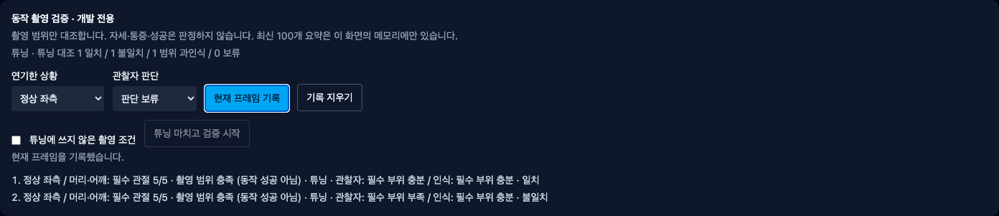
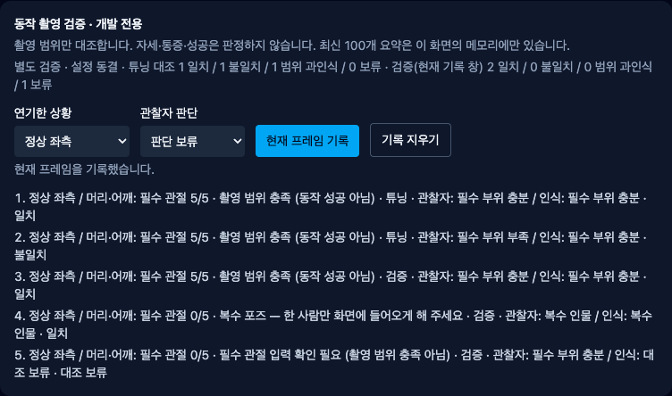

# 관찰자 촬영 범위 대조 — 구현·실제 작동·남은 조건

2026-10-09 · [S2.M4 계약](../../stories/observer-framing-comparison.md) · 기준 main6791e5d / codex/observer-framing-comparison

## 실제 작동하는 흐름

개발 전용 `/dev/measure`에서 수행 상황과 관찰자의 촬영 범위 판단을 따로 선택한다. 현재 프레임을 기록하면 관찰자/인식 결과를 나란히 보여 주고 다음 라벨은 다시 보류로 돌아간다. 충분·부족·복수 인물의 불일치와 인식 불가를 구분하며 자세의 옳음/성공은 판단하지 않는다.

비교 가능한 튜닝 기록과 미사용 조건 확인 뒤 검증으로 넘어간다. 현재 모델·머리/어깨 또는 전신·FPS·손/얼굴 설정, 튜닝 집계를 동결한다. 검증 시작 전/이미 사용한 프레임과 미선택 라벨은 거부한다. 설정을 바꿨다 복원해도 기록을 유지한 채 새 기록을 차단하며, 명시적으로 지우면 새 튜닝을 시작한다. 시작/지우기 후 초점은 관찰자 선택으로 돌아간다.

원래 미라벨 튜닝·100개 한도·준비 취소는 유지한다. 검증 집계는 화면에 남은 최신100개 창이고, 동결된 튜닝 집계는 그 창이 바뀌어도 그대로다. 시각 중복 방지는 프레임 재사용만 막는다. 독립 관찰자·새 사람·새 환경·실험 독립성을 자동 증명하지 않는다.

이 PNG는 실제 Chrome에서 구현된 개발 패널만 캡처했다. 공개 디자인 시안·실제 웹캠 인물·최종 아바타가 아니며 카메라/좌표/수치 패널은 캡처하지 않았다. `web-design-studio`로 기존 개발 패널과 네이티브 레이블/조작을 재사용하고 새 공개 화면·CSS를 추가하지 않았다.

## 실제 실행 증거

| 검증 | 결과·증거 종류 |
|---|---|
| 신규/기존 화면·순수 함수 | 전체 Vitest1464/74파일 통과, 이 Story의28개(기존3 포함). 합성 입력·모의 훅이며 실제 사람 정확도가 아님 |
| 타입·정적·자산·빌드·후보 제외·diff | 각각 exit0. Biome 기존 다른 증거 스크립트의 정보2건 유지. 기존 판단 수치·SDK/카메라 코드·API/DB·의존성 변경0 |
| 현재 공개 JS/CSS | JS354600bytes SHA434efb6661a704895d6746ff6a40779c11806d53af276e9244fb4e2ade6e6945 / CSS31199bytes SHA043cb9bdb5d82a3baa9a8463c7a641cbe92ace213303f20c6c7f91e9a14ac82e. 이전 main 배포 자산과 byte 동일 |
| 실제 Chrome154 기술 UI | 제어한 합성 측정 훅에서 일치/불일치·시작 전/중복·복수/미검출 보류·설정 변경/복원 차단·지우기, 1440/1024/800px·reduced-motion·Tab/Enter와 초점 복귀를 실행. 선택지 값은 Playwright 선택이며 네이티브 팝업 키 선택 통과로 세지 않음 |
| 실제 SDK / 사람 없는 카메라 | 별도 Chrome154·lite·손/얼굴 끔 조건에서 추론/기록·중지/재시작/SPA 이탈 후2트랙 ended. 낮춘 모델은 이 시험 조건일 뿐이며 제품 기본값/원래 시작P2 기준 변경이 아님 |
| 기존 카메라 E2E | 최종 `pnpm test:e2e` 기본 heavy·손/얼굴 설정, 설치 Chrome155.0.8059.40,1개 통과. 카메라 시작·중지·재시작·이탈 회귀. 실제 사람/26개 native 시작 회귀가 아님 |
| 개인정보 경계 | 대조 UI의 카메라 호출·외부 요청0, 전체 Storage 쓰기·JS 페이지 오류0. 실제 SDK는 기존 odml.pa.googleapis.com 요청3회를 시도했고 시험에서 차단했다. 제품 통신 정책 승격/해결로 세지 않음 |

기존 E2E의 로컬 API가 꺼져 있어 이탈 후 `/api/v1/me` 프록시 ECONNREFUSED가 있다. 계정 연결 검증이 아니라 카메라 정리 시험이며 이 Story는 API를 실행하거나 변경하지 않았다. NO_COLOR, 기존 Three.Clock·MediaPipe 경고/정보도 원문에 보존한다.

## 실패·리뷰·보완

- 구현 전 신규 순수 함수 import 실패(RED)를 남겼다. 초기 화면 시험3건은 미설치 jest-dom matcher를 사용한 시험 장치 실패였고 기존 boolean assertion 방식으로 고쳤다. 제품 결함3건을 고쳤다고 계산하지 않는다.
- 브라우저1회차는 Vite CJS React 모듈을 named export로 임의 교체한 장치 오류다. 실제 변환 모듈의 default export를 재사용하도록 수정했다.
- 2/3회차는 Mac headless 네이티브 선택 팝업의 ArrowDown/Enter가 확정되지 않은 시험 실패다. 옵션 선택은 Playwright로, 실제 키보드 증거는 Tab·Enter 및 초점 복귀로 구분했다. 전체 네이티브 키 조작 검증을 통과한 것으로 만들지 않았다.
- 4회차는 SPA URL 변경 직후 effect 정리 전에 트랙 ended를 즉시 단정한 시험 실패다. 기존 E2E처럼 실제 정리 완료 조건을 기다렸다. 최종 receipt의 URL 직후에는 `[ended,live]`였고 종료 확인 후2개 모두 ended다. 늦은 정리를 즉시 종료로 기록하지 않는다.
- 작성자 리뷰에서 검증 시작 버튼 제거/초기화 후 초점 복귀, waitForFunction의 인자 위치, 모의 UI와 SDK 요청 분리, 음수 시각/누락 관절·원시 객체 비보존을 보완한 뒤 최종 소스로 재실행했다.

현재 이 좁은 Story의 미해결 P1/P2는 없다. 독립 보안·의학·접근성 전문가 승인 또는 실제 관찰자 검증을 뜻하지 않는다. 최신 PR diff/HEAD/충돌/체크를 별도 확인한 후 조건부 병합한다.

## 보존과 재검증

원본/최종 소스·초기 실패·중간 통과와 최종 명령/브라우저 receipt/PNG는 [manifest](manifest.json)의74개 artifact에 gzip 또는 원본 PNG로 보존했다. 최종 소스10개 SHA를 대조한다. `frontend/scripts/verify-framing-trial-proof.mjs --current`로 보존 byte와 현재 소스 연결을 검사할 수 있다. 이는 브라우저/SDK/사람 검증을 새로 실행하는 명령이 아니다. 로컬 tmp 증거도 지우지 않았다.

새 실행은 로컬의 새 `/private/tmp/bodyguard-observer-framing-proof.*` 경로에서 `scripts/verify-framing-trial.mjs`와 `scripts/test-framing-trial-browser.mjs`로 재현한다. 증거 수집은 같은 저장 디렉터리를 덮어쓰지 않는다. 초기 의존성 복사 대상 실수·패치 context 실패·샌드박스 GitHub 상태 조회 실패는 대화 도구 출력에 남으며 별도 원문 로그 파일이 있다고 주장하지 않는다.

## 미완료 출시 조건

실제 수행자/관찰자·익명 촬영 조건·동의/안전·튜닝에 쓰지 않은 조건 대조는 아직 미실행이다. 목/어깨의 정상·보상 classifier, 임계값/유지 시간, 실제 노트북/다장치·최종 아바타/올바른 시범·추천·승인된 공개 코칭 구조·SDK 제품 정책·기존 시작P2·실제 공급자/배포·전문가 검토도 남는다. 출시 적격 동작0·S2.3b/D2/전체1~6은 미완료이며 출시 후보판을 선언하지 않는다. 영상·좌표·각도·이름 저장/전송/다운로드 기능은 추가하지 않았다. 비용·계정·시크릿·운영 DB migration·배포·출시와 중요한 범위/안전/개인정보 결정은 계속 별도 승인이다.
