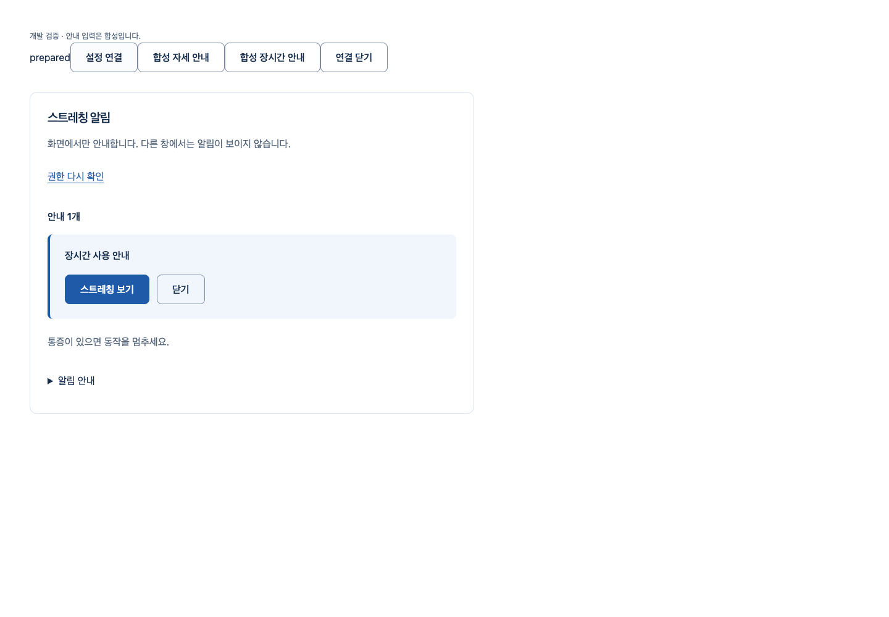

# 계정 설정·알림 전달 연결

[S4.N4](../../stories/owned-alert-lifecycle.md) · [집계·현재 소스·원본 SHA](summary.json)

실제 계정 권위와 본인 설정을 비공개 전달 부품에 연결했다. 명시 준비만 설정을 조회하고, 같은 사용자 재확인·로그아웃·페이지 종료·교체는 이전 조회/안내/권한 응답을 폐기한다. 공개 제품 화면은 바꾸지 않았다.

## 작동한 흐름

실제 production Chrome/AuthProvider/HTTP/API/격리 PostgreSQL18에서 **설정 화면 저장→명시 준비→허용된 종류만 화면 안내→키보드 선택/닫기→같은 계정 재확인·새 설정 재준비→로그아웃204·guest·본인 API401**을 확인했다. 안내 입력/메일은 합성, native 알림 권한은 CDP로 거부했다. 실제 촬영·올바른 동작·OS 허용 표시나 자동 알림 검증이 아니다.

최종 DOM765(이번 hook21)·실제 계정/설정 Chrome3·타입/Biome·runner Ruff/format·build/공개 guard를 통과했다. 기존 공개/개발 선택8은 최종 private handoff 보완 직전에 같은 공개 JS/CSS에서 실행했으며 계정/프레임은 모의다. 전체 API 회귀는 이번에 재실행하지 않았다. 운영 DB/SMTP/Google/Docker/배포는 사용하지 않았다.

## 실패와 리뷰 보완

- 처음 두 pnpm 명령은 복사된 의존성 연결/캐시 접근 때문에 DNS 실패·중단이며 테스트 실행0이다. 이후 offline 시도도 실패했고, 허용된 기존 캐시로194개 재사용·download0·고정 lock 유지 후 실행했다. 원래 콘솔 실패와 별도 offline 로그를 구분하며 실제 RED로 세지 않는다.
- 첫 실제 단위16 통과 후, 종료 subscriber의 새 prepare를 이전 호출이 덮는2건을18개 중2실패로 재현했다. 최신 operation을 먼저 소유하고 상태 전이를 폐기 전 적용했다. 추가 리뷰의 교체 handle.close 중 pagehide 누락은21개 중1실패로 확인하고, 새 listener를 이전 handle 회수 전에 등록했다.
- 최초 Chrome3실패는 너무 이른 CDP detach로 실제 denied가 default가 된 하네스 오류다. 이미 S4.N3에서 알려진 경계이며 제품 권한 코드 변경0이다. 다음1통과/2실패는 검증 output과 안내의 status 중복 선택/빈 안내 문구를 잘못 기대한 시험 오류다. 기존 안내 영역/문구를 정확히 검증하도록 시험만 수정했다.
- 각 browser report/native 로그와 실패 screenshot/context를 보존했다. 후속 Chrome3 통과 뒤 최종 handoff 소스로 다시3 통과했다. 타입의 port literal 오류와 formatting도 보완했다. PG start/stop 로그는 마지막 실행분이며 이전 전체를 보존한 것으로 표시하지 않는다. 단위/Chrome 실패를 최종 성공으로 덮지 않는다.
- 공개 guard는 생성된 시험 JS에 probe 문자열을 넣었을 때 실제 exit1로 차단했고, 시험 파일을 제거한 뒤 exit0을 확인했다. 공개 JS355151byte/CSS31199byte는 이전 PR62의 실제 빌드와 SHA까지 동일하다.

engineering:code-review로 현재 계정 identity·bookend·late callback/재진입·고정 오류·소유 listener/handle 회수를 작성자 검토했다. 최대2개 안내의 기존 제한을 유지하며 hot-frame loop·timer·새 패키지·API/인증/판정/개인정보 정책·미승인 화면 확장을 추가하지 않았다. 이 Story 범위의 미해결P1/P2는 없다. 독립 에이전트·전문가·사람 사용성 검토는 수행하지 않았다.

## 남은 의존성

공개 코칭 producer/검증된 classifier/아바타·동작/실측·SDK privacy·정책 Q07/08/21·소리/반응 기록·동시 설정 동기화는 미완료다. 준비할 때의 설정 snapshot이며 다른 탭의 변경을 자동 반영했다고 주장하지 않는다. 디자인 구조/적용 승인·Docker/HTTPS/외부 연결/참여자/법무/운영·Q32·2단계 이월·전체1~6 완료 기준을 유지한다.

소유한 native PostgreSQL은 실제 중지했고 데이터와 검증 원본은 보존했다. PR은 최신 diff/HEAD/CLEAN·체크·충돌을 읽은 뒤 조건부 merge하며, 병합 전 문서에서 미래 결과를 완료로 표시하지 않는다.
