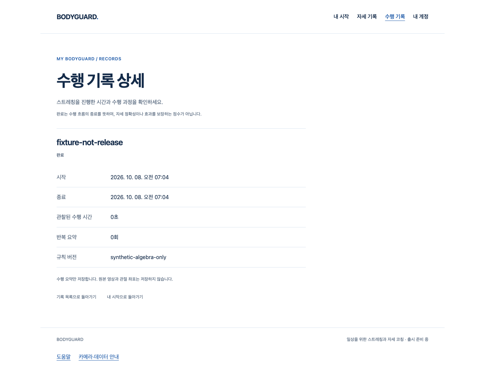

# 로그인 소유 재생 — S2.T8 검증

2026-10-08. baseline `907dbdf886d101bbda24b2068ede19fa0b65c71d`, 실제 재실행 runtime `f6c47d76e6e40fcfd8bac297c7989bea6d63f78a`. [Story](../../stories/owned-auth-playback.md), [실행·원본/source SHA](summary.json).

## 작동 흐름

준비 중 취소에도 명시 전송한 lifecycle을 닫는다. 기존 세션 정리가 끝나기 전에는 다음 세션을 준비 완료로 내보내지 않는다. 로그아웃·권한 재확인·이탈은 이전 세션의 재생/재개/저장 권한을 즉시 회수한다. 정리 실패는 고정 오류로 남고 같은 hook의 재준비를 격리한다.

실제 Chrome/API/격리 PostgreSQL에서 가입→합성 수행→명시 저장→본인 기록 상세, 같은 계정 refresh, 성공/실패 로그아웃, 서버 logout 후 /me401, pagehide를 확인했다. **브라우저 자원·동작·시계·메일은 합성이다.** native SDK/GLB와 실제 API를 동시에 연결한 검증은 아직 아니다.

화면은 기존 기록 화면의 검증 증거이며 새 확정 디자인 시안이 아니다. 100ms 합성 관찰이 초 단위로 0초 표시된 기록이다. 실제 사람의 수행·자세 정확도/효과를 증명하지 않는다.

## 검증

| 범위 | 실제 실행 결과 | 한계 |
|---|---|---|
| AuthProvider/hook·S2.T7 bridge | 40/40, pending camera/입력·교체·별칭·재진입·실패 격리 | 자원/입력은 모의, 의료 판정 아님 |
| 전체 frontend | 926/926, 실패/skip0 | 실제 사람/노트북 시험 대체 불가 |
| Chrome/API/SQL 계정 흐름 | 6/6, 실패/skip/flaky0 | 가짜 메일/동작/자원, 실제 SDK 연결 아님 |
| 타입·Biome·assets·build·공개 guard | runtime 모두 exit0 | 공개 producer/GLB0, 출시 동작0 |
| 공개 결과 | JS355151/CSS31199 byte·SHA가 PR70과 동일, cached 모델5도 byte 동일 | 디자인/SDK 제품 정책 변경0 |

Chrome 154.0.8037.98, Node24.20.0, PostgreSQL18. 전용 신규 Unix socket DB에만 로컬 migration/reset을 실행하고 시험 후 소유 DB 프로세스만 종료했다. 데이터·원본 실패는 보존한다. npm 설치/registry·운영 DB/시크릿·배포 실행0. 재현 launcher는 기존 설치 의존성을 사용하며 다른 명령/작업트리는 거부한다.

## 보존한 실패

최초 RED는 21통과/9실패. 작성자 리뷰에서 close callback의 새 prepare를 이전 prepare가 덮어쓰는 문제를 추가 RED(37통과/1실패)로 재현하고, operation/상태를 foreign close보다 먼저 설치하도록 보완했다. pending source 추가 사례의 첫 실패(39통과/1실패)는 fixture가 첫 RAF를 실행하지 않은 오류이며 실제 callback 실행 후 통과했다.

첫 타입 검사 실패(모의 반환 타입/async 할당), Biome 형식 실패, 신규 cache 없는 assets의 DNS 실패, pnpm의 symlink 설치 거부를 성공으로 세지 않는다. cache 복사 뒤 기존 모델의 동일 byte/SHA를 확인했다. Chrome 최초 실행은5통과/1실패: 시험에서 잘못 쓴 /api/v1/auth/me404를 실제 /api/v1/me로 수정하고6통과를 확인했다. 이후 runtime 커밋에서 전부 재실행했다. 원본은 각 파일의 raw gzip과 manifest SHA로 대조되며, 읽기용 텍스트는 경로/줄 끝 공백만 정리했다.

증거 스테이징의 첫 diff --check는 읽기용 로그2개의 EOF 빈 줄로 exit2였다. 커밋/푸시를 실행하지 않고 원본 raw를 유지한 채 읽기용 EOF만 정리해 재검증했다. [형식 변경 영수증](readable-formatting.json).

## 작성자 코드 리뷰

testing-strategy로 단위 모의와 실제 API 브라우저·native/사람 시험을 분리했고, code-review로 동기 재진입·비동기 장벽·별칭/권한·실패 격리·누수·원시 오류/데이터 경계를 점검했다. 위 재진입 문제는 보완했으며 **이 PR 범위 미해결 P1/P2는0**, 작성자 리뷰만 수행했다. 프로젝트 전체의 기존 Draft/SDK 개인정보·시작 지연 원인 P2 해결이나 외부 승인이 아니다.

caller는 prepare마다 fresh inert lifecycle을 전달한다. close는 자기 자원 정리를 끝내며 hook의 같은 정리 Promise를 반환/기다리지 않는다. 명시 cancel은 모든 정리 후 ResourceCleanupError를 거부할 수 있고, background 실패는 처리된 고정 상태로 남는다.

## 남은 조건

다음은 native SDK/남녀 GLB/로그인 소유권의 실제 Chrome 통합이다. 최종 얼굴·목/여성 표면, fine joint·올바른 시범/피드백, 실제 웹캠/참여자·노트북 품질·SDK 통신 정책/승인 UI·Gmail/Google/HTTPS·운영과 D2-A/M/T/R/I/P·전체1~6은 미완료다. 동일 아바타 부위 새 제작0, 최소 문구·안전 안내·기존 원본/검증·CEO 별도 승인 경계를 유지한다.
