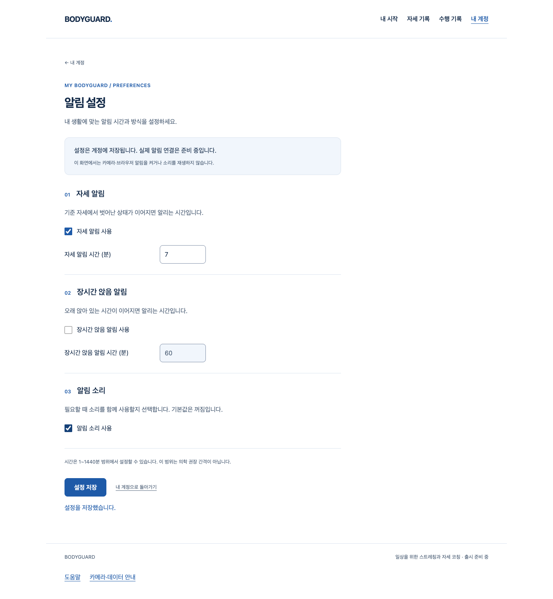
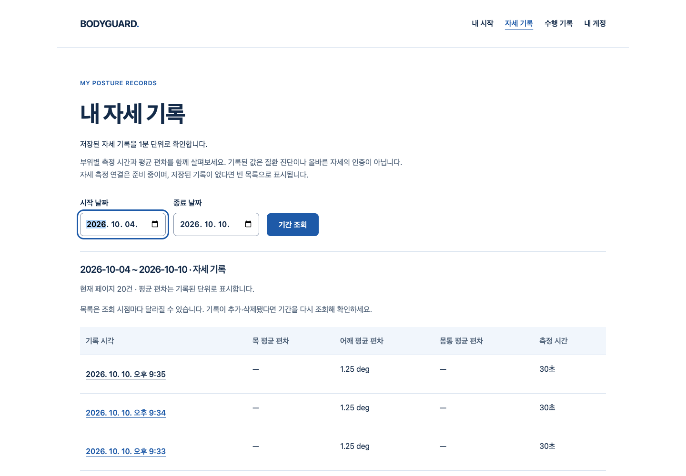

# S4.21 — 기록·알림 설정의 원래 계정 유지

2026-10-10 · main `0b440af763e8247680caa2c1335036cf7497d0e5`에서 시작. [실행 전 계약](../../stories/owned-context-identity.md).

## 실제 작동한 흐름

- 기존 웹의 가입→내 계정→알림 설정 조회/저장/새로고침·키보드·920px/확대·읽기 오류/잘못된 시간 복구가 작동한다. 이미 수락된 저장 응답이 끊기면 자동 재저장 없이 명시 재조회한다.
- 설정 GET만 B의 실제 합성 계정 쿠키로 보내도 A의 원래 proof/ID에 묶인 요청은403이다. 기존 AuthProvider 재확인 후 정상 A 설정8을 표시하고 B 설정23은 그대로다. 전후 /me만 검사하던 기존 코드의 GET200은 실제 Chrome/HTTP/SQL에서 먼저 재현했다. **제어된 전송 오류**이며 정상 브라우저에서 자연 발생한 계정 탈취를 입증한 것이 아니다.
- 기존 자세 기록의 목록/상세·페이지·삭제 취소/확인·신규 대상 변경409·삭제 뒤 응답 단절/명시 재조회가 작동한다. 타 계정 쿠키가 섞인 기록 조회는 표시하지 않는다.
- 같은 ready 객체 내부 ID가 달라지는 caller 결함에서는 기존 context가 새 계정으로 이전되지 않는다. 최초 ID를 고정하고 매 비동기 경계에서 닫아401로 거부한다. CSRF/JSON 중 변경, list/preview/remove·설정 save 직전/응답 중 변경은 모의 fetch로 재현했다.

새 디자인 시안이 아닌 **기존 제품 UI의 실제 회귀 화면**이다. 합성 계정·메일·요약/오류 입력과 실제 Chrome155/localhost API/PostgreSQL18.6을 구분한다. 실제 사람·외부 SMTP/Google·자세 정확도·알림 발송·카메라·3D·아바타 검증은 아니다.

## 결과와 재검증

| 검증 | 실제 결과 |
|---|---|
| 수정 전 focused frontend | 67개 중9실패/58통과, skip0 |
| 수정 전 설정 API / native | 각각1실패, 예상403 대신 실제200 |
| 수정 후 focused / 전체frontend | 67 / 1577 통과, 실패·skip0 |
| 전체 backend `pytest -q` | 537통과·4warnings, 실패·skip0 |
| 실제 설정 / 기록 browser suites | 5 / 4통과, retry·flaky·skip0 |
| API 생성 / tsc / Biome | 실제 `pnpm gen:api`/tsc/Biome 통과, Biome 기존info16 |
| Ruff / format / mypy | 통과·51files/12modules |
| production build / private guard | 각 실제 browser runner의 build 및 guard 통과 |
| 공개 UI/CSS | UI/라우터/AuthProvider 소스 불변, CSS byte동일; JS는 guard 수정으로 변경 |

전체frontend의 기존 순수 avatar 계산 회귀는 포함하지만 **새 아바타 제작·GLB/WebGL 검증 사이클0**이다. 시간/판정/추천 기준·공개 코칭 구성·저장 schema·기본값·권한/개인정보 정책은 바꾸지 않았다. 실제 OpenAPI에는 optional 설정 GET 헤더 타입만 추가됐다.

첫 initdb와 두 API 실행은 sandbox 공유메모리/소켓 권한으로 **시험 본문에 도달하지 못했다**. 실패 기록을 보존하고 실행 권한이 있는 새 전용 DB로 실제 RED를 재현했다. 첫 API 생성도 uv cache 쓰기 권한으로 실패해 전용 cache에서 실제 생성했다. 이런 준비 실패를 RED나 성공 테스트 수에 더하지 않는다. 별도 회귀 DB와 브라우저 DB로 충돌 없이 병행했고 role·database·경로·TCP 차단·PID/UID501을 확인해 각각 종료했다. 데이터/로그는 보존했으며 `pg_ctl status`의 종료 확인 exit3은 정상적인 비실행 상태다.

`node bodyguard/docs/review/owned-context-identity/verify.mjs --check`: 원본 RED 입력8, 최종 입력9·collector, 실제55압축 증거의 SHA/길이, 기존186소스 불변, 개별 native 결과/경계·CSS/JS 차이·DB 종료를 검사한다. [manifest](manifest.json)에 정확한 원본/생성 시각/파일 해시가 있다. 실행 입력은 테스트 **전**에 복사했고 collector는 실행 **후** 작성했다. mailbox·쿠키·CSRF/세션 값·DB 데이터·원시 좌표는 수집하지 않는다. private `/private/tmp` 원본과 나머지 실제 screenshots는 덮어쓰지 않았다.

## 작성자 코드 리뷰

`engineering:debug`의 재현→원인 분리→수정→회귀, `engineering:code-review`의 보안/정확성/성능/유지보수 기준을 적용했다. 외부 독립 리뷰를 받은 것으로 표시하지 않는다.

- 발견·보완: 동적 `authority.user.id`를 최초 primitive ID로 고정, check/서버 대조/header 통일. 설정 GET은 기존 optional read-binding을 요청 순간에 적용. caller ID는 소유자를 선택하지 않으며 owner가 cookie/session으로 결정한 값과 대조한다.
- 정확성: pending JSON·세대 교체/abort·single-flight·저장 불확실성·기존 명시 복구를 유지한다. 헤더 없는 기존 API 읽기/기본값 무작성도 실제 SQL 회귀에서 유지한다. 이미 반환된 데이터 복사본의 강제 소거는 범위 밖이다.
- 보안/성능: 원래 CSRF HMAC을 재사용하며 새 proof로 자동 재저장하지 않는다. 기존 /me 횟수·데이터 쿼리/인덱스는 늘리지 않는다. read binding은 기존 transaction 안에서 SELECT 전에 수행한다. 새 저장소/외부 전송/시크릿/DB migration0.
- scoped diff·검증에서 미해결 P1/P2 없음. 기존 시작P2·미승인 UI/SDK·실측/출시 동작0·외부/법무/운영 및 전체1~6 미완료는 별도 게이트로 유지한다. 이 Story의 완료가 전체 서비스/4단계 완료나 출시 승인이 아니다.

PR 직전/병합 직전 최신 main·remote diff·exact HEAD·CLEAN·체크를 다시 확인하며 체크가 없으면 **체크 없음**으로 기록한다. conditional merge commit과 브랜치 보존, 운영/배포 별도 승인 규칙을 유지한다.
