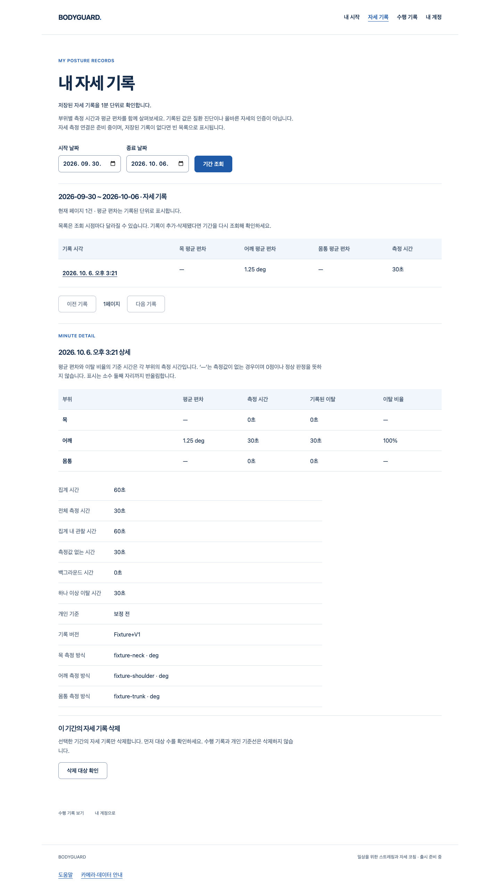

# S4.16 — 본인 1분 요약의 private 업로드 연결

2026-10-06 · baseline37354aa · codex/owned-minute-upload · PR 게이트 진행

## 실제로 연결된 흐름

기존 시간가중 엔진이 **관찰된 완성 분만** 집계 → 기존 서버 입력 검증 → 원래 로그인 권위/CSRF/기대 계정에 결속해 명시 전송 → 실제 서버 응답을 분·지표·시간 단위로 대조 → 본인 화이트·블루 자세 기록/상세에 표시한다. 공개 웹캠 측정 producer는 아직 연결하지 않았다.

실제 Chrome/FastAPI/격리 PostgreSQL에서 다음을 실행했다.

- 합성 관찰60초 중 어깨 측정30초·지표 없는30초를 실제 집계/저장하고 내 기록 상세에서 확인. 목/몸통 값은 null이며 정상0으로 만들지 않는다.
- 서버가201로 수락한 뒤 응답을 끊음 → 대기 기록 유지·자동 재전송0 → 명시적으로 동일 payload/원래 proof 재시도 → 실제200·DB 한 분만 남음.
- 같은 계정이라도 committed ready 객체가 바뀌면 메모리 폐기. 알림을 놓친 다른 계정 쿠키의 기존 proof는403으로 차단하고 타인 기록0.
- 같은 분의 다른 내용은 실제409로 거부하고 기존 본인 기록 및 별도 계정 기록을 보존.
- API 소유자 획득 A→B→A 경계를 실제 인증 쿠키/CSRF로 시험: 기존POST201 오쓰기를 red로 확인했고 요청 시점 기대 계정 대조 후403·삽입0. 기대 계정 없는 기존 클라이언트의201→200 동일 재시도도 유지.

이 이미지는 실제 실행 웹의 결과다. 계정·메일 전달·관찰 구간은 합성 시험 데이터이며 실제 사람의 자세/의료 정확도/카메라·Google·SMTP 검증이 아니다. 이미지 생성 예시나 Blender 미리보기가 아니다.

## 경계·예외

메모리 queue/batch caller 상한1~60, 미완성 분·관찰 없는 분의 임의 결과0, overflow/원시 필드 입력의 고정 실패·폐기, empty 요청0, 단일 진행 요청, 전송 중 새 완성 분 보존, 원래 batch만 명시 retry다. 부분/중복/다른 값/추가 필드/has_more/잘못된 status 응답은 성공으로 지우지 않는다.401/403 폐기,409/422 terminal 거부,네트워크/timeout/기타 불확실 결과는 재시도 권위로만 유지한다. JSON을 읽는 도중 제한 시간이 지난 경우도 늦은 응답을 채택하지 않는다.

raw 영상·좌표·초별 history·계정 metadata body0, 로그·IndexedDB·새 보관 정책0. 원래 cookie/Origin/HMAC/트랜잭션·DB migration 정책을 유지하고 optional X-Account-ID는 소유자 선택권이 아니다. 입력 공통 검증을 추출했으나 조회/삭제의 기존 semantics는 유지한다. 공개 JS의 private uploader/probe/후보 누출0.

## 실행 증거와 실패 보존

- 최종 frontend682/40파일, API466 통과. API 첫 전체 실행의 기존2warning, 최종 실행의 기존asyncio1warning을 구분한다.
- 타입은 실제 FastAPI OpenAPI로 생성. typecheck/Biome140/Ruff/format45/mypy11/build/production guard 통과.
- private 실제 Chrome4 통과, 공개 Chrome8 통과. 기존 자세 기록 Chrome4 회귀도 실제 통과했으며 기간/삭제·권한·오류와 좁은 웹 창/확대/키보드·초점·대비를 유지했다.
- 결정적 모의 fetch/clock/authority 시험29건 포함.60분 ascending ack는20행 조회 page와 별도 검증한다. timeout 시험은 모의 signal이며 실제 사람/환경 시험으로 세지 않는다.
- 증거 검사 Node12 통과: 기존 JUnit8검사 재사용+새 Chrome4검사. root·suite·testcase 실패/skip·부분/재실행된 Chrome 결과를 성공으로 세지 않고 모든 검사를 게시 전에 실행한다.
- 최초 stub 실행16실패, 실제 POST 기대 소유자1실패/1통과, timeout late ack1실패/23통과를 그대로 보존했다.
- offline 의존성 cache 실패 뒤 같은 lock의 online 설치 성공. sandbox shared memory 때문에 최초 DB init/연결2error → 로컬 권한의 별도 UTF8 DB 실행 후 위 실제 기능 red와 구분. UV cache 권한/첫 build 네트워크 실패도 보존하며 통과로 바꾸지 않는다.
- 새 collector는 실제 pinned Playwright leaf에서 suites가 생략된 형식을 처음 거부했다. 실제 보고서 red와 수정/12시험·실제 보고서 green을 보존했다. 실패는 실패로 기록한다.
- BMAD blind/edge의 같은 분 충돌 시험 시계 경계P2를 하나로 합쳐 fixed minute으로 보완했다. author late timeout P2도 실제 red 후 보완. 최종 재검토 각 역할 미해결 scoped P1/P2 없음. 외부/전문가 리뷰가 아니다.

최종 명령은 frontend의 pnpm test(default+junit),pnpm typecheck/check/build,production guard/public Chrome; backend의 전용 BODYGUARD_TEST_DATABASE_URL에서 pytest --junitxml/Ruff/format/mypy,python -m tests.run_browser minuteupload/summaries와 Node 증거 검사다. [artifacts.json](artifacts.json)의 source SHA·원본/공개 artifact SHA를 실제 확인한다. 원본은 Story 소유 scratch/test-results에 보존하고, 다른 Story의 파일·DB·증거는 변경하지 않는다.

최종 수집은 source28/artifact54이며 공개 SHA를 실제 대조했다. 모든 검사를 통과한 뒤 게시하고 동일 재실행이 같은 바이트인 것을 확인했다. 전용 PostgreSQL PID62123의 정확한 data 경로를 확인해 종료했으며 원본 DB/로그/이미지는 보존했다.

최종 acceptance reviewer가 읽기 전용으로 source28·원본/public artifact54의 SHA/크기/정규화와 모든 JUnit/Chrome 결과·문서 수치·실패/화면·DB 종료를 독립 대조했다. blind/edge/acceptance 최종 scoped P1/P2 없음. 리뷰어는 실행 시험을 새로 하지 않았으며 외부/전문가 검토도 아니다.

## 지정 디자인 스킬의 영향

web-design-studio의 기존 의료 느낌 화이트·블루 계약과 구성요소를 재사용했다. 이번 Story는 새 UI 디자인이나 의학적 신뢰 표식을 만들어내지 않으며 기존 실제 화면의 내용 정합성을 확인한다.

실제 상세 이미지 기준 final critique: visual-audit — 제목/기간 조회가 첫 행동으로 식별됨; hierarchy — 목록/선택 분 상세/삭제를 분리; spatial-rhythm — 공통 좌우 여백과 표 행 간격 유지; craft-signals — 버튼/날짜/테두리 정렬 유지; color-systems — 백색·짙은 남색 본문·청색 주 행동, 삭제만 적색; type-systems — 한글 제목/본문/보조 문구 역할 유지; motion-design — 장식 움직임 없이 상태 변화, reduced-motion 유지; quality-checklist — 기존 기간/빈 목록/오류/확인·취소/초점/좁은 창·확대 회귀. Figma·axe·Impeccable·외부 디자인 감사는 실행하지 않았다.

## 남은 것

이 Story는 private 집계·업로드 연결만 담당한다. 실제 classifier·관찰 producer/기준선 연결·두 고품질 아바타·SDK 개인정보P2/실측·실제 참여자·일/주 대시보드/알림/PDF/LLM/변화 탐지·법무/라이선스·외부/HTTPS/운영은 완료하지 않았다. 공개 카메라·같은 아바타 부위 새 제작·운영 DB/migration·시크릿·비용·배포·출시 실행0. 전체1~6 게이트 미충족이며 출시 후보판 선언이 아니다.
