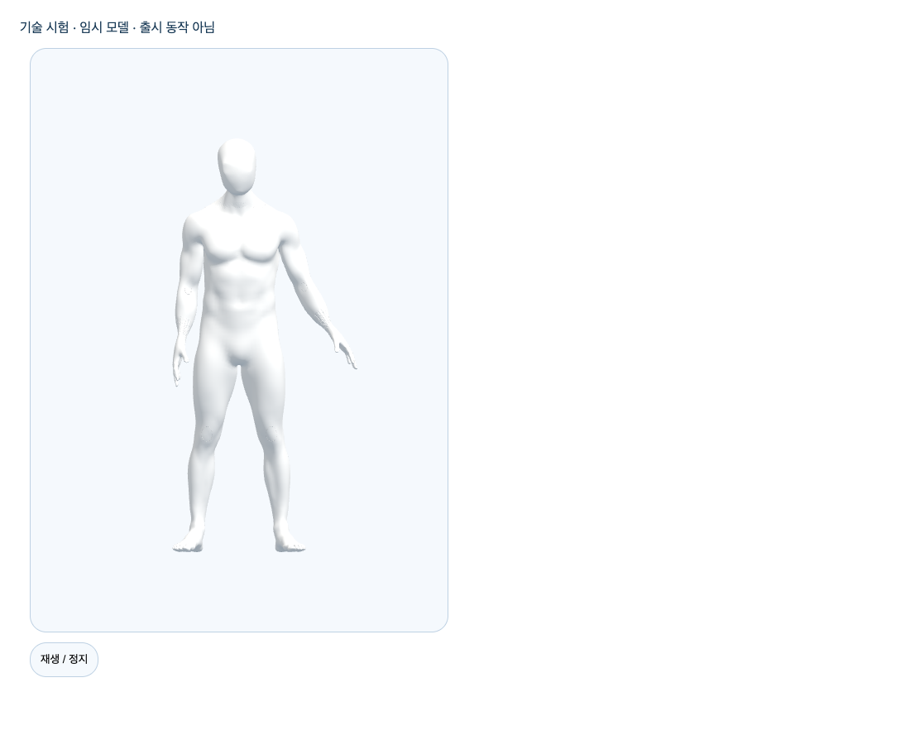
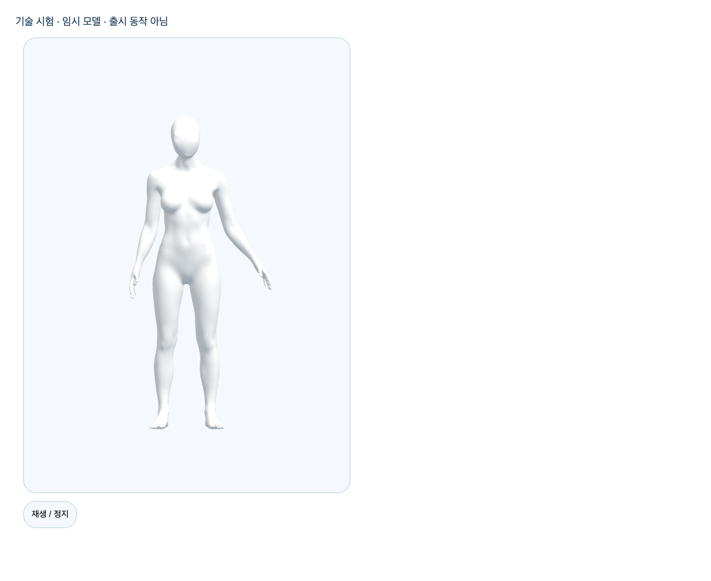

# S3.P1 — 실제 미리보기 흐름과 완료 경계

2026-10-09. 최신 main `85885c4d1ed3bc019dea3112fe8beaa62d4fd88b`의 독립 Story. 재생기와 비공개 검증만 완료했으며 공개 선택 화면이나 3단계 전체 완료가 아니다.

## 실제 작동한 흐름

마우스를 올리거나 키보드로 초점을 주면 보존 GLB의 **Blender 제작 시험 동작**을 재생한다. 이탈·초점 해제 때 시작 자세로 돌아가고 자원을 해제한다. 초점이 남아 있으면 마우스가 나가도 계속한다. 동작 감소 설정에서는 자동 재생하지 않고 명시적 재생만 허용한다. 실패 후 명시적 재시도, 남녀 선택 교체, 제거 후 대기 로드와 RAF 종료를 확인했다.

실제 WebGL/RAF·DOM 키보드·포인터·브라우저 동작 감소 설정으로 Chrome **154.0.8037.57 / 155.0.8059.40**, 남녀 총 4흐름에서 최종 **48 assertion + 4 counter snapshot**을 통과했다. `browser-chrome*-gate.json`과 `probe-gate.js.gz`가 같은 최종 번들 해시로 연결된다. 숨김은 하네스의 synthetic visibility 입력이며 실제 OS 최소화/다른 탭 전환 시험이라고 기록하지 않는다. 관절 변화 비교는 브라우저 메모리 안에서만 수행하고 증거에는 boolean과 자원 개수만 남겼다. 카메라·SDK 추론·개인 정보·외부 서비스 접근은 없다.

실제 화면(제품 디자인 제안이 아닌 기술 하네스 / 임시 모델 / 출시 동작 아님):

이 사진을 승인된 최종 아바타 외형이나 올바른 스트레칭으로 제시하지 않는다. 이번 하네스는 기존 pair 소유 경로의 한 모델만 그리지만 자산 내부 두 clone을 모두 정리한다. `peak=1`은 **미리보기 자산 소유자 수**이며 GLB mesh/GPU 자원 하나라는 뜻이 아니다. 다수 썸네일·목표 노트북 성능 검증은 후속 공개 연결 기준이다.

## 실패와 보완 보존

- [최초 import RED](initial-red.md): 구현 파일 없음으로 suite import 실패 / assertion 실행 0. 정상 단위 RED로 과장하지 않는다.
- 최초 로컬 asset 준비는 `fetch failed / ENOTFOUND storage.googleapis.com`으로 실패했다. 모델 다운로드 성공으로 기록하지 않는다. 기존 작업의 정확한 보존 모델 파일을 복사하고 prepare-assets를 재실행했다. `.env`·패키지·모델 버전 변경이나 새 외부 연결은 없었다. WASM은 같은 설치 패키지 1.0.1에서 준비했다.
- 최초 정적 검사에서 non-null assertion warning 5개를 발견하고 실제 요소/모델/renderer 검증으로 제거했다. 원본 시험 번들 `probe-final.js.gz`, 이후 `probe-reviewed.js.gz`, 최종 `probe-gate.js.gz` 및 첫 실제 브라우저 결과를 모두 보존했다.
- 공개 CSS 비교에서 사용되지 않는 `.\\!hidden`과 `.blur` 규칙이 시험 코드의 토큰 때문에 추가되는 것을 발견했다. 최초 CSS SHA `ebd019ba32f28718d27cf3150ed54b1bc8f58f94ce82ed7d53131e35dcb98771`는 공개 byte 동일 실패다. 시험 상태 이름과 실제 focusout 처리만 보완했다. 제품 CSS 파일을 편집하거나 기존 증거를 삭제하지 않았다. 최종 공개 JS/CSS는 기존 bytes와 동일하다.
- 작성자 리뷰에서 취소된 factory의 partial cleanup 실패 유지, 반복 dispose의 재진입 장벽, inherited input key 차단, 비정상 scheduler, 조기 취소의 불필요한 로드 방지, clip-time overflow를 보완했다. 기존 18→22→최종24 unit 결과와 실제 브라우저 재검증을 구분한다.

## 검증

`frontend/`에서 다음을 실제 실행했다.

- `node node_modules/vitest/vitest.mjs run`: **1435 passed / 73 files**. 새 재생기 24개는 결정적 모의 시계·자산의 단위 시험이며 실제 신체 시험이 아니다.
- `tsc --noEmit`, Biome, prepare-assets 재실행, Vite 공개 build, 확장된 공개 후보 유입 guard, `git diff --check`.
- 최종 공개 JS: 355151bytes / `b5d4f81164c8d3c196e853b3404382bc15077986aa626cd0c3c72571b6325ac0`.
- 최종 공개 CSS: 31199bytes / `043cb9bdb5d82a3baa9a8463c7a641cbe92ace213303f20c6c7f91e9a14ac82e`.
- `node scripts/verify-motion-preview-proof.mjs --current`: archived source·원본 번들·브라우저 JSON·PNG 26개와 현재 source14개·공개 bytes 연결. source 고정본은 manifest의 파일 경로→gzip→SHA로 확인한다.

재현: 새 `mktemp -d /private/tmp/bodyguard-motion-preview-proof.XXXXXX`를 사용한다. 보존 입력 male/female GLB·`authored-fixture.json`의 hash는 `manifest.inputs`에 있다. 새 proof와 label을 지정해 `BODYGUARD_MOTION_PREVIEW_PROOF=… BODYGUARD_MOTION_PREVIEW_LABEL=gate node node_modules/vite/bin/vite.js build --config e2e/fixtures/motionPreview.vite.ts` 실행 후, `node scripts/test-motion-preview-browser.mjs <proof> <보존 입력 폴더> <Chrome 실행 파일> <새 browser-label> gate`를 실행한다. 기존 결과 이름은 덮어쓰지 않는다. archive 검증은 `verify-motion-preview-proof.mjs`, 현재 소스 검증은 `--current`다. 새 검증 결과를 기존 evidence에 덮어쓰기 위한 collector 실행은 금지한다.

## 작성자 리뷰 / 미완료

engineering code-review 관점의 **작성자 자기 리뷰**이며 독립 리뷰어 검토를 주장하지 않는다. 구현 범위 내 알려진 P1/P2는 보완했다. 단일 pending·cancelled RAF·원래 asset 소유권·공개 번들 분리·원시 오류 비노출·모의/실제 구분을 검토했다. PR 생성 후 최신 원격 diff·충돌·체크·HEAD를 재확인해야 병합 가능하다.

공개 동작 선택 UI 연결은 디자인 구조 승인과 공개 자산·동작 게이트 충족 후다. 원본 GLB 및 시험 clip 해시는 그대로이며 새 Blender 조형 사이클은 없었다. 실제 참여자·임상 유효성·최종 외형/권리·노트북/다장치·HTTPS·SDK 통신 승인·기존 시작P2/Draft #101 및 D2 이월·전체1~6은 미완료다. 운영/배포/출시/시크릿/비용 승인은 실행하지 않았다.
