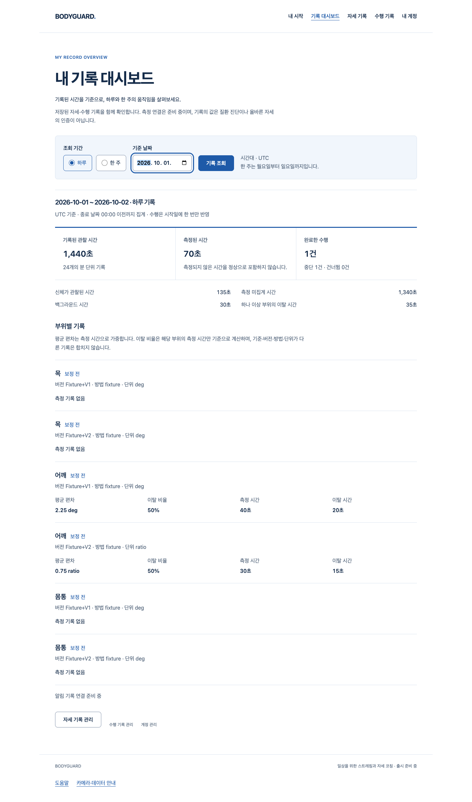

# S4.17 — 본인 일·주 기록 대시보드 (진행 중)

2026-10-06 · baseline `991ed2b33a1abc6158b3a177f8431a104c476ba0` · `codex/record-dashboard` · [Draft PR #51](https://github.com/HSU-OAS/bodyguard/pull/51)

**필수 브라우저 회귀 실패로 Story와 병합 게이트는 미완료다.** 작동한 화면·기능과 미충족 기준을 분리한다. 전체1~6단계 통과나 출시 후보판 선언이 아니다.

실제 원격 기록: 구현 source6f26913의 Git tree9e68994b860eb340cbe08930e642a95be3364e91이 로컬과 일치했고 PR은 OPEN/Draft/CLEAN/MERGEABLE·체크 없음이다. CLEAN/체크 없음이 필수 검증 실패를 대체하지 않으며 병합0·브랜치 유지다. 후속 커밋은 이 PR 상태와 본문 기록만 담당한다.

## 실제로 작동하는 흐름

로그인한 사용자가 시작/내 계정에서 기록 대시보드로 이동 → 하루/한 주와 날짜 조회 → 저장된 자세 시간·수행 건수·부위별 기록 확인 → 기존 자세/수행 기록 관리 → 대시보드 복귀다. 실제 production Chrome·로컬 HTTP·격리 PostgreSQL을 연결했다. 계정·메일·저장 기록과 오류 주입은 합성 자료다. 실제 사람/카메라/의료 정확도 시험으로 세지 않는다.

- 첫20행이 아닌 기간 전체를 단일 SQL snapshot에서 집계한다. 주간10000분 초과·타인 제외·기간 경계·DST·반복 역사 날짜를 실제 DB에서 검증했다.
- 보정/버전/방법/단위가 다른 목·어깨·몸통 값은 섞지 않는다. 시간가중 평균과 이탈 시간 비율을 사용하고, 측정 없는 값·미연결 알림을 정상0으로 만들지 않는다.
- 원래 committed ready 계정과 me/CSRF/me·기대 owner·최종 me를 대조한다. ready 교체·로그아웃·cookie 변경·abort·timeout 이후 과거 결과를 표시하지 않는다.
- 빈 기간, 잘못된 URL의 수동 복구, 실제403, 주입503과 명시 재조회, 리로드/관리 화면 복귀·키보드·920px/좁은 웹 창·200% 확대·reduced-motion을 구현했다.
- 같은 저장 float 시간에서 비율을 계산한다. 극소값의 overflow/양수 underflow는 정밀도null과 안내로 보존한다. 최대 평균과 곱셈 underflow는 numeric 시간가중 계산으로 보호한다. 임상 임계값/저장 입력/개인정보 정책 변경0.

## 실제 검증과 미충족 기준

| 구분 | 실제 결과 | 해석 |
|---|---|---|
| 결정적 frontend 전체 | 738/42파일 통과 | 합성 DTO·상태·관찰/계정 회귀. 실제 신체 시험 아님 |
| 실제 격리 PostgreSQL/API 전체 | 492 통과, 기존 asyncio warning1 | 소유권·집계·수치·날짜·기존 계정/삭제 API 회귀 |
| 대시보드 scoped | API26·파서/DOM56 통과 | 극소값·반복 날짜·계정 수명 보완 포함 |
| production Chrome 대시보드 | 최종 수치 보완본2개 기능 흐름 통과 | 새15초 기능 상태 기대는 기존 요청 deadline과 같으며 성능 통과가 아님 |
| 기존 기록 Chrome | headless3실패/1통과, headed4실패 | 기존5초 준비 기대 유지. 필수 회귀 미충족 |
| 공개/개발 탐색 Chrome | 현재6실패/2통과 | 기존5초/30초 유지. 필수 회귀 미충족 |
| 최신 main 격리 비교 | 같은6실패/2통과 | 변경 전에도 재현됐지만 근본 원인 확정 아님 |
| 실제 OpenAPI/정적/build/guard | 타입 생성·Biome146·Ruff/format47·mypy12·typecheck·빌드·공개 guard 통과 | 새 카메라/producer·미검증 코칭 공개0 |
| 증거 검증기 Node | 12 통과 | JUnit/Chrome 실패·skip·부분 결과를 성공으로 세지 않음 |
| BMAD3역할 | 최초6·추가6·최종2 코드 보완, 재검토 새 범위 지적0 | 읽기 전용 내부 리뷰. 미통과 회귀/성능의 승인 아님 |

초기 red·재검토 red·실패 브라우저·성공 실행·이미지·각 원본 SHA를 보존한다. 마지막 수치 API red2건은 각각0.4와0.40019762845849804의 불일치, 양수 비율0.0 대신null을 요구한 실패였다. 파서/DOM 및 실제 API green과 구분한다. UV 경로 누락·코드 검사 import 순서·진단 컴파일 실패·baseline 임시 의존성/모델 준비 실패도 통과로 바꾸지 않는다.

## 응답 지연 조사

production Chrome154.0.8037.98에서 대시보드 API 자체는 대부분 수 밀리초지만 UI 준비/테스트 접근성 탐색에 긴 작업이 남았다. CPU 진단에는 React 렌더링과 테스트 함수가 함께 포함됐다. 빈 문서도 최초1백만 JS 반복289.5ms·브리지879.6ms에서3회째2.4ms·14.1ms로 달랐다. 단순 free121MB와 reclaimable 포함42%를 구분하며 메모리 부족/Intl/Headless를 원인으로 단정하지 않는다. 사용자 프로그램 종료·새 자동 재시도·인증 우회·기존 시간 제한 변경0.

해결 조건은 실제 대상 노트북에서 원인을 분리·해결한 뒤 기존 기록4·공개8을 같은 필수 기준으로 통과하고, 대시보드의 실제 반응 시간도 재확인하는 것이다. 그 전에는 Draft/미완료로 보존한다.

이 이미지는 최종 실행 웹의 합성 저장 기록이다. 생성형 디자인 예시·Blender 이미지·실제 신체 검증 결과가 아니다. [좁은 웹 창](runs/dashboard-20261006T131052226822Z-f86b9b9c1635/dashboard-narrow-web.png), [오류/명시 재조회](runs/dashboard-20261006T131052226822Z-f86b9b9c1635/dashboard-error.png), [실행별 증거 manifest](runs/dashboard-20261006T131052226822Z-f86b9b9c1635/artifacts.json).

## 지정 디자인 스킬의 영향

web-design-studio로 기존 의료 느낌의 화이트·블루 WEB 토큰·한글 시스템 폰트를 재사용했다. 주 행동은 기간 조회 하나이며, 제목→필터→3개 요약→부위별 비교→관리 링크 순서다. 자격/의학 인증 배지·과장 점수·미관측 그래프·새 디자인 라이브러리0.

실제 desktop/narrow/error PNG의 final critique: visual-audit — 기간 조회가 첫 행동으로 식별됨; hierarchy — 날짜와 집계 결과·관리 이동을 구분; spatial-rhythm — 공통 좌우 여백/행 간격; craft-signals — 날짜·버튼·테두리 정렬과48px controls; color-systems — 백색/남색 본문/청색 행동, 상태를 색만으로 전달하지 않음; type-systems — 제목·수치·방법/단위의 역할 구분; motion-design — 상태 갱신만, 장식 움직임/시차0; quality-checklist — 빈/오류/재조회·키보드 초점·좁은 창/확대/reduced-motion 확인. Figma·axe·Impeccable·외부 디자인 감사는 실행하지 않았다.

## 증거와 재실행

`collect-proof.mjs <scratch> <dashboard-report> <records-report> <public-report>`의 기본 모드는 모든 필수 테스트가 통과하지 않으면 파일 게시 전에 실패한다. `--incomplete`는 실패 체크를 기록한 불변 실행별 증거를 게시하고 **exit2**로 끝낸다. manifest의 allRequiredTestsPassed·storyComplete·mergeAuthorizedByThisBundle은false다. 검사 결과 게시가 완료/병합을 허용하지 않는다. 새 실행/증거 수정은 `runs/<dashboard timestamp>-<manifest digest>`에 보존하며 이전 파일을 덮어쓰지 않는다. trace/mailbox/세션/PG data는 비공개 scratch에만 남긴다.

첫 증거 게시도 실패로 보존했다: 출력 로그를 같은 input scratch로 리다이렉트해 수집기가 아직 작성 중인 자신의 stdout을0바이트로 캡처했다. [첫 스냅샷](runs/dashboard-20261006T131052226822Z/artifacts.json)은 해당 raw hash 재대조 실패이며 유효 최종 증거가 아니다. 이후 stdout/stderr의 inode를 제외하고 raw_source locator와 content-addressed revision을 추가했다. 현재 참조 스냅샷은 source29/artifact141이며 완료/병합false를 유지한다. 전용 PostgreSQL PID78379의 정확한 data 경로를 확인해 정상 종료했고 원본 데이터·로그는 보존했다.

최종3역할 수치/collector 재검토에서 새 scoped 지적0. Acceptance Auditor가 source29와 raw/public artifact141의 SHA·길이·manifest digest·strict JUnit738/492·Chrome2와 실패3/6을 독립 읽기 전용으로 대조했다. 첫 무효 snapshot의 self-log 불일치도 재확인했다. 리뷰어는 테스트·DB·브라우저를 다시 실행하지 않았으며 필수 회귀/성능을 승인하지 않았다.

명령: frontend의 Vitest(default+JUnit),pnpm gen:api/typecheck/check/build,public harness/production guard; backend의 전용 BODYGUARD_TEST_DATABASE_URL에서 pytest/Ruff/format/mypy 및 python -m tests.run_browser dashboard/summaries. 원본 PG와 각 브라우저 로그는 Story 소유 경로에 보존한다.

## 남은 것

필수 브라우저 회귀·성능 미충족, 알림 이벤트와 횟수·PDF/LLM/변화 탐지·실제 측정 producer/classifier·두 최종 아바타·SDK 개인정보P2·동의된 참여자/실측·법무/외부/HTTPS/운영·전체1~6 출시 게이트는 그대로 남는다. 같은 아바타 부위 새 제작0·운영 DB/migration·시크릿·비용·배포·출시0. 다음 독립 Story는 최신 main에서 초기 화면 응답의 환경/제품/테스트 경로를 분리하는 결정적 브라우저 준비 하네스다. 이 Story를 완료로 건너뛰거나 실패 기준을 낮추지 않는다.
