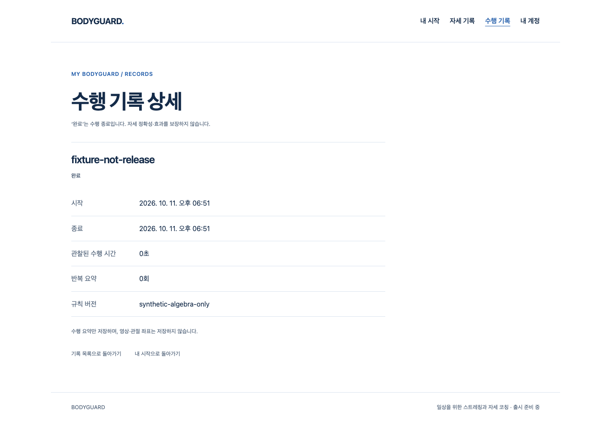

# 공통 코칭 결과 → 실제 계정·기록 저장

2026-10-11 · [S4.R7](../../stories/recorded-playback-api.md) · 기준 main `67c18dde067c10fb8188a92839239ce06d14af7b`.

## 실제 작동한 흐름

- production Chrome의 실제 AuthProvider·공통 `useRecordedPlayback` → 명시 준비/합성 수행 → 명시 저장 → 기존 수행 기록 상세를 실제 FastAPI·새 소유 PostgreSQL18로 연결했다. 준비/수행만으로 저장하지 않으며 UTC 시작점과 단조 elapsed를 유지한다.
- 서버가201로 저장한 뒤 시험 interceptor가 응답만 끊으면 실패 상태가 된다. 명시 재시도는 동일8필드 DTO/UUID를 보내200·같은 기록 한 건을 반환한다. 자동 재시도·새 기록 생성은 없다. 다른 실제 시험 계정은 상세404·목록0이다.
- cookie가 통지 없이 다른 실제 계정으로 교체되어도 옛 CSRF로 저장403·그 계정 기록0이다. 명시 재시도도403이며 proof 자동 갱신0, 기존 `failed/session-expired` 상태를 유지한다. 영구 로컬 종료 상태로 전환했다고 주장하지 않는다.
- 기존 refresh/logout 실패·성공/대기 pagehide/서버 revoke 경계도 현재 consumer로 확인했다. 수행 끝의 자원3개 종료와 화면 이탈의 outer lifecycle 종료를 구분한다.

위 화면은 실제 API에 저장된 `fixture-not-release / synthetic-algebra-only` 기록이다. 100ms의 합성 관찰이 화면에서0초로 표시되며 실제 스트레칭·정확성·최종 디자인/아바타 증거가 아니다.

## 실패·보완과 검증

최초 browser는6통과/2실패였다. H06은 수행 종료 시 outer close1을 잘못 기대해 응답 단절 시험 이전에 실패했고, H07은 실제403 뒤 기존 failed 상태를 closed로 잘못 기대했다. 자원 정리/기존 정책을 바꾸지 않고 하네스 기대를 기존 계약에 맞췄다. 두 번째8통과 후 공개 byte 검사에서 시험 config 주석의 단어가 사용되지 않는 CSS27byte를 생성한 것을 발견했다. 주석만 정리하고 새 DB의 마지막 browser8통과(10.450초)·공개 JS/CSS byte 동일을 확인했다. 첫/두 번째/마지막 report와 원본 출력·CSS·소스는 보존했다.

첫 verifier는 uv의 사용자 캐시 접근 거절로 종료1(내부 Ruff 실행2)이었고 원본 로그/스크립트를 보존했다. 이미 locked 설치된 venv 실행 파일로 검사했으며 두 번째 verifier의 CSS 비교 실패도 성공으로 세지 않는다. 마지막 실행 전 report 디렉터리 인수에 파일명을 붙인 호출1건은 인수 검증에서 종료1로 브라우저/게이트 재실행 전 실패했으며 원문은 대화 도구 출력에 있다.

- 전체 frontend98파일1750통과·실패/skip0. 이 실행 뒤 제품/unit 소스는 변경하지 않았고 시험 config의 주석만 수정했다.
- 마지막 실제 Chrome/API/SQL8통과·실패/skip/flaky0. TypeScript, 범위 Biome, Python runner Ruff/format, backend mypy12파일, helper 문법, production private guard, CSP/고지·GLB 없음, diff 검사 통과.
- 잘못된 suite/config 조합은 listener/DB 진입 전에 실제 종료2다. API8000/preview4173은 listener 없음, 세 소유 DB는 실제 정지·원본 데이터 보존을 확인했다. Docker·기존 서버/DB는 변경하지 않았다.
- [verification.json](verification.json)은 gzip141개의 복원·SHA, 현재 실행 관련17파일의 **실행 후 소스 snapshot**, 최종15명령/공개 asset hash/PNG를 기록한다. 실행 전후 소스 동일 receipt라고 주장하지 않는다. 이전 단계의 `final-*` 파일명은 당시 두 번째 실행을 뜻하며 이번 최종 결과는 `browser-third-report.json.gz`·`third-*`다.

메일·시계·gate·자원·관찰 프레임/판정은 합성이다. 실제 SDK/물리 웹캠/사람/3D/임상 판정·출시 적격 동작·Gmail/Google·기본 browser config·전체 backend pytest는 이번에 실행하지 않았다. 새 config/빌드는 시험 전용이며 공개 코칭/출시 동작0·UI/제품 API/개인정보 정책·원본 아바타 불변이다.

## 작성자 리뷰

`engineering:code-review` 기준으로 실제 diff와 계정/저장 계약, 응답 수락 후 단절, 옛 CSRF 거절·수동 retry, 자원 종료/outer 종료 구분, 새 scratch envDir/DB 소유 잠금·기본 runner 보존, 공개/외부 자산 경계를 검토했다. 독립 리뷰나 실제 참여자 검토는 아니다. 하네스 기대 오류와 불필요 CSS 생성은 보완 후 실제 재검증했다. 이번 좁은 변경의 미해결 P1/P2는 없다. 과거 시작P2/원인 미확정 native timeout은 별개로 남으며 전체1~6단계 완료 게이트를 닫지 않는다.

아바타·실제 참여자·Docker 보류는 유지한다. 필수 외형/정확도/동작·추천/성능·외부 연결·HTTPS/운영·실제 사용자 시험 전에는 전문가 검토만 남은 출시 후보판이라고 하지 않는다.
