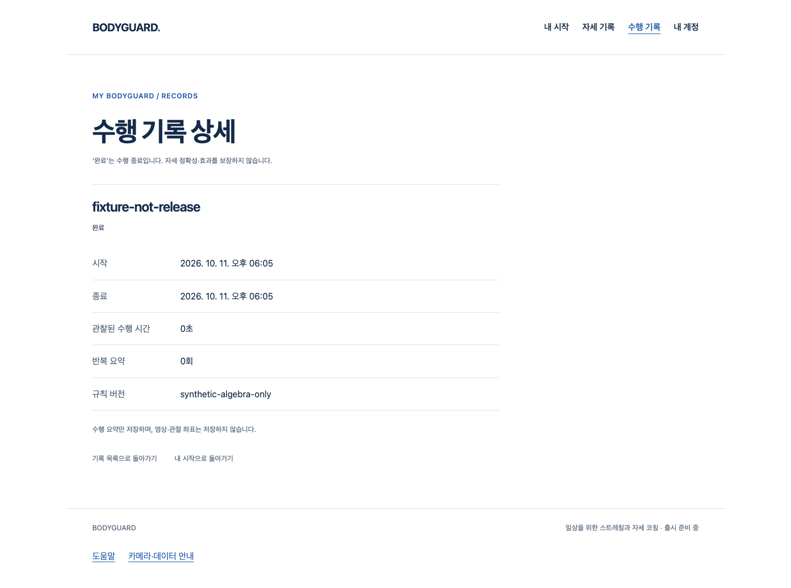

# S3.C6 — 입력·재생·소유 세션/기록 통합 결과

기준 main `f4bddae03ea16795b83fbadfe4ea1f9ce7aed1e1` · `codex/recorded-playback-assembly` · 2026-10-11. [Story/하네스 계약](../../stories/recorded-playback-assembly.md), [실제 실행·원문 SHA·현재 소스·공개 byte](verification.json).

## 작동하는 연결

기존 로그인 소유 세션에 새 `useRecordedPlayback`을 연결했다. 명시 준비는 inert owner만 만들고, 네 개 strict gate를 통과한 명시 start/새 세대 resume에만 재생을 한 번 시작한다. adapter 입력은 원래 세대·시각·순서를 유지해 기존 엔진으로 들어간다. 시범/피드백 consumer에는 같은 엔진의 현재 snapshot만 돌려준다. 입력 없는 tick도 만료를 처리한다. 별도 카메라/RAF를 추가하지 않았다.

기존 비공개 Auth 코칭 consumer를 이 공통 연결로 전환했다. 실제 Chrome·React·HTTP에서 명시 준비→합성 수행→실제 엔진 종료→명시 결과 저장→기존 본인 기록 상세 UI가 연결됐다. 계정 refresh·대기 중 취소·guest의 이전 시작/입력/저장 차단도 확인했다. HTTP 계정·자원·시계·판정은 시험 fixture이고 실제 SQL/인증 사업자/메일/웹캠/올바른 스트레칭은 검증하지 않았다. 아래 화면은 **합성 기록**이며 신규 디자인 시안이나 최종 코칭 화면이 아니다.

DOM 계약에서는 pause/resume·교체·동일 owner 재사용 거절·logout/unmount·만료/복수/미검출·start 거절·callback 오류·정리 실패 격리를 확인했다. 작성자 리뷰 중 native start가 동기적으로 실패를 보고한 뒤 옛 running 상태를 다시 전달할 수 있는 P2를 실제 RED로 재현했다. 현재 상태 객체를 재확인해 고쳤으며 종료 상태를 덮어쓰지 않는다. 아직 인계되지 않은 후보의 정리 실패도 고정 오류로 남기고 추가 준비를 차단한다.

## 실제 검증과 실패 보존

최종 전체 frontend **98파일/1743통과, 실패·skip0**; 관련5파일185통과. 실제 Chrome 흐름5개, 외부/GLB/카메라/Worker/저장소/페이지 오류0. 이 브라우저 실행은 native SDK나 아바타를 사용하지 않았다. 타입·변경4파일 Biome·production build117모듈·비공개 제외·diff를 실행해 exit0 원문을 보존했다. 제품 CSP/고지·GLB0과 공개 JS/CSS가 PR132와 byte 동일함을 검사했다. 제품 화면/출시 적격 목록·임상 기준·아바타/SDK/운영 변경0이다.

첫 unit의 잘못된 상태 필드(4통과/3실패), 첫 브라우저의 잘못된 필드명 대기 실패(1통과 후 record-detail TimeoutError), P2 재현 RED(0통과/1실패/의도적 필터 skip11), 강화된 정리 차단과 맞지 않던 시험의 실패를 모두 gzip 원문으로 남겼다. 최종 게이트에는 필터 skip을 사용하지 않았다. 중간 타입 오류는 도구 출력에서 확인했고 별도 raw 로그를 만들었다고 주장하지 않는다. 첫 verifier의 HTML CSP escape 미해석 실패도 도구 출력으로 관찰했고 이전 helper/게이트 출력을 보존한 뒤 디코딩 검사를 수정했다. 이후 정상 결과로 기존 시작P2/과거 native timeout을 닫지 않는다.

`verification.json`은 원문/소스30개와 실제 최종 명령5개를 연결한다. 앞선 verifier의 게이트 gzip8개도 별도로 보존되어 있다. `verify.mjs`는 실제 타입·정적/build/guard/diff를 실행하며 시험 결과를 만들어내지 않는다. scratch `/private/tmp/bodyguard-recorded-playback.B5ccrb`, product `/private/tmp/bodyguard-camera-preparation.Xh7cw7`, 비교 제품 `/private/tmp/bodyguard-camera-preparation.VPKNdu`를 보존한다. 실제 실행 명령은 frontend에서 `pnpm exec vitest run --maxWorkers=2 --reporter=json --outputFile=<고유 scratch JSON>` 및 관련5파일 Vitest, `node scripts/test-recorded-playback.mjs <scratch> <설치 Chrome 절대 경로> <고유 label>`, `node ../docs/review/recorded-playback-assembly/verify.mjs <scratch> <product scratch> <PR132 product scratch>`다.

## 작성자 리뷰·범위 게이트

`testing-strategy`로 불필요한 healthy 반복보다 자원/세션/기록 경계의 실패·정상 흐름을 정했고, `code-review`의 정확성·권한/CSRF·정보 유출·수명/재진입·상태 덮어쓰기·유지보수 기준으로 전체 변경을 직접 재검토했다. 새 P2는 위 증거로 보완했다. 이번 diff 범위의 미해결 P1/P2는 없으며 독립 리뷰는 수행하지 않았다. 기록 schema/인증 권위·gate 의미는 기존 부품에 위임하고 영상/관절/예외 원문을 DOM/저장/서버로 내보내는 경로를 추가하지 않았다.

아바타 보류·참여자 연결 나중·Docker 보류/디자인 추후를 유지한다. native 두 아바타 consumer 전환/실행, 실제 classifier·추천/올바른 시범·오류 정확도·최종 외형/실측·SQL/메일/Google·Docker/HTTPS·운영/배포·전체1~6 완료는 이 결과로 증명되지 않는다. 출시 적격 동작은0이며 공개 코칭은 열지 않았다. 다음은 실제 입력 경로의 남은 시작/지연 문제와 독립 통합 누락을 해결하되 보류된 최종 아바타/참여자·운영 게이트를 통과 처리하지 않는 것이다.

PR 최신 head/base·diff·충돌/체크·조건부 병합은 실행 시점에 원격 결과로 별도 기록한다. 저장소 승인 규칙은 그대로다.
