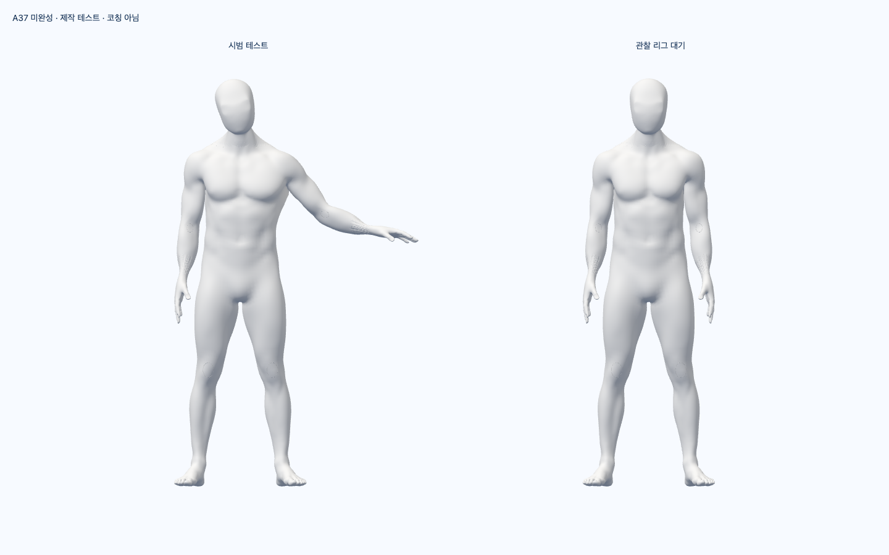
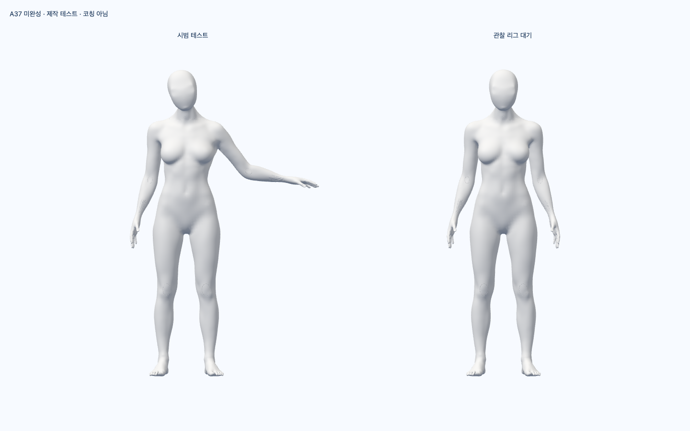

# S2.T17 — 작동하는 단계 재생 / 남은 조건

시범 모델의 준비 → 수행 → 유지 → 복귀가 단계 입력에 반응한다. 같은 입력은
클립을 다시 시작하지 않고, 현재 자세에서 다음 단계로 이어진다. 일시정지·만료는
멈추며 재개에 정지 시간을 더하지 않는다. 관찰 모델·원본·성공 판정은 별개다.
공개 웹의 화면·문구·JS/CSS와 5 SDK 모델 bytes는 기존과 동일하다.

## 실제 검증

runtime `2c24b659f703b2c97adaa6be06a5153d42ee5e4f` / 최신 main 기준
`24c9c0dcab13f96e1e3b397324fca38babf72ad0`.

- 전체 FE 1102 pass / 0 fail / 0 skip. tsc·Biome(경고/정보0)·assets·Vite build·
  production guard·Ruff·diff 실제 exit0. [요약·SHA·소스22/증거203](summary.json).
- Chrome 154.0.8037.98 / 실제 WebGL의 남녀 2흐름: 준비·수행·정지·재개·
  종단 유지·만료·복구·복귀·해제. 외부 요청/카메라 호출0. **SDK·물리 캠·실제 사람 시험 아님.**
- Blender 5.1.1에서 원본을 저장하지 않고 메모리에 테스트 action을 작성했다.
  실제 neck01/neck02/head/팔/손목/손가락의 basis keyframes를 샘플링하고,
  기존 GLB rest quaternion에 곱해 비출시 클립으로 재생했다. 새 GLB export나
  외형 수정·변형 정확도/임상 수행법 검수로 세지 않는다. 커밋된 제작 스크립트의
  재실행 결과도 이전 authored fixture와 같음을 확인했다.
- AnimationMixer는 mesh 없는 private Bone sampler에만 작동한다. 관절의
  local TRS를 먼저 검증한 뒤 시범에 적용한다. 실제 GLTFLoader CUBICSPLINE
  파싱·복사·중간 재생과 discrete/다중 TRS, 정지/소유권/실제 순수 progression을 단위 검증했다.
- 기존 male/female GLB·29,747,593 bytes 원본은 Git 25a9bd6의 bytes와 같다.
  관찰 리그는 이 브라우저 시험에서 대기 상태이며 사용자를 추적한 것으로 표시하지 않는다.
  8 weights 존재/독립 bone/전신 구도·실제 렌더링을 확인했고 FPS·노트북 성능 시험은 아니다.

## 실제 미리보기 — 외형·동작·디자인 승인본 아님

아래는 미완성 A37와 **제작 테스트**를 실제 렌더링한 화면이다.
팔 표면/손·머리 연결 등의 남은 외형 문제는 D2-A 이월에서 해결한다.

## 실패·보완·증거 보존

증거 이름이 red/green이어도 판정은 실제 내용/exit 기준이다.

- 최초 contract-red는 미구현 import 오류다. JUnit의 placeholder 1 failure를
  실행된 동작 테스트 1개로 세지 않는다.
- pair-red 42 tests/3 fail → 통합 후42 pass. optional reference 전달/사전 복사·
  잘못된 자산 정리와 API를 연결했다. types-pair의 새 optional status 타입 오류는 별도 수정했다.
- review-red 27/3 fail → 보완45 pass. abort 뒤 getter throw의 closed 유지,
  변경된 skin binding 검출, zero scale의 원자적 거부를 보완했다.
- browser-first는 남성7단계 뒤 정확한 freeze 비교에서 실패했다. 당시 bundle·
  report·stdout/stderr를 보존했다. wrapper receipt 이름이 browser report와
  충돌해 EEXIST도 발생했으며 wrapper JSON receipt는 생성되지 않았다.
  이 실패의 source stamp는 browser report에 있다.
- browser-review-red라는 최초 회귀는29 pass여서 실패를 재현하지 못했다.
  강화한 회귀는29/1 fail로 재현했고 zero-delta quaternion 원본 유지로 수정했다.
  second 실제 브라우저2 pass, 커밋된 final도2 pass. 세 번의 bundle 모두 보존했다.
- domain-review-red31/2 fail →49 pass. Bezier 필수 tangent/시간 범위·
  overflow duration을 거부한다. 전문 제작 클립의 임의 코드 실행 sandbox는 제공하지 않는다.
- Blender 첫 sandbox 실행은 Metal 초기화 backtrace와 함께 crash했다.
  확대 실행의 잘못된 neck 이름은 Python assertion이 있었지만 **process exit0**였다.
  marker 부재·stderr 때문에 성공으로 세지 않았다. 실제 이름을 읽어 수정하고
  `--python-exit-code 1`과 marker/stderr 검증을 추가했다. crash·stdout/stderr를 보존했다.
- types-probe/초기 Biome/Ruff 실패, format 경고도 보존했다. 최종 정적 검사0이다.
- 첫 public CSS에 comment 단어를 Tailwind가 utility로 읽어30 bytes가 추가됐다.
  최초 public bundle을 보존하고 문구를 수정한 뒤 기존 JS/CSS bytes와 다시 같음을 확인했다.
- 실제 guard-red는 개발 marker를 검출했다. 시험용 새 marker 파일만 제거했고
  원본은 증거로 보존했다. guard-restored0·기존 bundle은 유지됐다.
- collector 최초 소스 경로 오류는 실패로 기록하고 부분 폴더를 로컬에 보존했다.
  실제 `avatar/ownedPosePlayback.ts` 경로로 다시 수집·SHA 검증했다.
  일부 탐색 sed 경로 오류와 적용되지 않은 첫 patch도 tool 출력에서 확인된 실패다.
  해당 탐색/patch의 전체 raw 로그 파일이 보존됐다고 주장하지 않는다.

evidence의 gzip 파일은 압축본/원본 SHA를 함께 기록한다. 각 run의 source stamp와
현재 runtime source archive를 구분한다. 초기 실행을 현재 소스로 시험한 것처럼 표시하지 않는다.
초기 collector 부분/기존 worktree·원본·과거 PR 검증은 삭제하지 않았다.

## author review / 미완료

코드 리뷰 스킬의 정확성·예외·소유권·안전·프라이버시·성능 경계를 author가 확인했다.
발견한 Story P2는 위 실제 회귀로 보완했다. Story 범위 미해결 P1/P2 0은
외부 리뷰 승인이나 전체 제품의 P1/P2 0을 의미하지 않는다.

현재 옵션은 owned pair에만 연결됐으며 실제 로그인 native session의 단계 전달은 다음
독립 통합이다. 승인된 UI·실제 사용자와 동일인 대응·출시용 시범 데이터·오류 강조는 아직 없다.
입력 클립/명령은 내부 신뢰된 제작·세션 계약용이며 검증된 수행법의 증거가 아니다.
Three MIT 원문은 [실제 설치본](notices/three-MIT.txt)에 보존했다. 아바타·전체 SDK 권리 게이트는 별도다.
**0 qualified motions / D2-A·M·T·R·I·P·전체1~6 미완료.** 전문가 최종 검토만 남은 상태가 아니다.
실측/참여자·최종 외형·권리·승인 디자인·SDK egress/다장치/HTTPS·운영은 기존 별도 조건이다.

재현은 source archive의 커밋 코드, 원본 Git blob, evidence의 `run.mjs/quality.mjs/
collect.mjs`, 실제 command receipts, local-only fixture를 사용한다. 공개 배포 명령이 아니다.
