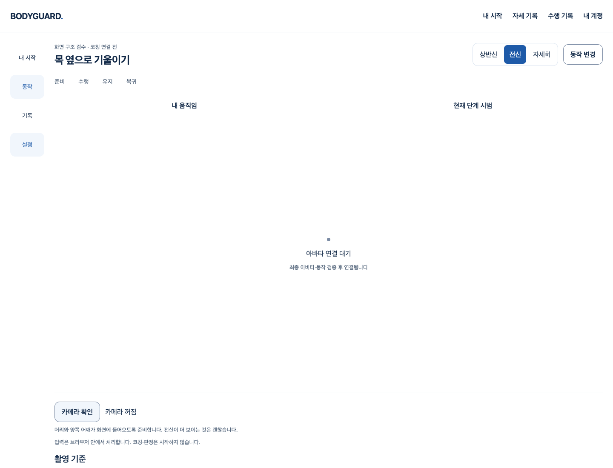

# Worker 실행 전 실패를 페이지 재시도로 복구

2026-10-16 · main203a6ab에서 시작 · [Story](../../stories/sdk-lifecycle-startup.md) · FR-M-02/07·NFR-07/08.

## 실제 사용 흐름

코칭에서 카메라 확인 중 Worker 파일이 시작하지 못하면, 기존 코드는 아직 시작되지 않은 SDK의 clean ACK를 기다렸다가 cleanup 오류로 고정했다. 이후 버튼이 비활성화돼 새로고침이 필요했다. 현재는 Worker가 protocol handler 설치 후 보내는 고정 boot를 확인해야 init/모델을 전송한다. boot 전 실패에서는 소유 Worker 종료를 확인하고 기존 ‘다시 확인’ 버튼으로 같은 페이지에서 명시 재시도할 수 있다. 카메라를 자동으로 다시 켜지 않는다.



[기존 코드의 재시도 차단](proof/browser-baseline-final-never-boots-failed.png) · [현재 코드의 재시도 가능 오류](proof/browser-complete-never-boots-failed.png). 빈 3D 공간은 기존 main의 미연결 검수 화면이며 이번 변경이 두 아바타나 올바른 자세/코칭을 완성했다는 뜻이 아니다.

## 원인과 실제 대조

- 원래 parent는 모델 다운로드 후 바로 initSent=true로 전송했다. Worker 코드가 로딩/실행되지 않아도 정리에서는 native closed 응답이 필요하다고 판단했다. 로딩 무응답의 원래5초가 지난 뒤 다시5초 정리 타임아웃을 거쳐 ‘카메라 정리를 확인하지 못했습니다’로 오염됐다.
- [불변 main unit 대조](proof/unit-baseline-b.log.gz)는 똑같은 누락 boot 조건에서 `Resource cleanup failed`로 실패했다. [Chrome main 대조](proof/browser-baseline-final.json)는 실제 카메라 준비 UI/가짜 장치에서 init→close 송신 후 cleanup 오류와 비활성 재시도를 확인했다. 이것은 **명시적인 Worker 로딩 실패 주입**의 재현이지 PR152의 과거 간헐 실패가 재현된 것은 아니다.
- [현재 Chrome](proof/browser-complete.json)은 로딩 무응답·Worker 실행 예외·실제 JavaScript 구문 오류3종 모두에서 init 송신0·Worker 종료·카메라 track 종료·저장0을 확인했다. 이후 같은 페이지의 명시 재시도는 boot→init→ready→frame→result→close→closed/clean=true를 실제 SDK heavy/face/hands로 통과했다. account API만 모의이고 실제 권한 팝업/사람 영상이 아니다.
- boot는 고정1회이며 SDK/신체 준비 완료로 쓰지 않는다. 모델 읽기 이후의 **원래5초 하나를 boot+init이 공유**한다. SDK 응답·cleanup 제한/가중치·기능·CSP/통신 정책·모델 파일은 바꾸지 않았다. init을 보낸 뒤에는 기존 실제 native clean ACK가 여전히 필수다. 종료 실패를 무시해 재시도를 허용하지 않는다.

## 실제 회귀 검증

1. 전체frontend1956/110파일, 타입을 포함한 `pnpm build`, 전체Biome exit0/기존16info·변경8파일 진단0, 원래 production guard와 diff를 통과했다. unit은 늦은/누락/반복/잘못된/배열 boot·취소·초기화/추론/정리 deadline·entry의 handler 설치 순서를 검사한다. 가짜 시계/자원이며 실제 SDK 품질 시험이 아니다.
2. [기존 카메라8흐름](proof/camera-boot-regression.json)은 실제 Chrome/React/가짜 장치/실제 SDK의 준비·중단·권한 거부 주입·늦은 permission·이탈·재진입·401 회수를 확인했다. 기존 시간/기대값을 낮추지 않았다. 계정은 모의이고 실제 SQL/공급자/사람/GLB는 시험하지 않았다.
3. [실제 build CSP5흐름](proof/policy-boot-policy.json)은 build된 meta CSP·Blob Worker·실제 lite/face/hands SDK와 동일 출처 요청을 검사했다. 시험 응답 CSP/route 우회로 보호를 만들어내지 않았다. 소유 로컬 다른 출처 trap 양성 대조2건과 차단 대조0건을 구분하며 문서 외부 요청/SDK 계측 proxy 시도0이다. Chrome 프로세스 배경 proxy33건은 모두 거절됐고 SDK 요청0과 구분한다.
4. [SDK 생성 단계4흐름](proof/lifecycle-boot-lifecycle.json)은 실제 heavy/face/hands SDK의 준비→생성 blank 추론→clean close와 body/face/hands 생성 중 명시 취소를 확인했다. 각 case의 Worker 생성=종료, clean ACK를 확인했다. Task/단계/종류/기술 시각만 기록했고 input·좌표/회전 원시값은 기록하지 않았다. 같은 브라우저/Worker bundle cache를 공유한 시험이며 cold driver/실제 사람 정확도 증거가 아니다.

최초 boot 오류/재시도 Chrome 대조는 전체 unit/build 전에 실행했다. 기존 카메라·build CSP·SDK 단계 회귀는 전체 unit/build가 종료된 뒤 순서대로 실행했다. full unit과 build는 서로 병렬로 실행했다. 위 숫자는 테스트 범위이며 코칭 정확도/노트북 성능/단계 통과율이 아니다.

## 실행·증거

`bodyguard/frontend`에서 아래처럼 매 실행 새 임시 폴더와 label을 사용한다. 실제 연결 대신 기존 소유 도구·localhost·가짜 장치만 사용하며 `.env`·원본/GLB·운영 데이터·기존 결과를 수정하지 않는다.

```sh
node scripts/test-worker-boot-recovery.mjs <bodyguard-worker-boot.scratch> baseline baseline
node scripts/test-worker-boot-recovery.mjs <bodyguard-worker-boot.scratch> current
node scripts/test-camera-preparation.mjs <bodyguard-camera-preparation.scratch> '/Applications/Google Chrome.app/Contents/MacOS/Google Chrome' current
node scripts/build-sdk-policy-probe.mjs <bodyguard-sdk-policy.scratch>
node scripts/test-sdk-network-policy.mjs <bodyguard-sdk-policy.scratch> '/Applications/Google Chrome.app/Contents/MacOS/Google Chrome' current
node scripts/test-sdk-lifecycle.mjs <bodyguard-sdk-lifecycle.scratch> current
pnpm test
pnpm build
pnpm check
node scripts/check-selection-production.mjs
git diff --check
```

baseline은 parent만 불변203a6ab으로 대입하는 명시 대조이며 현재 source 검증과 섞지 않는다. [실행 소스](executed/)·[원문 결과](proof/)·[asset/source hash](manifest.json)를 보존한다. 실제 시험 경로는 `/private/tmp/bodyguard-worker-boot.vUbUzE`, `bodyguard-camera-preparation.oTJH91`, `bodyguard-sdk-policy.roKOX9`, `bodyguard-sdk-lifecycle.PetbeB`다. 임시 폴더와 기존 파일을 삭제하지 않았다. 로그 gzip의 복원 byte/원문 SHA를 확인했다.

초기 하네스 실패도 보존했다. baseline.config.ts가 CJS로 묶여 plugin을 로드하지 못한 실행은 제품 재현으로 세지 않고 ESM.mts 대조 결과를 사용했다. 첫 browser 대조/현재 실행은 case JSON 작성·Chrome/Vite 종료 뒤 가짜 API 리스너를 닫지 않아 Node가 남았다. 결과와 당시 script를 보존하고 소유 PID7051/7334만 종료했다(exit143). 하네스 finally에서 API를 닫도록 보완한 final 실행은 baseline의 의도된 assertion exit1·현재2흐름 exit0으로 실제 종료했다. 이후 구문 오류까지 포함한 browser-complete는3흐름 exit0이다. 잘못 지정한 tsconfig.app.json 명령은 미실행 오류이며, 이후 원래 build의 `tsc --noEmit` 성공과 구분한다.

## 직접 리뷰·남은 문제

code-review의 정확성/소유권·경쟁·무응답/예외·종료 실패·동일 출처·저장/외부 전송·공개 제외 관점으로 실제 diff를 직접 검토했다. boot 전/후를 정확히 구분하고 원래 응답 budget/clean ACK를 유지한다. 위 하네스 리스너 종료 누락은 보완했고 이 pre-SDK 복구 변경의 알려진 미해결 P1/P2는 없다. 독립 전문가 리뷰가 아니다.

**PR152의 과거 두 간헐 준비/정리 실패는 당시 Worker 내부 단계 증거가 없어 동일 원인으로 확정할 수 없다.** 원문 실패와 전체 시작/정리 P2를 보존하며 해당 Draft를 병합/완료하지 않는다. 이 변경이 로딩 실패의 잘못된 cleanup 분류를 고쳤다는 좁은 증거를 전체 간헐성·실제 사용자 아바타·올바른 시범/추천/판정·최종 외형·실측/전문가 승인·1~4/1~6단계 통과로 확대하지 않는다. 비용/계정·실제 공급자/Docker·운영 DB/시크릿·배포/출시0이다.
