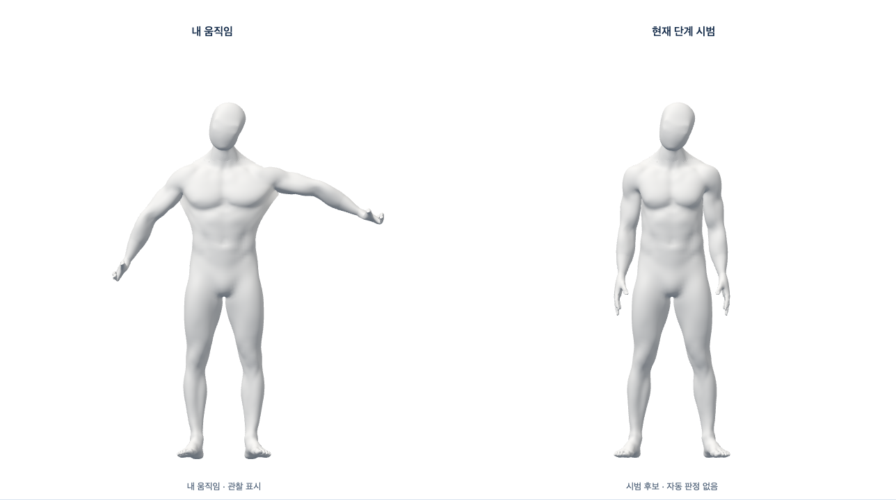

# 같은 공간의 사용자 관찰·단계별 Blender 시범

2026-10-16 · [Story](../../stories/shared-coaching-reference.md) · base main53ff077 · 개발 전용·최종 외형/판정 승인 아님.

## 작동하는 흐름

기존 `/dev/coaching?motion=neck-side`에서 **시범 미리보기 → 카메라 확인 → 입력 확인**을 누르면 하나의 흰 공간에 왼쪽 사용자 관찰과 오른쪽 단계 시범이 함께 표시된다. 시범만 먼저 확인하거나 카메라/촬영 기준만 확인할 수도 있다. 새 메뉴나 전체 디자인 변경은 없다.

왼쪽 사지·몸통은 기존 복사 관찰 슬롯을 소비한다. **움직임 맞추기**를 명시적으로 누른 다음 프레임의 머리/손 표시 기준을 사용하며, 올바른 자세로 자동 인증하지 않는다. 오른쪽은 기존 준비·수행·유지·복귀/좌우/일시정지 제어를 사용한다. 관찰은 시범을 움직이지 않고 시범은 사용자를 움직이지 않는다. 실제 신체 표면을 복원한 스캔이 아니라 선택한 일반 남녀 모델의 리타게팅 후보다.



[여성 전신/800px](evidence/browser-f-female-full-800.png) · [확대](evidence/browser-f-female-자세히.png) · [빈 입력](evidence/browser-f-empty-input.png). 이 이미지는 실제 사람의 영상/검출 결과나 최종 외형이 아니다.

전신은 하나의 카메라로 두 모델을 표시한다. 상반신/상세 보기는 같은 무테 흰 canvas에서 각 모델 중심을 잘라 반대 모델을 덮지 않게 한다. 확대에서 팔/하체가 잘릴 수 있으므로 전신이 필요하면 **전신**을 선택한다. 관찰 범위/판정에 쓰는 원본 촬영 기하는 이 표시 구도와 무관하다. 가림/빈 입력/만료·카메라 중단 뒤에는 왼쪽을 관찰 중인 모델로 남기지 않는다. 촬영 범위 안내/기준 수집·확인/저장은 기존 기능을 유지한다.

## 경계와 보존

- SDK generation/sequence/at를 그대로 전달한다. 다른 검출/카메라·영상/좌표 React state·기록/전송/로그를 추가하지 않는다. 오른쪽 stage 세대와 카메라 세대는 별개이며 현재 카메라 소유자가 명시적으로 표시 rig를 연결/중단한다. 단계 버튼은 판정/타이머/성공/코칭 결과를 만들지 않는다. 오류 빨강 강조에는 아직 검증된 classifier 연결이 필요하다.
- 머리/손 기준은 현재 입력의 표시 정렬이지 정자세 인증/임상 보정/같은 사람의 신원 확인이 아니다. 두 손의 기준이 없으면 임의 identity quaternion으로 채우지 않는다. 새 카메라 준비와 성별/동작/계정 변경 뒤 이전 정렬/자세를 이어받지 않는다. 원래 local 관절 회전을 보존했다가 연결 해제 시 복원한다.
- [PR155의 불변 native/GLB](../blender-reference-content/README.md), 163관절/모든8가중치·출처/라이선스와 실패 증거를 재사용한다. 원본/GLB/전문 action/메시·리깅 변경0이다. 기존 Draft152의 표시 정렬 코드를 참고했지만 해당 Draft를 병합하지 않았다. 최신 main의 bounded/hash-matched loader·GPU 준비/회수 경계를 유지한다.
- 숨김/계정/이탈 시 카메라와 stage 각 소유자가 정리된다. 늦은 stage 준비는 회수 후 다음 소유자를 허용하며, 표시 정리 실패도 카메라 close를 건너뛰지 않고 새 획득을 차단한다. stage 오류/닫기 뒤 촬영 기준용 카메라가 켜져 있다면 명시 카메라 상태/끄기 버튼을 유지하며 숨겨서 계속 촬영하지 않는다. 미채택 모델·이 코드/fixture는 production에서 제외한다.

## 실제 검증과 모의 경계

[browser-f.json](evidence/browser-f.json)은 실제 React·Chrome155·WebGL·불변 GLB/애니메이션을 사용했다. 관찰 입력/계정 응답은 생성 fixture다. 남녀 두 모델의 독립 픽셀 변화, 명시 머리/손 정렬, 오른쪽 단계, 빈 입력/복구, 중단 후 새 세대 연결, 성별 변경과 전신/확대/800px·숨김/401 회수를 확인했다. 카메라/SDK Worker·외부/저장/pageerror0이다. 실제 사람/SDK 양성 검출/임상 정확도 증거가 아니다.

[shared-native-a.json](evidence/shared-native-a.json)은 실제 SDK heavy body/face/hands Worker와 실제 브라우저의 가짜 카메라를 3D stage와 함께 실행했다. 명시 연속 입력·시범 재생·미검출 사용자 표시 보류, 원래 거부/늦은 권한/라우트/계정 회수9흐름이 통과했다. 입력/모델을 위해 외부/운영 서버를 쓰지 않았다. SDK 원래5초 한계/정리 ACK는 변경하지 않았다. 정상 이번 실행으로 PR152의 과거 간헐 원인을 확정/종결하지 않는다. build와 일부 시간이 겹쳤으므로 목표 노트북 성능 측정으로 사용하지 않는다.

실제 GLB unit은 남녀 원본/반대 모델 불변, 사지·머리·손 변화·가림/만료·중복/다른 세대 거부·중단 시 회전 복원·abort를 확인한다. DOM port 시험은 같은 슬롯 단일 전달·stage 교체·새 카메라 세대·늦은 준비와 정리 실패 회수를 확인한다. 조명/체형/카메라 정확도나 최종 변형 품질의 대체물이 아니다.

```sh
# bodyguard/frontend에서 각각 새 임시 폴더와 새 label로 실행
node scripts/test-shared-reference.mjs <bodyguard-shared-reference-scratch> browser-a
node scripts/test-camera-preparation.mjs <bodyguard-camera-preparation-scratch> '/Applications/Google Chrome.app/Contents/MacOS/Google Chrome' shared-native with-reference
node scripts/test-reference-content.mjs <bodyguard-reference-content-scratch> reference-regression
pnpm test
pnpm build
pnpm check
node scripts/check-selection-production.mjs
git diff --check
```

## 실패·직접 리뷰

1. a/b: 연속 입력과 촬영 안내는 작동했지만 모델은 기다림으로 남았다. RAF 프레임 시작 시각은 같은 프레임의 다른 callback이 받은 관찰보다 앞설 수 있었다. 현재 `performance.now()`로 실제 렌더 시각을 읽도록 수정하고 과거 시각/만료 거부는 유지했다. 과거 RAF 시각을 주는 unit을 추가했다. a는 실패 보고서/실행 스크립트만 있고 실패 화면은 없으며 b부터 UI/스크린샷을 보존했다.
2. c: canvas 촬영의 자동 스크롤 전후 서로 다른 위치를 반쪽 픽셀로 비교했다. 위치를 일치시키고 반쪽 PNG를 각각 보존하도록 하네스를 고쳤다. d는 기존50ms half-life 보간 수렴 도중의 정확한 픽셀 일치를 요구해 실패했다. 제품 보간을 끄지 않고 생성 입력이 멈춘 뒤2600ms 수렴을 기다린 e/f에서 엄격 픽셀 비교를 통과했다.
3. e는 기능을 통과했지만 확대에서 팔이 반대 모델에 겹쳤다. f에서 확대 구도만 각 중심 crop으로 보완하고 실제 화면을 재검수했다. 전신/GLB/신체 구조/가중치는 바꾸지 않았다.
4. 초기 타입 시험은 확장된 stage 메서드가 없는 mock을 거부했고 mock도 갱신했다. 여성 unit은 앞 남성 시험의 생성 머리각을 이어받아 같은 각을 다시 입력했으므로 fixture를 매 시험 초기화했다. 카메라 port unit은 ref만 바뀔 때 정렬 버튼이 갱신되지 않음을 드러내, 연결 여부 boolean만 React 상태로 반영했다. 실패 원문도 보존했다.
5. 전체 회귀의 CameraReference C6는 lazy 페이지가 아직 없는 상태에서 DOM을1초 기다려 실패했다. 단독10개는 통과했으며 다른 기존 DOM 시험과 같이 페이지 모듈을 먼저 읽도록 했다. 시간 한계를 늘리거나 실제 Chrome 시작 시험을 대체하지 않았다. 초기 전체 실패도 보존했다.

코드 리뷰·문서화 스킬을 적용해 동일 슬롯/소유자·새 세대·원본/반대 모델 독립·리그 복원·가림/시간·정렬과 판정의 구분·실패/재시도·원래 SDK 경계·production 제외를 직접 검토했다. 미실행/합성/실제 검증을 구분하며 최종 실행/보류 판정은 아래에 기록한다.

최종 실행: 전체frontend1988개/117파일(`full-test-c.log.gz`), typecheck/고지 포함 원래 build(`build-e.log.gz`), Biome exit0·기존16info(`check-d.log.gz`), production guard(`guard-e.log.gz`), diff 검사를 통과했다. 기본 실제 카메라8흐름([default-native.json](evidence/default-native.json))과 실제 남녀3종 시범만 보기6흐름([reference-regression.json](evidence/reference-regression.json))도 통과했다. 동시 SDK9흐름/합성5흐름·순수 GLB/DOM 시험은 서로 대체하지 않는다. 위 보완 뒤 이번 개발 통합 Story 범위의 알려진 미해결 P1/P2는 없다. PR150/152의 별도 기존 P2는 아래와 같이 남긴다.

실행 코드/원래 실패/PNG/압축 로그는 [evidence-manifest](evidence-manifest.json)에 SHA를 기록한다. 압축 전 원문 SHA와 무손실 복원은 `evidence/raw-compression.json`으로 대조한다. 실패 당시 소스는 a 하네스·b의 하네스/렌더 컴포넌트·c/d 하네스가 별도로 있으며 모든 초기 상태의 전체 소스를 보존했다고 주장하지 않는다. 최종 f는 보고서의 실행 전후 소스 SHA와 정확한 복사본이 일치한다. 최초 전체 실패의 본문에는 ‘코칭 화면을 여는 중입니다’가 남아 있다.

## 남은 필수 조건

자동 동작 판정과 적절한 오류 강조/교정 시범 적응, 신체 기반 추천, 완료/중단 결과 생산/기록 연결, 나머지4종과 최종 외형/변형·목표 노트북 성능은 미완료다. PR150/152는 기존 P2로 Draft/병합 금지를 유지한다. 전체1~4/1~6 완료가 아니며 실제 참여자/공급자/Docker·HTTPS/운영 DB/시크릿·배포/출시·비용/계정 작업은 이번에 실행하지 않았다.
