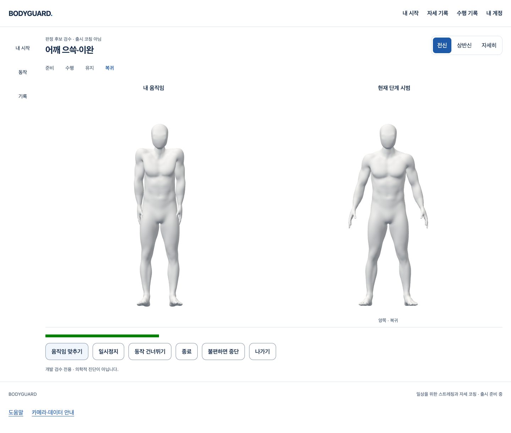
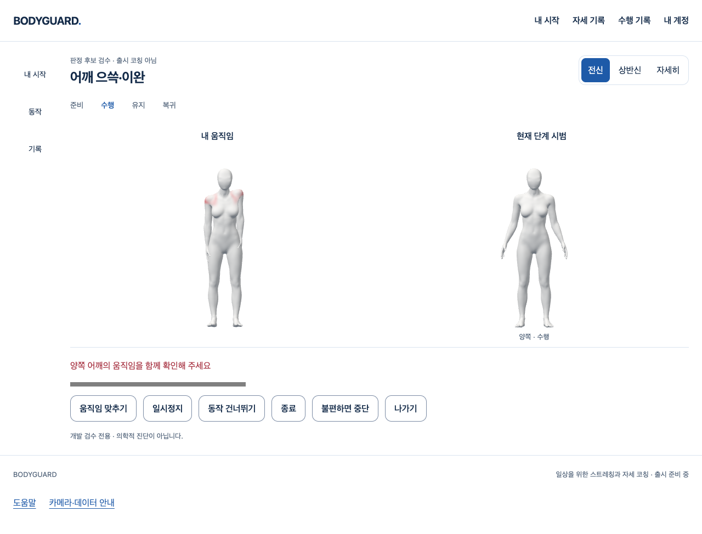

# 어깨 상승·오류 표면·두 아바타 실행 후보

2026-10-17 · [S3.C5 명세](../../stories/shoulder-shrug-workspace.md) · 시작 main `25429c004305de0393935f0b0bd470ecb0e0fd97`.

**로컬 후보 구현·검증 중이며 Story 완료/병합 승인이 아니다.** 실제 네이티브 일시정지·정리의 간헐 실패가 남아 Draft로 보존한다. 단독 통과를 실패 원인 해결로 세지 않는다.

후속 [자원별 정리/ACK 분리 진단](cleanup/README.md)은 [Draft PR #163](https://github.com/HSU-OAS/bodyguard/pull/163)에 기록한다. 아래 기본 소스44개·증거110개는 후보 커밋52c97937의 보존 묶음이며 후속 시험으로 덮어쓰지 않는다. 단독 정상 해제와 동시 실행 재개 추론 실패를 구분했지만 최초 정리 P2는 미해결이다.

최신 [첫 추론 준비 순서 보완](preparation/README.md)은 같은 source의 첫 입력을 아바타 GPU 준비 전에 폐기하도록 실제 구현했다. 재개 실패의 직접 경로를5초 응답 마감 초과로 확인하고 원래 제한/권한을 유지했다. 실제 구현의 동시 실행·목/어깨 회귀는 통과했으나 최초 정리 P2 해결/병합·Story/단계 완료를 주장하지 않는다. 이전 snapshot/실패는 그대로 보존한다.

## 작동하는 흐름

기존 흰 코칭 공간에서 남녀 선택 → 명시 시작 → 새 준비 프레임으로 표시 맞추기 → 왼쪽의 양측/한쪽 어깨 상승·복귀 → 오른쪽 Blender 단계 시범 → 같은 프레임의 오류 표면/짧은 안내 → 반복 결과·중단을 연결했다. 원래 목 실행·정리/기록 계약과 화이트/블루·둥근 컨트롤을 재사용했다. 새 메뉴·CSS/대규모 디자인 변경은 없다.

어깨·팔꿈치·손목·몸통·골반을 요구하도록 촬영 조건을 맞췄다. 단지 시작 버튼을 누르거나 프로필 shape가 맞는다고 임상 적격을 부여하지 않는다. 공개 목록은0이며, 수학 프로필은 시험 Vite entry에서만 주입한다. 기본 개발 화면/공개 제품에 자동 코칭을 활성화하지 않았다.

## 표시·판정 경계

- 골반 폭/어깨 높이의 image-plane 변화로 **표시용** 쇄골 swing을 각각 재타기팅한다. 명시 시작/맞추기 뒤 새 검수 준비 프레임이 필요하고, 불가능한 변위는 정답처럼 clamp하지 않는다. 실제 쇄골 각도나 깊이·통증·힘을 측정한 것이 아니다.
- 원래163관절의 위치·스케일·부모, 정점/정규/여덟 가중치·원본/GLB/제작 시범은 바꾸지 않는다. 팔·몸통과 새 어깨의 깊이 순서를 기존 driver가 처리하며, 어깨를 원래 관찰 bone 목록에 추가하지 않고 별도 projected coverage로 구분한다.
- 맞추기 재요청/가림·만료는 표시 근거와 색을 폐기한다. 현재 어깨 표시가 안 되는 프레임은 건너뛰지 않고 같은 stamp의 `unobservable`로 세션에 전달해 유지가 이어 적립되지 않는다. 오류는 사용자 복사본만 칠하고 머리/어깨 추적 소실에는 해당 색을 해제한다.
- 시범은 현재 준비/수행/유지/복귀 및 오류에 반응한다. 고정된 올바른 동작을 계속 반복하는 화면이 아니다. 단일 캡처·같은 세대/시각/순서·기존 자원 소유를 유지한다. 현재 후보 결과는 기록 쓰기0이다.

## 실제 실행과 미실행

| 실행 | 결과·실제 확인 | 대체/한계 |
|---|---|---|
| `test-shrug-workspace.mjs … browser-c` | 4흐름 통과: 실제 Chrome/React/GLB/GPU/classifier/engine, 남녀 상승/한쪽·머리 오류 사용자-only GPU 색, 머리 소실/빈/만료 색0·적립0, 두 반복·결과, 재개/새 canvas·늦은 권한 회수·401 | 카메라/Worker/관절/프로필/계정만 생성·모의. 실제 사람/SDK 정확도·SQL 아님. 1280×800 가로 넘침0. |
| 실제 SDK `native-a` | 시작/빈 입력1흐름 통과 후 pause 중 `cleanup-error`·resume 실패 | 생성 Chrome 가짜 장치/실제 Worker·SDK·모델/WASM·GLB. 다른 Chrome 실행과 겹쳤지만 원인은 미확정. **필수 정리 게이트 실패.** |
| 실제 SDK `native-b`, 최종 `native-c` | 각각2흐름 통과: 빈 입력 적립0, 명시 pause/새 SDK·카메라·GPU 소유 재개/중단 | 단독 통과이며 초기 간헐 실패의 원인/해결 증거가 아니다. 사람 양성 인식·정확도 시험 아님. |
| 기존 목 `s3c5-regression-a` | 기존 실제 Chrome/GLB 흐름8건 통과 | 생성 관절/Worker·계정, 목 오류·표면·결과·예외 회귀. 별도 소유 scratch의 새 이름만 사용. |
| 실제 GLB `rig-f` | 새 남녀 상승/한쪽/복귀·맞추기 전 거부·가림/새 세대·source/guide/속성 보존, 기존 UI/피드백 포함27검사 통과 | 생성 기하. 동일 quaternion의 비단위 반올림을 angleTo 허용오차로 숨기지 않고 배열 완전 일치로 검사. |
| `test:neck-surface` · `surface-proof-b` | 원래 목2 + 새 어깨2 = 실제 GLB/전체 skinned vertex4검사 통과 | 색을 넣기 전후 모든 vertex/weight·시범 독립성/가림을 검사. 기존 별도15초 CPU proof 한도 그대로. |
| 전체 일반 회귀 `full-b` | 126파일2084검사 통과, `--maxWorkers=2` | 첫 실패도 보존. 기본 suite를 새 범위만으로 대체하지 않음. |
| 원래 `build-final` → production guard | 타입·notice·Vite 및 개발 후보/모델·문구 제외 통과 | 실제 production 산출물. 테스트 entry로 공개 빌드를 대체하지 않음. |
| Biome `check-a` / `scoped-final` | 오류0·info17(기존16+새 runner 문자열 스타일1) / 변경24파일 오류0·info1 | 새 info는 스타일 제안이지 해결된 것으로 표시하지 않음. `git diff --check`도 확인. |

최종 핵심 runtime SHA는 `browser-c/native-c`의 전후 지문과 실제 현재 소스를 대조한다. a/b와 최종의 차이는 보존하되 모두 같은 소스라고 주장하지 않는다. native-a에서 달랐던 두 소스는 정확히 이후 변경을 되돌린 압축 사본을 만들고 **당시 before SHA 일치**를 검증했다. 당시 실패 시점에 별도 저장한 원본이었다고 주장하지 않는다. 초기 browser runner의 완전한 중간 소스 사본은 없고 지문/로그/실패 UI·시안만 보존했다.

원문 로그는 공백/내용을 수정하지 않고 gzip으로 보존한다. `evidence-manifest.json`이 최종 소스/원본 로그·그림·JSON과 실패의 SHA를 연결한다. 사용자 영상/좌표·쿠키/환경/DB 덤프는 추가하지 않았다. 새 Blender/원본 GLB 재제작·실제 사람/물리 웹캠·메일/OAuth·실제 API/SQL·Docker/HTTPS·운영/배포/출시는 이번에 미실행이다.

최종 압축 소스44개·증거110개를 보존했다. 첫 증거 수집은 cwd 상대 Git 경로를 혼동해 중간 실패했고 원문은 터미널에만 남아 있다. 저장된 초기 압축 사본을 지우거나 덮어쓰지 않고, 저장소 루트 기준 경로로 재수집하면서 동일 SHA를 확인했다. 제품 검사 성공으로 세지 않는 수집기 실패다.

## 실패·리뷰·병합 보류

1. 첫 복합 patch의 문맥 불일치는 전체 거절됐다. 후속 타입 검사에서 없는 helper/새 coverage 메서드가 빠진 기존 mock을 발견해 helper/호출부·mock 계약을 맞췄다. 당시 patch 거절 원문은 터미널에만 있고, 저장된 타입 실패 로그는 유지한다.
2. `rig-b`: 원본 GLTF와 기존8가중치 복사본의 attribute 이름을 혼동한 시험 실패. 실제 존재하는 모든 원본 속성과 복사 후 속성을 각각 기준으로 보존 검사를 수정했다. `rig-c`: 여성의 동일 비단위 quaternion에 angleTo를 쓰면 가짜 작은 차이가 생겼다. quaternion 배열 완전 일치로 보완했다. 어깨 상승 변위 기준은 낮추지 않았다.
3. `type-i`: 생성 fixture의 정적 타입에 없는 headOrientation을 직접 대입한 타입 실패. 실제 추가 필드 구조를 Object.assign으로 공급해 수정하고 원래 타입/전체 proof를 통과했다.
4. `browser-a`: 3흐름 뒤 지연 권한에서 기존 `종료`를 `준비 취소`로 잘못 기다린 시험 실패. 제품 버튼/게이트는 바꾸지 않고 시험 명칭을 맞췄다. b4흐름, 최종 c4흐름 통과.
5. `full-a`: 촬영 안내 확장 때 기존 필수 `몸통` 단어가 빠져 catalog 회귀1실패. 팔·손목·몸통·골반을 함께 명시하고 기존 기대를 완화하지 않았다. `full-b` 전체 통과.
6. **P2 미해결:** `native-a`의 실제 정리 실패는 단독 b/c 통과로 종결하지 않는다. 이전 Draft152의 SDK P2와 같은 원인인지도 미확정이다. 다음 작업은 동일 코드의 정리 ACK/소유 자원 실패 경로를 원시 입력 없이 분리 재현·보완하는 것이다. 타임아웃/해제 성공 기준을 늘리거나 실패를 통과로 바꾸지 않는다.

code-review의 소유권/신선도·원본/가중치·현재 coverage·초점/예외·공개 제외 검토에서 맞추기 즉시 coverage 해제와 표시 소실의 unobservable 전달도 보완했다. **미해결 P2가 있으므로 Draft 유지·병합하지 않는다.** Story/1~4/1~6 완료로 표시하지 않으며 goal과 승인 범위의 보완 작업은 계속한다. 개인별 임상 추천/실행 프로필·팔 위로 뻗기 통합·최종 외형/성능·기존 Draft/참여자 이월/외부·운영 별도 승인 기준도 남는다.
