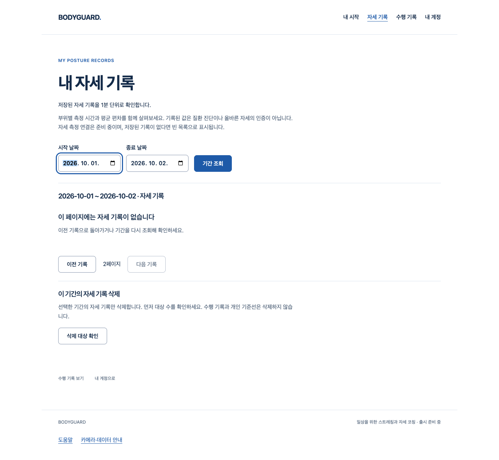

# 자세 기록 조회 중 사용자 초점 유지 — S4.R9

지연된 조회 응답이 사용 중인 날짜 입력·키보드·포인터·트랙패드 스크롤의 초점을 빼앗지 않도록 보완했다. 추가 조작 없이 기다릴 때만 결과 제목으로 인계한다. 기존 기간/페이지·빈 상태·오류 재조회·소유 계정·삭제 흐름은 유지하며 새 화면·버튼·문구·CSS 원본·API·SDK·아바타는 변경하지 않았다.

기준 main `4489b5bcad71d3d8b6084066e288468d169aba8f`, `codex/summary-query-focus-ownership`. [Story](../../stories/summary-query-focus-ownership.md), [실행·범위](verification.json), [보존 파일·원본/압축 SHA](manifest.json). **좁은 웹 사용성 보완이며 전체1~6단계 완료가 아니다.**

## 실제 웹에서 확인한 흐름

[원래 production UI와 실제 Chrome 최종7흐름](evidence/final-local.json.gz)은 다음을 통과했다. API·계정·기록은 제어 fixture이며 실제 인증 SQL·사람/웹캠·OS 접근성/VoiceOver 검증이 아니다.

- 다음 페이지를 기다릴 때 빈 결과 제목으로 인계.
- 대기 중 날짜 입력으로 이동한 뒤 정상/503 응답이 와도 입력 초점·날짜 보존.
- 같은 기간 조회 버튼에서 이어진 키 입력·포인터 드래그·native wheel이 있으면 해당 버튼 초점 보존.
- 503 후 명시 재조회로 복구하고 결과 제목으로 인계.

기다리는 사용자의 제목 인계는 첫 결과 DOM commit 관측에서도 확인했다. 계정/key 교체·unmount는 기존 요청 lease를 폐기하며 listener도 제거한다. window 이탈 또는 비활성 때 자동 인계하지 않는 경계는 결정적 DOM 시험으로 확인했다. OS 전체 초점/보조 기술 검증까지 완료했다는 뜻은 아니다.

아래는 실제 공개 웹의 기존 기록 화면이며 **디자인 시안이나 최종 코칭 화면이 아니다**. 제어된 빈 페이지 응답 후에도 시작 날짜 입력의 초점이 유지된다.

[오류 응답 후 입력 유지](evidence/final-local-date-error.png) · [추가 입력 없이 기다린 결과](evidence/final-local-wait-empty.png)

## 실패·보완 증거

- [처음 RED8중4실패](evidence/red.json.gz): 날짜 입력 정상/오류와 같은 요소의 키/포인터 초점 탈취를 재현했다. 초기 하네스의 모든 test-source 버전을 개별 저장하지는 않았다.
- [수정 전 Chrome6흐름 실패](evidence/before.json.gz): 날짜/키/포인터는 늦은 제목 인계가 초점을 빼앗았다. 대기/오류 흐름은 첫 commit이 BODY인 뒤 제목으로 인계해 commit 기준을 통과하지 못했다. 기존 제품 source·compiled JS/CSS/HTML과 동일 첫 driver 원본을 보존했다.
- [첫 수정 Chrome6통과](evidence/after.json.gz)는 수정 전과 같은 driver SHA다. 리뷰에서 wheel 누락을 추가로 확인하여 [wheel RED10중1실패](evidence/wheel-red.json.gz)를 보존하고 passive listener로 보완했다. 최종 driver는 native wheel1회 전달 확인을 추가한7흐름이며 초기6과 완전히 동일한 하네스라고 표시하지 않는다.
- [최종 로컬 첫 실행](evidence/final.json.gz)은 sandbox loopback listen EPERM으로0흐름/실패다. 범위 내 loopback 시험의 escalation 후 [최종7통과](evidence/final-local.json.gz)를 구분한다.
- [guard 첫 명령](evidence/final-guard.log.gz)은 존재하지 않는 pnpm script명으로 실패했다. 원래 `node scripts/check-selection-production.mjs`를 실제 실행한 [최종 guard](evidence/final-production-guard.log.gz)는 통과했다.
- PR143의 과거 SW10 1회 실패 원인은 여전히 확정하지 않는다. 이번 독립 재현과 layout 인계 보완, 현재 SW10 통과를 과거 비결정적 실패의 원인 증명으로 쓰지 않는다. PR90/시작P2·SDK 초기 실패도 종결하지 않는다.

## 검증·작성자 리뷰

최종 관련50/3파일·전체 frontend1885/104파일, 실패/skip0, 타입을 포함한 원래 notice build·Biome·원래 production guard·JS syntax·diff 검사를 실제 통과했다. Biome 기존 info16은 그대로다. Browser context 외부 요청·모델/아바타 요청·page error·카메라 호출·웹 저장0, 소유 server/proxy 종료를 확인했다. proxy62회 거부를 process 전체 egress0으로 해석하지 않는다.

public JS는 초점 수정으로 변경됐다. CSS 원본 변경0이나 Tailwind가 새 `blur` event 문자열을 스캔해 **미사용 .blur utility 한 개**를 생성하여 compiled CSS도31302→31514byte로 바뀌었다. 기존 rule 삭제0이며 실제 화면/배치 변경을 뜻하지 않는다. 공개 JS/CSS byte 동일이라고 표시하지 않는다.

debug로 지연 응답과 사용자 상호작용의 순서를 분리했고 testing-strategy로 제어 DOM·native Chrome을 구분했다. code-review에 따른 **작성자 검토**는 늦은 초점 탈취, 같은 요소 입력, wheel/blur, capture/passive cleanup, 기존 account/key/abort, 오류 복구와 빈 페이지를 확인했다. wheel 발견은 RED→보완→재검증으로 처리했고 좁은 변경의 미해결P1/P2 발견0이다. 독립/전문가 리뷰가 아니다. backend/API/SQL·실제 webcam/아바타 검증은 변경0·이번 Story 미실행이다.

## 완료 경계

이 Story의 구현·좁은 로컬 검증은 완료했다. 조건부 병합은 최신 main/diff·HEAD·CLEAN/충돌·체크·리뷰 재확인 후 merge commit으로 진행하며 원격 결과는 PR에 남긴다. 아바타/실제 참여자/Docker/공식 문의/실제 Gmail·Google 보류, 출시 동작0·실제 보정/판정/추천·최종 시범/아바타·권리/실측/외부/운영·전체1~6 미완료는 유지한다. 비용/계정/시크릿/운영 DB/배포/출시 변경은 없다.
