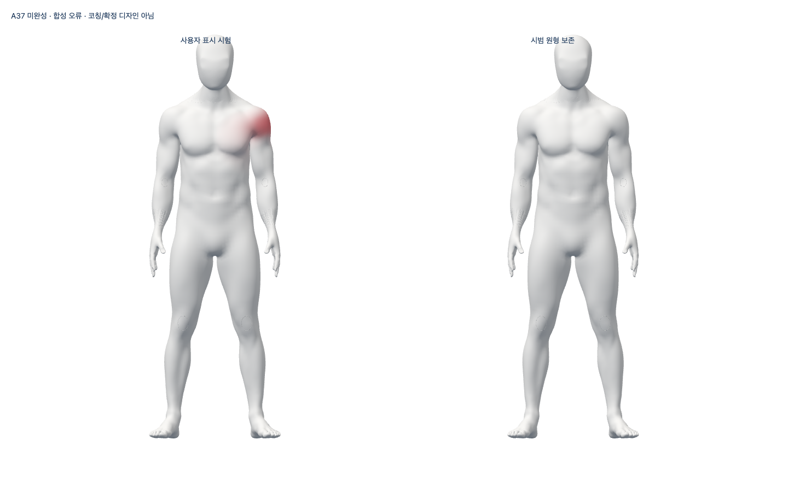
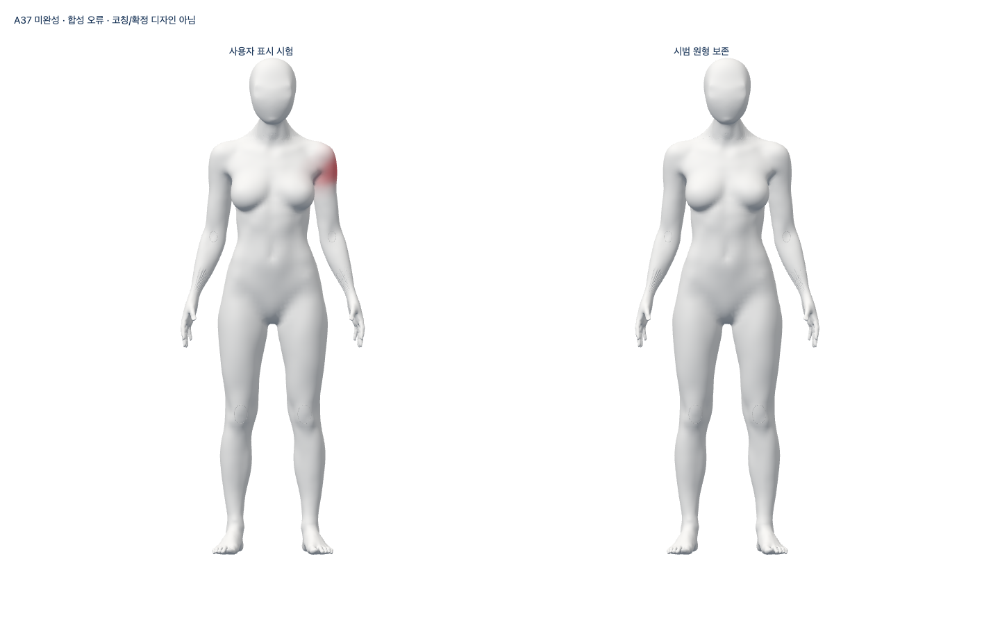

# S2.T19 — 사용자 표면 강조의 실제 검증

사용자 모델의 관찰된 부위만 주황/빨강으로 강조한다. 시범 모델은 변하지 않는다.
가림·여러 사람·미검출·만료·종료 때 이전 강조를 없애며 새 관찰로 명시 복구한다.
**소유 pair의 비공개 표시 기반이다. 실제 오류 판정·완성 웹·전체1~6 완료가 아니다.**

## 실제 화면

아래는 runtime e61870a의 실제 Chrome/WebGL이다. 왼쪽은 생성 관찰과 합성 오류,
오른쪽은 변하지 않은 비교 모델이다. A37의 목·전완·표면은 미완성이며 최종 외형,
올바른 스트레칭·실제 사람 추적 또는 승인 웹 디자인이 아니다. 조형/GLB 수출은 하지 않았다.

## 작동한 흐름·검증

- 남녀 준비→오류 강조→합성 사지 움직임→가림/복수/미검출→복구→이전 세대 거부→
  만료→새 관찰→주의 표시→다른 부위→오류 없음→abort/해제를 실제 Chrome154.0.8037.98에서 확인했다.
- 실제 GPU readback은 제작 마네킹만 읽고 부위별 색상 픽셀 **개수**만 반환했다.
  기준 오른쪽은0, 사용자 오류 왼쪽은 남3744/여1827, 가림/미검출/만료는0이었다.
  raw 픽셀/관절 배열을 로그·서버에 내보내지 않았다. 아바타 전용 screenshot만 보존한다.
- source/reference 재질·전체 vertex 속성·pose와 전신 구도가 동일했고 종료 후 renderer
  memory는 기존 PBR cache 기준(geometry0/texture1)으로 돌아왔다. 노트북 부드러움 완료는 아니다.
- 커밋 e61870a에서 전체FE1126·types·Biome246(경고/info0)·assets·Vite·공개 guard·diff를 재실행했다.
  guard 시험 표식은 실제 실패를 일으킨 뒤 원문을 보존하고 자기 시험 파일만 제거했다. 복구 guard 통과.
- 공개 JS355151/CSS31199 bytes는 PR81 main의 보존된 배포 파일과 byte 동일하다.
  원본 남녀 GLB·5 SDK 모델도 동일하다. SDK는 이 브라우저 시험에서 실행하지 않았다.
- 실제 카메라/참여자·native SDK 양성·임상 검증0. 관찰·오류·자원 단위 시험은 합성이다.
  외부 요청/카메라/storage0을 확인했다. 웹/API/DB·시크릿·운영·배포 변경0.
- native retained pair의 새 전달 메서드는 기존 controller를 재확인한다. SDK borrowed 종료 대기는
  Vitest 모의 자원으로 확인했다. 이 Story는 native feedback 옵션/실제 classifier/세션 판정 연결 완료가 아니다.

## 실패·리뷰 보완

1. 구현 전7계약 실패. 기본 구현 후84회귀 통과.
2. 미래 capture가 현재 RAF보다 늦으면 강조를 잃는 문제와 poisoned 관찰 후 이전 색이 남는 문제를
   7통과/2실패로 재현했다. 원래 render 시각까지 대기하고 driver coverage 폐기 때 강조를 없앴다.
3. sparse 영역 설정이 검증 전에 load를 부르는 문제를12통과/1실패로 재현했다. Array.from으로 조기 검증한다.
4. per-vertex Map 대신 bounded typed region mask, weight set의 사전 생성으로 불필요 할당을 피했다.
   성능 수치/실제 노트북 검증으로 허위 표시하지 않는다. 재진입·getter 종료·cleanup 실패도 검증했다.
5. 타입 검사2오류(closure nullable 및 throwing getter 추론)를 보완해 실제 통과했다.
   포맷/정적 오류와 infos도 최종0으로 해결했고 초기 출력을 유지한다.
6. 최초 loopback은 sandbox EPERM으로 Chrome 시작 전에 실패했다. 실행기 receipt와 browser report의
   이름 충돌도 실제 실패였다. 고유 label·동일 번들 복제 후 actual run으로 분리했다.
   `approved` label은 실행기 이름일 뿐 디자인/외형 승인이 아니다. 이후 최종 새 번들도 실제 재실행했다.
7. 최초 증거 수집은 SDK 정적 파일을 중복 포함했다. 원문을 로컬에 보존하고 저장소 증거에서
   중복만 제외했다. 다음 수집의 license 경로 조회 실패도 보존하고 실제 설치된 동일 원문으로 해결했다.
8. 증거를 stage한 diff 검사는 raw 로그의 원래 공백 때문에 exit2였다. 로그를 고치거나 실패를
   삭제하지 않고 gzip으로 보존했다. 압축 해제 후 bytes/SHA는 원문과 동일하며 이전 raw 파일도 로컬에 유지한다.
   첫 재stage는 실행기 cwd를 잘못 지정해 exit128이었고 뒤 diff도 이전 stage의 exit2였다.
   제품 재검증 실패가 아니라 증거 기록 실패이며 모두 보존했다. 저장소 cwd를 명시한 재stage와
   `git diff --cached --check`는 실제 exit0이다. 원문/압축184개와 Git source11개의 SHA를 확인했다.

author-only 코드 리뷰로 권한·관측 시각·coverage/가림·재진입·8가중치·source 독립·cleanup·
불필요 할당·개인정보와 실제 화면을 점검했고 Story P1/P2 미해결0이다. 독립 reviewer/전문가 승인은 아니다.
초기 미커밋 코드의 일부는 hash와 로그만 남았다. 모든 실패 당시 TS 원문을 보존했다고 주장하지 않는다.
비파괴 파일 조회의 경로 오류·truncated tool output도 별도 원시 파일로 보존했다고 주장하지 않는다.

## 증거·다음 조건

[manifest](summary.json)은 실행 receipt·원문/압축 SHA와 runtime의 Git 소스 snapshot을 연결한다.
gzip은 원문 SHA로 다시 검증했다. 대용량 GLB는 Git25a9bd6과 hash로 연결하고 새 복제물을 PR에 넣지 않는다.
번들에 실제 포함된 Three MIT 원문 고지를 보존한다. 최종 에셋/서비스의 권리·배포 승인을 뜻하지 않는다.
수집 후 생성된 commit/PR/병합 receipt는 이 manifest에 포함되어 있다고 주장하지 않는다.

다음은 같은 native 관측과 현재 코칭 판정에 표시·시범 안내를 연결하는 비공개 통합이다.
실제 수행법/오류·동일인/깊이·목/체간/손·실측·최종 외형/권리·승인 공개 디자인·물리 webcam/
참여자/다장치·SDK 정책·외부 계정·HTTPS/운영·사용성/보안/성능 및 전체1~6 완료 기준은 유지한다.
최소 텍스트는 방향 승인이고 공개 구조/적용 승인은 남아 있다. 출시 적격 동작0개다.
