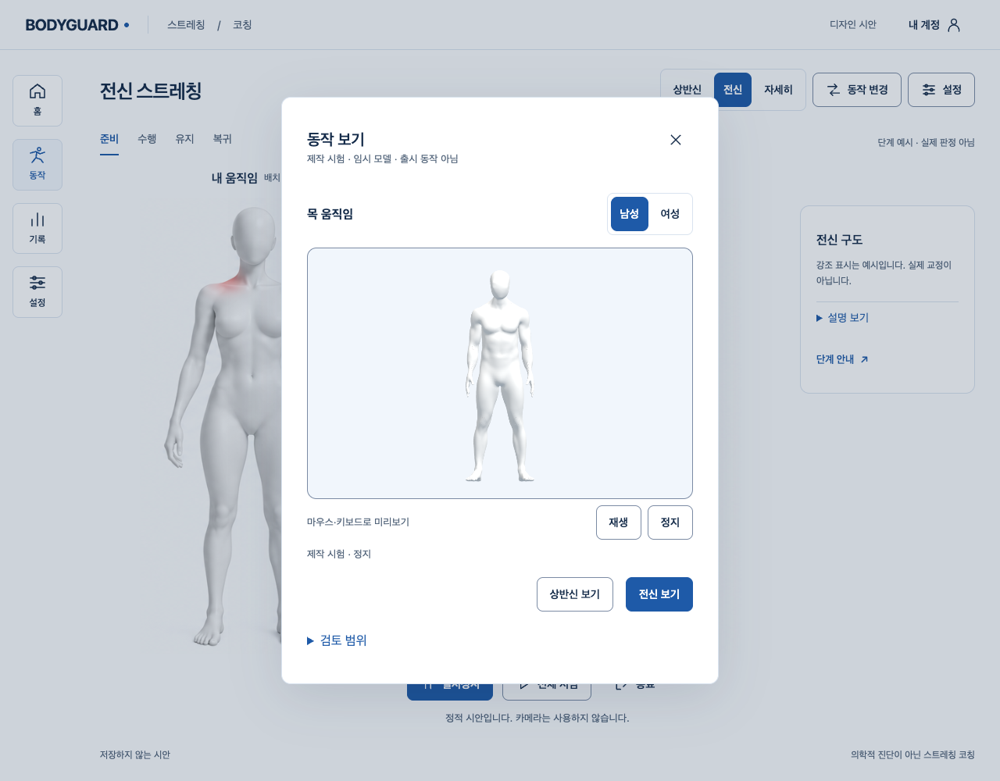
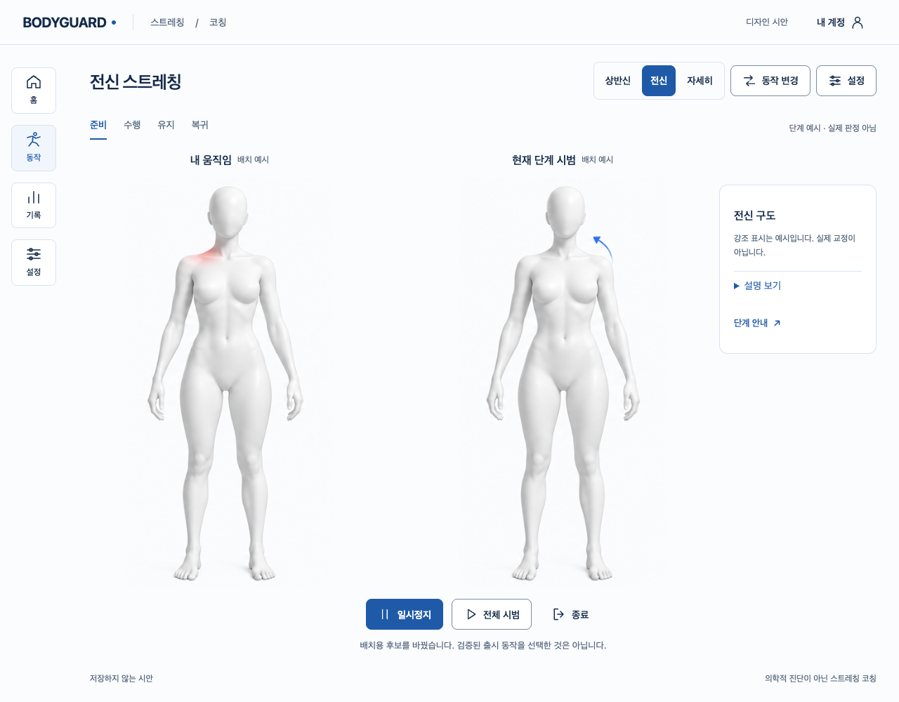

# 움직이는 선택 시안 — 실제 흐름

제품 적용 전 **독립 디자인 시안**이다. 기존 정적 코칭 화면→동작 보기→남녀 제작 시험 모델 미리보기→재생/정지→상반신/전신 배치 복귀를 실제 로컬 Chrome에서 연결했다. 새 메뉴·공개 구조·계정/API·카메라·임상 판정·기록·원본/GLB/Blender 제작은 변경하지 않았다. 텍스트는 아바타와 행동 뒤에 두며 추가 설명은 접었다. [Story](../../stories/visual-motion-selection-prototype.md).

## 실제 작동·실패

- 마우스·키보드 미리보기, 남녀 교체, 명시 재생/정지, Escape·초점 복귀, 설명 펼치기·포커스 순환, 실패/재시도, 느린 로드 뒤 닫기·빠른 교체에서 이전 결과 폐기. 남녀 같은 시험 동작 하나이며 두 개의 검증된 스트레칭을 만든 것이 아니다.
- 처음 실제 HTML은 미리보기가 없어 실패했다. 다음3개 흐름 통과 후 정지 클릭 경합이 실패했다. 마우스가 재생 영역을 떠날 때 상태가 바뀌어 toggle이 다시 재생하는 원인이었다. 재생/정지를 분리했다. 원본 보고서·그때 모델/HTML·bundle은 보존했다.
- 타입 검사에서 직접 node_modules의 Three import는 선언이 없어 실패했다. 명시적인 독립 타입/빌드 경로로 고쳤다. 정적 검사에서 semantic group·표현식 대입·forEach 반환7개가 실패했고, native fieldset/명시 콜백으로 수정했다. 이 진단 원문은 대화 출력이며 별도의 원본 로그 파일이 있다고 주장하지 않는다.
- 기존 정적 HTML12건은 통과했다. 다음 단위 회귀는 잘못된 저장소 root에서 실행해 E2E까지 수집한40 suite 오류/exit1이었다(1487 통과 숫자만으로 성공 처리하지 않음). 실제 frontend cwd에서1479/74파일이 최종 통과했다. 실패/최종 JSON을 모두 보존했다.

## 최종 검증·한계

Chrome155.0.8059.40/154.0.8037.57 각각24개 흐름, 실행 전후14개 소스 SHA 동일. 최종 단일 live owner peak1,155모델13/해제13·154모델14/해제14·종료 live/RAF0. API/외부 route 요청·카메라 호출·Storage.setItem0, 페이지 JS 오류0. 이 카운터는 해당 시안 페이지의 경계이며 브라우저 전체 백그라운드 통신·모든 저장 API의 부재를 입증하지 않는다. 숨김/pagehide는 이벤트/속성을 주입한 시험이며 실제 OS 숨김·BFCache 재현이 아니다.

820px/CSS200% 구도·키보드/동작 감소·로딩/실패 PNG 확인. 실제 브라우저 메뉴 확대·모바일 지원·스크린리더 실사용 시험은 아니다. 새 시안 타입/정적 검사·기존 frontend 타입/정적/단위·production build/guard 통과. frontend 정적15개의 기존 info는 다른 파일이며 수정하지 않았다. 공개 JS354600/CSS31199 byte와 SHA는 PR106/main과 동일. 기존 Blender 모델·클립 SHA도 S3.P1 증거와 같다.

기본 접힌 dialog의 공백 제외 DOM 문자는64였다. 아바타 비교/짧은 제목·버튼을 우선하고 상시 문단 대신 details를 사용한다. 이미지 안의 글자나 전체 웹 텍스트가 줄었다는 수치가 아니다. 필수 시험 구분·비진단·카메라 미사용·오류 복구는 유지한다.

디자인 스킬의8개 critique로 실제 화면을 검토했다: 두 아바타가 주 대상/청색 주요 조작·한글16px 기본/8·12px 반경·8/16/24px 간격·기존 흰색/남색/청색·모션은 이해용 하나만. 초판의 작은 모델 구도를 개선하고 발끝을 보존했다. 기존 키보드 trap이 새 summary를 건너뛰는 문제도 보완했다. 최종 외형의 얼굴/목·근육·변형 문제는 그대로 남는다. scoped P1/P2는 없으며 **제품 구조 승인·최종 외형·올바른 동작/실측·전체1~6/D2·기존 시작P2·SDK 정책/외부/운영은 미완료**다.

UI UX Pro Max의 첫 keyboard/threejs 검색은0이었다. dispose renderer 재검색은 geometry/material/texture 정리·단일 renderer 권장3개를 반환했다(대상0.185.1). 기존0.186.1 소유/정리 코드를 직접 확인하고 한 canvas의 직렬 소유/실제 해제에 참고했다. 제품을 최신 검색 권장안으로 바꿨다고 주장하지 않는다.

## 재현

`design-prototypes/visual-motion-selection/build.mjs`로 독립 bundle을 새 `/private/tmp/bodyguard-visual-selection-proof.*`에 만들고 기존 증거의 모델·클립을 `assets/`에 둔다. `serve.mjs <proof> bundle-final`은 loopback의 명시 경로만 열어 검토하며 운영 배포가 아니다. `verify.mjs <frontend 절대경로> <proof> <새 label> <Chrome 실행파일> bundle-final`은 실제 시안을 재실행한다. `verify-proof.mjs`는 현재 소스/보존 증거 hash 확인만 하며 실제 재실행을 대신하지 않는다. 전체 원본/이전 PNG는 `/private/tmp/bodyguard-visual-selection-proof.ync9hK`에 보존한다.
